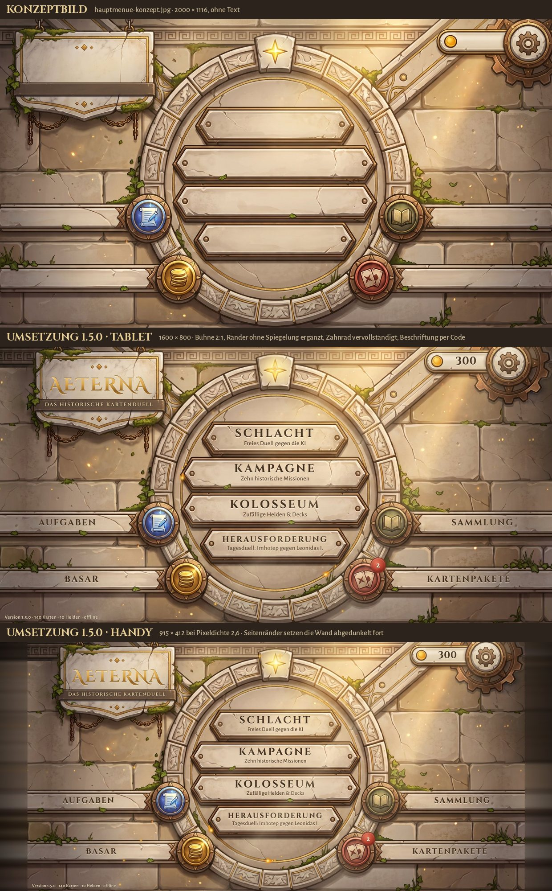

# Aeterna

*Vormals „Chroniken der Helden“.* Ein historisches Offline-Kartenduell für Android: 416 Karten,
22 Helden nach dem sächsischen Lehrplan Geschichte (Klasse 5–7), von der Fürstin von Vix bis Vauban, 22 Kampagnenmissionen.
Das Projekt liegt in `ProjectPyTales/Aeterna_Hauptspiel` (vorher `ProjectPyTales/Aeterna_Copy`, ab 24. 10. 2026 eine Kopie von
`thepytales/Aeterna` mit der ganzen Historie). **Das Spiel ist fertig gebaut – jetzt kommen die Bilder:** [`ungenutzte_assets/ASTRA_START.md`](ungenutzte_assets/ASTRA_START.md).
Aktueller Stand im Code: **Version 1.38.0** (**Match-HUD, Auftritt der Legendären und Vibration im Takt** nach AP 1.9, AP 3.10
und AP 4.5 – bei voller Hand liegen die Karten weiter auseinander und etwas höher, Modus, Zug, Deck und Friedhof stehen in
Mindestgröße hell auf dunklem Band, das Bereit-Grün ist wärmer und ruhiger, das Schildwall-Wappen kleiner; vor jeder Legendären
fährt ein Band mit Name und Epoche über das Brett, ein Siegel prägt sich darauf; das Handy vibriert im Moment des Einschlags nach
Wucht); davor 1.37.0 (**Bildrate und Wärme** nach AP 2.7 – in Ruhe zeichnet das Match nur noch 30 Bilder
je Sekunde, der Tisch liegt auf einer eigenen Ebene unter dem Brett und wackelt per CSS auf der GPU, im Gefecht senkt ein Regler die
Auflösung stufenweise, wenn das Gerät nicht mitkommt, die letzten Live-Schatten sind Sprites, und die Funken des Hauptmenüs ruhen
unter Fenstern); davor 1.36.0 (**Automatische Updates** nach dem Vorbild von ADEU-Harness – die App sucht nach dem
Intro im Release „Test-APK“ nach einer neuen Version, fragt im Hauptmenü mit „Was ist neu“, lädt die APK, prüft Größe und
SHA-256 und öffnet den Installer von Android; „Später“ fragt beim nächsten Start wieder, nie mitten im Match; einmal nach jedem
Update erscheint „Neu in Aeterna …“; ein- und ausschalten und von Hand suchen unter *Einstellungen → Daten*; siehe
[Automatische Updates](#automatische-updates-seit-1360)); davor 1.35.0 (**Sammlung 3.0** – die Sammlung ist jetzt wie die Deckbauer großer
Sammelkartenspiele aufgebaut: zuerst ein **Raster aller Decks** als Kacheln mit Heldenbild, Name, Kartenzahl und kleiner Manakurve,
dazu „Neues Deck“ und in der Kopfleiste der Reiter **Kartensammlung**; ein angetipptes Deck öffnet den **Deckbau in zwei Spalten** –
links das Deck als **30 Plätze** (leere Plätze bleiben sichtbar, ein Platz antippen nimmt die Karte heraus) mit Manakurve, rechts
**alle Karten als Raster** (6 × 2 je Seite, Blättern auch per Wischen) mit Suche, Held, Kartenart, Sortierung, Steinknöpfen für Mana
und Seltenheit, „Im Besitz“ und Zurücksetzen; **Antippen fügt die Karte hinzu**, sie fliegt auf ihren Platz, ⓘ öffnet die Details;
das Kartenbuch mit Umblättern aus 1.19.0 entfällt, `assets/ui/kartenbuch.webp` bleibt vorerst ungenutzt liegen);
davor 1.34.0 (**bereit für Astra** – die letzten offenen Pakete vor der Bildbestellung:
**Lehrstunden** nach AP 6.5 – drei geführte Partien, in denen der Chronist Schritt für Schritt Mana, Ausspielen, Angriff,
Heldenfähigkeit, Schildwall, Zauber, Großansicht, Gunst der Stunde, Einmarsch, Sturmangriff und Vermächtnis zeigt, angeboten auf
der vierten Platte des Hauptmenüs; **Schwierigkeitsgrade** nach AP 5.8 – Lehrling, Feldherr (die bisherige KI) und Legende;
**Einstellungen** nach Phase 7 in vier Reitern mit Textgröße, Farben bei Farbsehschwäche, ruhiger Bewegung und sparsamer Grafik,
**automatische Sicherungen** und ein **lokales Fehlerprotokoll**; eine **Geräte-Testmatrix** von 16:9 bis 21:9 in der CI; der
Astra-Auftrag in **43 fertigen Bestellpaketen** mit Startanleitung; AP 6.6 pausiert); davor 1.33.0 (**Kartenrätsel** nach AP 6.4 Teil 2 – je Kapitel ein Rätsel „Gewinne in diesem
Zug“ nach einer historischen Lage: Auaris, Leuktra, Naulochos, Süntel, Konstantinopel 1203 und Böttgers Brennofen; feste Hand,
festes Brett, kein Zufall, offen nach dem Kapitel, Tipp und „Noch einmal“; ein Löser im Test beweist, dass jedes lösbar und nicht
trivial ist); davor 1.32.0 (**Lebendige Schlachtfelder und Lesbarkeit** nach AP 3.9 – vier **Eck-Dioramen**
auf dem Spielbrett, die beim Antippen spielen, klingen und eine Zeile Geschichte mit Quelle erzählen, **Schlüsselwörter** eines
Dieners als Sprechblase nach langem Druck, **Angriffsvorschau** mit erwartetem Schaden; dazu die **Story-Szenen neu erzählt** nach
Deiner Rückmeldung: Leitfrage des Chronisten, jede Stimme mit Ort und Zeit, Schattenrisse, die ins Licht treten);
davor 1.31.0 (**Kampagne 2.0** nach AP 6.4 mit der **Lunte** aus AP 3.7 – die 22 Missionen in
sechs Kapiteln nach den Epochen des Lehrplans und einem Epilog, vor jedem Kapitel eine kurze **Story-Szene** mit Sprechblasen über
den Porträts und Quelle, am Ende jedes Kapitels eine **Belagerung mit Lunte**: 12 eigene Züge, Alesia und Auaris 14, dann ist die
Mission verloren; alte Spielstände behalten ihre Missionen);
davor 1.30.0 (**Aufgaben und Heldenstufen** nach AP 6.3 – drei Tagesaufgaben, eine davon zum Lernen,
einmal neu würfeln, Tagesgeschenk mit Serie über sieben Tage, zehn Heldenstufen mit Gold, Paketen, Staub und auf Stufe 10 der Goldenen
Fassung der Legendären; dazu ein **Balance-Feinschliff**: Zufallsdecks erstmals **22 von 22 im Ziel**);
davor 1.29.0 (**Kolosseum als Draft** nach AP 6.1 – Held aus drei Epochen, dann 30-mal eine von drei
Karten, Lauf bis 12 Siege oder 3 Niederlagen, Belohnung nach Siegen, der erste Lauf als Probelauf; unter jeder angebotenen Karte ihre
Zeile „Aus der Chronik“; dazu der **Balance-Feinschliff der Zufallsdecks**: Agrippa, Imhotep, Dandolo und Böttger jetzt im Ziel,
Mauern von Messene, Murus Gallicus und Mausoleum stärker);
davor 1.28.0 (**Erweiterung „Wunder der Welt“ Teil 2** nach AP 5.7 – die übrigen 27 Karten,
damit 54: je Held die zweite, etwa **„Mit ihm oder auf ihm“**, die **Lingua ignota**, der **Murus Gallicus** oder
**Theophanius imperator augustus**, dazu **Artemistempel von Ephesos**, **Mausoleum von Halikarnassos**, **Ischtar-Tor**,
**Stele des Hammurapi** und der Hinterhalt **Feuerpost**; jede mit Quelle, alle als Platzhalter für Astra; nach Deiner Rückmeldung
**auffälligere Wachsrollen** – größer, auf dunklem Grund, mit leisem Glimmen am Siegel; Code **`WELTWUNDER`**);
davor 1.27.0 (**Erweiterung „Wunder der Welt“ Teil 1** nach AP 5.7 und Entscheidung 22: 27 neue Karten
aus der Geschichte – je Held eine aus seiner Lebenswelt, etwa die **Irminsul**, das **Kloster Pegau**, die **Heiratsurkunde der
Theophanu** oder **Neuf-Brisach**, dazu **Koloss von Rhodos**, **Zeus des Phidias**, die **Himmelsscheibe von Nebra** und die Hinterhalte
**Gänse des Kapitols** und **Skytale**; jede mit Quelle, alle als Platzhalter für Astra; beim ersten Hinterhalt erklärt ein Fenster die
Wachsrolle); davor 1.26.0 (Bonus: **Start mit Deinem Entwickler-Splash PY'TALES und einem Intro** – sechs
Epochen im Takt, Karten im Wirbel, Einschlag mit Siegel und Titel, Match-Cut ins Hauptmenü; siehe
[Notiz](#notiz-start-mit-entwickler-splash-und-intro-1260)); davor 1.25.0 (**Taktische Hinterhalte** nach AP 5.6: zwölf Zauber, die verdeckt als versiegelte
Wachsrolle neben dem Helden liegen und im Zug des Gegners zuschnappen – vom **Hinterhalt am Süntel** über das **Fallgatter** bis zur
**Gegenmine**, jeder mit Quelle in „Aus der Chronik“; eine KI, die eigene Hinterhalte legt, die fremden aber nicht kennt, nur fürchtet);
davor 1.24.0 (Karten und Schlüsselwörter nah an der Geschichte nach AP L.6 Teil 1: elf neue Namen, die
dem vorhandenen Bild folgen – etwa **Brennspiegel des Archimedes**, **Erdmessung des Eratosthenes**, **Brot und Bier** –, **Segen** statt
Göttlicher Gunst, **Weisheit** statt Arkanem Fokus, „Zauber“ als Glaube der Zeit erklärt; eine Zeile **„Aus der Chronik“** mit Quelle für
16 Karten; kein einziges neues Bild, der Astra-Auftrag schrumpft von 205 auf 165 Motive);
davor 1.23.0 (Heldenfähigkeiten aus der Geschichte nach AP L.5: **Hypatia unterrichtet** und ruft Schüler
herbei, **Imhotep baut** als Baumeister des Djoser, **Vercingetorix verbrennt das Land** – „Kein Korn für Caesar“;
neue Namen für Nezahualcóyotl, Thusnelda und die Fürstin von Vix; in der Heldenwahl steht unter jeder Fähigkeit die Tat mit
Quelle; nach Deiner Rückmeldung schließt die Steintür als runde Flügeltür und die Leuchtrahmen folgen dem gemalten Kartenrahmen);
davor 1.22.0 (Astra-Oberfläche nach AP A.2: **gemalte Kartenrahmen** für Diener, Zauber und
Bauwerke, **acht gemalte Kartenrücken**, Chronikleiste, Stundenglas, versiegelte Befehle, Waffenablage, Schildwall, Phiole und Urne
im Match, Kartenpaket, Podest, Kartenbuch, Startbefehle, Steinplatten, **neu gemaltes Hauptmenü**, Hintergründe, Währungssymbole,
**neues App-Icon und Splash**; Entscheidung 19: `hypatia_0`/`hypatia_2` werden neu bestellt); davor 1.21.0 (Astra-Bilder eingebaut nach AP A.1: **alle 22 Heldenporträts**, **167 von 377
Karten- und Spielsteinbildern**, vier Marmor-Skins und **fünf gemalte Schlachtfeld-Tische** aus Astras sechs Teillieferungen
und den geretteten Bildern; der Auftrag für die übrigen 210 Motive steht in `ungenutzte_assets/ASTRA_AUFTRAG.md`); davor
1.20.0 (Schlüsselwort-Effekte und Anfang und Ende des Matches nach AP 3.6 und AP 3.8:
Schildwall als Holz- und Bronzeschilde, Göttliche Gunst als schimmernder Aurenkreis, der klirrend zerspringt, Starre mit Ketten
und Raureif, Tarnung im Unterholz, Gift als Phiole, Vermächtnis als Urne; Zauber-Partikel je Element und ein eigener Effekt für jede
der 22 Heldenfähigkeiten; Intro mit den Helden und dem Chronisten, Münzwurf um den ersten Zug, Startbefehle als Schriftrollen, Sieg
mit brechendem Relief, Banner „TRIUMPH“, Kriegshörnern und Belohnungsbalken – alles als Astra-Platzhalter; nach Deiner Rückmeldung
leiseres Uhrwerk, ruhigerer Tod, Blätterseiten mit Karten statt weiß); davor 1.19.0 (Basar, Sammlung und Heldenwahl im neuen Stil nach AP 1.4, AP 1.6 und AP 1.7: Basar als
Schaufenster mit Marmorpodest und Lichtkegel, Kartenrücken drehen sich in 3D, Skins in der Heldenmünze, Schlachtfelder als
Miniatur-Tisch, Kauf mit fliegenden Münzen und brechendem Siegel; Sammlung als Kartenbuch zum Umblättern mit Steinknöpfen, Zoom
und Manakurve in drei Phasen mit Hinweis, Karten fliegen ins Deck; Heldenwahl als Galerie mit großem Medaillon, Fähigkeit, Epoche,
Lehrplan und Lieblingskarten; Kampagne als Karte Europas und des Mittelmeers mit 22 Stationen und markierten Belagerungen – alles
als Astra-Platzhalter; nach Deiner Rückmeldung weicheres Uhrwerk statt Gong, dezenterer Tod, Goldglanz über der ganzen Karte,
„Zug des Gegners“ nicht mehr abgeschnitten); davor 1.18.0 (neue Karten und Spielgefühl nach AP 1.5 und AP 3.1–3.5: Karten als Tempeltor mit
Ätherkristall, Klingen, Schild, Archiv-Siegel und Lorbeer, „Goldene Karten“ als Kosmetik; Animations-Werkzeugkasten mit Uhr,
Treffer-Stopp, Kamerawackeln und Federn, Spieltempo für alle Animationen; Karten wachsen beim Drücken, Nachbarn weichen aus,
Ausspielen mit Wumms, Staub und Rissen, Ziehen verdeckt mit Umdrehen, Verbrennen, Stundenglas, Marschrouten-Pfeil, Tinte,
Splitter – alles als Astra-Platzhalter; Heldennamen auf der Münze nicht mehr abgeschnitten); davor 1.17.0 (Spielbrett vervollständigt nach AP 1.8 Teil 2 und AP 3.7: Chronik-Leiste am
linken Rand, Deck als Pergamentstapel, der dünner wird, Stundenglas bei leerem Deck, KI-Hand als versiegelte Befehle,
Mana als Äther-Uhr links mit Kristallen, die sich zu Zugbeginn nacheinander mit Glanz und Klang füllen, „Dein Zug“ als
herabfallende Tafel; nach Deiner Rückmeldung ohne Epochenhälften, blaues Band und Mittelnaht); davor 1.16.0 (neues Spielbrett nach AP 1.8 Teil 1: Feldherrentisch mit eingeritzter
Karte, eine Epochenhälfte je Held mit Farbe, Zeichen und Name, bronzene Mittelnaht, Helden als geprägte Münzen,
Heldenfähigkeit als Siegel, das sich nach Benutzung umdreht, Mana als Amulette unten rechts, „Zug beenden“ als
Chronometer – alles als Astra-Platzhalter; die vier alten Schlachtfelder sind durch Platzhalter-Tische ersetzt); davor 1.15.0 (die 132 Karten der elf Lehrplan-Helden heißen jetzt nach deren Lebenswelt –
Novizinnen auf dem Rupertsberg, Grenzsteine in der Mark Meißen, Schanzkörbe vor Lille, Varusschlacht und Venusfahrt –,
neutrale Karten ohne Fantasy-Namen, Bildideen für Astra); davor 1.14.0 mit elf neuen Helden nach dem Lehrplan – Widukind,
Hildegard von Bingen, Vercingetorix, Thusnelda, Theophanu, Böttger und andere – mit Chronikseiten und Missionen, sechs
Zeitalter nach den Epochen des Lehrplans, neue Zeitalterkarten für Frühzeit und Frühe Neuzeit, alle im Code gezeichneten
Grafiken für Astra gekennzeichnet; davor 1.13.0 mit Match ohne Bilddrossel (volle Pixeldichte, vorgerenderte Leuchteffekte, Zeichenzeit
−69 %), Bildraten-Anzeige, Renderer-Labor, Balance-Feinschliff und eigener Musik für Hauptmenü und Duell; davor 1.12.0 mit neuer nativer Android-Hülle in Kotlin mit Vollbild bis in die Kamera-Aussparung, Splash, Icon und Vibrationsmustern; Bilder als
WebP – APK 56 → 12 MB –, Laden in Stufen, Massenöffnung aller Pakete ohne Standbild, angeglichene Steingeräusche mit
Klangprobe); davor 1.11.0 mit Welle 2 der neuen Helden (Epaminondas, Fabius Maximus, Mandukhai, Baibars, Jan Žižka, Fu Hao),
21 Zeitalterkarten, Massenöffnung und Code-Eingabe; 1.10.0 mit Kartenwelle 1 (56 Karten – je Held zwei, je sieben Zeitalterkarten für Griechische Antike, Europäisches Mittelalter
und China/Korea/Japan, Weltwunder wie Kolosseum und Pyramiden –, neue Bauwerk-Regeln, eine KI, die Bauwerke belagert
oder ignoriert, und eine KI-Persönlichkeit je Held); davor 1.9.0 mit sechs neuen Helden und Heldenfähigkeiten als
Daten, 1.8.0 mit Platzhaltern, Chronik der Helden
und fünf neuen Schlüsselwörtern, 1.7.0 mit eigenen Schlüsselwörtern und zwölf neuen Legendären, 1.6.0 mit
Balance-Werkzeug und ausbalancierten Helden (47–53 %), 1.5.0 mit MVVM-Struktur und automatischer Sichtprüfung in der
CI, 1.4.0 mit neuem Namen Aeterna, gemaltem Hauptmenü, Stil-Bibel und Tagesduell.

Dieses Dokument ist zugleich der **Arbeitsplan** für die nächsten Sitzungen. Ziel: Aeterna soll sich so
flüssig und hochwertig anfühlen wie die besten Kartenspiele, ohne eine Kopie zu sein, und vor allem Spaß machen.

---

## Inhalt

1. [APK herunterladen](#apk-herunterladen)
   - [Automatische Updates (seit 1.36.0)](#automatische-updates-seit-1360)
   - [Notiz: Start mit Entwickler-Splash und Intro (1.26.0)](#notiz-start-mit-entwickler-splash-und-intro-1260)
2. [Projektaufbau](#projektaufbau)
3. [Regeln für jede Sitzung](#regeln-für-jede-sitzung)
4. [Ehrliche Bestandsaufnahme](#ehrliche-bestandsaufnahme)
5. [Leitbild: nah an Hearthstone, aber eigenständig](#leitbild-nah-an-hearthstone-aber-eigenständig)
6. [Qualitätsziele](#qualitätsziele)
7. [Arbeitsplan](#arbeitsplan)
   - [Phase 0 – Sofortkorrekturen und Umbenennung](#phase-0--sofortkorrekturen-und-umbenennung-s)
   - [Phase 1 – Neue Optik mit gemalten Grafiken](#phase-1--neue-optik-mit-gemalten-grafiken-höchste-priorität-l)
   - [Phase 2 – Technisches Fundament](#phase-2--technisches-fundament-l)
   - [Phase 3 – Game Feel im Match](#phase-3--game-feel-im-match-l)
   - [Phase 4 – Klang, Stimmen und Haptik](#phase-4--klang-stimmen-und-haptik-m)
   - [Phase 5 – Regeln, Karten und Balance](#phase-5--regeln-karten-und-balance-l)
   - [Phase 6 – Spielmodi und Motivation](#phase-6--spielmodi-und-motivation-fortlaufend)
   - [Phase 7 – Release-Qualität](#phase-7--release-qualität-m)
   - [Phase 8 – itch.io und Crossplay](#phase-8--itchio-und-crossplay-wunsch-vom-12-10-2026)
8. [Weitere Ideen](#weitere-ideen)
9. [Deine Ideensammlung – wo sie im Plan steht](#deine-ideensammlung--wo-sie-im-plan-steht)
10. [Offene Entscheidungen](#offene-entscheidungen)
11. [Empfohlene Reihenfolge der Sitzungen](#empfohlene-reihenfolge-der-sitzungen)
12. [Vorschlag für die nächste Sitzung](#vorschlag-für-die-nächste-sitzung)

---

## APK herunterladen

Jeder Push baut automatisch eine signierte Test-APK (`.github/workflows/apk.yml`, seit 1.12.0 mit Gradle aus `android/`).
Seit Oktober 2026 liegt sie nicht mehr unter „Artifacts“ (der Actions-Speicher von 0,5 GB war voll), sondern im Release:

1. Im Repo rechts unter **Releases** auf **„Aeterna <Version> – Test-APK“** tippen (oder `…/releases/tag/test-apk`).
2. Unter **Assets** auf `Aeterna-<Version>-Test.apk` tippen – die APK direkt, ohne ZIP.

Jeder Lauf auf `main` ersetzt diese eine APK; Zweige bauen und prüfen nur. Die Screenshots der Sichtprüfung gibt es nur noch,
wenn sie fehlschlägt (Artefakt „Sichtpruefung“ am Lauf, 3 Tage).

### Automatische Updates (seit 1.36.0)

Wie bei ADEU-Harness aktualisiert sich die App selbst – ohne GitHub-Konto, ohne Store. **Einmal eine Version ab 1.36.0 von Hand
installieren** (wie oben), ab dann geht es automatisch:

1. Nach dem Intro liest die App `…/releases/download/test-apk/version.json` (ein einfacher Download aus diesem öffentlichen
   Repo). Ist dort ein höherer `versionCode`, fragt sie im Hauptmenü: **Neue Version verfügbar** mit „Was ist neu“ –
   *Jetzt aktualisieren* / *Später*. Nie mitten im Match; ohne Netz bleibt sie still.
2. *Jetzt aktualisieren* lädt die APK mit Fortschritt (*Im Hintergrund* spielt weiter, *Abbrechen* hört auf), prüft Größe und
   SHA-256 aus `version.json` und öffnet den Installer von Android – dort **Aktualisieren** tippen. Beim allerersten Update
   führt die App einmal zu *Apps aus dieser Quelle zulassen*: einschalten, zurück, noch einmal *Installieren*.
3. Sammlung, Decks und eine laufende Partie bleiben (gleicher Schlüssel, gleiche Paket-ID). Nach dem Neustart zeigt das
   Hauptmenü einmal **Neu in Aeterna <Version>**.

*Später* fragt beim nächsten Start wieder (oder nach sechs Stunden im Hintergrund). Von Hand und zum Abschalten:
*Einstellungen → Daten → Updates* („Jetzt nach Updates suchen“, „Beim Start suchen: Ein/Aus“, „Alle Versionen“).

**Für die Pflege:** Ein Update erreicht die Geräte, sobald `main` mit **höherem `versionCode`** gebaut ist – also bei jeder neuen
Version wie bisher `versionCode` +1, `versionName`, `VERSION` in `app.js` und dazu **`model/neu.js`** (ein bis drei Sätze „Was ist
neu“; ein Test prüft die Versionsnummer). Die CI schreibt mit `werkzeuge/update_info.js` die `version.json` (Version,
`versionCode`, „Was ist neu“, Adresse, Größe, SHA-256) und lädt sie mit der APK in einem Schritt ins Release „Test-APK“. Ein
Merge ohne neue Version ändert für die Geräte nichts. Zurückziehen: wie bisher `main` zurücksetzen, aber mit **neuem, höherem
`versionCode`** – Android installiert keine niedrigere Version über eine höhere.

**Sicherheit:** Nur die Hülle spricht mit dem Netz (`Updater.kt`, nur https); die WebView lädt weiter nur
`https://chroniken.local/`. Installiert wird nur eine Datei mit passender Prüfsumme, und Android nimmt nur APKs mit demselben
Schlüssel als Update an. Die APK gibt `UpdateFiles.kt` dem Installer nur lesend und nur für diesen einen Aufruf frei.

Umstieg von 1.2.2 (anderer Signaturschlüssel): In der alten App *Einstellungen → Spielstand
exportieren*, alte App deinstallieren, neue installieren, *Spielstand importieren*. Ab 1.3.0
installieren sich neue Versionen direkt als Update (z. B. 1.19.0 → 1.20.0: einfach die neue APK installieren – die neue
Hülle hat dieselbe Paket-ID, denselben Schlüssel und liest denselben Spielstand; Sammlung, Decks und eine laufende Partie
bleiben).

**Codes** (*Einstellungen → Code einlösen*, je Spielstand einmal, Groß-/Kleinschreibung egal; Liste in
`model/profile.js`, `CHP.codes`):

| Code | Belohnung |
|---|---|
| `AETERNA` | 500 Gold |
| `KARTENPAKETE` | 10 Kartenpakete – im Basar mit „Alle öffnen“ auf einmal aufdecken (seit 1.12.0 alle, vorher höchstens 50) |
| `ZEITALTER` | 1 000 Staub |
| `CHRONIK` | jede Karte in voller Zahl (zwei, Legendäre eine) – zum Ausprobieren aller 416 Karten |
| `WUNDER` | seit 1.27.0: jede Karte der Erweiterung „Wunder der Welt“ in voller Zahl – für Spielstände, die `CHRONIK` schon eingelöst haben |
| `WELTWUNDER` | seit 1.28.0: dasselbe mit den 27 Karten aus Teil 2 – für Spielstände, die `WUNDER` schon eingelöst haben |

---

### Notiz: Start mit Entwickler-Splash und Intro (1.26.0)

Bonusaufgabe vom 15. 10. 2026: vor dem Spiel Dein eigener Entwickler-Splash, danach ein Intro von einigen Sekunden, das Lust
aufs Spiel macht. Ablauf beim Start der App:

1. **System-Splash** (Android 12+): seit 1.26.0 ohne Zeichen, schlicht im Grau Deines Videos (`#2c2c2c`), bis die Seite steht –
   vorher zeigte er das Aeterna-Siegel, das sonst *vor* PY'TALES gekommen wäre.
2. **PY'TALES** (≈ 2,8 s): Deine Animation blendet auf ihrem Grau ein und zu Schwarz aus. Dein Video ist eine Ruheschleife aus
   drei Posen (A B C B, je 125 ms, 50 s lang, ohne Ton); im Spiel liegt genau diese eine Schleife als verlustfreies animiertes WebP
   (`assets/intro/pytales.webp`, 480 × 480, 33 KB) – mittig und so groß wie das Video im Vollbild, also sieht es aus wie das
   Video. Das Original liegt in `ungenutzte_assets/entwicklersplash/`, `werkzeuge/entwicklersplash.py` erzeugt das WebP daraus.
   Ein WebP statt Video: läuft in der WebView ohne Videodecoder, ohne grauen Abspielknopf und auch, während das Spiel lädt.
3. **Intro „Die Geschichte erwacht“** (≈ 8 s, `view/intro.js`, ein Canvas, alle Bilder aus dem Spiel):
   - *Funke* – ein Lichtpunkt reißt eine Naht aus Licht quer über den Bildschirm auf;
   - *Sechs Epochen im Takt* – je drei gemalte Helden auf schrägen Tafeln mit Namen, im Schlag gewischt, darüber die Epoche des
     Lehrplans, darunter ein Jahreszähler, der von 2650 v. Chr. bis 1708 n. Chr. rollt, dahinter das Farblicht der Epoche;
   - *Karten* – die Porträts kippen zu Karten (die echten Karten des Spiels mit Astras Rahmen, Legendäre in Gold), sieben weitere
     fliegen ein, ein Ring wirbelt immer schneller („22 Helden · 389 Karten · 6 Epochen“, gezählt aus den Daten) und stürzt in einen Lichtpunkt;
   - *Einschlag* – ein Atemzug Stille, dann Blitz, Druckwelle, Funken, Lichtstrahlen und Kamerawackeln: das Aeterna-Siegel
     schlägt ein, AETERNA erscheint Buchstabe für Buchstabe, „Die Geschichte erwacht“, ein Lichtstreif läuft über den Titel;
   - *Match-Cut* – das Hauptmenü baut sich darunter auf, das Siegel fliegt in den Stern über dem Ring, der aufblitzt.
4. **Musik** (`assets/audio/intro.ogg`, 9,8 s, `werkzeuge/intro_klang.py`): sample-genau zur selben Zeitleiste – Taiko auf jedem
   Epochen-Schnitt, gezupfte Achtel in d-Moll, eine Fläche, die sich öffnet; ein Schwirren, dessen Pulse genau dann kommen, wenn
   eine Karte vorn vorbeizieht, ein Trommelwirbel; beim Einschlag Unterbass, Gong, Kriegshorn und Schwert aus den vorhandenen
   Spielgeräuschen und ein D-Dur-Akkord, ein Glöckchen je Buchstabe. Das Bild folgt der Uhr des Tons. Lautstärke: Regler
   „Geräusche“; die Menümusik übernimmt danach. Im Browser bleibt das Intro stumm (Autoplay ist dort ohne Tippen gesperrt).

**Bedienung:** Tippen (oder Zurück) überspringt – im Splash zum Intro, im Intro sofort ins Hauptmenü. In den **Einstellungen**
schaltet „Intro beim Start: Aus“ das Intro ab, dann kommt nur PY'TALES. Bei „Bewegung reduzieren“ des Systems ebenso.
Während Splash und Intro laufen, lädt das Spiel im Hintergrund – die Wartezeit ist also nicht verloren.

**Prüfung:** `werkzeuge/tests/intro.test.js` (Dateien, gleiche Zeitleiste in Bild und Musik, Inhalt, Ablauf, Einstellung, Hülle)
und in der CI `werkzeuge/intromessung.js` (ganzer Ablauf bis ins Menü, Überspringen, reduzierte Bewegung, Standbilder der Akte).
Klickpfad und Sichtprüfung starten wie bisher ohne Intro (`navigator.webdriver`); `?intro=1` erzwingt es,
`AEI.current.freeze(t)` hält jeden Moment an. **Offen:** auf dem Gerät ansehen und anhören – Länge, Lautstärke und Tempo lassen
sich über die Zeitleiste `T` in `view/intro.js` und `werkzeuge/intro_klang.py` (beide gleich halten, der Test prüft es) anpassen.

## Projektaufbau

Das Spiel ist eine Web-App (HTML/CSS/JavaScript) in einer Android-WebView. Menüs sind DOM,
das Match wird auf ein Canvas (1600 × 800) gezeichnet. Seit 1.5.0 ist der Code nach **MVVM**
(Model – View – ViewModel) gegliedert, ein Ordner je Schicht unter `quellcode/assets/game/`:

| Pfad | Schicht | Inhalt |
|---|---|---|
| `core/mvvm.js` | Kern | Kleiner eigener Binder (`AEM`, ~5 KB, offline): beobachtbare ViewModels, DOM-Abgleich statt `innerHTML`-Neuaufbau, Befehle über `data-cmd`, maskierendes `html`-Template |
| `model/data.js` | Model | 22 Helden mit Heldenfähigkeit als Daten (`ability`: Effekte und Ziel), Zeitalter (`age`, Liste `CHD.ages` mit Farbe und Zeichen, seit 1.14.0 sechs Epochen nach dem Lehrplan; `CHD.replaced` nennt die elf in AP L.1 ersetzten Helden) und KI-Persönlichkeit (`ai`, `CHD.personalities`), 350 Karten (davon 42 Zeitalterkarten), Spielsteine (Tokens), 22 Missionen, Glossar; `CHD.missingArt` kennzeichnet Karten ohne Motiv, `CHD.playable(karte, held)` sagt, ob ein Deck des Helden sie enthalten darf, `CHD.owner`/`CHD.eraOf` nennen Held, Zeitalter oder „Neutral“; seit 1.24.0 `CHD.glossaryOf(karte)` – Schlüsselwörter einer Karte, bei Zaubern auch das Wort „Zauber“ |
| `model/bilder.js` | Model | Seit 1.21.0 (AP A.1): gemalte Astra-Bilder je Karte, Spielstein und Held → Atlas und Feld (`CHB`), erzeugt von `werkzeuge/astra_bilder.py`, vor `data.js` geladen; `data.js` legt sie über alte Atlasfelder und Platzhalter |
| `model/lore.js` | Model | Chronik der Helden (AP 5.9, 22 Seiten): Lebensdaten, Biografie, Zitat mit Quelle, Spielstil, Beziehungen (`AELORE`); seit 1.14.0 die Tabelle `curriculum` mit Klassenstufe und Lernbereich je Held (AP L.1), seit 1.23.0 `deeds` – die Tat hinter jeder Heldenfähigkeit mit Quelle (AP L.5), seit 1.24.0 `cards` – „Aus der Chronik“, ein belegter Satz mit Quelle je Karte (AP L.6 Teil 2, `AELORE.card(id)`) |
| `model/engine.js` | Model | Regel-Engine und KI (`CHE`); `E.copy` ist die schnelle Zustandskopie der KI-Vorausschau; seit 1.25.0 Hinterhalte (`player.ambush`, `E.canSet`, `E.ambushes`; `s.blind` verbirgt der KI-Vorausschau die fremden Rollen) |
| `model/profile.js` | Model | Spielstand-Regeln, Packs (auch mehrere auf einmal, `openPacks`), Codes (`codes`, `redeem`), Aufgaben, Import-Prüfung (`CHP`) |
| `model/cosmetics.js` | Model | Kosmetik-Katalog, Kaufen/Ausrüsten (`CHK`); seit 1.16.0 sind Schlachtfelder die Tische unter den Epochenhälften, Tische ohne `image` Platzhalter mit CSS-Farbfilter `tint`, alte Felder werden über `refund` erstattet; seit 1.18.0 Kartenrahmen `frames` (Tempeltor, Goldene Karten, ausgerüstet in `equipped.frame`) |
| `model/draft.js` | Model | Seit 1.29.0 (AP 6.1): Kolosseum als Draft (`AEDR`) – Lauf im Spielstand `profile.draft` (über `normalize`, alte Saves bleiben), Heldenwahl aus drei Epochen, Wahl aus drei Karten gleicher Seltenheit (`options`, je Lauf und Wahl fest), Gegner und Partie (`foe`, `game`, Modus `draft`), Ergebnis aus `CHP.reward` (`record`), Belohnung (`reward`, `claim`), Statistik `profile.draftStats` |
| `model/quests.js` | Model | Seit 1.30.0 (AP 6.3): Aufgaben und Heldenstufen (`AEQ`) – drei Tagesaufgaben aus einem Pool, eine davon zum Lernen (`profile.daily`, einmal Neuwürfeln, Tageswechsel schreibt Erledigtes gut), Tagesgeschenk mit Serie über sieben Tage (`profile.login`), Erfahrung je Held mit zehn Stufen (`profile.heroXp`, `level`, `gain`), Stufe 10 gibt die Goldene Fassung der Legendären des Helden (`golden`, gezeichnet über `R.gilded`); Ende einer Partie über `finish` aus `CHP.reward`; alles über `normalize` |
| `model/campaign.js` | Model | Seit 1.31.0 (AP 6.4): Kampagne 2.0 (`AEKA`) – sechs Kapitel nach den Epochen des Lehrplans und ein Epilog über den 22 Missionen (`CHAPTERS`, Reihenfolge `ORDER`, angezeigte Nummer `number`), Story-Szenen mit Sprechern und Quelle (seit 1.32.0 mit Ort und Zeit je Zeile `cue` und Zeitspanne `years`), Grund und Quelle der Lunte (`fuse`), Freischalten in der neuen Reihenfolge (`unlocked`, alter Fortschritt bleibt), gesehene Szenen `profile.scenes` (über `normalize`) |
| `model/puzzles.js` | Model | Seit 1.33.0 (AP 6.4 Teil 2): Kartenrätsel (`AERA`) – sechs Rätsel je Kapitel (`PUZZLES`: Lage, Tipp, Quelle, Brett und Hand), fester Zustand `state(z)` im Modus `puzzle` (Feld `s.puzzle`, Name des Gegners `s.boss`), Freischalten nach dem Kapitel (`unlocked`), gelöste Rätsel `profile.puzzles` (über `normalize`), Löser `solve(s)` über alle Züge für die Tests |
| `model/tutorial.js` | Model | Seit 1.34.0 (AP 6.5): Lehrstunden (`AETU`) – drei geführte Partien mit festen Händen und Decks (`LESSONS`), Schritte des Chronisten mit Ziel (`focus`, `card`) und Bedingung (`done`), fester Anfang `state(z)` im Modus `tutorial` (Feld `s.lesson = {id, step}`, Gegner als Lehrling), `advance` nach jeder Aktion, `coach(s)` für die Tafel, geschaffte Lehrstunden `profile.tutorial` (über `normalize`) |
| `model/store.js` | Model | Laden, Speichern, Sicherung, Export/Import des Spielstands (`AES`); meldet Änderungen; seit 1.34.0 automatische Sicherungen (`snapshots`, erster Stand je Tag, drei Tage, Schlüssel `chroniken.auto`) |
| `viewmodel/*.js` | ViewModel | Zustand und Befehle je Bildschirm (`AEVM`): `menu`, `setup`, `campaign`, `collection`, `shop` (Basar), `packs` (Pack öffnen), `match`, `dialogs`, dazu `base` und `chronicle` (seit 1.17.0 auch in Node, Einträge mit Seite `p`; `Match.strip` liefert die Chronik-Leiste; seit 1.18.0 `Match.press`/`release` für die gedrückte Handkarte und `Match.hand` mit Kosten, spielbar und erfüllter Bedingung je Handkarte; seit 1.19.0 Schaufenster `Shop.showcase`/`select` und Kauf-Zeichen `bought`, Kartenbuch mit Blätterrichtung `turn`, Steinknöpfen `pick`, Kurve `curveHint` und Flug `flight`, Heldengalerie `GALLERY`, Kampagnenkarte `MAP`/`STATIONS` mit Projektion, seit 1.31.0 mit Kapiteln `chapters`, Routen je Kapitel `routes` und der Szene `AEVM.Scene`; seit 1.20.0 Intro `Match.opening`, Schriftrollen `rolling`, Finale und Belohnungsbalken `rewardBars`, Blatt `view.leaf` im Kartenbuch) – **ohne DOM, in Node testbar** |
| `viewmodel/draft.js` | ViewModel | Seit 1.29.0: Bildschirm „Kolosseum“ (`AEVM.Draft`) – Eintritt mit Rückfrage, Heldenwahl, Kartenwahl mit Manakurve und „Aus der Chronik“, Kampf, Lauf beenden, Belohnung abholen |
| `view/kit.js` | View | Gemeinsame Bausteine, je einmal: Steinknopf, Panel, Reiter, Wallet, Kopfleiste, Modal (`AEV`) |
| `view/*.js` | View | Vorlagen je Bildschirm und Dialog (`shop`, `packs`, `collection`, `setup`, seit 1.19.0 `campaign`, `dialogs`), Hauptmenü `hall.js` (`CHH`), Steinplatten-Übergang und Kartenrücken `stone.js` (`CHS`), seit 1.26.0 Start mit Entwickler-Splash und Intro `intro.js` (`AEI`, Zeitleiste `AEI.T`, Stil `css/intro.css`), seit 1.29.0 Kolosseum `draft.js` (Stil `css/draft.css`, fünf Astra-Platzhalter), seit 1.30.0 Aufgaben-Fenster in `dialogs.js` und Heldenstufe in `setup.js` (Stil `css/quests.css`, drei Astra-Platzhalter) |
| `view/match/` | View | Match-Canvas: `render.js` (`CHR`, seit 1.13.0 mit Sprite-Cache `R.sprite`/`R.blit` und Pixeldichte `R.scale`; seit 1.16.0 Feldherrentisch `table`, Heldenmünze `coinArt`, Siegel `seal`, Chronometer `chronometer`, Touch-Ziele ≥ 48 dp über `touch`; seit 1.17.0 Äther-Uhr `dial`, Chronik-Leiste `strip`, Pergament-Deck und Stundenglas `deck`, versiegelte Befehle `orderArt`, Zugtafel `turnPlate`; seit 1.18.0 Kartenrahmen `R.card` als Tempeltor, Hand mit Federn `hand`, Marschroute `route`, Effekte `effects` mit Tinte, Pumpen, Splittern, Staub und Rissen), seit 1.20.0 `fx.js` (`CHF`: Schlüsselwort-Bilder und -Effekte, Elemente und Heldenfähigkeiten, Intro mit Münzwurf und Finale), `anim.js` (`CHT`, seit 1.18.0: Kurven, Zeitleisten, Federn, Match-Uhr mit Tempo und Treffer-Stopp, Kamerawackeln), `motion.js` (`CHM`, Zeitleisten je Aktion, Ziehen, Verbrennen, Stundenglas; seit 1.37.0 in `anim.js` auch Ruhetakt `pace` und Auflösung `Resolution`, AP 2.7), seit 1.32.0 `dioramen.js` (`AEDI`: Eck-Dioramen, Sprechblase, Angriffsvorschau; AP 3.9), `layout.js` (`CHL`, seit 1.32.0 mit `dioramas`), `board.js` (Gesten → ViewModel, Bildschleife ohne Drossel auf der Match-Uhr, Bildraten-Anzeige; seit 1.37.0 Tisch auf der Ebene `#table`, Wackeln als CSS-transform, Ruhetakt und Auflösungsregler) |
| `view/css/` | View | seit 1.22.0 `astra.css` (zuletzt geladen: Astras gemalte Bilder für Paket, Podest, Kartenbuch, Startbefehle, Steinplatten, Hintergründe, Währungen), `style.css`, `packs.css`, `stone.css` (seit 1.19.0 mit dem Basar-Schaufenster), `hall.css` (Schriften, Farbvariablen `--ae-…`), `kit.css`, seit 1.19.0 `screens.css` (Kartenbuch, Heldengalerie, Kampagnenkarte), seit 1.34.0 `lesbar.css` (Textgröße und ruhige Bewegung, erzeugt von `werkzeuge/lesbar_css.py`) |
| `service/` | Dienste | `audio.js` (Web-Audio-Mischer, `CHA`, Pegel je Klanggruppe in `CHA.levels`), `platform.js` (Android-Brücke, `AEP`; seit 1.34.0 `exportText` und `calm` für ruhige Bewegung), seit 1.34.0 `protokoll.js` (lokales Fehlerprotokoll `AEF`, Schlüssel `aeterna.fehler`) |
| `model/neu.js` | Model | Seit 1.36.0: „Was ist neu“ zur aktuellen Version (`AENEU`) – erscheint einmal nach einem Update und als `notes` in `version.json` |
| `viewmodel/update.js` | ViewModel | Seit 1.36.0: automatische Updates (`AEVM.Updates`, Fenster `UpdateDialog`) – wann das Spiel fragt (ruhiges Hauptmenü, `ui.idle()`), „Später“, Laden im Hintergrund, „Was ist neu“ (Schlüssel `aeterna.version`), Stand für Einstellungen → Daten |
| `app.js` | Shell | Steckt alles zusammen: Store, ViewModels, Views, Navigation mit Übergängen, Dialoge, Toasts; `window.App` für die Hülle. Auf Bildschirmen breiter als 2:1 wird die Bühne um zwei Flügel (`--wing`) breiter: Untermenüs und Dialoge reichen randlos bis an den Rand, Inhalte bleiben im mittleren 1600 × 800-Bereich |
| `assets/ui/` | – | Seit 1.22.0 (AP A.2): Astras Oberflächenbilder als WebP mit Transparenz (Kartenrahmen, Kartenrücken, Chronikleiste …) und Währungen als SVG, erzeugt von `werkzeuge/astra_bilder.py`, geladen von `CHS.loadUI` vor dem ersten Bildschirm |
| `assets/intro/` | – | Seit 1.26.0: Entwickler-Splash `pytales.webp` (aus `werkzeuge/entwicklersplash.py`); die Musik des Intros liegt als `assets/audio/intro.ogg` (aus `werkzeuge/intro_klang.py`) |
| `assets/fonts/` | – | Cinzel, Cinzel Decorative, Alegreya Sans (SIL OFL, Lizenztexte daneben) |
| `assets/art/` | – | Bilder als WebP, nie von Hand ersetzen: seit 1.21.0 Astra-Atlanten `astra-karten-*.webp`, Helden `heroes`/`heroes2`, Skins und Tische aus `werkzeuge/astra_bilder.py`; übrige alte Bilder aus `werkzeuge/bilder_webp.py` (Originale in `ungenutzte_assets/archiviert/art-original/`); seit 1.19.0 `weltkarte.svg` (Küsten der Kampagnenkarte, erzeugt von `werkzeuge/weltkarte.js` aus Natural Earth) |

| Pfad | Inhalt |
|---|---|
| `android/` | **Native Hülle** (seit 1.12.0, AP 2.1): Gradle-Projekt in Kotlin – `MainActivity.kt` (WebView, Vollbild, Aussparung, Zurück, Export/Import), `Bridge.kt` (`window.Android`), `AssetClient.kt` (liefert `quellcode/assets/game` unter `https://chroniken.local/` aus), `Haptics.kt`, seit 1.36.0 `Updater.kt` (automatische Updates: `version.json` aus dem Release „Test-APK“, Download, SHA-256, Installer) und `UpdateFiles.kt` (gibt die APK dem Installer frei); Version, Paket-ID und Signatur in `app/build.gradle.kts` |
| `quellcode/assets/game/labor/` | Renderer-Labor (AP 2.5): `renderer.html`, `labor.js`, PixiJS `pixi.min.js` (MIT, `LIZENZ-pixi.txt`) – nur im Entwicklermodus erreichbar |
| `quellcode/` | Web-Spiel (`assets/game/`), das die Hülle als Assets einpackt. Die alte, nur kompiliert vorliegende Hülle (`classes.dex`, binäres Manifest) ist mit 1.12.0 entfallen. |
| `werkzeuge/` | Asset-Pipeline `bilder_webp.py`, Hauptmenü-Bild, Sound-Generatoren (`stein_sounds.py`, `aether_klang.py`, seit 1.18.0 `spielgefuehl_klang.py`, seit 1.19.0 `oberflaeche_klang.py`, seit 1.20.0 `schluessel_klang.py`, seit 1.26.0 `intro_klang.py`, seit 1.32.0 `diorama_klang.py`), Entwickler-Splash `entwicklersplash.py`, Kampagnenkarte `weltkarte.js`, Sichtprüfung, Klickpfad mit Referenzbildern (`referenz/`), Balance-Werkzeug `balance.js`, Liste fehlender Motive und der im Code gezeichneten Grafiken (`ASTRA:`) `motive.js`, Match-Messung `matchmessung.js`, Labor-Messung `labormessung.js`, seit 1.26.0 Start-Messung `intromessung.js`, seit 1.34.0 Geräte-Testmatrix `geraetematrix.js` und `lesbar_css.py`, Tests – siehe `werkzeuge/LIESMICH.md` |
| `balance/` | Balance-Berichte: `BERICHT.md` (aktueller Stand, 22 Helden, 416 Karten), `BERICHT-1.29.0.md` (vor dem Feinschliff in 1.30.0), `BERICHT-1.28.0.md` (vor dem Feinschliff in 1.29.0), `BERICHT-1.27.0.md` (vor AP 5.7 Teil 2), `BERICHT-1.26.0.md` (vor AP 5.7), `BERICHT-1.24.0.md` (vor AP 5.6), `BERICHT-1.22.0.md` (vor AP L.5), `BERICHT-1.13.0.md` (vor AP L.1), `BERICHT-1.12.0.md` (vor AP 5.11 Teil 2), `BERICHT-1.10.0.md` (vor AP 5.10 Welle 2, 16 Helden), `BERICHT-1.9.0.md` (vor AP 5.11), `BERICHT-1.8.0.md` (vor AP 5.10, 10 Helden), `BERICHT-1.7.0.md` (vor AP 5.4 Teil 2), `BERICHT-1.6.0.md` (vor AP 5.3/5.4), `BERICHT-1.5.0.md` (vor AP 5.2) |
| `stil/` | Stil-Bibel (`STILBIBEL.md`), Stil-Tafel und Vergleichsbild Konzept ↔ Umsetzung |
| `ungenutzte_assets/` | Ausgangsbilder: `neue_astra_assets/` alle Astra-Lieferungen (Teil1–Teil6, `gerettet`, `gerettet_2te`, dazu `PRODUKTIONSBRIEFING.md`), seit 1.34.0 `ASTRA_START.md` (Ablauf der Bestellung) und `astra_bestellung/` (fertige Pakete K01–K32 und U01–U11), `ASTRA_AUFTRAG.md` der Auftrag an Astra (nur offene Motive, Übersicht der Pakete), `ASTRA_AUFTRAG_OBERFLAECHE.md` der Auftrag für die 77 noch gezeichneten Oberflächenteile, `ASTRA_STAND.csv` Status jeder Karte; `archiviert/` alte Originale (`art-original/`, Hauptmenü-Konzept); `MOTIVE.md` listet Karten mit Platzhalter (AP 5.12) und alle im Code gezeichneten Grafiken für Astra (AP L.4) |

### Architektur: wohin neuer Code gehört (MVVM)

- **Model** kennt keine Bildschirme: Regeln, Daten, Spielstand. Änderungen am Spielstand laufen über die
  Regeln in `model/` und enden mit `store.commit()` (speichert und meldet allen, die zuhören).
- **ViewModel** hält den Bildschirmzustand (Reiter, Filter, Auswahl) und die Befehle (`buy`, `equip`, `filter` …).
  Es liest und ändert das Model, fasst aber **nie das DOM** an. Was es von der Oberfläche braucht (Navigation,
  Dialog, Toast, Klang, Vibration), bekommt es über den `ui`-Dienst der Shell – in Tests ersetzt durch eine Attrappe.
- **View** ist eine Funktion `render(vm) → HTML` und ändert nie das Model. Eingaben werden zu Befehlen:
  `data-cmd="buy" data-a="boards" data-b="japan"` ruft `vm.buy('boards','japan')`, `data-input`/`data-change`
  für Felder. Listen bekommen `data-key`, damit Einträge ihre Knoten behalten.
- **Binder** (`core/mvvm.js`): Nach jeder Änderung rendert die View neu und der Binder gleicht nur die
  Unterschiede ins DOM ab – Bilder werden nicht neu geladen, Scrollpositionen, Fokus und CSS-Übergänge bleiben.
  `data-static` schützt Teilbäume (Canvas), `data-own` überlässt einzelne Attribute der Animation der View.
- Das Match-Canvas zeichnet jedes Bild aus `vm.view` (Auswahl, Ziele, Ziehen); `view/match/board.js` liefert dem
  ViewModel nur Geometrie (Hand, Ablagezone, Platz), die Regeln entscheidet das ViewModel.

Native Brücke (`window.Android`): `save`, `load`, `exportSave`, `importSave`, `haptic(0–3)` (leicht, mittel, schwer,
doppelt), `exitApp`, seit 1.12.0 auch `keepAwake(an)` (Bildschirm bleibt im Match an) und `info()` (Hülle, Version,
Android), seit 1.36.0 `updateState`, `updateCheck(vonHand)`, `updateDownload`, `updateInstall`, `updateCancel` und `updatePage`
(im Spiel `AEP.updates`); die Hülle ruft `App.back()`, `App.importText()`, `App.onPause()`, `App.onResume()`, `App.resize()` (mit
`window.safeInsets` der Kamera-Aussparung) und seit 1.36.0 `App.onUpdate(json)` auf. Spielstand wie bisher in den SharedPreferences `chroniken_v1` und im
localStorage. Inhalte werden unter `https://chroniken.local/` ausgeliefert (Unterordner gehen, Pfade mit `..` nicht),
mit echten MIME-Typen (u. a. `.webp .jpg .svg .woff2 .mp3`, Liste in `AssetClient.kt`).

**Bereits vorhandene Spielmechanik** (damit nichts doppelt gebaut wird): Mana 1 → 10,
Startkarten-Tausch, Münze für den zweiten Spieler („Gunst der Stunde“, 0 Mana, +2 Mana in diesem Zug),
Handlimit 10 mit Verbrennen, steigende Erschöpfung bei leerem Deck, Aufmarsch-Verzögerung,
höchstens 7 Diener pro Seite, kein Zugtimer, Schildwall, Segen (bis 1.23.0 Göttliche Gunst), Einmarsch, Vermächtnis,
Sturmangriff, Waffen, Rüstung, Runensteine (Engine-IDs `totem_*`), KI-Gegner. Seit 1.7.0 außerdem Vorstoß, Starre, Ergründen (offene Wahl
`s.choice`, Aktion `choose`), Doppelschlag, Weisheit (bis 1.23.0 Arkaner Fokus), Bauwerke (`building`), Auren, Kostenänderungen je Handkarte
(`E.cost`) und Übernahme feindlicher Diener. Seit 1.8.0 Plünderung (`plunder`), Tarnung (`stealth`), Bannung (Effekt
`silence`, Feld `silenced`), Tödliches Gift (`poison`) und Belastung (`overload`, gesperrte Kristalle `locked`).
Seit 1.9.0 (AP 5.10) **Heldenfähigkeiten als Daten** (`hero.ability`: dieselben Effekte wie Karten; Bedingungen wie Platz
zum Rufen leitet `E.canPower` aus den Effekten ab – ein neuer Held braucht keinen Code), Bauwerke und Diener mit
Auslösern `start`/`end` (Zugbeginn/-ende), `onHeal`/`allyHeal` (Heilung), Auren `buffAura` und `buildingDiscount`, neue
Effekte `fortify`, `bounce`, `destroy`, `randomDamage`, `grant`/`grantAll`/`grantRandom`, `buffSelf`/`buffRandom`,
`enemyOverload`, Ergründen aus Bauwerken (`pool:'building'`) und Missionen mit Bossfähigkeit als Daten (`effects`, `every`).
Seit 1.10.0 (AP 5.5, 5.8, 5.11) **Zeitalterkarten** (`hero` und `age` = Zeitalter, nur für Helden dieses Zeitalters),
Auslöser `onDamage` (Schaden erlitten) und `anyDeath` (irgendein Diener stirbt), Auren `spellDiscount`, `healDouble`,
`doubleDeath` (Vermächtnis zweimal) und `wall` (Große Mauer), Kosten je gespielter Karte (`costPerPlayed`), Ergründen aus
den Pools `hero`, `age` und `ages`, eine **KI-Persönlichkeit** je Held (`ai`: aggressiv, defensiv, kombinierend; Gewichte
`E.STYLE`) und eine Bauwerk-Bewertung nach Wirkung (`E.impact`: wirkungslose ignoriert die KI, wirksame belagert sie).
Seit 1.11.0 (AP 5.10 Welle 2) der **Diener ganz links** (`buffLeft`, Epaminondas), Bedingungen nach Zahl der eigenen Diener
(`ifMinions`), verliehener Vorstoß, der frische Diener sofort angreifen lässt (Baibars), zufällige Starre und Ziele nur in
Starre (`targetFrozen`, Fabius), Schaden je Schildwall-Diener und Auren nur für Schildwall (Žižka), Wachstum je eigenem
Diener (`per:'minion'`) und **Ergründen aus dem eigenen Deck** (`pool:'deck'`: die obersten drei Karten, Fu Hao).
Seit 1.14.0 (AP L.1) sind elf Helden durch Personen aus dem sächsischen Lehrplan ersetzt: IDs, Fähigkeiten, KI und
Karten-IDs bleiben (`khan` ist Widukind, `fuhao` die Fürstin von Vix), ebenso die Zeitalter-IDs (`steppe` = Frühzeit und
Ägypten, `ostasien` = Frühe Neuzeit, `byzanz` = Kreuzzüge). Seit 1.15.0 (AP L.2) tragen auch ihre Karten und Spielsteine
Namen aus der Lebenswelt der neuen Person; neu ist nur der Spielstein `novice` (Novizin, 1/1) für Hildegard – Jutta von
Sponheim stärkt Novizinnen, die Rekruten (`recruit`) bleiben Dandolo und Caesars Mission.
Seit 1.25.0 (AP 5.6) **Hinterhalte**: Zauber mit Feld `ambush` (Auslöser `attack`, `hero`, `defend`, `minion`, `spell`, `death`),
höchstens drei verdeckt je Spieler (`player.ambush`), keiner doppelt; sie schnappen nur im Zug des Gegners zu, neue Effekte `cancel`
(Angriff fällt aus), `counter` (Zauber vereitelt), `decoy` (Spielstein fängt den Angriff ab) und `copySpell`.
Seit 1.27.0 (AP 5.7 Teil 1) Karten der Erweiterung mit Feld `set:'wunder'` – nur vorhandene Regeln; das Feld `profile.ambushSeen`
merkt sich, dass die Hinterhalt-Erklärung schon kam. Seit 1.28.0 (AP 5.7 Teil 2) beschränkt `targetTaunt` ein Ziel auf Diener
mit Schildwall, und Ergründen im Zug des Gegners oder am Ende des eigenen Zuges (Vermächtnis) wählt der Zufall.
Seit 1.29.0 (AP 6.1) der Spielmodus `draft` (Kolosseum): keine neue Regel in der Engine, nur das Feld `s.draft` (Nummer des Laufs);
`CHP.reward` gibt dort kein Gold je Partie und meldet das Ergebnis an `AEDR.record`.
Seit 1.31.0 (AP 6.4, AP 3.7) die **Lunte**: Missionen mit Feld `fuse` (eigene Züge) enden verloren, wenn der letzte eigene Zug
ohne Sieg vorbei ist (`CHE.fuse(s)` → `{turns, left}`, Feld `s.burnt`); sonst gilt kein Zugtimer.
Seit 1.34.0 (AP 5.8) **Schwierigkeitsgrade** über das Feld `s.level` (`lehrling`, `legende`; ohne Feld der Feldherr – genau die KI bis
1.33.0, auf der alle Balance-Läufe beruhen; `CHE.LEVELS`, `CHE.level`) und (AP 6.5) der Modus `tutorial` mit `s.lesson` – keine neue Regel.
Die Schlüsselwörter erklärt das Glossar `CHD.keywords`.

---

## Regeln für jede Sitzung

- **Tests vor jedem Push:** `node --test werkzeuge/tests/*.test.js` (Kosmetik, Spielstand, ViewModels, Regeln und
  Heldenfähigkeiten, Schlüsselwörter Teil 1 und 2, Legendäre, Platzhalter, Chronik, neue Helden beider Wellen, Kartenwelle mit Bauwerken und KI-Persönlichkeit, Massenöffnung und Codes, native Hülle, Klangpegel, Renderer und Bildraten-Anzeige, Lehrplan-Helden, Kartennamen nach Lebenswelt und Astra-Kennzeichnung, Spielbrett, Schlachtfelder und Chronik-Leiste (AP 1.8), Spielgefühl und Kartenrahmen (AP 1.5, AP 3.1–3.5), Basar, Sammlung, Heldenwahl und Kampagnenkarte (AP 1.4, AP 1.6, AP 1.7), Schlüsselwort-Effekte, Intro, Münzwurf und Finale (AP 3.6, AP 3.8), Astra-Einbau (AP A.1), Heldenfähigkeiten aus der Geschichte (AP L.5), Karten, Schlüsselwörter und Chronikzeilen nah an der Geschichte (AP L.6), Hinterhalte (AP 5.6), Erweiterung „Wunder der Welt“ und Hinterhalt-Erklärung (AP 5.7), Aufgaben und Heldenstufen (AP 6.3), Kampagne 2.0 mit Lunte (AP 6.4), Lebendige Schlachtfelder und Lesbarkeit (AP 3.9), Kartenrätsel mit Löser (AP 6.4 Teil 2), Lehrstunden, Schwierigkeitsgrade, Einstellungen, Sicherungen und Fehlerprotokoll (AP 6.5, AP 5.8, Phase 7), Bestellpakete für Astra (AP A.3), automatische Updates (1.36.0), Balance-Werkzeug, 100 simulierte Partien) und `node werkzeuge/klickpfad.js` (Klickpfad mit
  Referenzbildern, läuft auch in der CI), seit 1.34.0 auch `node werkzeuge/geraetematrix.js` (16:9 bis 21:9 und Tablets).
- **CI muss grün sein** (Jobs „apk“, „sichtpruefung“ und „balance“), die APK kommt aus dem Release „Test-APK“ – keine gebauten APKs/ZIPs ins Repo.
  Keine neuen Artefakte anlegen: Der Actions-Speicher (Free: 0,5 GB) ist knapp. Hochgeladen wird nur noch bei Fehlern und mit
  `continue-on-error`, damit ein voller Speicher die CI nie rot macht. Zurück zu einer alten Version: `main` auf den alten Stand
  zurücksetzen (Revert) – die CI baut genau diese APK neu, mit derselben Signatur.
  Der Job „apk“ baut seit 1.12.0 mit Gradle (`android/`) und prüft Paket-ID, Version und Zertifikat. Lokal fehlt in den
  Claude-Code-Sitzungen das Android-SDK (`dl.google.com` gesperrt): Kotlin-Änderungen dort gegen die Android-API aus
  `org.robolectric:android-all` (Maven Central) vorkompilieren, gebaut wird in der CI.
- **MVVM einhalten:** Regeln und Spielstand in `model/`, Bildschirmzustand und Befehle in `viewmodel/` (ohne DOM,
  mit Test in `werkzeuge/tests/viewmodel.test.js`), Markup in `view/` (ohne Spiellogik), gemeinsame Bausteine aus
  `view/kit.js` statt eigener Knöpfe und Fenster. Kein `innerHTML`-Neuaufbau ganzer Bildschirme, kein `onclick="App…"`.
- **Spielstände bleiben kompatibel:** Neue Felder immer über eine `normalize`-Funktion ergänzen
  (Muster: `CHK.normalize`), alte Saves dürfen nie verloren gehen. Interne Schlüssel wie
  `chroniken.profile` bleiben trotz Umbenennung bestehen.
- **Regeländerungen nur bewusst:** `data.js`/`engine.js` nur in Arbeitspaketen anfassen, die das
  ausdrücklich vorsehen (Phase 5), und dann mit neuen Tests und vollem Balance-Lauf `node werkzeuge/balance.js`
  (mit 22 Helden und 416 Karten ≈ 50 min auf 4 Kernen; `balance/BERICHT.md` mit committen, Ziele aus AP 5.2 und AP 5.3 halten). Varianten erst ohne Änderung am Spiel
  vergleichen: Kopie von `model/` anlegen und `AETERNA_MODELL=<Ordner> node werkzeuge/balance.js --partien 40`.
- **Sichtprüfung:** Jede optische Änderung per Playwright-Screenshot im Handyformat
  (915 × 412, Pixeldichte 2,6) und im Tabletformat (1600 × 800) prüfen –
  `node werkzeuge/sichtpruefung.js` liefert beides plus Messwerte (`sichtpruefung/`, nicht im Repo).
  Gewollte optische Änderungen: `node werkzeuge/klickpfad.js --referenz`, die neuen Bilder in
  `werkzeuge/referenz/` ansehen und mit committen – sonst schlägt die CI zu Recht fehl.
- **Neue Karten oder Helden ohne Motiv:** `art` weglassen (Platzhalter, AP 5.12) und `node werkzeuge/motive.js`
  ausführen – der Test prüft, dass `ungenutzte_assets/MOTIVE.md` jede Karte ohne Motiv nennt. Neue Karten-IDs nur
  hinten anhängen, nie bestehende umnummerieren (Spielstände).
- **Platzhalter für Astra:** Alle Platzhalter und im Code gezeichneten Grafiken werden später mit ChatGPT Astra ersetzt.
  Neue Grafiken deshalb ruhig als Platzhalter bauen und immer gleich kennzeichnen: Bilder über fehlendes `art`
  (→ `MOTIVE.md`), Zeichenfunktionen mit dem Kommentar `ASTRA: <kennung> – <was>, <Größe>` (AP L.4).
- **Stil:** Neue Oberflächen folgen `stil/STILBIBEL.md` (Palette als `--ae-…`-Variablen in `view/css/hall.css`). Nach einer
  Änderung an Schriftgrößen oder `prefers-reduced-motion`-Regeln `python3 werkzeuge/lesbar_css.py` ausführen (ein Test prüft es).
- **Signatur, Paket-ID und Version:** Immer mit `werkzeuge/signatur/chroniken-test.p12` signieren (Alias `chroniken`), Paket-ID
  `de.chroniken.helden.layout` nie ändern – sonst gehen Updates nicht. Neue Version: `versionCode` +1 und `versionName` in
  `android/app/build.gradle.kts`, dazu `VERSION` in `app.js` (ein Test prüft, dass beide übereinstimmen) und seit 1.36.0
  „Was ist neu“ in `model/neu.js` – nur ein höherer `versionCode` erreicht die Geräte als automatisches Update.
- **Bilder:** Astra-Lieferungen als neuer Ordner nach `ungenutzte_assets/neue_astra_assets/` (PNG oder WebP, Dateiname = ID;
  neuen Ordner in `FOLDERS` von `werkzeuge/astra_bilder.py` eintragen), dann `python3 werkzeuge/astra_bilder.py` und
  `node werkzeuge/motive.js` – das Spiel lädt nur die WebP-Atlanten. Alte Bilder: `ungenutzte_assets/archiviert/art-original/`,
  `python3 werkzeuge/bilder_webp.py`. Atlanten für Match, Sammlung und Basar in
  `R.atlases()` eintragen (lädt im Hintergrund), Bilder des Hauptmenüs in `H.preload`.
- **Lizenzen:** Nur eigene, generierte oder klar lizenzfreie Assets (CC0/OFL/MIT), Quelle in der Credits-Liste notieren.
- **Effort-Empfehlung:** Der [Vorschlag für die nächste Sitzung](#vorschlag-für-die-nächste-sitzung) endet immer mit
  dem empfohlenen Effort (low, medium, high, xhigh oder max) für den nächsten Prompt.

---

## Ehrliche Bestandsaufnahme

Warum sich das Spiel im Moment „billig“ und nicht flüssig genug anfühlt – mit Belegen aus dem Code.

### Optik – das Hauptproblem

1. **Die Grafik ist mit Code gezeichnet, nicht gemalt.** Hauptmenü, Steinplatten, Medaillons, Reiter und
   Basar bestehen aus Rechtecken, Kreisen, Verläufen und Konturlinien (`stone.js`, `stone.css`). Das
   ergibt bestenfalls Clipart-Niveau und wirkt primitiv – daran ändert auch Feinschliff nichts.
   Hochwertige Spiele nutzen **gemalte Texturen**: Stein mit Poren, Kanten, Abrieb, Schmutz in den Fugen,
   Metall mit Glanzlichtern, Edelsteine mit Lichtbrechung, weiche Umgebungsschatten.
   *Stand 1.4.0:* Das Hauptmenü ist jetzt das gemalte Konzeptbild; Basar, Sammlung, Heldenwahl und Spielbrett folgen (AP 1.4–1.8).
   *Stand 1.19.0:* Alle Bildschirme haben ihre neue Inszenierung (Podest, Kartenbuch, Galerie, Weltkarte) – die Materialien
   sind weiter CSS und Code, gekennzeichnet für Astra.
2. **Kein einheitlicher Stil.** Gemalte, fast realistische Kartenmotive und Spielfelder treffen auf flache
   Vektorflächen im Hauptmenü und generische Web-Oberflächen (dunkle Kästen, Standardknöpfe) in Basar,
   Sammlung und Heldenwahl.
3. **Keine Tiefe und kein Licht.** Es gibt keine Lichtquelle, keine Schatten zwischen den Ebenen, keine
   Glanzlichter und keine Bewegung im Bild. Alles liegt platt auf einer Ebene.
4. **Typografie ohne Charakter.** Fließtext nutzt DejaVu Sans, es fehlt eine markante Display-Schrift.
   *Stand 1.4.0:* Cinzel, Cinzel Decorative und Alegreya Sans sind eingebunden und im Hauptmenü und Ladebildschirm im Einsatz.
5. ~~**Basar wie ein Webshop.** Raster aus Kästen statt Inszenierung (kein Podest, kein Licht, keine Kaufanimation).~~
   *Behoben in 1.19.0 (AP 1.4):* Schaufenster mit Podest und Lichtkegel, Kauf mit Münzen, Siegel und Lichtausbruch.
6. **Karten werden prozedural gezeichnet** (`R.card` in `render.js`): Verläufe und Ellipsen statt gemalter Rahmen.
   *Stand 1.18.0 (AP 1.5):* neuer Rahmen als Tempeltor mit Werte-Symbolen und Archiv-Siegel – weiter im Code gezeichnet, als
   Astra-Platzhalter gekennzeichnet (`kartenrahmen`, `werte-*`, `archivsiegel`, `lorbeerkranz`).
7. ~~**Sichtbarer Fehler:** Die goldene Platte „Partie fortsetzen“ ist zu schmal für ihren Text.~~ Behoben mit AP 1.3.

**Was Code leisten kann und was Bilder leisten müssen:** Code übernimmt Anordnung, Animation,
Lichteffekte darüber, Partikel, Text und Zustände (gedrückt, gesperrt). Material, Oberfläche,
Ornamente und Charakter müssen aus gemalten Bildern kommen.

### Karten und Balance

1. ~~**Die Legendären sind belanglos.** Alle 12 folgen demselben Muster: großer Körper für 7–9 Mana plus
   ein einfacher Kampfschrei oder ein Schlüsselwort. Keine verändert eine Regel, mehrere sind fast identisch.~~
   *Behoben in 1.7.0 (AP 5.3):* Jede Legendäre hat eine eigene Regel (Aura, Duell, Übernahme, Ergründen,
   Bauwerk …), alle zwölf liegen „gewinnt, wenn gezogen“ nah an ihrem Helden. Legendäre Zauber und Waffen fehlen noch.
2. **Kleines, gleichförmiges Set.** 1.6.0: 60 Basis-, 28 gewöhnliche, 26 seltene, 14 epische, 12 legendäre Karten;
   je Held 10 eigene, 40 neutrale. *Stand 1.11.0:* 350 Karten, 22 Helden mit je 10–14 eigenen Karten, dazu 42 Zeitalterkarten für sechs Zeitalter. Bis 1.6.0 nur fünf Schlüsselwörter (Schildwall 22×, Einmarsch 27×, Göttliche Gunst
   15×, Vermächtnis 13×, Sturmangriff 11×); seit 1.7.0 dazu Vorstoß, Starre, Ergründen, Doppelschlag, Arkaner Fokus und
   ein erstes Bauwerk – die Karten dazu sind noch wenige (AP 5.11).
3. ~~**Schlüsselwörter tragen die deutschen Hearthstone-Namen.** Das verstärkt den Eindruck einer Kopie.~~
   *Behoben in 1.7.0 (AP 5.4):* Schildwall, Göttliche Gunst, Einmarsch, Vermächtnis, Sturmangriff, Gunst der Stunde.
4. ~~**Heldenbalance ist ungeprüft.** Es gibt bisher keine Messung der Siegquoten je Held oder Paarung.~~
   *Gemessen und ausgeglichen in 1.6.0 (AP 5.1, AP 5.2):* Mit Startdecks lagen die Helden zwischen 15 % (Leonidas)
   und 80 % (Hypatia), jetzt alle zwischen 47,8 und 51,9 %.

### Flüssigkeit und Technik

1. ~~**Ungleichmäßige Bildrate auf 90/120-Hz-Displays.** Die Zeichenschleife überspringt Frames
   (`now-lastFrame>=15` in `app.js`). Bei 90 Hz wechseln sich 11- und 22-ms-Abstände ab → Ruckeln.~~ *Behoben in 1.13.0
   (AP 2.4):* ein Bild je Bildwechsel. *Rückmeldung zu 1.13.0:* auf dem OnePlus 15 stabil rund 120 fps in mehreren Partien.
2. ~~**Teure Effekte pro Frame.** `render.js` nutzt 23-mal `shadowBlur` und erzeugt Verläufe neu, statt
   sie zwischenzuspeichern – auf schwächeren Handys der größte Bremsklotz.~~ *Behoben in 1.13.0 (AP 2.4):* Sprites je
   Zustand, Zeichenzeit eines vollen Matches 1,9 → 0,6 ms.
3. ~~**Menüs werden komplett neu aufgebaut.** 16 Stellen ersetzen ganze Bildschirme per `innerHTML`.
   Folgen: CSS-Übergänge sind unmöglich, Bilder flackern, die Scrollposition springt zurück (z. B. nach
   einem Kauf im Basar).~~ *Behoben in 1.5.0 (AP 2.3):* Views werden per Abgleich aktualisiert; nach einem Kauf
   bleiben Scrollposition, Reiter und alle Bilder (gemessen: 0 statt 51 neu erzeugte Elemente).
4. ~~**Lange Ladezeit, großes APK.** Alle 29 Bilder (51 MB, Heldenatlanten je 3–3,4 MB PNG) werden vor
   dem Hauptmenü geladen und dekodiert. APK ≈ 53 MB.~~ *Behoben in 1.12.0 (AP 2.2):* WebP (53 → 9,4 MB), Hauptmenü
   wartet nur auf Schriften und sein Bild, die Atlanten laden danach im Hintergrund.
5. ~~**Animationen ohne Persönlichkeit.** Bewegungen haben kaum Ausholen, Nachschwingen, Gewicht oder
   Treffer-Stopp. Gezogene Karten fliegen sofort aufgedeckt aus dem Deck, Diener verschwinden beim Tod
   fast ohne Effekt.~~ *Behoben in 1.18.0 (AP 3.1–3.5):* Zeitleisten mit Ausholen, Federn, Treffer-Stopp und Wackeln nach
   Gewicht; Karten verlassen das Deck verdeckt und drehen sich um, Plaketten zerbrechen in Splitter. Die Effekte selbst sind
   Platzhalter (Astra) und bekommen mit AP 3.6 und Phase 4 Klang und Feinschliff.
6. ~~**Native Hülle nur kompiliert.** Ohne Quelltext sind Verbesserungen wie echte Vibrationsmuster,
   Vollbild, Splash-Screen, 120 Hz, WebP-Unterstützung oder eine saubere Versionierung kaum möglich.~~ *Behoben in 1.12.0
   (AP 2.1):* Kotlin-Hülle unter `android/`, gebaut mit Gradle.
7. **Audio ungeprüft und dünn.** Die Steingeräusche wurden synthetisch erzeugt und nie auf einem Gerät
   angehört; die Musik ist eine prozedurale Eigenkomposition; Diener haben keine eigenen Stimmen oder Laute.
   *Stand 1.12.0:* Pegel gemessen und angeglichen, Klangprobe in den Einstellungen – der Höreindruck auf dem Gerät fehlt noch.
   *Stand 1.13.0:* Deine Stücke für Hauptmenü und Duell ersetzen die prozedurale Musik (AP L.3) – auf dem Gerät „läuft super“
   (Rückmeldung zu 1.13.0).
8. ~~*Nebenpunkt:* Das Match-Canvas (1600 × 800) wird auf Handys hochskaliert (`devicePixelRatio` fehlt).~~ *Behoben in
   1.13.0 (AP 2.4):* Pixeldichte bis 2.

### Was schon gut ist

Regel-Engine und KI laufen stabil (100 simulierte Partien), die Spielstand-Prüfung ist robust,
die Kartenmotive sind stark, Packöffnung und Basar-Logik funktionieren, die Grundstruktur der
Navigation steht – und mit `ungenutzte_assets/ui/hauptmenue-konzept.jpg` gibt es jetzt ein
gemaltes Zielbild für das Hauptmenü.

---

## Leitbild: nah an Hearthstone, aber eigenständig

**Übernehmen (Prinzipien, nicht Gestaltung):**
- Jede Aktion hat **Gewicht**: Anheben → Schweben → Einschlag → Nachwirkung (Staub, Risse, Klang).
- **Klarheit vor Effekt:** Was spielbar ist, leuchtet; was passiert, ist eindeutig lesbar.
- **Alles reagiert auf Berührung:** Kein Element bleibt stumm, wenn man es antippt.
- **Jede Karte hat eine Stimme:** Auftritt, Angriff und Tod klingen unverwechselbar.
- **Belohnungen werden inszeniert**, nicht nur verbucht.

**Bewusst vermeiden:** Blizzard-Namen und -Symbole (Spirale), die Schrift Belwe, die deutschen
Hearthstone-Schlüsselwörter (in 1.7.0 ersetzt), das Brennseil als Zugtimer, Original-Sounds,
1:1 nachgebaute Bildschirme und Kartenrahmen.

**Spaß und Lernen zu gleichen Teilen (Wunsch vom 12. 10. 2026):** Aeterna soll zur Hälfte Spiel und zur Hälfte
Geschichtsunterricht sein. Helden und Karten bleiben deshalb **sehr nah an der belegten Geschichte**: Namen, Wirkungen,
Bilder und Texte knüpfen an das an, was Quellen und Funde wirklich zeigen; Fantasy-Reste (Sternenmagie, Zauberstrahlen)
werden ersetzt, Unsicheres wird als unsicher erzählt (AP L.5, AP L.6).

**Eigene Identität – „Die lebendige Chronik“:**
- Material: heller Kalkstein, poliertes dunkles Holz, Bronze, Blattgold, Lapislazuli-Akzente; Licht fällt warm.
- Das Spielfeld ist ein **Feldherrentisch** mit eingeritzter Weltkarte; Diener werden auf dem Feld zu
  **Truppensiegel-Plaketten**, Helden sind gemeißelte Münzen oder Gemmen.
- Der **„Chronist der Zeiten“** ist die Erzählerstimme; die Schlacht wird als Chronik mitgeschrieben.
- Tote Einheiten zerbrechen zu **Gesteinssplittern**, Zug beenden ist ein **bronzenes Chronometer**,
  Zeitdruck gibt es nur in Belagerungsmissionen als **glühende Lunte**.
- Jede Epoche bringt ihren Klang, ihre Bildsprache und ihre **eigene Spielfeldhälfte** mit.

---

## Qualitätsziele

| Bereich | Ziel | Stand 1.12.0 (gemessen; Menü- und Bildwerte aus 1.9.0, das Hauptmenü ist unverändert) |
|---|---|---|
| Gestaltung | Jeder Bildschirm besteht aus gemalten Assets nach der Stil-Bibel; Freigabe durch dich vor dem Einbau | Hauptmenü und Ladebildschirm ✓ (freigegeben, Blitz und Seitenränder nach deiner Rückmeldung zu 1.6.0 überarbeitet, Stern nach deiner Rückmeldung zu 1.8.0 leiser); übrige Bildschirme noch alt, Bausteine warten auf gemalte Grafiken. *1.16.0:* Spielbrett und HUD nach AP 1.8 Teil 1 als gekennzeichnete Astra-Platzhalter (Tisch, Hälften, Münzen, Siegel, Amulette, Chronometer). *1.17.0:* Teil 2 (Chronik-Leiste, Pergament-Deck, Stundenglas, versiegelte Befehle, Zugtafel, Äther-Uhr); Hälften, Naht und Amulette nach Deiner Rückmeldung entfernt. *1.18.0:* Karten als Tempeltor mit Werte-Symbolen, Siegeln und Lorbeer, Goldene Karten; Effekte von Phase 3 – alles Astra-Platzhalter (Rückmeldung zu 1.17.0: „als Platzhalter ganz gut“, Überarbeitung mit Astra später). *1.19.0:* Basar als Schaufenster mit Podest, Sammlung als Kartenbuch, Heldengalerie, Kampagnenkarte – zehn neue Astra-Kennungen (57 im Code gezeichnete Grafiken) |
| Bildrate im Match | stabil 60 fps (95 % der Frames < 16,7 ms) auf einem Mittelklasse-Handy, z. B. Galaxy A54 | **1.18.0 (Federn, Splitter, Tinte, Staub):** Ruhe unverändert (0,69–0,72 gegen 0,71–0,75 ms; CPU 4×: 3,0–3,7 gegen 3,2–3,6 ms), Gefecht mit allen neuen Effekten 1,2 statt 0,8 ms (95 %: 1,8–2,1 ms; CPU 4×: 5,5–5,8 ms, 95 %: 9,7–12,2 ms – unter 16,7 ms; Tabelle in AP 3.5)¹. **1.17.0 (Chronik-Leiste, Äther-Uhr):** unverändert gegenüber 1.16.0 auf demselben Rechner (0,85–0,91 / 0,91–0,94 ms gegen 0,85–0,88 / 1,0 ms, Tabelle in AP 1.8)¹. **1.16.0, neues Brett (AP 1.8):** Zeichenzeit 0,58 ms in Ruhe und 0,73 ms im Gefecht (95 %: 0,8 / 1,0 ms), CPU 4×: 2,7 / 3,1 ms – auf demselben Rechner wie 1.15.0 mit 0,57 / 0,67 ms bzw. 2,9 / 3,3 ms, also **kein Mehraufwand**: Tisch, Karte, Hälften und Naht sind ein statisches Bild, Münzen, Siegel und Amulette Sprites je Zustand¹. Auf dem OnePlus 15 bitte mit dem Overlay gegenprüfen. **✓ OnePlus 15: stabil rund 120 fps** in mehreren Partien (Rückmeldung zu 1.13.0, Overlay des Geräts: 121 fps). Match mit 7 gegen 7 und voller Hand (AP 2.4, Emulation): Zeichenzeit 0,6 ms (95 %: 0,9 ms), 60 fps ohne Drossel bei 2144 × 1072; CPU 4×: 3,5 ms (1.12.0: 1,9 / 10,6 ms, ≈ 30 fps)¹ – auf dem Gerät mit dem Overlay prüfen. Hauptmenü mit Partikeln im Ruhezustand: 95 % ≤ 16,8 ms, 0 von 181 Bildern > 20 ms, auch bei 4× gedrosselter CPU (1.8.0: 0–4; weniger Glitzer am Stern)¹ |
| Touch-Reaktion | sichtbare Reaktion < 50 ms nach Berührung; Touch-Ziele ≥ 48 dp | Hauptmenü: 6 ms, mit 4× gedrosselter CPU 23 ms¹; Kauf im Basar ohne Ruckler (längstes Bild 16 ms bei 4× CPU). *1.16.0:* alle Touch-Ziele im Match ≥ 84 Bühneneinheiten = 48 dp im Handyformat (vorher Pause und Hilfe 34 × 32, „Zug beenden“ 98 × 37 CSS-Pixel; jetzt Chronometer 76 × 106). *1.17.0:* Chronik-Leiste und jeder Eintrag ≥ 84 Einheiten. *1.19.0:* Menü-Knöpfe wie bisher 45–54 Einheiten; Kampagnen-Siegel und Mana-Knöpfe 48, Seltenheits-Siegel 40 × 44 Einheiten (≈ 27 dp) – enger als 48 dp, weil nahe Orte dicht liegen; Gerätetest steht aus |
| Menüwechsel | ≤ 600 ms, unterbrechbar | **1.19.0, Hauptmenü → neue Heldenwahl:** fertig nach 571 ms, neuer Bildschirm ab 411 ms (4× CPU: 720–762 / 559–594 ms); zurück ins Menü 327–333 ms (4× CPU: 342–359 ms) – auf demselben Rechner wie 1.18.0 mit 637 / 476 ms (4× CPU: 712 / 551 ms), Medaillons und Lieblingskarten entstehen jetzt vorab im Leerlauf (Tabelle in AP 1.7)¹. Davor vom Hauptmenü: 561 ms (4× CPU: 584 ms), neuer Bildschirm ab 401 ms; zurück ins Menü 328 ms (4× CPU: 362 ms)¹ – nicht unterbrechbar (1.8.0: 525–549 ms) |
| Oberfläche | keine Komplett-Neuaufbauten, Scrollposition und Fokus bleiben | ✓ alle Bildschirme und Dialoge über den MVVM-Binder (AP 2.3), geprüft im Klickpfad der CI |
| Start bis Hauptmenü | < 2,5 s (kalt), < 1 s (warm) | auf dem Gerät noch nicht gemessen (bitte mit 1.12.0 stoppen). Emulation im Handyformat: **171–225 ms** (1.11.0: 307–371 ms), CPU 4×: 520–617 ms (1.11.0: 572–626 ms); alle Atlanten danach im Hintergrund fertig nach 0,54–0,59 s (CPU 4×: 0,92–1,06 s) – 1.11.0 dekodierte sie erst beim ersten Zeichnen³ |
| APK-Größe | < 25 MB | **✓ 12,1 MB** (1.11.0: 55,9 MB; Bilder 53,1 → 9,4 MB als WebP) |
| Heldenbalance | jeder Held 47–53 % Siegquote gegen das Feld (Simulation, ≥ 200 Partien je Paarung) | **1.30.0 (101 200 Partien): Zufallsdecks ✓ 22 von 22 im Ziel** (Leonidas 52,3 % bis Nezahualcóyotl 47,7 %; Thusnelda 53,8 → 51,6 %, Leonidas 53,4 → 52,3 %, Vix 46,6 → 51,9 %), 225 von 231 Paarungen innerhalb 40/60 (vorher 223); Startdecks unverändert 21 von 22 (Leonidas 53,4 %); alter Bericht `BERICHT-1.29.0.md`. Davor **1.29.0 (Feinschliff der Zufallsdecks, 101 200 Partien): Zufallsdecks 19 von 22 im Ziel** (vorher 18): Agrippa 56,4 → 48,2 %, Imhotep 54,4 → 51,1 %, Dandolo 45,2 → 50,7 %, Böttger 46,5 → 49,6 %; knapp außerhalb jetzt Thusnelda 53,8 %, Leonidas 53,4 %, Vix 46,6 %; 223 von 231 Paarungen innerhalb 40/60 (vorher 219), Beginner 50,9 %. **Startdecks 21 von 22** wie vorher (Leonidas 53,4 %, vorher 53,7 %), 200 von 231 Paarungen (vorher 198); alter Bericht `BERICHT-1.28.0.md`. Davor **1.28.0 (AP 5.7 Teil 2, 101 200 Partien): Startdecks Zahl für Zahl wie in 1.27.0; Zufallsdecks 18 von 22 im Ziel** (wie vorher):
Agrippa 56,4 %, Imhotep 54,4 %, Böttger 46,5 %, Dandolo 45,2 % (vorher 48,4 %); Vauban steigt von 46,8 auf 47,4 % ins Ziel;
219 von 231 Paarungen innerhalb 40/60 (vorher 218), Beginner 50,7 %, keine neue Karte über +7 Punkte; alter Bericht `BERICHT-1.27.0.md`. Davor **1.27.0 (AP 5.7 Teil 1, 101 200 Partien, zwei volle Läufe): Startdecks Zahl für Zahl wie in 1.25.0** (keine neue Karte im Startdeck); **Zufallsdecks 18 von 22 im Ziel** (vorher 21): Imhotep und Agrippa 54,2 %, Vauban 46,8 %, Böttger 45,8 % (vorher 49,8 %); 218 von 231 Paarungen innerhalb 40/60 (vorher 223), Beginner 50,2 %; Nezahualcóyotl steigt von 45,6 auf 49,9 %; alter Bericht `BERICHT-1.26.0.md`. Davor **1.25.0 (AP 5.6, 101 200 Partien): Startdecks Zahl für Zahl wie in 1.24.0; Zufallsdecks 21 von 22 im Ziel** (vorher 19) – nur Nezahualcóyotl 45,6 %; 223 von 231 Paarungen innerhalb 40/60; alter Bericht `BERICHT-1.24.0.md`. Davor **1.15.0 (AP L.2, 101 200 Partien): Startdecks Zahl für Zahl wie in 1.14.0**; Zufallsdecks bis auf eine Paarung gleich – Dandolo gegen Hildegard 49 → 48 %, weil Jutta Rekruten aus fremden Karten nicht mehr stärkt (nur noch Novizinnen); Dandolo damit 47,0 % knapp unter der Grenze (20 statt 21 von 22 im Ziel, im Zufallsfehler), Theophanu unverändert 54,4 %. Bericht `balance/BERICHT.md`, der alte `BERICHT-1.14.0.md`. Davor **22 Helden, 350 Karten** (1.14.0, 101 200 Partien): **Startdecks unverändert** – alle 22 Siegquoten und Paarungen genau wie in 1.13.0 (Startdecks enthalten keine Zeitalterkarten, nur Namen geändert): 46,5–54,3 % (20 von 22: Leonidas 54,3 %, Vercingetorix 46,5 %), 199 von 231 Paarungen innerhalb 40/60. **Zufallsdecks** ändern sich, weil zwölf Helden andere Zeitalterkarten bekommen: 47,0–54,4 % (21 von 22: Theophanu 54,4 %, +1,4 – im Zufallsfehler ±1,5; Hypatia jetzt 47,9 %), 223 von 231 Paarungen innerhalb 40/60 – Ausreißer vor allem um die Fürstin von Vix (gegen Dandolo und Nezahualcóyotl 64/36) und Fabius (Perikles 37/63, Anna 63/37). Beginner gewinnt 47,3 / 50,7 % (1.13.0: 46,5–54,3 % bzw. 46,5–53,0 %, 199/224 Paarungen; 1.11.0: 46,6–53,9 % bzw. 46,5–52,8 %; 1.6.0: 47,8–51,9 % bzw. 47,9–51,6 %; 1.5.0: 15,4–80,2 % bzw. 42,1–57,6 %)² |
| Legendäre | jede Legendäre hat einen einzigartigen Effekt, der eine Partie sichtbar verändert; als Gruppe ≤ 55 % „gewinnt, wenn gezogen“ | ✓ 24 Legendäre mit eigener Regel (12 aus AP 5.3, 12 aus AP 5.10, darunter zwei legendäre Zauber); Gruppe 53,5 % (1.13.0: 53,0 %), einzeln 45,8 (Nezahualpilli) bis 58,6 % (Lagertha)² |
| Karten (AP 5.11) | keine Karte über 60 % „gewinnt, wenn gezogen“ | **1.27.0:** keine der 27 neuen Karten über 60 % (höchste: Thumelicus 56,7 %, Pilger im Asklepieion 55,0 %); darüber nur Phalanxveteran 62,2 % und Balsamierer 60,3 % (Zufallsfehler ±2,5). Davor knapp verfehlt: **348 von 350** Karten unter 60 % (1.13.0: 349), darüber Itzcoatl (Nezahualcóyotl) 60,6 % und Phalanxveteran (Leonidas) 60,2 % – beide im Zufallsfehler; der Goldene Reiter fällt von 61,2 auf 53,8 %² |

¹ Playwright-Emulation im Handyformat (915 × 412, Pixeldichte 2,6), `node werkzeuge/sichtpruefung.js` und
`node werkzeuge/klickpfad.js`; Werte auf einem echten Handy können abweichen.

³ Playwright, Handyformat, lokaler Server, je drei Kaltstarts; gemessen bis der Ladebildschirm verschwindet. Auf dem Gerät
kommt das Lesen aus der APK dazu – dort wirkt der Unterschied 51 MB PNG ↔ 9,4 MB WebP stärker als am Desktop.

² KI gegen KI, `node werkzeuge/balance.js` (200 Partien je Paarung, Startwert 20261006), Bericht
[`balance/BERICHT.md`](balance/BERICHT.md). Zufallsfehler (95 %): ±1,5 Punkte je Held (21 Gegner), ±6,9 je Paarung. Der volle Lauf dauert mit 22 Helden und 350 Karten 27–36 min auf 4 Kernen, mit den 362 Karten von 1.25.0 rund 47 min.

---

## Arbeitsplan

Größen: **S** = eine Sitzung, **M** = zwei Sitzungen, **L** = drei oder mehr.
Jedes Arbeitspaket (AP) hat Abnahmekriterien; abhaken, wenn erfüllt.

### Sehr hohe Priorität – Lehrplan-Helden, Lebenswelten, Musik und Astra-Assets (Wunsch vom 7. 10. 2026)

Diese Pakete gehen allen anderen offenen Paketen vor (siehe [Empfohlene Reihenfolge](#empfohlene-reihenfolge-der-sitzungen)).
Grundlage ist der **Sächsische Lehrplan Geschichte, Gymnasium (2019)**. Für die Helden zählen die Klassenstufen 5–7:
Kl. 5 Steinzeit/Metallzeit, Ägypten, Griechenland (Athen, Sparta), Hellenismus/Alexandria · Kl. 6 Rom (Caesar, Augustus,
Kaiserzeit, Germanien, Teutoburg, Limes), Mittelalter (Frankenreich, Karl der Große, Reichsstruktur, Burg und Rittertum,
Kloster, Stadt und Hanse), Juden, Islam und Kreuzzüge, Wahlbereiche Besiedlung Sachsens, Mark Meißen, Wettiner ·
Kl. 7 Buchdruck, Renaissance, Entdeckungen und eine indianische Hochkultur, Reformation, Dreißigjähriger Krieg,
Absolutismus (Ludwig XIV.), Barock in Sachsen (August der Starke), Aufklärung.
Leitlinien: nur ältere Geschichte (bis etwa 1800), **eher unbekannte Personen aus dem Umfeld** der großen Namen
(Perikles statt Sokrates, ein Weggefährte oder Gegner statt Napoleon), keine problematischen Figuren. **Jede
Heldenfähigkeit gehört zur historischen Rolle, Funktion oder Tat ihres Helden – im Namen und in der Wirkung** (AP L.5). Kartenwirkungen
und Heldenfähigkeiten bleiben, es ändern sich Person, Namen, Texte und Bilder.

**AP L.1 – Helden nach dem Lehrplan (M)** – *✓ in 1.14.0 (Entscheidung 17: wie vorgeschlagen, Leonidas bleibt)*
- [x] 11 Helden bleiben, weil sie im Lehrplan stehen: Leonidas (Sparta), Perikles (Athen), Epaminondas (griechische
  Poleis), Hypatia (Alexandria), Imhotep (Ägypten), Marcus Agrippa (Umfeld des Augustus), Fabius Maximus
  (Roms Ausdehnung), Enrico Dandolo, Anna Komnene und Baibars (Kreuzzüge aus christlicher, byzantinischer und
  islamischer Sicht), Nezahualcóyotl (indianische Hochkultur). *Leonidas bleibt (Deine Rückmeldung: „ich folge
  deinen Vorschlägen“).*
- [x] 11 Helden werden ersetzt. Die neue Person erbt Spielweise, Heldenfähigkeit, KI-Persönlichkeit und die Karten-IDs:

  | bisher | neu | Lehrplan | Heldenfähigkeit (Wirkung unverändert) | Mission (Boss) |
  |---|---|---|---|---|
  | Boudicca | **Vercingetorix**, Gallier, Gegner Caesars | Kl. 6 · Rom: Caesar und Gallien | Schild der Arverner | Alesia (Caesar) |
  | Nostradamus | **Johann Friedrich Böttger**, Erfinder des Meißner Porzellans | Kl. 7 · Barock in Sachsen | Arkanum | Gefangen auf dem Königstein (Statthalter Fürstenberg) |
  | Jeanne d’Arc | **Hildegard von Bingen**, Äbtissin | Kl. 6 · Leben im Kloster | Klostergemeinschaft | Der Weg zum Rupertsberg (Abt Kuno) |
  | Miyamoto Musashi | **Ulrich von Liechtenstein**, Turnierritter und Minnesänger | Kl. 6 · Burg, Rittertum, Minne | Tjost | Der letzte Horizont (Finale, unverändert) |
  | Ragnar Lodbrok | **Wiprecht von Groitzsch**, Graf in der Mark Meißen | Kl. 6 · Besiedlung Sachsens | Grenzsteine setzen | Streit um die Mark Meißen (Konrad von Wettin) |
  | Dschingis Khan | **Widukind**, Anführer der Sachsen gegen Karl den Großen | Kl. 6 · Frankenreich | Überfall aus dem Wald | Der Sachsenkrieg (Karl der Große) |
  | Mandukhai Khatun | **Thusnelda**, Cheruskerin | Kl. 6 · Rom und die Germanen | Stammesbündnis | Der Feldzug des Germanicus |
  | Hōjō Masako | **Theophanu**, Kaiserin und Regentin | Kl. 6 · Reich der Ottonen | Regentschaft | Das Kind auf dem Thron (Heinrich der Zänker) |
  | Fu Hao | **Fürstin von Vix**, keltische Fürstin der frühen Eisenzeit | Kl. 5 · Metallzeit und frühe Kelten | Opfergabe | Der Fürstensitz am Mont Lassois (Fürst der Heuneburg) |
  | Amanirenas | **Ahhotep I.**, ägyptische Königin im Kampf gegen die Hyksos | Kl. 5 · Ägypten | Goldene Fliegen | Gegen die Hyksos (Apophis) |
  | Jan Žižka | **Vauban**, Festungsbaumeister Ludwigs XIV. | Kl. 7 · Absolutismus | Festungsbau | Namur 1692 (Menno van Coehoorn) |

  *Umgesetzt: Name, Epoche (`era`), Name der Fähigkeit, Zeichen, Medaillon mit Monogramm statt des alten Porträts
  (`CHD.replaced`); Wirkung, Kosten und KI bleiben. Die Karten der elf tragen noch Namen und Bilder der Vorgänger
  (Widukind spielt vorerst „Subutai“) – das ist AP L.2. Die Spielsteine der Fähigkeiten (Rekrut, Runensteine,
  Kriegswagen) heißen ebenfalls noch wie bisher. → ✓ in 1.15.0 (AP L.2).*
- [x] **Zeitalter neu** (Heldenwahl, Zeitalterkarten): *Frühzeit und Ägypten* (Fürstin von Vix, Imhotep, Ahhotep) ·
  *Griechenland und Hellenismus* (Leonidas, Perikles, Epaminondas, Hypatia) · *Rom und Germanien* (Agrippa, Fabius,
  Vercingetorix, Thusnelda) · *Mittelalter im Reich* (Widukind, Theophanu, Wiprecht, Ulrich, Hildegard) ·
  *Kreuzzüge* (Dandolo, Anna Komnene, Baibars) · *Frühe Neuzeit* (Nezahualcóyotl, Vauban, Böttger).
  *Die sechs Kartensätze bleiben unter ihren IDs: `steppe` ist jetzt Frühzeit und Ägypten, `ostasien` Frühe Neuzeit,
  `byzanz` Kreuzzüge, `mittelalter` Mittelalter im Reich. Orient, Afrika, Renaissance und Amerika ohne eigene Karten
  entfallen. Neu mit Zeitalterkarten: Imhotep, Ahhotep, Böttger, Nezahualcóyotl und Vauban (bisher keine); Dandolo
  wechselt zu den Kreuzzügen.*
- [x] Spielstände bleiben gültig: **interne IDs bleiben** (`khan`, `musashi_3`, `steppe_2` …), nur Anzeige-Felder ändern
  sich – wie beim Schlüssel `chroniken.profile`. Gekaufte Marmor-Skins ersetzter Helden: 300 Gold zurück (über `normalize`).
  *Die sechs Marmor-Skins von Khan bis Musashi entfallen; `CHK.refund` zahlt je 300 Gold einmal zurück, `normalize`
  entfernt sie danach. Alte Decknamen wie „Mongolen · Basis“ heißen jetzt „Sachsen · Basis“, eigene Namen bleiben.*
- [x] Chronik der Helden (`model/lore.js`), Missionen (Bossnamen, Texte), Glossar, KI-Persönlichkeitsnamen und
  `ungenutzte_assets/MOTIVE.md` (neue Porträt- und Bildideen) für alle 11 neuen Personen.
  *Elf Chronikseiten neu, jede mit Quelle (Einhard, Caesar, Tacitus, Strabon, Scivias, Pegauer Annalen, Frauendienst,
  Ahmose-Stele, Theophanus Urkunde von 990, Herodot); Zitate, die nur sinngemäß überliefert sind, sind so markiert.
  Zehn Missionen neu erzählt (Tabelle oben), Bossfähigkeit und Belohnung unverändert; Mission 10 bleibt das Finale.
  Glossar und KI-Persönlichkeiten nennen keine Personen – unverändert. Neu: Jede Chronikseite zeigt ihren Lernbereich
  („Lehrplan Sachsen · Klasse 6 · Frankenreich: Karl der Große und die Sachsen“). 18 Porträt-Prompts in `MOTIVE.md`.
  Beziehungen der gebliebenen Helden, die auf ersetzte zeigten, nennen jetzt Xerxes, Thusnelda, Vercingetorix,
  Kitbuqa, Baibars und Vauban.*
- Abnahme: Jeder Held ist einem Lernbereich zugeordnet (Tabelle in `model/lore.js`, Test prüft das); alte Spielstände
  laden ohne Verlust; Balance-Bericht unverändert (nur Namen geändert → gleiche Prüfsumme der Regeln oder gleiche Zahlen).
  *✓ Tabelle `curriculum`, geprüft in `werkzeuge/tests/lehrplan.test.js` (auch: keine alten Namen an Helden, Chronik und
  Missionen; alter Spielstand mit Decks, Skins und Zeitalterkarten). Lernbereiche stehen mit Klassenstufe und Thema –
  die Nummern der Lernbereiche habe ich nicht gegen den amtlichen Lehrplan geprüft und darum weggelassen.
  Balance (voller Lauf, 101 200 Partien): Mit **Startdecks sind alle Zahlen gleich wie in 1.13.0** – die Gegenprobe,
  dass nur Namen geändert sind. Mit Zufallsdecks verschieben die neuen Zeitalter die Werte (zwölf Helden spielen andere
  Zeitalterkarten): 21 von 22 Helden im Ziel, Theophanu 54,4 % knapp darüber (im Zufallsfehler) – bei AP L.2 im Blick
  behalten. *1.15.0: unverändert 54,4 % – AP L.2 ändert nur Namen, Regeln bleiben (siehe AP L.2).* Bericht in `balance/BERICHT.md`, der alte in `balance/BERICHT-1.13.0.md`.*

**AP L.2 – Kartennamen nach Epoche und Lebenswelt (M)** – *✓ in 1.15.0 (Zeitalterkarten schon in 1.14.0)*
- [x] Die Zeitalterkarten von *Persien & Steppe* und *China, Korea, Japan* (14) bekommen Namen, Texte und Bildideen der
  neuen Zeitalter. *✓ in 1.14.0, Wirkungen unverändert:* **Frühzeit und Ägypten** – Wagenbauer, Schreiber im Lebenshaus,
  Schuss vom Streitwagen, Wache der Medjai, Angriff der Streitwagen, Bernsteinstraße, Festung Buhen (Spielsteine
  Streitwagen und Medjai-Krieger); **Frühe Neuzeit** – Landsknecht, Buchdrucker aus Mainz, Leipziger Kaffeehaus,
  Kartaunen-Salve, Kriegsgaleone, Stehendes Heer (Musketiere), Sternschanze. Der Spielstein „Steppenreiter“ heißt
  jetzt „Reiter“ (Widukinds Karten, Thusneldas Mission); der neue Spielstein „Streitwagen“ hat dieselben Werte.
- [x] Alle Karten der 11 neuen Helden (≈ 130) und ihre Spielsteine bekommen Namen, Texte und Bildideen aus der
  Lebenswelt der neuen Person und Epoche (z. B. Jurtenlager → Heerlager an der Weser, Rekruten → Novizinnen,
  Runensteine → Grenzsteine, Wagenburg → Bastion). Kartenbilder, die nicht mehr passen (Samurai, Wikinger,
  Mongolen), werden Platzhalter mit Bildidee in `MOTIVE.md`.
  *✓ in 1.15.0: 129 von 132 Karten neu benannt (Pfeilschuss, Treueschwur und Hüterin des Herdfeuers passten schon),
  Wirkungen, Kosten und IDs unverändert – ein Vergleich aller Kartenfelder alt gegen neu zeigt null Regeländerungen.
  Legendäre: **Abbi** (Widukind), **Commius** (Vercingetorix), **Tschirnhaus** (Böttger), **Jutta von Sponheim**
  (Hildegard), **Judith von Böhmen** (Wiprecht), **Friedrich der Streitbare** (Ulrich), **Zeremonialaxt des Ahmose**
  (Ahhotep), **Otto II.** (Theophanu), **Bund der Stämme** (Thusnelda), **Ludwig XIV.** (Vauban), **Gesandter aus
  Massalia** (Fürstin von Vix); dazu z. B. Heerlager an der Weser, Versammlung in Marklo, Letzter Ritt vor Alesia,
  Zwanzig Städte in Flammen, Glut des Brennofens, Eid der Arkanisten, Spiel der Tugenden, Lokator, Rodung, Venusfahrt,
  Überfall auf Nefrusi, Haft in Utrecht, Varusschlacht, Zitadelle von Lille, Gelage am Krater. Spielsteine: Novizin
  (neu, Regel der Legendären zieht mit), Grenzstein des Klosters / der Mark / der Burg / des Dorfes, Schanzkorb,
  Füsilier, Sippenbruder, Habicht. Die Chronikseiten nennen die neuen Legendären bei den Beziehungen. Voller
  Balance-Lauf (101 200 Partien, ≈ 60 min auf 3 Threads): Startdecks Zahl für Zahl wie in 1.14.0, Zufallsdecks bis auf
  Dandolo gegen Hildegard (49 → 48 %) gleich. Bilder: 8 alte
  Motive bleiben (Pfeil, Hüterin des Hains, Eichenschild, Heilkundige mit der Mistel, Erhebung der Gallier,
  Apothekerlehrling, Rezeptbuch, Pestarzt), 52 werden Platzhalter; alle 124 Platzhalter der elf haben eine neue
  englische Bildidee in `MOTIVE.md`.*
- [x] Neutrale Karten nach Lehrplan-Lebenswelten durchsehen: Grundherrschaft, Zunft, Hanse, Kloster, Burg, Buchdruck,
  Bauernstand – Namen schärfen, wo sie nur „Fantasy“ sind; Wirkungen unverändert.
  *✓ in 1.15.0, zehn neue Namen: Grenzläuferin → **Wilderin**, Festungsschild → **Torwache der Burg**,
  Laternenträger → **Nachtwächter**, Erste Hilfe → **Heilkräuter**, Bernsteinhüter → **Ordensritter**, Goldene Löwin →
  **Löwin der Arena** (Motiv bleibt); Marmorwächter → **Prätorianer**, Ruinengolem → **Trojanisches Pferd** (Vermächtnis:
  zwei Krieger), Phönix der Chroniken → **Brander**, Wächter des Weltenbaums → **Burgbesatzung** (vier neue
  Platzhalter). Die übrigen neutralen Namen (Dorfwache, Schmied, Wandermönch, Condottiere …) sind schon Lebenswelt.*
- Abnahme: keine Karte mehr mit Bezug auf entfernte Helden oder Kulturen ohne Lehrplanbezug; Test: Kartentexte nennen
  nur Helden, die es gibt. *✓ (`lehrplan.test.js`): Name, Text und gerufene Spielsteine aller 350 Karten und Spielsteine
  ohne Personen und Welten der ersetzten Helden (Mongolen, Icener, Wikinger, Samurai, Kusch, Kamakura, Hussiten, Shang …)
  und ohne Fantasy-Wesen; die Zeilen in `MOTIVE.md` tragen die neuen Namen und Bildideen.*

**AP L.3 – Musik für Hauptmenü und Duell (S)** – *✓ in 1.13.0*
- [x] Deine beiden Stücke ersetzen die prozedurale Musik: `musik-menue.ogg` im Hauptmenü und in allen Untermenüs,
  `musik-duell.ogg` im Match (Überblendung beim Wechsel). Alle Soundeffekte bleiben. *Auf −20 LUFS angeglichen (wie die
  bisherige Menümusik; die Originale waren mit −12,5 LUFS gut 7 dB lauter als die Effekte vertragen), Vorbis q4,
  je 2,5 MB statt 4,3 MB; Originale in `ungenutzte_assets/musik-original/`. Gestreamt über `<audio>` in den
  Musikregler mit Ducking – dekodiert hätte jedes Stück ≈ 64 MB Arbeitsspeicher gebraucht. Die frühere Spannungsschicht
  bei wenig Leben entfällt (das Duellstück hat eigene Steigerungen); `menu.ogg`, `battle.ogg`, `tension.ogg` sind entfernt.*
- Abnahme: *auf dem OnePlus 15 anhören* – Lautstärke gegenüber den Effekten (Einstellungen → Klangprobe), Übergang
  Menü → Duell → Menü, Pause beim Wechsel in eine andere App. *✓ Rückmeldung zu 1.13.0: „Musik läuft super“.*

**AP L.4 – Platzhalter für Astra kennzeichnen (S, fortlaufend)** – *✓ in 1.14.0, gilt weiter für jede neue Grafik*

Alle Platzhalter und alle bisher nur im Code gezeichneten Grafiken erzeugst Du in einigen Wochen mit **ChatGPT Astra**.
Bis dahin entstehen weiter Platzhalter – einheitlich gekennzeichnet, damit Astra sie findet:
- [x] **Bilder ohne Motiv:** `art` weglassen (wie seit AP 5.12) – `ungenutzte_assets/MOTIVE.md` listet sie mit Größe
  und Prompt. *Stand 1.15.0: 288 Karten und Spielsteine, 18 Helden (1.14.0: 226).*
- [x] **Im Code gezeichnete Grafiken** bekommen einen Kommentar `ASTRA: <kennung> – <was>, <Größe>` direkt an der
  Zeichenfunktion (z. B. Stufenpyramide, Fähigkeitssymbole, Manasäule, Steinknöpfe, Kartenrahmen, Diener-Plakette,
  Kartenrücken, Rahmen der Legendären). `node werkzeuge/motive.js` sammelt diese Stellen als zweiten Abschnitt
  „Im Code gezeichnet“ in `MOTIVE.md`. *✓ 26 Kennungen: Kartenrahmen, Diener-Plakette, Heldenfassung,
  Fähigkeitssymbole, Manasäule, Edelstein, Lebensherz, Schildwall-Rahmen, Starre-Reif, Knopf im Match, Gegnerhand,
  Stufenpyramide, acht Kartenrücken, Steinplatten, Steinknopf, Panel, Reiter, Kartenpaket, Währungssymbole – je mit
  Prompt und Ablageort `ungenutzte_assets/astra/<kennung>.png`. *1.16.0 (AP 1.8): 33 Kennungen – neu `feldherrentisch`, `epochenhaelfte`,
  `bronzenaht`, `heldenmuenze` (statt `heldenfassung`), `herrschersiegel`, `phalanxschild`, `waffenablage`, `mana-amulett`
  (statt `manasaeule`), `chronometer`; dazu ein Abschnitt „Schlachtfelder ohne Bild“ mit den vier Platzhalter-Tischen.* *1.17.0 (AP 1.8 Teil 2, AP 3.7): 36 Kennungen – neu `aetheruhr` (statt `mana-amulett`), `chronikleiste`,
  `chronik-eintrag`, `pergamentstapel`, `stundenglas`, `versiegelte-befehle` (statt `gegnerhand`), `zugtafel`; `epochenhaelfte` und
  `bronzenaht` entfallen.* *1.19.0 (AP 1.4, 1.6, 1.7): 57 Kennungen – neu `praesentationspodest`, `heldenmuenze-basar`,
  `miniatur-spielfeld`, `goldglanz-basar`, `filterknopf`, `kartenbuch`, `manakurve`, `heldengalerie`, `missionssiegel`,
  `weltkarte`.* Der Rahmen der Legendären ist schon gemalt
  (`legendary-frame`). Bewusst ohne Kennung: Partikel, Glühen und Zielpfeil (bleiben Code bzw. kommen in die
  PixiJS-Ebene), der Platzhalter-Generator selbst (er steht für die Motive der Liste) und das gemalte Hauptmenü.*
- [x] Platzhalter-Bilder, die doch als Datei nötig sind, heißen `platzhalter-<kennung>.webp`. *Bisher keins nötig.*
- Abnahme: `grep -rn "ASTRA:" quellcode/` und `MOTIVE.md` nennen dieselben Kennungen (Test). *✓ `lehrplan.test.js`
  prüft auch, dass jede Kennzeichnung Kennung, Beschreibung und Größe hat und keine Kennung doppelt vorkommt.*

**AP L.5 – Heldenfähigkeiten aus der Geschichte des Helden (M)** – *✓ in 1.23.0 (Prüftabelle in Sitzung 19, Entscheidung 20: alle Empfehlungen)*

Die Heldenfähigkeit muss etwas mit der **historischen Rolle, Funktion oder den Handlungen** des Helden zu tun haben –
**sowohl im Namen als auch in der Funktionsweise**. Ein passender Name reicht nicht, wenn die Wirkung beliebig ist (z. B.
„+1 Angriff“ für eine Herrscherin); eine passende Wirkung braucht einen Namen, der die Tat nennt. Seit AP L.1 haben die elf
Ersatzhelden die Wirkung ihrer Vorgänger geerbt – dort ist der Abgleich am dringendsten.
- [x] Alle 22 Fähigkeiten prüfen: Welche historische Rolle, Funktion oder Tat steht dahinter (mit Quelle, wie in der Chronik)?
  Passt die Wirkung zu dieser Tat, passt der Name? Ergebnis als Tabelle hier: *passt* / *Name ändern* / *Wirkung ändern*.
  *✓ Prüftabelle unten: 16 passen, 3 brauchen einen neuen Namen, 3 eine neue Wirkung.*
- [x] Für jede Fähigkeit, die nicht passt, einen Vorschlag mit Name und Wirkung aus den vorhandenen Effekten (`ability` als
  Daten, AP 5.10) – Spielweise und KI-Persönlichkeit des Helden möglichst erhalten; Entscheidung bei Dir.
  *✓ Vorschläge in der Spalte rechts; für Imhotep und Vercingetorix steht je eine Alternative dabei.*
- [x] Umsetzen als bewusste Regeländerung (Phase-5-Regeln: neue Tests, voller Balance-Lauf, Ziele aus AP 5.2 halten),
  Effekt der Fähigkeit (`CHF.POWERS`, AP 3.6), Chronikseite und Glossar nachziehen.
  *✓ in 1.23.0: Test `faehigkeiten.test.js`, `CHF.POWERS`, Spielstil der Chronikseiten, Glossar unverändert (keine neuen
  Schlüsselwörter). Voller Balance-Lauf (101 200 Partien, Bericht `balance/BERICHT.md`, vorher `BERICHT-1.22.0.md`):
  Startdecks **21/22** Helden im Ziel (vorher 20/22) – Vercingetorix 46,5 → 48,7 %, Hypatia 51,8 → 52,8 %, Imhotep
  48,6 → 52,1 %; nur Leonidas bleibt mit 53,7 % knapp darüber (vorher 54,3 %). Zufallsdecks 19/22 (vorher 20/22): Theophanu
  53,9 % und Dandolo 46,7 % wie bisher, neu Imhotep mit 53,5 % knapp darüber (im Zufallsfehler von ±1,4 Punkten);
  Vercingetorix 48,4 %, Hypatia 48,7 %. Paarungen ≥ 40/60: 198/231 und 220/231 (vorher 199 und 223), Beginner 47,3 % und
  50,6 %, Legendäre 53,5 %.*
- Abnahme: Für jeden Helden steht in der Tabelle, an welche Rolle oder Tat Name und Wirkung anknüpfen; Balance im Ziel.
  *✓ Tabelle unten und `AELORE.deeds` (Heldenwahl); Balance siehe oben – Imhotep mit Zufallsdecks im Blick behalten.*
- Gilt auch für **jeden künftigen Helden**: Fähigkeit erst aus der Geschichte ableiten, dann ausbalancieren.

  **Prüftabelle (Sitzung 19, Stand 1.22.0).** Maßstab: Name *und* Wirkung knüpfen an eine belegte Rolle, Funktion oder Tat
  an; Spielweise und KI-Persönlichkeit bleiben; nur Effekte, die die Engine schon kennt. Fett = Vorschlag zur Entscheidung.

  | Held | Rolle oder Tat (Quelle) | heute | Urteil | Vorschlag |
  |---|---|---|---|---|
  | Leonidas I. | hielt 480 v. Chr. mit der Phalanx der Hopliten den Engpass der Thermopylen (Herodot VII 204–225) | Phalanx: 1 Rüstung, Diener +1 Leben | *passt* – die geschlossene Schildreihe wird Zug um Zug zäher | – |
  | Hypatia | lehrte Mathematik, Astronomie und Philosophie; ihre Hörer kamen von weit her (Sokrates Scholastikos, Kirchengeschichte VII 15), etwa Synesios von Kyrene | Sternenfunke: 1 Schaden an einem zufälligen Feind | *Wirkung und Name ändern* – ein Funke aus den Sternen ist Zauberei, und genau Zauberei dichtete ihr der Chronist Johannes von Nikiu später an, um ihre Ermordung zu rechtfertigen; Hypatia lehrte und rechnete, sie kämpfte nicht | **Unterricht:** Ruft einen Schüler (1/2, Arkaner Fokus +1). Neuer Spielstein „Schüler der Hypatia“ (Platzhalter für Astra). Spielweise bleibt: Zauber, nur durch Wissen statt durch Sterne verstärkt |
  | Imhotep | Siegelbewahrer Djosers, Hohepriester von Heliopolis und „Vorsteher der Bildhauer“ (Statuensockel aus Sakkara, Kairo JE 49889); die Überlieferung (Manetho) macht ihn zum Erbauer der Stufenpyramide. Als Heilgott verehrt wurde er erst rund 2 000 Jahre später | Heilkunst: stellt bei einem Ziel 3 Leben wieder her | *Wirkung ändern* – Heilen erzählt die spätere Verehrung, nicht sein Leben | **Baumeister des Djoser:** Euer schwächster Diener erhält +2 Leben – Stufe um Stufe wie die Pyramide (die Karte Djoser zeigt das große Vorbild). *Alternative:* Wirkung bleibt, Name „Heilgott von Sakkara“ |
  | Enrico Dandolo | stand 1203 beim Sturm auf Konstantinopel in Waffen am Bug seiner Galeere, das Banner von San Marco vor sich, und ließ sich als Erster an Land setzen (Villehardouin) | Rammsporn der Galeeren: Waffe 1/2 | *passt* – der Doge greift selbst an; Name nach Entscheidung 13 | – |
  | Widukind | führte den Widerstand der Sachsen gegen Karl den Großen, ein Krieg aus Überfällen und Aufständen; 778 zogen die Sachsen plündernd bis an den Rhein (Fränkische Reichsannalen 777–785) | Überfall aus dem Wald: 2 Schaden am feindlichen Helden | *passt* | – |
  | Vercingetorix | Oberbefehlshaber der Gallier 52 v. Chr.; ließ Dörfer und Vorräte verbrennen, damit Caesars Heer hungerte – an einem Tag über zwanzig Städte der Biturigen (Caesar, Gallischer Krieg VII 14–15); siegte bei Gergovia | Schild der Arverner: +1 Angriff für diesen Zug, +2 Rüstung | *Wirkung und Name ändern* – von Boudicca geerbt, ohne Bezug zu ihm | **Kein Korn für Caesar:** Fügt allen feindlichen Dienern 1 Schaden zu. Belastung 1 – das eigene Land brennt mit. Heldenangriff bleibt über Barde und „Letzter Ritt vor Alesia“. *Alternative:* Wirkung bleibt, Name „Gergovia“ |
  | Johann Friedrich Böttger | fand das Arkanum, das geheime Rezept des Porzellans, in Versuchen, die seine Gesundheit ruinierten (Chronik) | Arkanum: zieht 1 Karte, 1 Schaden am eigenen Helden | *passt* – Wissen um den Preis der eigenen Gesundheit | – |
  | Hildegard von Bingen | Magistra, gründete um 1150 das Kloster Rupertsberg und später Eibingen (Vita Hildegardis) | Klostergemeinschaft: ruft eine Novizin (1/1) | *passt* | – |
  | Wiprecht von Groitzsch | ließ Wald roden, siedelte Bauern aus Franken an, gründete Kloster Pegau, erhielt 1123 die Mark Meißen (Pegauer Annalen) | Grenzsteine setzen: ruft einen fehlenden Grenzstein | *passt* – die vier Steine stehen für Kloster, Mark, Burg und Dorf seines Landesausbaus | – |
  | Ulrich von Liechtenstein | forderte auf der Venusfahrt 1227 jeden Ritter zur Tjost (Frauendienst, 1255) | Tjost: +1 Angriff für diesen Zug (1 Mana) | *passt* | – |
  | Perikles | bezahlte aus der Kasse des Seebunds das Bauprogramm der Akropolis (Plutarch, Perikles 12–13), lenkte die Bürger auf der Pnyx | Bauherr der Akropolis: Bürger (1/2), Bauwerk +2 | *passt* | – |
  | Marcus Agrippa | Feldherr und Bauherr: Aquädukte, Thermen, Pantheon (Cassius Dio 49,43), Straßen in Gallien (Strabon IV 6,11) | Legionspioniere: Pionier (1/3, seit 1.29.0 1/2), Bauwerke −1 | *passt* | – |
  | Ahhotep I. | hielt Ägypten im Krieg gegen die Hyksos zusammen und „sorgte für seine Soldaten“ (Ahmose-Stele, Karnak); im Königinnengrab von 1859 lagen drei Goldene Fliegen, eine Auszeichnung für Tapferkeit (Zuordnung umstritten) | Goldene Fliegen: 1 Schaden an einem zufälligen Feind, stirbt dadurch ein echter Diener, zieht 1 Karte | *passt* – ihre Truppen schlagen zu, Erfolg wird belohnt wie mit der Goldenen Fliege; Chronik und Glossar erklären die Auszeichnung | – |
  | Anna Komnene | schrieb die Alexiade, damit die Taten ihres Vaters nicht vergessen werden (Vorwort der Alexiade) | Alexiade: ergründet eine schon gespielte Karte | *passt* | – |
  | Nezahualcóyotl | Dichter und Gesetzgeber; leitete um 1450 nach einer Flut den Bau des Damms durch den Texcoco-See und später den des Aquädukts von Chapultepec, das Tenochtitlan mit Quellwasser versorgte (Ixtlilxochitl) | Blumenlied: alle eigenen Charaktere +2 Leben | *Name ändern* – Lieder heilen nicht, frisches Wasser schon | **Quellwasser von Chapultepec:** Wirkung bleibt. Das Blumenlied bleibt in der Chronik |
  | Theophanu | regierte 984–991 für ihren dreijährigen Sohn Otto III., den sie Heinrich dem Zänker wieder abrang (Thietmar von Merseburg) | Regentschaft: ein Diener +1 Leben und Schildwall | *passt* – sie stellt sich schützend vor das Kind auf dem Thron | – |
  | Epaminondas | stellte bei Leuktra 371 v. Chr. den linken Flügel „fünfzig Schilde tief“ auf (Xenophon, Hellenika VI 4,12) | Schiefe Schlachtordnung: Diener ganz links +1/+1 | *passt* | – |
  | Fabius Maximus | mied die Feldschlacht, folgte Hannibal über die Höhen und schnitt ihm den Nachschub ab (Livius XXII 12–18) – „einer hat uns durch Zögern den Staat gerettet“ (Ennius) | Cunctator: 1 Schaden und Starre (3 Mana) | *passt* | – |
  | Thusnelda | Frau des Arminius; 15 n. Chr. vom eigenen Vater an Germanicus ausgeliefert – ihr Raub trieb Arminius, die Cherusker und ihre Nachbarn erneut zum Krieg zu rufen (Tacitus, Annalen I 57–59); 17 n. Chr. im Triumphzug (Strabon VII 1,4) | Stammesbündnis: ab 3 Dienern alle +1 Leben, sonst ein Stammeskrieger (1/2) | *Name ändern* – das Bündnis schmiedete Arminius, nicht sie; die Wirkung (die Stämme stehen zusammen) passt zu dem, was ihr Schicksal auslöste | **Ruf zu den Waffen:** Wirkung bleibt |
  | Baibars | führte bei Ain Dschalut 1260 die Vorhut der Mamlukenreiter und lockte die Mongolen mit einer vorgetäuschten Flucht in die Falle | Mamlukenreiter: ein Diener +1 Angriff und Vorstoß | *passt* | – |
  | Vauban | leitete rund fünfzig Belagerungen mit Laufgräben, die gedeckt an die Mauern heranführten, und baute rund dreihundert Festungen (Chronik) | Festungsbau: ruft einen Schanzkorb (1/2, Schildwall) | *passt* – Schanzkörbe deckten seine Laufgräben | – |
  | Fürstin von Vix | ihr Grab (1953) barg den Krater aus einer griechischen Werkstatt und weitere Waren aus dem Mittelmeer; der Mont Lassois lag am Oberlauf der Seine an einem Handelsweg nach Massalia | Opfergabe: seht die obersten drei Karten an, nehmt eine | *Name ändern* – ob sie Priesterin war, ist offen; belegt ist der Fernhandel | **Handel mit Massalia:** Wirkung bleibt – aus den Waren der Händler das Beste wählen |

  Folgen der Vorschläge: neuer Spielstein „Schüler der Hypatia“ (hinten angehängt), Belastung an einer Heldenfähigkeit
  (eine Zeile in `engine.js`), drei neue Effekte in `CHF.POWERS`, Chronikseiten (Spielstil) von Hypatia, Imhotep,
  Vercingetorix, Thusnelda und der Fürstin von Vix, Glossar unverändert. Dann voller Balance-Lauf.
  *✓ Umgesetzt in 1.23.0, drei Werte nach den Balance-Läufen justiert (Varianten vorher in Modellkopien verglichen):*
  - *Vercingetorix: 1 Schaden an **allen** feindlichen Dienern (auch mit Belastung 2 oder 3 Mana) gewann mit Startdecks
    80–89 % – die Startdecks sind voller kleiner Diener. Jetzt trifft die verbrannte Erde **einen zufälligen feindlichen
    Diener** (1 Schaden, ohne Belastung) – derselbe Gedanke, eine Truppe nach der anderen hungert.*
  - *Hypatia: Der Schüler mit Arkanem Fokus stapelte sich (jeder Zug ein Schüler, +1, +2, +3 …); mit dem doppelten
    Sternenregen im Startdeck gewann sie zu oft, mit Zufallsdecks zu selten (59 % gegen 42 %). Jetzt ruft sie einen
    **Schüler (1/1)** ohne Fokus. Der Fokus kann zurückkommen, wenn AP L.6 ihre Sternen-Zauber durch geschichtliche ersetzt.*
  - *Imhotep: Mit +2 Leben für den Schwächsten fehlte seinem Startdeck die Heilung des Helden (42,9 % im vollen Lauf).
    Jetzt erhält der schwächste Diener **+1/+1** – wie die Stufenpyramide (+2/+2), nur eine Stufe kleiner.*
  - *Belastung an Heldenfähigkeiten braucht es damit nicht; `canPower` verlangt für Vercingetorix einen feindlichen Diener.*
  *Zur Korrektur gegenüber meiner ersten Fassung: Der Statuensockel nennt Imhotep belegt nur
  „Vorsteher der Bildhauer“ (neben Siegelbewahrer und Hohepriester), nicht „Baumeister“ – die Stufenpyramide schreibt ihm
  die Überlieferung zu; Tabelle und Chronik sagen das jetzt so.*

  Ausgangsstand 1.21.0:

  | Held | Fähigkeit | Wirkung |
  |---|---|---|
  | Leonidas I. | Phalanx | Erhaltet 1 Rüstung. Eure Diener erhalten +1 Leben. |
  | Hypatia | Sternenfunke | Verursacht 1 Schaden an einem zufälligen Feind. |
  | Imhotep | Heilkunst | Stellt bei einem Ziel 3 Leben wieder her. |
  | Enrico Dandolo | Rammsporn der Galeeren | Rüstet eine Waffe mit 1 Angriff und 2 Haltbarkeit aus (seit 1.29.0: 3 Haltbarkeit). |
  | Widukind | Überfall aus dem Wald | Fügt dem feindlichen Helden 2 Schaden zu. |
  | Vercingetorix | Schild der Arverner | +1 Angriff für diesen Zug und +2 Rüstung. |
  | Johann Friedrich Böttger | Arkanum | Zieht 1 Karte. Euer Held erleidet 1 Schaden. |
  | Hildegard von Bingen | Klostergemeinschaft | Ruft eine Novizin (1/1) herbei. |
  | Wiprecht von Groitzsch | Grenzsteine setzen | Ruft einen zufälligen Grenzstein, den Ihr noch nicht habt. |
  | Ulrich von Liechtenstein | Tjost | +1 Angriff für diesen Zug. |
  | Perikles | Bauherr der Akropolis | Ruft einen Bürger (1/2). Euer schwächstes Bauwerk erhält +2 Haltbarkeit. |
  | Marcus Agrippa | Legionspioniere | Ruft einen Pionier (1/3; seit 1.29.0 1/2). Solange er lebt, kosten Eure Bauwerke 1 weniger. |
  | Ahhotep I. | Goldene Fliegen | Verursacht 1 Schaden an einem zufälligen Feind. Stirbt dadurch ein Diener, der nicht beschworen wurde, zieht 1 Karte. |
  | Anna Komnene | Alexiade | Ergründet eine Karte, die in dieser Partie schon gespielt wurde. |
  | Nezahualcóyotl | Blumenlied | Stellt bei allen eigenen Charakteren 2 Leben wieder her. |
  | Theophanu | Regentschaft | Ein befreundeter Diener erhält +1 Leben und Schildwall. |
  | Epaminondas | Schiefe Schlachtordnung | Euer Diener ganz links erhält +1/+1. |
  | Fabius Maximus | Cunctator | Verursacht 1 Schaden an einem feindlichen Diener und versetzt ihn in Starre. |
  | Thusnelda | Stammesbündnis | Habt Ihr 3 oder mehr Diener, erhalten alle +1 Leben. Sonst ruft Ihr einen Stammeskrieger (1/2). |
  | Baibars | Mamlukenreiter | Ein befreundeter Diener erhält +1 Angriff und Vorstoß. |
  | Vauban | Festungsbau | Ruft einen Schanzkorb (1/2, Schildwall). |
  | Fürstin von Vix | Opfergabe | Seht die obersten drei Karten Eures Decks an und nehmt eine davon auf die Hand. |

**AP L.6 – Karten, Schlüsselwörter und Chronik nah an der Geschichte (L)** – *Teil 1 ✓ in 1.24.0 (Entscheidung 21), Teil 2 begonnen (16 Chronikzeilen)*

Was AP L.5 für die Heldenfähigkeiten tut, gilt für alle 350 Karten und Spielsteine: Name, Wirkung und Bild sollen an etwas
Belegtes anknüpfen. AP L.2 hat Namen nach Lebenswelt vergeben, aber die Wirkungen und die Karten der elf gebliebenen
Helden nicht geprüft.
- [x] **Fantasy-Reste** finden und ersetzen, z. B. Hypatias Himmelsstrahl, Sternenregen, Sonnenfokus und Sternenorakel,
  Imhotep mit Urteil der Sonne und Sonnensegen – als Prüftabelle wie in AP L.5 (Karte, Bezug, Urteil, Vorschlag),
  Entscheidung bei Dir, Wirkungen nur mit Balance-Lauf. *✓ in 1.24.0: Prüftabelle unten, alle Vorschläge umgesetzt – elf neue
  Namen, die dem vorhandenen Bild folgen, Platzhalter für Ordensritter und Grabwächter, zwei ungenutzte alte Bilder (Steinadler,
  Buch mit Erdkugel). Wirkungen unverändert: Ein Vergleich aller Kartenfelder außer Name, Text und Bild gegen 1.23.0 zeigt null
  Regeländerungen – deshalb kein voller Balance-Lauf (der verkürzte läuft in der CI).*
- [x] **Schlüsselwörter** prüfen: „Arkaner Fokus“ und „Göttliche Gunst“ klingen nach Magie – historische Namen vorschlagen
  (etwa Gelehrsamkeit, Schutz der Heiligen), Entscheidung bei Dir (vgl. Entscheidung 4). *✓ in 1.24.0 nach Deiner Entscheidung:
  **Segen** (Glossar: „Um Segen baten Menschen in jeder Epoche …“), **Weisheit** (Dein Vorschlag – „Gelehrsamkeit“ war zu schwer),
  **„Zauber“ bleibt** und wird als Glaube der Zeit erklärt: unter jedem Zauber in der Großansicht und in den Kartendetails
  (Amulette in Ägypten, Fluchtafeln in Rom, Merseburger Zaubersprüche), die Hilfe sagt, wo. Der Lichtkreis des Segens und alle
  Effekte bleiben, Engine-Felder (`shield`, `focus`) und Spielstände ebenso.*
- [ ] **Ein Satz Geschichte je Karte:** In der Großansicht eine Zeile „Aus der Chronik“ mit einer belegten Tatsache und
  Quelle (z. B. Lange Mauern: „Sie verbanden Athen mit dem Hafen Piräus, 6 km.“) – das Lernen steckt dann in jeder Karte.
  *Begonnen in 1.24.0: Anzeige in Großansicht und Kartendetails (`V.chronicle`, Daten `AELORE.cards`), 16 Zeilen für die
  geprüften Karten – darunter die drei Sagen und Unsicherheiten (Brennspiegel „wohl eine Legende“, Trojanisches Pferd „Sage“,
  Hängende Gärten „unsicher“) und Marco Polo, der erst nach Dandolo lebte. Offen: die übrigen 334 Karten.*
- [ ] Chronikseiten aller 22 Helden gegenlesen: Zitate mit Quelle, Unsicheres als unsicher markiert, Spielstil-Text passend
  zur (neuen) Fähigkeit.
- Abnahme: Test, der jeder Karte eine Chronikzeile abverlangt; keine Fantasy-Wörter mehr in Namen und Texten (Liste im Test).

  **Prüftabelle Teil 1 (Sitzung 20, Stand 1.23.0) – entschieden (Entscheidung 21), umgesetzt in 1.24.0.** Geprüft: alle 350 Kartennamen und -texte, 28 Spielsteine
  und alle 212 Bilder im Spiel (167 von Astra, 45 alte). Maßstab nach Deiner Rückmeldung zu 1.23.0: **Der neue Name richtet sich nach
  dem Bild, das schon im Spiel ist** – kein neues Astra-Bild; Wirkungen bleiben (kein Balance-Lauf nötig). Fett = Vorschlag.

  *A. Fantasy-Reste – Astras Bild bleibt, der Name folgt dem Bild*

  | Karte (Wirkung) | Bild heute | Urteil | Vorschlag (Bezug, Quelle) |
  |---|---|---|---|
  | Himmelsstrahl (Hypatia, 2: 3 Schaden) | Sonnenstrahl fällt auf eine Armillarsphäre, Pharos dahinter | *Name ändern* – ein Strahl vom Himmel ist Zauberei | **Erdmessung des Eratosthenes** – der Leiter der Bibliothek bestimmte um 240 v. Chr. aus dem Schatten der Mittagssonne in Alexandria (1/50 Kreis) und Syene (5 000 Stadien entfernt) den Erdumfang: 250 000 Stadien (Kleomedes, Himmelslehre I 7) |
  | Sternenregen (Hypatia, 4: 2 Schaden an allen feindlichen Dienern) | Sternschnuppen über Alexandria, zwei Männer beobachten und schreiben mit | *Name ändern* – Sterne fallen nicht auf Feinde | **Sternkatalog des Hipparchos** – Hipparchos sah einen neuen Stern und verzeichnete daraufhin die Fixsterne, damit Spätere Veränderungen am Himmel erkennen (Plinius, Naturgeschichte II 95); Ptolemaios übernahm den Katalog |
  | Astrolabienwächter (Hypatia, 3: 3/3 Göttliche Gunst) | Mann trägt ein Astrolab durch eine Säulenhalle am Hafen | *Name ändern* – einen „Wächter“ des Astrolabs gab es nicht | **Synesios von Kyrene** – Hypatias Schüler, später Bischof von Ptolemais (daher die Gunst); ließ ein silbernes Astrolab bauen und nennt Hypatia dabei seine „verehrteste Lehrerin“ (Synesios, Über das Astrolab; seine Briefe an Hypatia) |
  | Sonnenfokus (Hypatia, 6: 7 Schaden) | Bronzespiegel bündelt Sonnenlicht | *Name ändern* – das Bild zeigt schon den Brennspiegel | **Brennspiegel des Archimedes** – Archimedes soll 212 v. Chr. römische Schiffe vor Syrakus mit Spiegeln entzündet haben; das erzählen erst Zonaras (IX 4) und Tzetzes (Chiliaden II 35) im 12. Jh., Polybios schweigt – **wohl eine Legende**, und so erzählt es die Karte |
  | Sternenorakel (Hypatia, 5: 4/7, am Zugende 1 Schaden am Helden) | Gelehrter unter dem Sternenhimmel mit Armillarsphäre | *Name ändern* – ein Orakel aus den Sternen ist Sterndeutung | **Klaudios Ptolemaios** – schrieb um 150 n. Chr. in Alexandria den Almagest mit über 1 000 Sternen; Theon kommentierte ihn, und laut Theons Vermerk sah Hypatia die Ausgabe des dritten Buchs durch |
  | Sonnensegen (Imhotep, 2: ein Diener +2/+2) | Opfertisch mit Broten, Krug und Lotos vor der Stufenpyramide | *Name ändern* – die Sonne segnet nicht | **Brot und Bier** – Lohn und Speise der Arbeiter im Alten Reich; in der Arbeiterstadt von Gizeh fand man Großbäckereien (Ausgrabungen von Mark Lehner); „Brot und Bier“ steht auch in jeder Opferformel |
  | Urteil der Sonne (Imhotep, 5: 5 Schaden, 5 Leben) | Gericht: Beamter mit Schriftrolle, Bittsteller knien | *Name ändern* – die Sonne richtet nicht | **Urteil nach der Maat** – Maat heißt Wahrheit, Recht und Ordnung; „Groß ist die Maat, dauernd ihre Wirkung“ (Lehre des Ptahhotep, Altes Reich). Schaden und Heilung gleich groß: das Gleichgewicht |

  *B. Passt nicht in die Zeit – Astras Bild bleibt*

  | Karte | Bild heute | Urteil | Vorschlag |
  |---|---|---|---|
  | Maskierte Wache (Dandolo, 3/3 Schildwall) | Wache mit Kapuze und Laterne am Kanal, ohne Maske | *Name ändern* – Masken sind in Venedig erst ab 1268 belegt (Dandolo †1205), das Bild zeigt auch keine | **Nachtwache am Kanal** |
  | Agent des Zehnerrats (Dandolo, 4/3 Tarnung) | Vermummter mit Dolch in einer Hafengasse | *Name ändern* – den Rat der Zehn gab es erst ab 1310 | **Spitzel im Venezianerviertel** – Venedigs Kaufleute hatten seit 1082 ein eigenes Viertel in Konstantinopel (Chrysobull des Alexios I.); 1171 ließ Kaiser Manuel I. alle Venezianer im Reich festnehmen (Niketas Choniates) |
  | Marco Polo, der Weltenfahrer (Dandolo, Legendär) | Reisender mit Kamel am Hafen | *passt mit Hinweis* – geboren 1254, nach Dandolo; aber Vater und Onkel handelten um 1260 im lateinischen Konstantinopel, das Dandolos Kreuzzug geschaffen hatte (Marco Polo, Il Milione, Prolog) | bleibt – die Chronikzeile (Teil 2) sagt es |

  *C. Alte Bilder (nicht von Astra) mit Fantasy-Motiv – nur vorhandene Bilder*

  | Karte | Bild heute | Urteil | Vorschlag |
  |---|---|---|---|
  | Ordensritter (neutral) | Gestalt aus glühenden Kristallen | *Bild weg* | Name bleibt; bis Astra liefert der **Platzhalter** – das Motiv steht schon im Auftrag (weißer Waffenrock mit Kreuz), also kein zusätzliches Bild |
  | Grabwächter (neutral) | wandelndes Skelett mit Pharaonenkopftuch | *Bild weg* – Untote gibt es nicht | ebenso **Platzhalter**, Motiv schon im Auftrag (lebender Wächter mit Lampe) |
  | Vergessene Weisheit (neutral, 4: Ergründet zwei Karten, 3 Rüstung) | Schriftrolle mit schwebenden Lichtringen | *Bild und Name ändern* | ungenutztes altes Bild „goldenes Buch mit Erdkugel“ (`neutral3`, Feld 10) als **Mercators Atlas** – Gerhard Mercator nannte in Duisburg als Erster eine Kartensammlung „Atlas“ (erschienen 1595); „Ergründet zwei Karten“ wird zum Wortspiel. Fällt aus dem Astra-Auftrag |
  | Adler der Berge (neutral) | Weißkopfseeadler – lebt nur in Nordamerika | *Bild tauschen* | ungenutztes altes Bild eines **Steinadlers** (`khan`, Feld 10), Name bleibt. Fällt aus dem Auftrag |
  | Geheimes Rezeptbuch (Böttger) | Sternkarte mit Sonnengesicht und Mondphasen (Rest von Nostradamus) | *Name ändern* – dann passt das Bild | **Rezept des Goldmachers** – Böttger gab 1701 in Berlin vor, Gold machen zu können, und floh nach Sachsen; für die Alchemisten stand die Sonne für Gold, der Mond für Silber. Fällt aus dem Auftrag |

  *D. Schlüsselwörter und Kartentyp (nur Wörter; die gezeichneten Effekte bleiben)*

  | Heute | Wo | Urteil | Vorschlag |
  |---|---|---|---|
  | Göttliche Gunst | 24 Karten, Spielstein, Missionen, Hilfe | *ändern* – nennt eine Tat der Götter, also Magie | **Segen** – ein Ritual, das Menschen in jeder Epoche vollzogen (Opfer vor der Schlacht, Schwertsegen, Segen der Äbtissin); der Lichtkreis passt weiter. *Alternative:* „Parade“ (weltlich, passt aber nicht zu Nonnen und Pilgern) |
  | Arkaner Fokus | Theon, Astronomin des Museions, Leuchtturm von Pharos | *ändern* – „arkan“ heißt geheim, magisch | **Gelehrsamkeit** – alle drei stehen für Wissen. *Alternative:* „Wissen“. *Entschieden: **Weisheit*** (Gelehrsamkeit war zu schwer) |
  | Kartentyp „Zauber“ | Großansicht, Glossar, Hilfe, 6 Kartentexte | *ändern* – Zauberei, dazu der deutsche Hearthstone-Begriff | **Ereignis** – Pest von Athen, Scherbengericht, Varusschlacht: die meisten „Zauber“ sind Ereignisse; Waffen heißen in der Großansicht nur „Waffe“. *Entschieden: **„Zauber“ bleibt*** – an Zauber glaubten die Menschen wirklich; Glossar und Hilfe erklären es |

  *E. Astra-Auftrag verkleinern (Deine Rückmeldung: möglichst keine neuen Bilder)*

  | Was | Vorschlag |
  |---|---|
  | 36 alte Bilder, die nichts Falsches zeigen: 30 neutrale (Dorfwache bis Zenobia), Pfeilschuss, Apothekerlehrling, Sternenkundiger, Spielsteine Rekrut, Krieger, Gunst der Stunde | **behalten** und aus `ASTRA_AUFTRAG.md` nehmen (Status „altes Bild bleibt“); mit C und dem nie gerufenen Spielstein „Pyramidenwächter“ wird der Auftrag **205 → 165 Bilder** kleiner |
  | bleiben im Auftrag, weil das alte Bild nicht stimmt | Feldheilerin (rotes Kreuz erst seit 1863), Wachhund (Deutscher Schäferhund erst seit 1899), Bibliothekslehrling (prunkvolle Bibliothek, die es um 400 nicht mehr gab), Ordensritter, Grabwächter |

  *Geprüft und passend* (Auswahl): Orakel von Delphi (die Einrichtung ist belegt), Eid der Arkanisten (so hießen in Meißen die
  Eingeweihten), Seherin der Fürstin von Vix (Vogelschau), Grünkraft (Hildegards *viriditas*), Donnernde Legion (*Legio XII
  Fulminata*), Goldener Skarabäus (Schutzamulett); Trojanisches Pferd und Hängende Gärten bleiben, die Chronikzeile (Teil 2) nennt sie
  Sage bzw. unsicher. Missionsgegner ohne Vorbild (Der Zensor, Hüter der Grabkammer, Der Maskendoge) sind ein Punkt für später.
  Hypatias Schüler bekommt den Fokus nicht zurück – das Stapeln war eine Regelfrage, kein Namensproblem.

**AP A.1 – Astra-Bilder einbauen: Karten, Spielsteine, Helden, Skins, Tische (M)** – *✓ in 1.21.0*

Astra hat die Bilder in Teillieferungen geschickt, weil die Chats bei großen Datenmengen abbrachen: Teil 1 (Helden, Skins,
Kartenrücken, Hintergründe, Tische, 192 UI-Vektoren, 19 gemalte UI-Ebenen, 9 Karten), Teil 2 (30 Karten/Spielsteine), Teil 3
(UI-Ergänzungen, Masken, Android-Grafiken), Teil 4 (beschädigt: 24 von 30 Bildern), Teil 5 (30: Imhotep, Ahhotep, Vix), Teil 6
(28 von 40, Limit erreicht), dazu 41 gerettete Bilder ohne IDs und 5 Mamlukenbilder ohne IDs.
- [x] **PNG oder WebP ist egal:** Das Spiel lädt nur WebP-Atlanten; `werkzeuge/astra_bilder.py` erzeugt sie aus jedem
  Lieferformat (Originale 1254 px vor 1024er-Fassungen, spätere Lieferungen vor früheren). Drei 1024er-PNGs in Teil 5 und Teil 6
  waren abgeschnitten – die Originale waren heil.
- [x] **167 Karten- und Spielsteinbilder** in 14 Atlanten `astra-karten-*.webp` (4 × 3 à 362 px wie bisher), Zuordnung
  `model/bilder.js`. Astras Bilder gehen alten Motiven vor; 5 alte Kartenatlanten fielen ganz weg (Bilder 8,9 → 14,8 MB, die APK wächst entsprechend).
  Gerettete Bilder nach Astras Arbeitszuordnung, die fünf Mamlukenbilder als `baibars_0`–`baibars_4` (angesehen, passen).
- [x] **Alle 22 Heldenporträts** (`heroes`, `heroes2`) statt Monogrammen, **vier Marmor-Skins** neu, **fünf Tische** gemalt
  (Standard, Athen, Kapitol, Skriptorium, Porzellan) statt Farbfilter-Platzhaltern.
- [x] **Aktuelle Liste:** `ungenutzte_assets/ASTRA_AUFTRAG.md` (Stand, Auftragstext, Parameter, nur offene IDs mit Motiv aus
  Astras Briefing) und `ASTRA_STAND.csv` (alle 377 IDs mit Status und Quelle) – beide erzeugt, nie von Hand ändern.
  *Stand: 166 eingebaut, 1 eingebaut mit Korrekturwunsch (`fabius_0`, Rüstung zu schwer), 202 neu zu erzeugen, 6 aus Teil 4
  verloren (`perikles_7`–`9`, `pioneer`, `citizen`, `parthenos`), 2 gesperrt (`hypatia_0`, `hypatia_2`, Entscheidung 19 – *seit 1.22.0 entschieden: neu bestellen*).*
  Das von ChatGPT gelieferte Briefing (Stand nach Teil 4) liegt als `neue_astra_assets/PRODUKTIONSBRIEFING.md` bei und ist
  nur noch Quelle der Motivbeschreibungen.
- Abnahme: Test `astra.test.js` (Zuordnung, Atlasgrößen, Helden, keine verwaisten Bilder, Stand und Auftrag stimmen überein),
  Klickpfad mit neuen Referenzbildern. *✓* Auf dem Handy ansehen: Porträts in Münze und Galerie, Karten im Kartenbuch, Tische.

**AP A.2 – Astra-Oberfläche einbauen (L)** – *✓ in 1.22.0 für alle gemalten Teile (Rückmeldung vom 11. 10. 2026: „da fehlt aber einiges“)*

Teil 1 und Teil 3 liefern zweierlei: **27 gemalte Oberflächenbilder** (Kartenrücken, Kartenrahmen, Chronikleiste, Stundenglas,
versiegelte Befehle, Waffenablage, Schildwall, Phiole, Urne, Kartenpaket, Podest, Kartenbuch, Startbefehle, Steinplatten), dazu
gemalte Hintergründe, ein neu gemaltes Hauptmenü und App-Icon/Splash – und **192 flache Vektorgrafiken** (Äther-Uhr, Chronometer,
Knöpfe, Edelsteine, Staub, Risse …). Die gemalten sind jetzt im Spiel; jede Zeichenfunktion bleibt als Ersatz, falls ein Bild
fehlt (`CHS.ui`, `R.pic`), und trägt statt `ASTRA:` den Vermerk `Astra-Bild (AP A.2)`.
- [x] **Kartenrahmen** gemalt (Diener mit Rundfenster, Zauber mit Bogen, Bauwerk mit Zinnen; je normal und golden): Bildfenster
  aus Astras Clipmasken (`CHB.windows`), Namensband, Textfeld und Giebelstern auf den Bildern vermessen; Kosten, Werte,
  Siegel und Lorbeer bleiben gezeichnet darüber.
- [x] **Acht Kartenrücken** (Basar, Deck, Pakete, Hand), **Kartenpaket**, **Präsentationspodest** im Basar, **Kartenbuch** in der
  Sammlung, **Startbefehle** als gemalte Schriftrolle, **Steinplatten** des Bildschirmwechsels als runde Steintür.
- [x] Im Match: **Chronikleiste** in drei Stücken (nur die Mitte wird gestreckt, Teil 3), **Stundenglas**, **versiegelte Befehle**
  der KI-Hand, **Waffenablage** mit den Werten in ihren Fassungen, **Schildwall**, **Giftphiole**, **Vermächtnis-Urne**.
- [x] **Hauptmenü** neu gemalt: Astras Fassung hat dieselbe Geometrie (2602 × 1084, deckungsgleich überblendet) – Trefferflächen
  und Ausschnitte in `hall.js` bleiben. **Hintergründe**: Bühne, Basar, Sammlung, Kartenpakete, Heldenwahl (unter der dunklen
  Lasur der Bildschirme); `temple.webp` entfällt.
- [x] **App-Icon** (adaptiv, monochrom) und **Splash** aus Teil 3 `android-res/` (Vektor, keine Bilddateien).
- [x] **Währungssymbole** (Gold, Staub, Pakete) als Vektorbilder statt der Schriftzeichen ◉ ✧ ▣.
- [ ] **Flache Vektorgrafiken:** bewusst *nicht* eingebaut – Äther-Uhr, Chronometer, Edelsteine, Werte-Symbole, Siegel, Knöpfe,
  Steinknöpfe, Panels, Reiter, Filterknöpfe, Staub, Risse, Tinte, Marschroute, Banner und Fähigkeitssymbole sind einfache
  Flächen mit Verlauf und damit schlichter als die heutigen Zeichnungen. Sie bleiben in `neue_astra_assets/Teil1/assets/ui/`.
  *Rückmeldung vom 11. 10.: gemalt bestellen* → **Auftrag `ungenutzte_assets/ASTRA_AUFTRAG_OBERFLAECHE.md`**: alle 48 noch
  gezeichneten Kennungen in fünf Paketen (Spielbrett, Karten und Werte, Effekte, Inszenierung, Menüs) mit Dateinamen,
  Größen, Varianten und freien Flächen für die Zahlen des Spiels; Test `astra.test.js` hält ihn mit `MOTIVE.md` gleich.
- [x] **Rückmeldung zu 1.21.0:** Großansicht einer Karte – das Motiv füllt jetzt seinen Rahmen (eine ältere CSS-Regel hielt es
  auf 300 px); Heldenmünzen zeigen Astras Porträts quadratisch und mit der Oberkante am Rand, Helmbusch und Stirn sind nicht
  mehr abgeschnitten.
- [x] **Rückmeldung zu 1.22.0** (Sitzung 19): Die **Steintür** vor dem Match sah beim Zuschlagen komisch aus – Astras zwei
  Hälften passen nicht zueinander (andere Rundung, Platten und Scharniere) und standen mit einem Stück Wand dazwischen. Jetzt
  kommen beide Flügel aus der rechten Hälfte (die linke gespiegelt, ohne leeren Rand) und treffen sich mit ihren Steinleisten an
  der Naht: eine runde Flügeltür, die symmetrisch zuschlägt (`astra_bilder.py`, `astra.css`). Die **Leuchtrahmen** der
  Handkarten (grün spielbar, gelb mit erfüllter Bedingung, gold gewählt) folgten noch dem gezeichneten Tempeltor und standen
  schief über dem gemalten Giebel – jetzt haben sie die Silhouette des gemalten Rahmens samt Bildfenster (`render.js`, `gateGlow`).
- Abnahme: Klickpfad mit neuen Referenzbildern, Test `astra.test.js` (jedes Oberflächenbild liegt bereit, Rahmen haben ein
  Bildfenster), `MOTIVE.md` ohne die ersetzten Kennungen (70 → 48). *✓* Auf dem Handy ansehen: Karten, Rücken, Match, Menü, Icon.

**AP A.3 – Restliche Motive bei Astra (Du, erst wenn das Spiel fertig gebaut ist)**

*Dein Hinweis vom 13. 10. 2026:* Erst wird das Spiel komplett fertig gebaut, dann kommen die Assets – damit spätere Änderungen
keine Bilder mehr verwerfen. Bis dahin: neue Karten und Grafiken als gekennzeichnete Platzhalter (AP 5.12, AP L.4), und jede
Namensänderung richtet sich nach einem vorhandenen Bild (wie in AP L.6).
- [x] **Bestellfertig (1.34.0, Sitzung 29):** Ablauf in [`ungenutzte_assets/ASTRA_START.md`](ungenutzte_assets/ASTRA_START.md). Die
  239 offenen Kartenbilder (232 neue Motive seit der Erweiterung „Wunder der Welt“ – vorher 165 –, die Korrektur `fabius_0` und sechs
  aus Teil 4) liegen in **32 fertigen Paketen** `ungenutzte_assets/astra_bestellung/K01.md` … `K32.md` (höchstens zehn Bilder, höchstens
  zwei Gruppen je Paket, mit Auftrag zum Kopieren und genau den Motivzeilen); die 77 Oberflächenteile in **elf Paketen** `U01.md` …
  `U11.md`. Die leeren Referenzplätze des Briefings sind jetzt drei feste Bilder aus Astras eigenen Lieferungen (Tempelärztin,
  Bibliothek von Alexandria, Schlacht bei Leuktra), für die Oberfläche drei Oberflächenbilder. `python3 werkzeuge/astra_bilder.py
  --nur-auftrag` schreibt Stand, Auftrag und Pakete neu, ohne die Atlanten anzufassen; jeder Ordner `Lieferung_K…` wird beim Einbau
  ohne Eintrag in `FOLDERS` gefunden. Tests in `astra.test.js`: die Pakete enthalten genau die offenen IDs, jedes Oberflächenpaket hat
  seine Datei, die Referenzen liegen bereit.
- [ ] Die Pakete K01–K32 und U01–U11 bei Astra bestellen (Du); jede Lieferung als Ordner `neue_astra_assets/Lieferung_<Paket>/`, dann
  baut eine Sitzung sie ein (Kartenbilder ohne Code: nur Werkzeug, Tests, Referenzbilder).
- [ ] Teil 4 vollständig wiederfinden (sechs Bilder) und `fabius_0` korrigieren lassen.

### Phase 0 – Sofortkorrekturen und Umbenennung (S)

**AP 0.1 – Sichtbare Fehler beheben**
- [x] ~~Goldene Platte „Partie fortsetzen“: Text passt nicht (`renderMenu` in `app.js`, `.plaque.gold` in `stone.css`).~~
  Entfallen durch AP 1.3: „Partie fortsetzen“ steht auf der vierten Platte, lange Inschriften verkleinern sich automatisch.
- [x] Basar: Scrollposition und aktiven Reiter nach Kaufen/Ausrüsten erhalten. *Fällt mit AP 2.3 ab: Der Basar
  (`viewmodel/shop.js`, `view/shop.js`) wird nach einem Kauf nur noch abgeglichen; das Regal ist je Reiter verschlüsselt
  (Reiterwechsel beginnt oben, Kauf und Ausrüsten behalten die Position).*
- Abnahme: Screenshots im Handy- und Tabletformat ohne Überläufe; im Basar kein Sprung nach einem Kauf.
  *Gemessen (Klickpfad, Reiter Schlachtfelder ganz unten, „Zen-Schiefer“ kaufen und ausrüsten):* Scrollposition
  1.4.0: 268 → **0**, 1.5.0: 268 → 268 → 268. Reiter bleibt in beiden Versionen. Screenshots `03`–`05` im Artefakt
  „Sichtpruefung“ der CI.

**AP 0.2 – Audio-Check auf dem Gerät**
- [x] Lautstärken der Steingeräusche (`stone`, `scrape`, `grind`, `slam`) in `audio.js` angleichen. *Umgesetzt in 1.12.0:*
  gemessen je Datei das lauteste 100-ms-Fenster (RMS, ffmpeg + NumPy, Mittel der Varianten); wirksam ist Messwert + Pegel
  (`CHA.levels`) + Verstärkung des Aufrufs. Ziel: Tippen leise und knapp, der Platten-Übergang gleichmäßig, das Einrasten als
  Akzent, nichts Bedienendes so laut wie ein Treffer. Abgesichert durch `werkzeuge/tests/audio.test.js`.

  | Klang | Datei (dBFS) | Pegel 1.11.0 → 1.12.0 | wirksam 1.11.0 → 1.12.0 |
  |---|---|---|---|
  | `stone` – Menü-Tipp, Reiter, Ausrüsten | −13,8 | 0,8 → 0,31 | −15,7 → **−24,0 dB** |
  | `scrape` – Platten schließen (Aufruf ×0,9) | −15,3 | 0,45 → 0,42 | −23,2 → **−23,8 dB** |
  | `grind` – Platten öffnen | −14,2 | 0,5 → 0,36 | −20,2 → **−23,1 dB** |
  | `slam` – Einrasten (mit Vibration) | −13,0 | 0,75 → 0,5 | −15,5 → **−19,0 dB** |
  | `click` – Dialog-Klick | −27,5 | 0,38 → 1 | −35,9 → **−27,5 dB** |
  | zum Vergleich: `hit` (Treffer) / `draw` (Karte) | −12,1 / −21,7 | unverändert | −14,0 / −25,4 dB |

- [ ] Auf dem Handy anhören, bei Bedarf ersetzen. *Dafür neu:* **Einstellungen → Klangprobe** spielt Tippen, Schleifen,
  Einrasten, Mahlen, Karte und Treffer nacheinander zum Vergleich. Rückmeldung bitte als „lauter/leiser“ je Knopf.

**AP 0.3 – Umbenennung in „Aeterna“**
- [x] Texte: Fenstertitel und Ladebildschirm (`index.html`), Titeltafel im Hauptmenü, „Über das Spiel“,
  Packtitel „CHRONIKEN“, Kartenrücken „Chroniken-Siegel“ → „Aeterna-Siegel“ (interne ID `chroniken` bleibt),
  Pack-Aufdeckbildschirm, Export-Dateiname im Browser (`Aeterna-Spielstand.json`). Auch der Import-Hinweis
  und die Kartenrücken-Beschriftung; die Version steht nur noch an einer Stelle (`VERSION` in `app.js`).
- [x] App-Name auf dem Homescreen: Manifest-Label „Chroniken 1.3.0“ → „Aeterna“. `werkzeuge/manifest_version.py`
  baut den String-Pool jetzt neu auf (beliebige Länge, `--label`); ohne Änderung ist das Ergebnis byte-identisch,
  `androguard` liest das neue Manifest fehlerfrei.
- [x] Version 1.4.0 / versionCode 7; Artefakt- und APK-Namen im Workflow auf `Aeterna-<Version>-Test`.
- [x] Bleibt bewusst gleich: Paket-ID, Speicher-Schlüssel, Server-Name `chroniken.local`, das In-Game-Konzept
  „Chronik“ (Spielverlauf, Chronist). Der native Standard-Dateiname beim Export ändert sich erst mit AP 2.1.
  Abgesichert durch `werkzeuge/tests/aeterna.test.js`.
- Abnahme: Auf dem Gerät heißt die App „Aeterna“, Update über 1.3.0 funktioniert, Spielstand bleibt.
  *Stand:* Manifest, Signatur (v2, gleicher Schlüssel) und Tests geprüft; **der manuelle Test auf deinem Handy war
  erfolgreich** (Rückmeldung zu Sitzung 2). ✓

### Phase 1 – Neue Optik mit gemalten Grafiken (höchste Priorität, L)

Grundsatz: **Erst Stil festlegen und von dir freigeben lassen, dann Grafiken erzeugen, dann einbauen.**
Kein Bildschirm wird mehr aus Code-Formen gezeichnet; `stone.js` dient danach nur noch für Animation und Effekte.

**AP 1.1 – Stil-Bibel (S)**
- [x] Ausgangspunkt ist das Konzeptbild `ungenutzte_assets/ui/hauptmenue-konzept.jpg`: Farben, Materialien,
  Lichtrichtung und Detailgrad daraus ableiten. *Die Farbwerte sind im Bild gemessen; abgeleitet sind nur Gravur- und Zustandsfarben.*
- [x] Datei `stil/STILBIBEL.md`: Farbpalette (Hex-Werte), Materialien (heller Kalkstein mit Poren und Abrieb,
  poliertes dunkles Holz, gealterte Bronze, Blattgold, Lapislazuli, Efeu), Licht, Konturstärken, Schriften,
  Icon-Stil, Bewegungssprache (Dauern, Easing-Kurven), Klangfarben je Epoche. Dazu die Übersicht
  [`stil/stiltafel.jpg`](stil/stiltafel.jpg) und die Palette als CSS-Variablen (`--ae-…` in `hall.css`).
- [x] Schriften (OFL, offline): **Cinzel Decorative** (Logo), **Cinzel** (Titel, Platten, Zahlen),
  **Alegreya Sans** Medium/Bold (Text) in `assets/fonts/` – zusammen 0,29 MB. Fira Sans bleibt Alternative.
- Abnahme: Du gibst die Stil-Bibel frei. *Stand:* **freigegeben** – manueller Test erfolgreich, keine Änderungswünsche
  außer dem Zahnrad im Hauptmenü (siehe AP 1.3). ✓

**AP 1.2 – Asset-Werkstatt: gemalte Grafiken erzeugen (M, fortlaufend)**

Die Grafiken entstehen außerhalb des Codes. Claude-Code-Sitzungen haben bisher kein Bildgenerierungs-Werkzeug,
die Bilder kommen deshalb von dir (z. B. Bild-KI wie beim Konzeptbild) oder werden zugekauft (Lizenz für
kommerzielle Mobile-Spiele prüfen) bzw. beauftragt.

Ablauf: das Konzeptbild als Stilreferenz anhängen, in doppelter Zielgröße erzeugen, transparenter Hintergrund
(oder einfarbig zum Freistellen), Upload nach `ungenutzte_assets/ui/`. Die nächste Sitzung stellt frei,
schneidet zu (9-Slice für Panels), optimiert und baut ein.

Gemeinsamer Prompt-Anfang:
*„Game UI asset for a mobile card game, hand-painted stylized fantasy-antique style, weathered light limestone
with fine pores, chipped edges, ivy and dust in the crevices, aged bronze and gold trim with soft specular
highlights, warm light, soft ambient occlusion, rich detail, clean readable silhouette, isolated on transparent
background, no text“* – passend zum Konzeptbild.

*Menü und Oberflächen*

| Asset | Größe (px) | Verwendung | Prompt-Zusatz |
|---|---|---|---|
| Hauptmenü in hoher Auflösung | 3840 × 2140 | Ersatz für das Konzeptbild (2000 × 1116) | dasselbe Bild hochskaliert/neu erzeugt, ohne Text |
| **Hintergrund Untermenüs und Dialoge, randlos** *(deine Rückmeldung zu 1.8.0: auf dem OnePlus 15 reichen die Menüs noch nicht ganz an den Rand)* | 4000 × 1600 | Basar, Sammlung, Heldenwahl, Kampagne, Dialog-Schleier; die Mitte (3200 × 1600) trägt die Inhalte, links und rechts je 400 px ruhige Fortsetzung für breite Handys, Kamera-Aussparung und 21:9 | „wide dark stone hall interior with bronze lamps, calm low-contrast centre for UI panels, the scene continues seamlessly to both far edges“ |
| Hauptmenü-Einzelteile | je nach Teil | Platten, Medaillons, Titeltafel, Goldanzeige, Zahnrad einzeln | „same element isolated on transparent background“ |
| Panel (9-Slice) | 768 × 768 | Fenster, Kacheln | „stone tablet frame with bronze corners, recessed darker centre“ |
| Reiter aktiv + inaktiv | 800 × 180 | Basar, Sammlung | „small carved stone tab with bronze trim; active version glowing gold“ |
| Präsentationspodest | 1200 × 900 | Basar-Vorschau | „round marble pedestal with soft spotlight“ |
| Siegesbanner / Niederlage | 1600 × 500 | Match-Ende | „unrolling victory banner, gold embroidery“ (Text per Code) |

*Karten*

| Asset | Größe (px) | Verwendung | Prompt-Zusatz |
|---|---|---|---|
| Kartenrahmen Diener / Zauber / Waffe / Bauwerk | 800 × 1128 | Handkarten | „card frame shaped like a temple gateway arch, name banner, empty art window“ |
| Seltenheits-Siegel | je 160 × 160 | Bronze (gewöhnlich), Silber (selten), Gold (episch), Himmels-Obsidian (legendär) | „archive wax seal in bronze / silver / gold / black obsidian with starlight“ |
| Lorbeerkranz | 900 × 500 | Rahmen legendärer Karten | „golden laurel wreath crowning a card frame“ |
| Werte-Symbole | je 160 × 160 | Ätherkristall (Kosten), gekreuzte Klingen (Angriff), Schild (Leben), Turm (Haltbarkeit) | „gem / crossed swords / round shield / small stone tower icon“ |
| Runensteine (Ragnar) | je 724 × 724 | Heilrune, Feuerrune, Schutzrune, Kraftrune – ersetzen das bisherige Totem-Motiv (Atlasfeld 10 von Ragnar) | „carved Norse rune stone glowing with a green healing / red fire / blue shield / golden strength rune, mossy, Viking age“ |
| Truppensiegel-Plakette | 600 × 700 | Diener auf dem Feld (oval), je Seltenheit | „oval medallion plaque with bronze rim, empty centre for portrait“ |
| Schlüsselwort-Rahmen | je 700 × 800 | Schildwall (Holz-/Bronzeschilde), Göttliche Gunst (Aurenkreis), Starre (Ketten/Reif), Tarnung (Unterholz-Schatten) | jeweils als Overlay |
| Kleine Marken | je 128 × 128 | Urne (Vermächtnis), Phiole (Gift), Doppelschlag, Plünderung | „small carved icon“ |

*Spielbrett und HUD*

| Asset | Größe (px) | Verwendung | Prompt-Zusatz |
|---|---|---|---|
| Halbe Spielfelder je Epoche | 10 × (3200 × 800) | Sparta, Alexandria, Ägypten, Venedig, Mongolei, Kelten, Renaissance, Frankreich, Wikinger, Japan | „half of a commander's war table, ancient stone and dark polished wood, carved world map, themed for …“ |
| Mittelnaht | 3200 × 120 | Übergang zwischen den Hälften | „bronze divider rail with engraved meander“ |
| Heldenmünze / Gemme | 800 × 800 | Heldenporträt oben/unten | „carved coin / cameo frame, bronze and stone“ |
| Herrschersiegel Vorder- und Rückseite | je 400 × 400 | Heldenfähigkeit (dreht sich nach Benutzung) | „embossed ruler's seal; back side grey stone“ |
| Phalanx-Schild | 300 × 300 | Rüstungsanzeige | „bronze phalanx shield“ |
| Waffenablage | 400 × 300 | Waffe links neben dem Helden | „stone weapon rest with bronze clamps“ |
| Äther-Runen aktiv + leer | je 160 × 160 | Ressourcen 1–10 unten rechts | „glowing ether rune / golden sun amulet“ |
| Chronometer | 700 × 700 | Zug beenden (zwei Zustände) | „bronze chronometer / hourglass mechanism“ |
| Versiegelte Befehle | 300 × 400 | verdeckte KI-Hand | „rolled order scroll with wax seal“ |
| Pergamentrollen-Stapel | 400 × 500 | Deck, Dicke nimmt ab | „stack of parchment scrolls“ |
| Stundenglas | 300 × 400 | Erschöpfung „Zahn der Zeit“ | „ancient hourglass, sand running out“ |
| Chronik-Leiste | 300 × 1600 | Spielverlauf am linken Rand | „vertical parchment strip with bronze holders“ |
| Eck-Dioramen | je 500 × 500 | vier Bildschirmecken | „burning incense burner / rotating astrolabe / crumbling marble column / miniature catapult“ |
| Bronzemünze | 400 × 400 | Münzwurf um den ersten Zug | „ancient bronze coin, two distinct faces“ |
| Wachsrolle | 200 × 260 | Hinterhalte über dem Helden | „sealed wax scroll“ |

- Abnahme: Grafiken liegen vor, passen sichtbar zum Konzeptbild, du hast sie freigegeben.

**AP 1.3 – Hauptmenü aus dem Konzeptbild (M)**

Das textfreie Konzeptbild ist als Grundlage geeignet. Umsetzung:
- [x] **Format:** Das Bild ist 2000 × 1116 (etwa 16:9), die Bühne 2:1. Auf Höhe skalieren und die Seiten
  (je ca. 80 px) mit horizontal gestreckten Randstreifen füllen – die Balken laufen waagerecht, das fällt kaum auf.
  Besser: höhere Auflösung oder Breitbild-Version des Bildes (AP 1.2).
  *Umgesetzt mit `werkzeuge/hauptmenue_bild.py`:* gestreckte Streifen schlierten sichtbar (Efeu, Zahnrad), deshalb
  oben 24 px und unten 8 px Wand abgeschnitten und die Seiten (je 84 px) gespiegelt fortgesetzt; das angeschnittene
  Zahnrad wird durch Drehung um seine Achse nahtlos ergänzt. Für Handys breiter als 2:1 reicht das Bild abgedunkelt
  bis 2,4:1 in die Seitenränder. Ergebnis 2602 × 1084, 0,45 MB.
- [x] **Bedienelemente aus dem Bild lösen:** Platten, Medaillons, Titeltafel, Goldanzeige und Zahnrad-Knauf
  als eigene Ebenen mit Masken entlang der Konturen (oder als gelieferte Einzelteile).
  *Umgesetzt als Ebenen mit `clip-path` über demselben Bild (keine Zusatzdateien), Geometrie im Konzeptbild
  vermessen (`PLATES`, `RAILS` in `hall.js`). Trefferflächen folgen Platte, Kreis und Balken.*
- [x] **Beschriftung per Code** im gemeißelten Stil: Titeltafel „AETERNA“ mit Unterzeile, die vier Platten,
  die vier Balken (Aufgaben, Basar, Sammlung, Kartenpakete), Goldzahl in der Anzeige.
- [x] **Vier Platten belegen:** Schlacht, Kampagne, Kolosseum und eine vierte (Vorschlag: „Partie fortsetzen“,
  wenn eine Partie läuft, sonst „Herausforderung“ – siehe Offene Entscheidungen).
  *Wie vorgeschlagen; „Herausforderung“ ist vorerst ein **Tagesduell**: feste Helden, Decks und Startwert pro
  Kalendertag (`CHP.daily`), die Platte nennt die Paarung des Tages. „Partie fortsetzen“ pulsiert golden.*
- [x] **Drücken:** Platte sinkt 6–8 px in eine dunkle Fuge, Medaillon drückt ein (Skalierung 0,94, Leuchtkranz in
  seiner Farbe), Balken leuchtet kurz auf, Zahnrad-Knauf dreht sich um 60°; dazu Steinklopfen und Vibration.
- [x] **Leben:** Lichtstrahlen von oben rechts (wie im Bild) pulsieren sanft, Funken und Staub schweben,
  der Stern im Schlussstein glüht, Glanzlauf über die Medaillons, Benachrichtigungs-Siegel (Aufgaben, Pakete).
- [x] **Mehr Leben (Nachtrag):** goldene Partikel auf einer Canvas-Ebene – Glut steigt durch den Saal, Staub
  treibt in den Lichtstrahlen, schwebende Lichtkugeln geben Tiefe, Glitzersterne funkeln am Schlussstein, zwei
  Kometen laufen auf der Goldlinie des Rings, jede Berührung wirft einen Funkenregen, beim Start sprüht der Stern.
  Ein Glanzlauf wandert im Leerlauf von Platte zu Platte (auch auf dem Handy sichtbar).
  **Hover** (Maus/Stift): Platten heben sich 3 px in einen Goldschein mit Glanzlauf, Medaillons schwellen an und
  leuchten in ihrer Farbe, Balken-Inschriften wachsen und glühen, Siegel wackeln, das Zahnrad dreht vor, der
  Mauszeiger zieht eine Funkenspur. Bei „Bewegung reduzieren“ entfällt alles.
- [x] **Auftritt beim Start:** Platten fahren nacheinander ein, Stern blitzt auf (≤ 700 ms, überspringbar).
  *Gemessen 700 ms; Antippen beendet den Auftritt, ohne einen Knopf auszulösen.*
- [x] **Menüwechsel:** Platte drückt → Lichtblitz aus dem Stern → Zoom in den Ring → neuer Bildschirm (≤ 600 ms).
  *Gemessen 524–526 ms; zurück ins Menü umgekehrt (Zoom aus dem Ring) in 333–338 ms. Wechsel zwischen anderen
  Bildschirmen behalten die Steinplatten.*
- [x] **Feinschliff nach deiner Rückmeldung (Sitzung 2):** Das Zahnrad oben rechts hatte eine Kerbe und darunter
  saß ein seltsamer Fleck auf der Wand. Ursache: Das im Konzeptbild angeschnittene Zahnrad wurde um 90° gedreht
  ergänzt – das sind 3,5 Zähne (14 Zähne, je ≈ 25,7°), also traf Zahn auf Lücke; die Wand darunter war an der
  Bildkante gespiegelt, das ergab symmetrische „Rorschach“-Flecken (links genauso, bei Efeu und Balken).
  *Neu in `werkzeuge/hauptmenue_bild.py`:* Speichenkranz um 2 × 45°, Zahnkranz um 4 Zähne gedreht (Winkel an der
  Bildkante gemessen), Zwischenräume zeigen die Wand mit Schlagschatten; die Wand wird je Steinlage **versetzt statt
  gespiegelt** fortgesetzt (die beste Quelle ist meist die gegenüberliegende Bildkante), der Mäanderfries läuft
  periodisch weiter, die Naht ist ein Schnitt geringster Abweichung mit Helligkeitsausgleich.
  Vorher/nachher: [`stil/zahnrad-vorher-nachher.jpg`](stil/zahnrad-vorher-nachher.jpg).
- [x] **Feinschliff nach deiner Rückmeldung zu 1.6.0:** *Lichtblitz zu hell, Rand der Menüs verschwommen.*
  Der Blitz beim Menüwechsel (oben Mitte, aus dem Stern) war ein weißer Kreis, der die ganze Bühne weiß überdeckte. Jetzt
  ein warmes Goldlicht: kleiner heller Kern, dann Gold und Bronze; die bedeckte Bühne leuchtet wie Lampenlicht statt
  zu blenden (`#ring-flash` in `hall.css`, auch der Auftrittsblitz des Sterns ist schwächer). Die Seitenränder auf Handys
  breiter als 2:1 waren gestreckte, weichgezeichnete Randspalten – daher das Verschwommene. `hauptmenue_bild.py` setzt
  die Wand dort jetzt genauso fort wie innerhalb der Bühne (Steinlage für Steinlage aus Originalpixeln, eigener
  Nahtschnitt, Zahnrad bleibt unberührt) und dunkelt sie nach außen nur sanft ab (88 → 66 %). Innerhalb der Bühne ist
  das Bild unverändert (gemessen: höchstens 4 Helligkeitsstufen JPEG-Rauschen, außer den 32 Spalten des Nahtstreifens).
  Geprüft im Handyformat (915 × 412 ist breiter als 2:1, die Ränder sind dort sichtbar) per Screenshot-Folge des Blitzes.
- [x] **Feinschliff nach deiner Rückmeldung zu 1.8.0:** *Der Effekt am Stern oben Mitte ist immer noch zu stark.* Das
  Sternglühen (`.hall-star` in `hall.css`) war eine 130-px-Scheibe mit fast deckend weißem Kern, die bis 95 % Deckkraft
  pulsierte und mit der Bühne auf dem Handy zur großen goldenen Kugel über dem Schlussstein wurde; dazu funkelten fast
  zwei Glitzersterne pro Sekunde. Jetzt: 84 px, warmer Kern ohne Weiß, pulsiert nur noch zwischen 30 und 55 %
  Deckkraft; Glitzer 0,5 pro Sekunde, kleiner und blasser; Auftrittsblitz und Startfunken schwächer. Bitte auf dem
  OnePlus 15 gegenprüfen – wenn er noch stört, kann er auch ganz weg.
- [x] *Niedrige Priorität (deine Rückmeldung zu 1.8.0):* **Der linke Rand wirkt tot** und wird von Untermenüs nicht
  überdeckt – auf dem OnePlus 15 bleibt links ein dunkler Streifen (rechts nicht), vermutlich die Kamera-Aussparung,
  in die die WebView der alten Hülle nicht zeichnet. Stört laut dir nur wenig; Lösung mit AP 2.1 (Vollbild mit
  Display-Aussparung, `layoutInDisplayCutoutMode`) oder vorher mit dem randlosen Hintergrund aus AP 1.2.
  *Ursache gefunden (beim Auslesen der alten Hülle):* Die alte Hülle zeichnete schon in die Aussparung und meldete deren
  sicheren Rand (`window.safeInsets`); `resize()` in `app.js` legte aber auch die Flügel der Untermenüs in den sicheren
  Bereich – der Streifen über der Kamera blieb leer. Seit 1.12.0 reichen die Flügel um die Breite der Aussparung weiter
  (Inhalte bleiben im sicheren Bereich); im Browser ohne Aussparung ändert sich nichts. **Bitte auf dem OnePlus 15
  gegenprüfen.**
- Abnahme: Screenshot neben dem Konzeptbild – gleiche Qualität; alle Knöpfe reagieren; du gibst frei.
  *Stand:* Vergleichsbild [`stil/vergleich-hauptmenue.jpg`](stil/vergleich-hauptmenue.jpg) (neu mit 1.5.0); alle
  acht Knöpfe und das Zahnrad per Playwright angetippt. **Freigegeben** (manueller Test erfolgreich), Zahnrad und
  Wand danach korrigiert. ✓

*Messwerte AP 1.3 (Handyformat, Emulation, `node werkzeuge/sichtpruefung.js`; Stand 1.5.0, das Menü läuft jetzt über
den MVVM-Binder – die Beschriftung der Platten wird nur noch einmal eingepasst, sonst kostete jeder Druck bei 4× CPU
6 ms Layout zusätzlich):*

| Messung | normal | CPU 4× gedrosselt |
|---|---|---|
| Berührung → sichtbare Reaktion | 6 ms | 20–29 ms |
| Menüwechsel: neuer Bildschirm unter dem Blitz / fertig | 365–366 / 525–526 ms | 379–389 / 541–549 ms |
| Zurück ins Hauptmenü | 329–333 ms | 356–364 ms |
| Auftritt beim Start | 700 ms | – |
| Bildzeit Handy im Ruhezustand mit Partikeln (95 %) | 16,7–16,8 ms, 0 von 181 > 20 ms | 16,7–16,8 ms, 1–2 von 180 > 20 ms |
| Bildzeit Tablet im Ruhezustand mit Partikeln | 57–59 Bilder/s, 95 % meist ≤ 16,8 ms, 3–14 von ~170 > 20 ms | – |

*Was die Messungen verändert haben:* Lichtstrahlen und Sternglühen nutzten `mix-blend-mode: screen`; das halbierte
im Tabletformat die Bildrate (31 Bilder/s, schon vor den Partikeln) und ist jetzt normale Transparenz. Die
Partikel-Canvas läuft 1:1, wenn die Bühne etwa in Originalgröße erscheint (Tablet), sonst mit 0,75 der
Bühnenauflösung (Handy), und pausiert während des Ring-Übergangs. In voller Auflösung kostete sie bei gedrosselter
CPU jedes fünfte Bild. Alle Werte stammen aus Desktop-Chromium ohne GPU; ein echtes Handy rechnet Canvas und
Ebenen auf der GPU und sollte eher besser liegen – bitte auf dem Gerät gegenprüfen.

*Bekannte Grenzen:* Das Bild hat nur 1116 px Höhe und wird auf Tablets mit hoher Pixeldichte hochskaliert;
die ergänzten 84 px je Seite sind aus dem Bild zusammengesetzt (seit 1.5.0 ohne Spiegelung). Beides löst eine
höher aufgelöste Breitbild-Fassung aus AP 1.2 – dann nur `hauptmenue_bild.py` neu ausführen.

**AP 1.4 – Basar 2.0 (M)** – *✓ in 1.19.0 als Astra-Platzhalter; offen: gemalte Panels, Reiter und Wallet (Astra)*
- [x] Schaufenster statt Raster: Auswahl links, großes Präsentationspodest rechts mit Licht.
  *1.19.0: Jeder Kosmetik-Reiter ist ein Schaufenster – links die Auswahl (zwei Spalten, Schlachtfelder eine), rechts ein
  Marmorpodest mit Bronzering unter einem warmen Lichtkegel, daneben die Tafel mit Name, Text, Zustand und Knopf
  (`ASTRA: praesentationspodest`). Antippen legt einen Gegenstand aufs Podest (`Shop.select`, `showcase`); ohne Wahl liegt dort,
  was Du trägst. Die Vorschau-Dialoge entfallen. Auch das Kartenpaket steht jetzt auf dem Podest.*
- [x] Kartenrücken drehen sich in 3D, Skins in der Heldenmünze, Schlachtfelder als Miniatur-Spielfeld.
  *Der Rücken pendelt und dreht sich alle 10 s einmal um – seine Rückseite ist eine Karte in Deinem Rahmen (CSS 3D,
  Bodenschatten statt Filter, sonst wird die Szene jedes Bild neu gemalt). Skins sitzen in der bronzenen Heldenmünze mit
  Rändelung wie im Duell, das Standardporträt klein daneben (`heldenmuenze-basar`). Schlachtfelder liegen als kleiner
  Feldherrentisch in Schrägsicht mit zwei Münzen und acht Plaketten (`miniatur-spielfeld`). Goldene Karten glänzen auf dem Podest
  wie im Duell (`goldglanz-basar`). Bei „Bewegung reduzieren“ steht alles still.*
- [x] Kaufen inszenieren: Münzen fliegen aus der Goldanzeige, Siegel bricht, Gegenstand leuchtet auf, kräftiger Klang.
  *Nach dem Bestätigen fliegen elf Münzen im Bogen von der Goldanzeige aufs Podest, ein rotes Wachssiegel stempelt sich auf den
  Gegenstand und bricht in zwei Hälften, ein Lichtausbruch folgt (1,4 s, `Shop.bought` – ein neues Zeichen je Kauf). Klang als
  Folge: Münzen (neu: `coins-1/2.ogg`), nach 0,5 s das brechende Siegel (neu: `seal-1/2.ogg`), danach der Belohnungsklang; dazu
  eine kräftige Vibration. Dafür kann `CHA.play` jetzt verzögern (`delay`).*
- [ ] Panels, Reiter und Wallet aus den gemalten Grafiken; klare Zustände (gesperrt, besitzt, ausgerüstet).
  *Zustände ✓: Jede Kachel trägt ein Abzeichen – Preis (rötlich, wenn das Gold nicht reicht), „Im Besitz“ (türkis), „Im Einsatz“
  (Gold); gesperrte Bilder sind gedämpft, die gewählte Kachel leuchtet. Die gemalten Panels, Reiter und Währungssymbole kommen
  mit Astra (`panel`, `reiter`, `waehrung`).*
- Abnahme *(Klickpfad, Handyformat)*: Reiter Schlachtfelder, Auswahl ganz nach unten (272 px), Meißner Porzellan aufs Podest,
  kaufen, ausrüsten – Scrollposition 272 → 272 → 272, keine neuen Bilder, längstes Bild beim Kauf 16 ms (CPU 4×). Bildzeiten mit
  Bewegung (`Emulation`, je zweimal):

  | Basar, Handyformat | normal: 95 % / längstes Bild | CPU 4×: 95 % / längstes Bild |
  |---|---|---|
  | Kauf mit Münzen, Siegel und Licht (1,5 s) | 16,8 / 16,8 ms | 16,8 / 83 ms (ein Bild beim Start) |
  | Kartenrücken dreht sich (2 s) | 16,8 / 16,8 ms | 16,8 / 16,8–33 ms (mit Filter vorher: 67 ms, 3 Bilder > 20 ms) |

**AP 1.5 – Karten neu gestalten (M)** – *✓ in 1.18.0 als Astra-Platzhalter; offen: gemalte Kartenrücken (Astra)*
- [x] Gemalte Rahmen in Tempeltor-Form; Werte-Symbole: Kosten oben links im Ätherkristall, Angriff unten links
  mit gekreuzten Klingen, Leben unten rechts im Schild.
  *1.18.0: Rahmen als Tempeltor aus Kalkstein und Bronze – Giebel mit dem Zeichen des Helden in seiner Farbe, Gesims mit
  Zahnschnitt, zwei kannelierte Säulen, Bogenfenster mit Schlussstein für das Bild, Namensband mit Schwalbenschwänzen,
  Regeltext auf Pergament, gestufter Sockel (`R.card`, `ASTRA: kartenrahmen`). Kosten im Ätherkristall wie in der Äther-Uhr
  (billiger grün, teurer rot; `werte-kristall`), Angriff auf gekreuzten Klingen hinter einer Bronzescheibe (`werte-klingen`),
  Leben im roten Schild (`werte-schild`), Haltbarkeit von Bauwerken auf einem Turm (`werte-turm`). Gilt überall: Hand,
  Flug, Sammlung, Packs, Starthand, Ergründen. Die Aura spielbarer Karten folgt dem Tempeltor.*
- [x] Seltenheit über Archiv-Siegel (Bronze, Silber, Gold, Himmels-Obsidian); Legendäre mit goldenem Lorbeerkranz.
  *1.18.0: Wachssiegel unten Mitte, Himmels-Obsidian mit Sternen (`archivsiegel`); Basiskarten und Spielsteine ohne Siegel.
  Legendäre tragen einen goldenen Lorbeerkranz über dem Giebel (`lorbeerkranz`) und einen vergoldeten Rahmen; der gemalte
  Adlerrahmen (`legendary-frame.webp`) wird nicht mehr geladen – zu nah an Hearthstone.*
- [ ] Neue gemalte Kartenrücken – die acht Rücken sind schon als Platzhalter gekennzeichnet (`kartenruecken-*`), die Bilder
  kommen mit Astra.
- [x] „Goldene Karten“ als Kosmetik mit animiertem Glanz. *1.18.0: neuer Basar-Reiter „Kartenrahmen“ (Tempeltor, Goldene
  Karten für 600 Gold, `CHK.catalog.frames`, alte Spielstände bekommen das Tempeltor über `normalize`). Golden werden alle
  eigenen Karten – Hand, Flug, Sammlung, Packs; im Duell läuft alle 2,8 s ein Glanzstreifen darüber (`goldglanz`, nicht bei
  reduzierter Bewegung).*

**AP 1.6 – Sammlung und Deckbau 2.0 (M)** – *✓ in 1.19.0 als Astra-Platzhalter; seit 1.35.0 abgelöst durch Sammlung 3.0*
- *1.35.0 (Wunsch vom 3. 11. 2026: „mehr wie in Master Duel – Rasteransicht, dann zwei Spalten, links das Deck, rechts die Karten
  mit Suchfiltern“): Übersicht als Raster der Decks (`view.decks`, Kacheln mit `R.heroStyle`), Reiter Decks | Kartensammlung in der
  Kopfleiste (`Collection.tab`). Deckbau: links `view.slots` – jedes Exemplar ein Platz mit eigenem Schlüssel (`id#n`), nach Mana
  sortiert, 8 × 4 Raster mit 30 Plätzen –, Manakurve und Knöpfe; rechts das Kartenraster (`PER_PAGE` 12) mit Suche, Held (im
  Deckbau fest), Kartenart (`typeOf`: Diener, Gebäude, Zauber, Hinterhalte), Sortierung (Mana, Name, Seltenheit, Angriff),
  Mana- und Seltenheitsknöpfen, „Im Besitz“ (im Deckbau voreingestellt) und Zurücksetzen. `tapCard` fügt hinzu (fehlt die Karte,
  öffnen sich die Details zum Herstellen), die Karte fliegt von ihrem Platz im Raster auf ihren Deckplatz (`flight.from/to`), ⓘ
  öffnet die Details, „Zurück“ führt im Deckbau zur Übersicht. Blättern schiebt das Raster in Blätterrichtung (260 ms) statt ein
  Blatt zu schwingen; das Kartenbuch (`kartenbuch`) wird nicht mehr gezeigt. Klickpfad: Deckraster → Deckbau → Suche.*
- [x] Kartenbuch mit Umblätter-Animation, Antippen zoomt die Karte heran, Filter als gemalte Steinknöpfe.
  *1.19.0: Die Sammlung ist ein aufgeschlagenes Buch mit Ledereinband, zwei Pergamentseiten (je vier Karten) und Buchrücken
  (`kartenbuch`). Blättern schwingt ein Blatt über den Rücken (560 ms, vorwärts nach links, zurück nach rechts; `Collection.turn`,
  die Seite ist ein neuer Knoten, ein Filter auf derselben Seite blättert nicht), dazu ein Pergamentklang (neu: `page-1/2.ogg`).
  *1.20.0 (Rückmeldung zu 1.19.0: „beim Blättern sind die Seiten, die sich bewegen, vollkommen weiß“): Das Blatt trägt jetzt die
  Karten – vorne die Hälfte der alten Doppelseite, die es anhebt, hinten die Hälfte der neuen, die es ablegt (`view.leaf`, zwei
  Seiten mit `backface-visibility`); darunter bleibt die andere alte Hälfte liegen, bis das Blatt sie bedeckt. Die Keyframes
  nutzen `visibility` statt `opacity` (eine Deckkraft-Animation hebt das 3D auf, die Vorderseite erschien dann gespiegelt).*
  Die Nachbarseiten werden im Leerlauf vorgezeichnet. Eine angetippte Karte zoomt von ihrem Platz im Buch heran (`inspect(id, slot)`),
  ein Tipp neben die Karte schließt. Manakosten als acht Ätherkristall-Knöpfe, Seltenheit als fünf Archiv-Siegel (Basis bis
  Himmels-Obsidian); ein zweiter Tipp zeigt wieder alle (`pick`, `ASTRA: filterknopf`).*
- [x] **Manakurve als dauerhafter Anker:** Balkendiagramm der Kosten immer sichtbar, eingefärbt nach
  Früh- (1–3), Mittel- (4–6) und Spätphase (7+), mit Hinweis bei Schieflage.
  *Im Deckbau steht die Kurve fest über den Knöpfen (nur die Kartenliste darüber scrollt): acht Balken 0 … 7+ mit Zahl, grün für früh
  (0–3, die 0 zählt dazu), gold für die Mitte (4–6), rot für spät (7+), darunter die Summen je Phase und die mittleren Kosten.
  Der Hinweis (`curveHint`) warnt bei mehr als 5 (bzw. 20 %) teuren Karten, unter 35 % frühen, über 75 % frühen oder unter 15 %
  mittleren – sonst „Ausgewogene Kurve“. In der Deckübersicht trägt jedes Deck eine kleine Kurve (`ASTRA: manakurve`).*
- [x] Karten fliegen beim Hinzufügen ins Deck, der passende Balken wächst sichtbar.
  *„Zum Deck hinzufügen“ schickt die Karte aus der Großansicht in den Balken ihrer Kosten (620 ms, `Collection.flight`); der
  Balken wächst federnd und leuchtet kurz auf.*
- Abnahme *(Klickpfad, Handyformat)*: Suche behält Fokus und Text; neue Referenzbilder 06 und 07. Bildzeiten mit Bewegung:

  | Sammlung, Handyformat | normal: 95 % / längstes Bild | CPU 4×: 95 % / längstes Bild |
  |---|---|---|
  | Umblättern | 16,8 / 50 ms (ein Bild beim Einsetzen der neuen Seite) | 16,8 / 33–50 ms |
  | Karte fliegt ins Deck | 16,7 / 16,8 ms | 16,8 / 16,8–33 ms |

  *Was die Messung verändert hat: Schatten unter jeder Karte (`drop-shadow`) und ein Helligkeitsfilter im Blatt kosteten beim
  Umblättern bis 95 ms; ohne sie und mit vorgezeichneten Nachbarseiten bleibt ein Bild von 50 ms, das die Emulation ohne GPU beim
  Rastern der neuen Seite braucht – auf dem OnePlus 15 bitte darauf achten, ob das Blättern hakt.*

**AP 1.7 – Heldenwahl und Kampagnenkarte (M)** – *✓ in 1.19.0 als Astra-Platzhalter*
- [x] Heldenwahl als Galerie mit großem Porträt, Fähigkeit, Epoche und Lieblingskarten.
  *1.19.0: Links die Galerie – sechs Reihen, eine je Zeitalter in seiner Farbe, darin die Helden als kleine Münzen mit Kurznamen
  (`Setup` → `GALLERY`); in der Mitte der Gewählte als großes Bronzemedaillon mit Zeitalter, Name, Herkunft und Lebensdaten,
  Lernbereich des Lehrplans, Heldenfähigkeit mit Kosten, Spielweise der KI und seinen drei Lieblingskarten aus der Chronik
  (antippen: Großansicht), „Chronik lesen“ darunter; rechts Deck, Gegner und Start (`ASTRA: heldengalerie`). Im Tagesduell sind
  Held und Gegner markiert, im Kolosseum zeigt das Medaillon ein „?“. Medaillons und Lieblingskarten des aktuellen Helden entstehen
  im Leerlauf des Hauptmenüs, Stück für Stück (sonst kosteten sie beim Öffnen 165 ms).*
- [x] Kampagne als gemalte Weltkarte mit Stationen von Sparta bis Japan; Belagerungsmissionen markiert.
  *Statt Japan (keine Mission mehr dort) reicht die Karte seit dem Lehrplan von den Säulen des Herakles bis Ain Dschalut, die
  Neue Welt (Azcapotzalco) steht im Kästchen oben rechts. Die Küsten stammen aus Natural Earth (gemeinfrei, über world-atlas,
  ISC; `werkzeuge/weltkarte.js` → `assets/art/weltkarte.svg`, 83 KB) auf Pergament, mit Gradnetz und Kompassrose
  (`ASTRA: weltkarte`). Jede der 22 Missionen ist ein Wachssiegel an ihrem Ort (Thermopylen, Alexandria, Eresburg, Alesia,
  Rupertsberg, Meißen, Actium, Leuktra, Namur …): rot offen und pulsierend, gold mit ✓ vollendet, grau versiegelt; nahe Orte
  werden auseinandergeschoben, ein feiner Strich führt zum echten Ort (`STATIONS`, mindestens 51 Einheiten Abstand). Die
  Marschroute folgt der Missionsfolge – gewonnene Strecken gold, der Weg zur nächsten gepunktet, der Rest ist noch nicht
  geschrieben. **Belagerungen** (Eresburg, Alesia, Athen, Auaris, Azcapotzalco, Namur) tragen einen Turm ♜
  (`ASTRA: missionssiegel`). Antippen öffnet die Mission rechts: Ort, Titel, Boss, Wirkung, Belohnung, „Mission vorbereiten“.
  Orte und Projektion stehen im ViewModel (`viewmodel/campaign.js`), nicht in `data.js` – Regeln bleiben unberührt.*
- Abnahme *(Klickpfad und Messung, Handyformat; 1.18.0 und 1.19.0 nacheinander auf demselben Rechner)*:

  | Messung | 1.18.0 | 1.19.0 |
  |---|---|---|
  | Hauptmenü → Heldenwahl: neuer Bildschirm / fertig | 476 / 637 ms | **411 / 571 ms** |
  | dasselbe, CPU 4× | 551 / 712 ms | **559–594 / 720–762 ms** |
  | Hauptmenü → Kampagnenkarte sichtbar | – | **306–308 ms** (CPU 4×: 342–355 ms) |
  | Kampagnenkarte in Ruhe (pulsierendes Siegel), 95 % / längstes Bild | – | **16,7 / 16,8 ms** (CPU 4×: 16,8 / 16,8–33 ms) |

  *Klickpfad: neue Referenzbilder 08 (Heldenwahl im Tagesduell) und 13 (Kampagnenkarte); die Karte zeigt 22 Stationen, eine
  angetippte Station öffnet ihre Mission. Alle 29 Prüfungen bestanden.*

**AP 1.8 – Spielbrett und HUD neu (L)** – *Teil 1 ✓ in 1.16.0, Teil 2 ✓ in 1.17.0 (als Astra-Platzhalter), Hinterhalte ✓ in 1.25.0, Dioramen ✓ in 1.32.0; offen: Formationen*
- [x] **Feldherrentisch** aus antikem Stein und poliertem Holz mit eingeritzter Weltkarte. *1.16.0: Der gemalte Standardtisch
  (Sandstein, Holzrahmen) bleibt die Grundfläche; darüber ist eine Karte in den Stein geritzt – Kompassrose auf der Naht,
  32 Loxodromen, Gradnetz, je dunkle Rille mit heller Unterkante (`chart`, `ASTRA: feldherrentisch`).*
- [x] **Zwei thematische Hälften:** Jeder Held bringt seine Epochen-Spielfeldhälfte mit (unten Spieler, oben
  Gegner), verbunden durch eine Bronze-Mittelnaht. Verhältnis zu den Schlachtfeld-Skins aus dem Basar klären.
  *1.16.0: Jede Hälfte trägt Farbe, eingelegtes Band, großes Zeichen und Namen des Zeitalters ihres Helden (`CHD.ages`,
  `half`, `ASTRA: epochenhaelfte`) – links, wo seit dem Wegfall der Mana-Säule kein Diener steht; Bronzenaht mit
  Kompass-Medaillon (`seam`, `ASTRA: bronzenaht`). Geklärt (Entscheidung 3): Das Schlachtfeld aus dem Basar ist der
  Tisch, die Hälften liegen immer darüber.*
  *1.17.0 (Deine Rückmeldung zu 1.16.0: „Trennlinie in der Mitte schlecht, dieses blaue Overlay schlecht … die schlechten
  Sachen raus“): Farbschleier und blaues Band der Hälften, Epochenzeichen und -namen links sowie die Bronzenaht mit dem
  Medaillon sind entfernt; der Tisch zeigt nur noch Schlachtfeld und eingeritzte Karte. Die Kennungen `epochenhaelfte`
  und `bronzenaht` entfallen in `MOTIVE.md`.*
- [x] **Helden** als gemeißelte Münzen/Gemmen oben (KI) und unten (Spieler); **Rüstung** als Phalanx-Schild über
  dem Leben; **Waffe** links neben dem Helden mit Wucht (Angriff) und Schmiedequalität (Haltbarkeit).
  *1.16.0: Bronzemünze mit Rändelung, Name als Umschrift und rundem Porträt (`coinArt`, `ASTRA: heldenmuenze`),
  Rüstung als Aspis über dem Lebensherz (`ASTRA: phalanxschild`), Waffenablage mit Klinge, Wucht im Goldkreis und
  Schmiedequalität im Stahlschild (`ASTRA: waffenablage`).*
- [x] **Heldenfähigkeit** als geprägtes Herrschersiegel rechts neben dem Porträt: nach Benutzung **dreht es sich um**
  (graue Rückseite) und rastet ein; zu Beginn des nächsten Zuges dreht es sich zurück. *1.16.0: gezacktes Siegel in
  Heldenfarbe mit Symbol und Kosten, Rückseite grau mit dem Zeichen des Helden; Drehung 0,44 s um die senkrechte Achse
  mit Anheben, danach ein kurzes Einrasten; bei reduzierter Bewegung ohne Animation (`seal`, `ASTRA: herrschersiegel`).*
- [x] **Ressourcen unten rechts** als 1–10 Äther-Runen bzw. Sonnen-Amulette (ersetzt die Mana-Säule links).
  *1.16.0 (Entscheidung 5: Mana-Amulette, wie in Deinem Prompt): zehn Bronze-Amulette mit Sonnenzeichen in einer Reihe
  rechts neben dem Siegel – voll (leuchtend blau), verbraucht (dunkel), gesperrt durch Belastung (rot mit Kreuz), noch
  nicht verfügbar (nur Ring); davor „5/8“, darunter Belastung und Folgezug. Der Gegner hat eine kleinere Reihe oben
  rechts statt der Textzeile (`amulets`, `ASTRA: mana-amulett`). Die Mana-Säule links entfällt – Platz für die
  Chronik-Leiste.*
  *1.17.0 (Deine Rückmeldung: „neue Manaanzeige schlecht … neu designen und woanders anordnen, eher links, wo die Symbole
  sind“): Die Amulette sind weg. Neu ist die **Äther-Uhr** links, wo die Epochenzeichen standen – eine Bronzescheibe wie
  Münze und Chronometer (die Dir gefallen), zehn Kristalle im Ring (voll leuchtend blau, verbraucht dunkel, durch
  Belastung gesperrt rot mit Riss, noch nicht verfügbar nur eine Mulde), die Zahl groß in der Mitte, darunter „/ 8“;
  Belastung und Folgezug in Rot darunter. Deine Uhr (Radius 58) steht in Deiner Hälfte, die des Gegners (44) in seiner
  (`dial`, `CHL.mana`, `CHL.crystal`, `ASTRA: aetheruhr`). AUSSPIELEN sitzt jetzt darunter (`CHL.confirm`).*
- [x] **Chronik-Leiste am linken Rand:** Pergament-Abschnitte mit allen gespielten Karten, Zaubern und Verlusten.
  *1.17.0: Pergamentleiste mit zwei Bronzestäben (oben „CHRONIK“) am linken Rand; die sechs neuesten Einträge stehen oben
  (gespielte Karten und Zauber ✦, Heldenfähigkeiten ◆, Verluste ☠ grau, verbrannte Karten ✕, Übernahmen ⇄, Erschöpfung als
  Stundenglas mit Schaden), Rahmen gold für Dich und rot für den Gegner, jeder Zug ein eigener Abschnitt mit „ZUG n“;
  ein neuer Eintrag leuchtet kurz auf. Antippen eines Eintrags zeigt die Karte groß, die Leiste öffnet die ganze Chronik
  (ersetzt den Knopf CHRONIK). Daten aus dem ViewModel (`Match.strip`, zwischengespeichert je Logzeile); die Seite merkt
  sich die Chronik jetzt mit (`p`), damit sie auch im Spiegelduell stimmt (`strip`, `ASTRA: chronikleiste`,
  `ASTRA: chronik-eintrag`).*
- [x] **Deck unten rechts** als Pergamentrollen-Stapel, der sichtbar dünner wird; **KI-Hand** oben als versiegelte Befehle.
  *1.17.0: je fünf Karten eine Rolle (höchstens sechs, mit rotem Band), die Zahl darunter bleibt (`deck`,
  `ASTRA: pergamentstapel`); die Karten der KI sind gerollte Befehle mit rotem Wachssiegel am oberen Rand
  (`orderArt`, `ASTRA: versiegelte-befehle`). Der ausgerüstete Kartenrücken ist im Match damit nicht mehr am Deck zu
  sehen – er kehrt mit AP 3.4 beim Kartenziehen zurück.*
- [x] **Zug beenden** als bronzenes Chronometer bzw. Sanduhr, das beim Tippen umspringt, auf Messing schlägt und gongt.
  *1.16.0: Taschenuhr mit Bügel, Zifferblatt und Schild „ZUG BEENDEN“/„GEGNERZUG“, darunter die Zugzahl; der Zeiger
  steht in Deinem Zug oben und schwingt beim Tippen mit Überschwingen und kleinem Sprung nach unten (und im nächsten Zug
  zurück), das Zugereignis schlägt den Gong; im Gegnerzug ist das Zifferblatt grau (`chronometer`, `ASTRA: chronometer`).*
- [x] **Vier Eck-Dioramen**, antippbar (Räuchergefäß brennt, Astrolabium dreht sich, Säule bröckelt, Katapult schießt). *✓ in 1.32.0
  mit AP 3.9 – vier feste Dioramen für alle Tische statt je Epoche (schlank nach Entscheidung 22).*
- [x] **Hinterhalte** als versiegelte Wachsrollen über dem Helden (mit AP 5.6); **Erschöpfung** als Stundenglas ✓.
  *1.25.0: bis zu drei kurze Rollen mit Schnur und Wachssiegel neben der Münze – Deine in einer Spalte links Deiner Münze (Goldrand,
  antippen zeigt die Karte), die des Gegners in einer Reihe links seiner Münze unter den versiegelten Befehlen (rot, antippen erklärt
  nur, was sie auslösen kann). Legt die KI einen Hinterhalt, fliegt die Karte verdeckt zur Rolle; schnappt einer zu, bricht das
  Siegel und die Karte steigt unter dem Band „Hinterhalt!“ auf (`L.ambush`, `rolls`, `CHF.paint.ambush`, `ASTRA: hinterhalt-rolle`,
  `ASTRA: hinterhalt-enthuellung`).*
  *1.17.0: Ist das Deck leer, steht dort ein Stundenglas mit rinnendem Sand und dem Schaden des nächsten Zugs („−3“,
  `ASTRA: stundenglas`).*
- [ ] Höchstens 7 Plätze je Seite, Formationen rücken bei Verlusten sofort mittig zusammen (vorhanden, Animation verbessern).
- Abnahme: Mockup zuerst als Bild freigeben, dann einbauen; alle Touch-Ziele mindestens 48 dp.
  *Teil 1: statt Mockup gleich als Platzhalter eingebaut (Wunsch aus Sitzung 12: „Platzhalter, damit Astra nur noch Bilder
  liefert“) – die Freigabe ist Dein Test auf dem OnePlus 15. Touch-Ziele ✓: Im Match ist jede Fläche mindestens
  84 × 84 Bühneneinheiten groß (48 dp im Handyformat), auch wo das Bild kleiner ist (Pause, Hilfe, Chronik, Deck,
  Friedhof); Hilfe rückt dafür 16 Einheiten nach rechts. Geprüft in `werkzeuge/tests/spielbrett.test.js` (Geometrie:
  Amulette zwischen Siegel und Deck und über der Hand, Siegel und Waffe im freien Gang zwischen den Handfächern,
  Chronometer zwischen den Decks; Touch-Ziele; Drehen und Schwingen mit reduzierter Bewegung).*
  *Messung (`node werkzeuge/matchmessung.js`, Handyformat, 7 gegen 7, volle Hand, alt und neu nacheinander auf demselben
  Rechner):*

  | Match, 7 gegen 7, volle Hand | 1.15.0 | 1.16.0 (neues Brett) |
  |---|---|---|
  | Zeichenzeit Ruhe / Gefecht (Mittel) | 0,57 / 0,67 ms | **0,58 / 0,73 ms** |
  | dasselbe, 95 % der Bilder | 0,8 / 1,0 ms | **0,8 / 1,0 ms** |
  | CPU 4×: Zeichenzeit Ruhe / Gefecht | 2,9 / 3,3 ms | **2,7 / 3,1 ms** |
  | CPU 4×: 95 % der Bilder | 6,0 / 5,8 ms | **4,2 / 4,5 ms** |

  *Klickpfad: neue Referenzbilder für Basar (Schlachtfelder, Kauf, nach Kauf) und Match, Pause, Ergebnis; zwei Läufe
  hintereinander: Match 0,1 % abweichende Pixel.*
  *Teil 2 (1.17.0): Touch-Ziele ✓ – Leiste und jeder Eintrag ≥ 84 Einheiten; Geometrie in `spielbrett.test.js` (Uhr
  zwischen Leiste und äußerem Diener, unter Pause und Hilfe, AUSSPIELEN zwischen Uhr und Hand, Zeilen zwischen den
  Stäben), Chronik-Leiste in `viewmodel.test.js` (Spiegelduell Leonidas gegen Leonidas, Abschnitte, Antippen,
  Erschöpfung, alte Chroniken ohne Seite). Messung wie oben, alt und neu je zweimal nacheinander:*

  | Match, 7 gegen 7, volle Hand | 1.16.0 | 1.17.0 (Leiste, Uhr, Rollen) |
  |---|---|---|
  | Zeichenzeit Ruhe / Gefecht (Mittel) | 0,85–0,88 / 1,0 ms | **0,85–0,91 / 0,91–0,94 ms** |
  | dasselbe, 95 % der Bilder | 1,2–1,5 / 1,5–1,6 ms | **1,3–1,4 / 1,1–1,4 ms** |
  | CPU 4×: Zeichenzeit Ruhe / Gefecht | 3,9–4,1 / 4,4–4,9 ms | **3,6–3,9 / 4,4–4,7 ms** |
  | CPU 4×: 95 % der Bilder | 6,1–7,2 / 6,9–8,2 ms | **5,1–5,5 / 5,6–7,6 ms** |

  *(Dieser Rechner ist langsamer als der aus Sitzung 13 – verglichen wird nur innerhalb der Tabelle. Die Leiste kostet
  nichts messbar: Einträge und Uhr sind Sprites je Zustand.) Klickpfad: neue Referenzbilder für Hauptmenü (Version),
  Starthand, Match, Pause und Ergebnis; alle 25 Prüfungen bestanden.*

**Rückmeldung zu 1.18.0** – *✓ in 1.19.0*
- [x] „Der Soundeffekt, wenn man auf die Uhr klickt, ist etwas unangenehm.“ *Das war der Gong des Zugwechsels (lautestes
  100-ms-Fenster −10,8 dBFS, wirksam −16 dB, dazu senkte er die Musik ab). Neu ist ein Uhrwerk: Tick-Tack der Hemmung und ein
  weicher, tiefer Glockenton mit langsamem Einsatz (`chime-1/2.ogg`, prozedural aus `werkzeuge/oberflaeche_klang.py`, CC0),
  wirksam −24 dB, ohne Absenken der Musik – gut 8 dB leiser. Der Gong bleibt nur noch für die Deko.*
- [x] „Die Animation, wenn ein Diener stirbt, ist etwas zu viel.“ *Die Splitter fliegen nur noch etwa 40 % so weit, fallen
  halb so schnell, drehen sich weniger und sind nach 560 statt 850 ms fort (verblassen ab einem Drittel); die Staubwolke ist fast
  weg, das Schleifen danach leiser (Pegel 0,3 statt 0,55).*
- [x] „Goldene Rahmen sehen nicht gut aus, da der Glanzeffekt rechts unter der Karte stattfindet und die Fläche über den
  Bildern nicht glänzt.“ *Ursache: Die Handkarte wird um ihre Mitte gezeichnet, der Umriss für den Glanz aber von ihrer Ecke aus –
  der Streifen lief eine halbe Karte nach rechts unten versetzt und traf das Bild nie. Jetzt läuft er von links oben nach rechts
  unten über die ganze Karte samt Bild (`glint`); derselbe Glanz liegt auf der Goldenen Karte im Basar.*
- [x] „Zug des Gegners ist etwas abgeschnitten.“ *Der Text war 381 Einheiten breit, die Tafel 380 mit Rahmen. Die Tafel misst ihren
  Text jetzt und wächst mit (`plateSize`: „ZUG DES GEGNERS“ 477 statt 380 Einheiten, die Ketten rücken mit).*

**Rückmeldung zu 1.17.0** – *✓ in 1.18.0*
- [x] „Neue Features ganz gut als Platzhalter, benötigen sobald die Zeit ran ist nochmal eine Überarbeitung mit Astra
  Bildgenerierung usw.“ – Äther-Uhr, Zugtafel, Chronik-Leiste und Deck bleiben, wie sie sind; alle tragen `ASTRA:`-Kennungen
  und stehen in `MOTIVE.md` (jetzt 47 im Code gezeichnete Grafiken).
- [x] „Die Namen der Helden auf dem Spielfeld im Rahmen werden teilweise abgeschnitten angezeigt.“ *Ursache: Die
  Porträtscheibe (Radius 57) wurde nach der Umschrift (Radius 58,5) gezeichnet und verdeckte die innere Hälfte der
  Buchstaben. Jetzt ist das Porträt etwas kleiner (53), die Umschrift liegt in einem eigenen Band (Radius 60,5) und wird
  zuletzt geprägt; jeder Buchstabe bekommt seine gemessene Breite, lange Namen (Johann Friedrich Böttger) werden kleiner statt
  in die Werte zu laufen (`legend`). Geprüft im Handyformat für Leonidas I., Hypatia und Widukind.*

**Rückmeldung zu 1.16.0 – Spielbrett** – *✓ in 1.17.0*
- [x] Gut und unverändert: Chronometer („Uhr“), Heldenmünze („Heldenrahmen“), Siegel der Heldenfähigkeit.
- [x] „Trennlinie in der Mitte schlecht“ – Bronzenaht mit Kompass-Medaillon entfernt (die eingeritzte Karte bleibt; falls Du
  die Kreise der Kompassrose in der Mitte meintest, kommen sie mit einem Satz weg).
- [x] „Dieses blaue Overlay schlecht“ – Farbschleier und blaues Band der Epochenhälften entfernt, ebenso die Zeichen und
  Namen der Epochen links.
- [x] „Neue Manaanzeige schlecht … neu designen und woanders anordnen, eher links“ – Äther-Uhr links (siehe AP 1.8).

**Rückmeldung zu 1.15.0 – Schlachtfelder** – *✓ in 1.16.0*
- [x] „Alle Schlachtfelder außer Standard sehen ehrlich gesagt schlecht aus und sollen rausfliegen, vielleicht erstmal
  Platzhalter dafür bauen?“ *Griechischer Marmor, Pharaonen-Gruft, Wikinger-Basalt und Zen-Schiefer sind entfernt
  (Bilder und Originale, APK −0,55 MB); wer eins gekauft hat, bekommt **100 Gold je Feld einmal zurück** (`CHK.refund`,
  wie bei den Marmor-Skins), ein ausgerüstetes altes Feld wird zu Standard. An ihre Stelle treten vier
  **Platzhalter-Tische nach dem Lehrplan** zu je 100 Gold: Marmortisch von Athen, Porphyr des Kapitols, Pult des
  Skriptoriums, Meißner Porzellan. Bis Astra die Bilder liefert, zeichnet das Spiel den Standardtisch mit einem
  Farbfilter (im Basar mit dem Hinweis „Platzhalter · Bild folgt“); `MOTIVE.md` nennt sie mit Größe und Prompt im neuen
  Abschnitt „Schlachtfelder ohne Bild“. Der Rest von 1.15.0 ist laut Deinem Test in Ordnung.*

**AP 1.9 – Match-HUD: Lesbarkeit und Feinschliff (S)** – *✓ in 1.38.0 (Vorschlag vom 9. 11. 2026); offen nur der optionale
Punkt zur Chronik-Leiste*
Gesehen im Bild von `node werkzeuge/matchmessung.js` (Handyformat 915 × 412, 7 gegen 7, 10 Handkarten):
- [x] **Handkarten lesbar:** Bei 10 Karten sind die Namen abgeschnitten („Schmi…“, „Wüstensp…“, „Gebirgsw…“), die Karten ragen
  unten aus dem Bild. Die Hand liegt als zwei Fächerseiten links und rechts der Heldenmünze (AP 3.2, `CHL.handPose`). Vorschlag:
  bei voller Hand die Fächerseiten enger und etwas höher, der Name der berührten Karte auf einem Band darüber; Alternative ein
  einziger Fächer in der Mitte, die Heldenmünze rückt dafür nach oben – Entscheidung 23.
  *1.38.0 (Entscheidung 23 nach meinem Vorschlag, zwei Fächerseiten – sag Bescheid, wenn Du den einen Fächer willst): Jede Seite
  nutzt den Platz bis zu ihrem Rand (links bis vor die Säule und das Diorama, rechts bis vor das Katapult), die linke beginnt bei
  voller Hand näher an der Münze, vor den Hinterhalt-Rollen; die Karten liegen 98 bzw. 90 statt 80 Einheiten auseinander, die
  Hand sitzt 12 Einheiten höher (`L.handSides`, `CHL.handPose`). Ein Band über der berührten Karte war nicht nötig: Drücken
  vergrößert sie schon (AP 3.2).*
- [x] **Bereit-Leuchten ruhiger:** Das Grün bleibt (Status-Leuchten aus Deiner Ideensammlung, AP 3.2 und AP 3.5), aber `#71ff56`
  wirkt auf sieben Dienern grell gegen Pergament und Gold. Ein wärmeres, satteres Grün mit weicherem Rand, kräftig nur am gewählten
  Diener; die Palette „klar“ für Farbsehschwäche bleibt eigenständig (`PALETTES` in `view/match/render.js`).
  *1.38.0: `#7fd24e` statt `#71ff56` (Ring `#a9dc7f`), das Atmen der bereiten Diener leiser und langsamer; Gold am gewählten.*
- [x] **Mindestgröße für Text auf dem Brett:** „SCHLACHT“, „ZUG 1“ und die Zahlen an Deck und Friedhof sind im Handyformat nur
  wenige Pixel hoch und blass. Mindestens 22 Einheiten (≈ 12,5 px bei 915 px Breite) und Kontrast nach `stil/STILBIBEL.md`;
  am besten mit einem Test, der die kleinste Schrift im Match-Renderer prüft (wie `lesbar_css.py` für die Menüs).
  *1.38.0: `MIN_TEXT = 22` für Modus (auf dunklem Band), „ZUG BEENDEN“ und „ZUG n“ am Chronometer, Deck, Erschöpfung und Friedhof;
  in der Chronik-Leiste ein Siegel mit der Zahl des Zuges statt „ZUG n“ in 8,5 Einheiten. Test `tests/hud.test.js`. Klein bleiben
  die Ziffern auf dem Zifferblatt und „CHRONIK“ auf Astras Rolle (Schmuck, kein Lesetext).*
- [x] **Schildwall-Wappen zurücknehmen:** Bei vollem Brett trägt fast jeder Diener oben ein Wappen – kleiner oder als Rand der
  Plakette, damit das Brett ruhiger wirkt. *1.38.0: 70 % groß, tiefer auf dem oberen Rand der Plakette.*
- [ ] Klein, optional: Die Chronik-Leiste links ist zu Beginn der Partie leer (rund 5 % der Breite); sie könnte eingeklappt
  starten und mit dem ersten Eintrag herausfahren.
- Pause- und Hilfe-Knopf (graue Platzhalter) kommen mit Astra (`knopf-match`, AP A.3) – hier keine Arbeit.
- Abnahme: Sichtprüfung im Handyformat und in der Geräte-Matrix, neue Referenzbilder im Klickpfad; bei 10 Handkarten ist jede
  Karte ohne Großansicht zu erkennen.

### Phase 2 – Technisches Fundament (L)

**AP 2.1 – Native Android-Hülle neu aufsetzen (M)**
- [x] Gradle-Projekt (Kotlin) mit gleicher Paket-ID, `WebViewAssetLoader` für `https://chroniken.local/`,
  Brücke mit identischer JS-API. Verhalten der alten Hülle lässt sich aus `classes.dex` ablesen.
  *Umgesetzt in 1.12.0 unter `android/` (AGP 8.10, Kotlin 2.2, Gradle 8.14, minSdk 28, targetSdk 36, ohne AndroidX).*
  `classes.dex` mit androguard ausgelesen und nachgebaut: SharedPreferences `chroniken_v1`/`profile` (gleiche Prüfung:
  höchstens 2 MB, `version` 1), Export/Import über das Speicherzugriffs-Framework, Zurück → `App.back()`,
  Pause/Fortsetzen, sichere Ränder der Aussparung, alle Adressen außer `https://chroniken.local/` gesperrt. Statt
  `WebViewAssetLoader` (AndroidX) liefert ein eigener `AssetClient` aus – wie die alte Hülle, aber mit vollständiger
  MIME-Tabelle; so braucht die Hülle keine Bibliothek. Activity-Name `de.chroniken.helden.MainActivity` bleibt
  (Verknüpfung auf dem Startbildschirm).
- [x] Gleicher Signaturschlüssel, CI baut mit Gradle statt mit `apk_bauen.py`; App-Name, Versionen und
  Dateinamen werden normal gepflegt statt binär gepatcht. *Job „apk“: `./gradlew assembleRelease` (R8 verkleinert die
  Hülle, `proguard-rules.pro` schützt die Brücke), danach prüft `aapt2` Paket-ID und Version und `apksigner` das Zertifikat
  (SHA-256 `8d4ab16f…e509` wie seit 1.3.0). `apk_bauen.py`, `manifest_version.py` und die binären Teile der alten Hülle
  sind entfernt (in der Git-Geschichte bis 1.11.0). Export-Dateiname jetzt `Aeterna-Spielstand.json`.*
- [x] Gewinne: echte MIME-Typen (WebP/JPEG), Vollbild mit Display-Aussparung (behebt den toten linken Rand auf dem
  OnePlus 15, AP 1.3), Bildschirm bleibt an im Match,
  Splash-Screen mit Aeterna-Logo, App-Icon, `VIBRATE` mit Mustern, hohe Bildwiederholrate.
  *Alles drin:* WebP/JPEG/WOFF2/SVG; Vollbild (`WindowInsetsController`, Wischen zeigt die Leisten kurz),
  `shortEdges` und Flügel bis in die Aussparung (AP 1.3); Bildschirm-an nur noch im Match (`keepAwake`, die alte Hülle
  hielt ihn überall an); Splash ab Android 12 mit dem Aeterna-Zeichen (✦ im Bronzering), bleibt bis der Ladebildschirm
  steht (höchstens 1,5 s); adaptives Icon mit Themen-Variante; `haptic(0–3)` über die vordefinierten Effekte des Geräts
  (Tick, Klick, schwerer Klick, Doppelklick – Grundlage für AP 4.5); höchster Bildmodus des Displays bei gleicher
  Auflösung (`preferredDisplayModeId`, 120 Hz). „Über das Spiel“ nennt Hülle und Android-Version.
- Abnahme: Update über die Vorversion installierbar, Spielstand bleibt, alle Brückenfunktionen getestet.
  *Stand:* in der CI gebaut und geprüft (Paket-ID, Version 1.12.0 / versionCode 15, Zertifikat); die Kotlin-Quellen
  kompilieren gegen die Android-API 36; `werkzeuge/tests/huelle.test.js` prüft, dass jede Brückenfunktion, die das Spiel
  aufruft, in der Hülle existiert. **Offen: dein Test auf dem OnePlus 15** (Update über 1.11.0, Spielstand, Export/Import,
  Zurück-Geste, Vibration, linker Rand, 120 Hz) – siehe [Vorschlag für die nächste Sitzung](#vorschlag-für-die-nächste-sitzung).

**AP 2.2 – Asset-Pipeline (S)**
- [x] Alle Bilder nach WebP (Qualität ~85), Atlanten in benötigter Größe; Kartenmotive für Daumennagel und Großansicht getrennt.
  *`werkzeuge/bilder_webp.py`:* Originale in `ungenutzte_assets/art-original/` (verschoben, nicht kopiert), 30 Bilder
  **53,1 → 9,4 MB**; Atlanten Qualität 85 (PSNR 33–36 dB, im Vergleichsbild nicht zu unterscheiden), Hauptmenü 90,
  Hintergründe 80. Der Lorbeerrahmen der Legendären wird höchstens 384 px breit gezeichnet und ist jetzt halb so groß
  (1,58 → 0,10 MB). Die Atlasfelder (362 px) entsprechen der Großansicht und bleiben; die Daumennägel entstehen wie bisher
  zur Laufzeit aus ihnen (`R.thumb`), jetzt als kurze `blob:`-Adressen statt ~150 KB langer `data:`-Adressen im HTML –
  getrennte Bilddateien für Daumennägel hätten nichts gespart. Dabei gefunden: Aus WebP-`` dekodiert Chromium bei
  jedem Zeichnen neu (ein legendäres Kartenbild 84 statt 11 ms) – die Atlanten liegen deshalb als `ImageBitmap` vor.
- [x] Laden in Stufen: Hauptmenü sofort, Match-Assets im Hintergrund, Ladebalken mit echtem Fortschritt.
  *Stufe 1 (Ladebalken mit echtem Fortschritt):* fünf Schriften und das Hauptmenü-Bild (`H.preload`). *Stufe 2* nach dem
  Auftritt des Menüs: 18 Atlanten (`R.atlases()`), aus der Datei im Hintergrund-Thread dekodiert – `createImageBitmap()`
  hätte das Menü bei CPU 4× bis zu 3 s blockiert. Wer vorher Basar, Sammlung oder ein Duell öffnet, sieht „Die Chronik
  lädt ihre Bilder … %“ und kommt nach, sobald alles da ist.
- Abnahme: APK < 25 MB, Start bis Menü < 2,5 s auf dem Testhandy. *APK ✓ 12,1 MB (vorher 55,9 MB). Start in der
  Emulation 171–225 ms statt 307–371 ms (siehe [Qualitätsziele](#qualitätsziele)); **auf dem OnePlus 15 bitte stoppen**
  (Antippen des Icons bis die Platten stehen).*

**AP 2.3 – UI ohne Komplett-Neuaufbau (M)**
- [x] Bildschirme behalten ihre DOM-Knoten; nur geänderte Teile werden aktualisiert (kleiner eigener Helfer oder
  offline eingebundene Mini-Bibliothek wie Preact + htm, ca. 10 KB).
  *Eigener Binder `core/mvvm.js` (6 KB) als Teil der neuen **MVVM-Struktur** (siehe [Projektaufbau](#projektaufbau)):
  Views rendern HTML, der Binder gleicht nur Unterschiede ab (Listen über `data-key`), Eingaben laufen als Befehle
  `data-cmd` an das ViewModel. Umgestellt: Hauptmenü, Duell-Vorbereitung, Kampagne, Sammlung und Deckbau, Basar,
  Pack öffnen, Starthand, Ergebnis und alle Dialoge; das Match-Canvas liest seinen Zustand aus dem Match-ViewModel.
  `app.js` schrumpft von 56 KB auf 7,6 KB und steckt nur noch zusammen. Die ViewModels laufen ohne DOM und sind
  in `werkzeuge/tests/viewmodel.test.js` getestet (Basar, Packs, Sammlung, Menü, Match, Store).*
- [x] Gemeinsame Bausteine: Steinknopf, Panel, Reiter, Wallet, Modal – je einmal implementiert (`view/kit.js`, dazu
  Kopfleiste und Nachrichtendialog); alle Bildschirme und Dialoge nutzen sie.
- [ ] … mit den gemalten Grafiken – die Bausteine tragen noch die bisherige CSS-Optik. Sobald die Grafiken aus AP 1.2
  da sind (Liste im [Vorschlag für die nächste Sitzung](#vorschlag-für-die-nächste-sitzung)), ändert sich nur
  `view/kit.js` / `kit.css`, nicht die Bildschirme.
- Abnahme: Übergänge laufen weich, keine Bild-Neuladungen, Scrollpositionen bleiben.
  *Gemessen im Klickpfad (Handyformat, gleicher Ablauf für beide Versionen):*

  | Messung | 1.4.0 | 1.5.0 |
  |---|---|---|
  | Basar: Elemente nach einem Kauf neu erzeugt | 51 von 51 | **0** von 51 |
  | Basar: Bilder nach Kauf / nach Ausrüsten neu erzeugt | 5 / 5 von 5 | **0 / 0** |
  | Basar: Scrollposition nach Kauf / Ausrüsten (vorher 268) | 0 / 0 | **268 / 268** |
  | Basar: längstes Bild beim Kauf, CPU 4× gedrosselt | 16 ms | 16 ms |
  | Sammlung: Suchfeld behält beim Tippen Fokus und Cursor | nur durch Nachsetzen von Hand | ✓ von selbst |
  | Starthand: Bilder beim Markieren einer Karte neu erzeugt | alle (Overlay neu) | **0** |

  Der Basar ist klein genug, dass auch der alte Neuaufbau keinen messbaren Ruckler erzeugte – der Gewinn liegt in
  Scrollposition, Bildern und Übergängen (z. B. dreht sich eine aufgedeckte Packkarte jetzt auf demselben Element).

**AP 2.4 – Match-Renderer entlasten (S)** – *umgesetzt in 1.13.0*
- [x] Frame-Drossel `now-lastFrame>=15` entfernen (Ruckeln auf 90/120 Hz). *Die Schleife in `view/match/board.js` zeichnet
  jetzt bei jedem Bildwechsel des Displays.*
- [x] Canvas-Auflösung an die Pixeldichte koppeln (höchstens 2), Touch-Koordinaten bleiben in Spielfeld-Einheiten.
  *`R.scale` = CSS-Breite × `devicePixelRatio` / 1600, zwischen 1 und 2 (Handyformat: 1,34 → 2144 × 1072 statt 1600 × 800);
  gezeichnet und getippt wird weiter in 1600 × 800. Schatten skalieren mit (`R.scaled`), damit nichts kleiner wirkt.*
- [x] Statische Ebene offscreen zeichnen; Leucht- und Schatteneffekte als vorgerenderte Sprites statt `shadowBlur`.
  *`R.sprite`/`R.blit`: Schlachtfeld mit Schatten und Naht als ein Bild; je Zustand ein Sprite für Diener-Plaketten,
  Heldenporträt mit Fähigkeit, Manasäule, Knöpfe, Deckstapel, Kartenrücken des Gegners; Leuchten der Handkarten und
  Wurfschatten fliegender Karten als Sprites, Zielpfeil mit dunklem Unterstrich. Im Bild selbst läuft kein `shadowBlur`
  mehr (ein Test prüft das). Das Bild sieht aus wie vorher, nur schärfer (Klickpfad: Match 0,2 % abweichende Pixel).*
- [x] Entwickler-Overlay (FPS, Frame-Zeit) über eine versteckte Einstellung. *Einstellungen → Über das Spiel → fünfmal auf
  „Version“ tippen: oben rechts im Match Bilder je Sekunde, Zeichenzeit (Mittel, 95 %), längste Lücke, Pixeldichte. Noch
  einmal fünfmal tippen schaltet es aus.*
- Abnahme: Frame-Zeit auf dem Testhandy mindestens halbiert (vorher/nachher hier eintragen).
  *✓ in der Emulation* (`node werkzeuge/matchmessung.js`, Handyformat, 7 Diener je Seite mit Schildwall, Göttlicher
  Gunst, Starre und Tarnung, 10 leuchtende Handkarten; je 3 s; „Gefecht“ = alle 250 ms Treffer, Tod und Heilung mit
  Partikeln; Vorher-Wert mit `--spiel` aus 1.12.0):

  | Match, 7 gegen 7, volle Hand | 1.12.0 | 1.13.0 |
  |---|---|---|
  | Leinwand (Handyformat) | 1600 × 800 | **2144 × 1072** (1,8× so viele Pixel) |
  | Zeichenzeit je Bild, Ruhe / Gefecht (Mittel) | 1,91 / 2,03 ms | **0,61 / 0,59 ms** (−69 %) |
  | dasselbe, 95 % der Bilder | 3,0 / 3,0 ms | **0,9 / 0,8 ms** |
  | Bilder in 3 s, Ruhe / Gefecht | 89 / 84 (≈ 30 fps) | **165 / 177** (≈ 60 fps) |
  | Abstände über 20 ms, Ruhe / Gefecht | 81 / 79 | **16 / 5** |
  | CPU 4×: Zeichenzeit Ruhe / Gefecht | 10,6 / 9,4 ms | **3,5 / 3,5 ms** (−65 %) |
  | CPU 4×: Bildabstand (Median) | 167 ms | **83 ms** |

  Die Emulation hat keine GPU: Die Zeichenzeit ist die Arbeit im Hauptthread, die Bildabstände enthalten das Rastern in
  Software – deshalb nur 30 bzw. 60 fps. *Auf dem OnePlus 15 bitte mit dem Overlay gegenprüfen* (erwartet: 120 fps bei
  einer Zeichenzeit unter 1 ms). **✓ Rückmeldung zu 1.13.0:** auf dem OnePlus 15 stabil rund 120 fps in mehreren
  Partien (Overlay des Geräts: 121 fps).

**AP 2.5 – Entscheidung Canvas 2D oder WebGL (PixiJS) (S)** – *Labor in 1.13.0, Entscheidung unten (Gerätewert offen)*
- [x] Prototyp eines Matches mit 7 Dienern pro Seite, voller Hand, Partikelregen und Verformung (Karte → Siegel) in
  PixiJS (MIT, offline eingebunden); auf dem Gerät gegen den optimierten Canvas messen.
  *Renderer-Labor `quellcode/assets/game/labor/` (PixiJS 8.22, 0,84 MB, im APK ≈ 0,24 MB): dasselbe volle Match einmal
  mit dem Canvas-Renderer des Spiels, einmal mit PixiJS. Die Pixi-Szene entsteht aus demselben Bild – ein Durchlauf von
  `CHR.draw` zeichnet jedes Bild als Pixi-Sprite mit derselben Textur nach –, darüber 500 bzw. 2000 additive Partikel und
  vier Karten, die sich im Gitternetz (10 × 10) zum runden Siegel verformen. In Canvas 2D braucht die Verformung je
  Dreieck Clip und Transformation (200 je Karte), in PixiJS ist sie ein `MeshPlane`. Auf dem Gerät: Entwicklermodus
  einschalten (siehe AP 2.4), Über das Spiel → **Renderer-Labor** → **Messreihe** (6 × 3 s).*

  Emulation (`node werkzeuge/labormessung.js`, Handyformat, Pixeldichte 1,34; WebGL läuft dort in SwiftShader auf der
  CPU, die Bildrate von PixiJS ist darum hier bedeutungslos – aussagekräftig ist die Arbeit im Hauptthread):

  | Szene | Canvas 2D: Zeichenzeit / fps | PixiJS: Zeichenzeit / fps (Software-WebGL) |
  |---|---|---|
  | Brett | 0,52 ms / 60 | 0,51 ms / 7 |
  | + 500 Partikel, 4 Verformungen | 3,28 ms / 30 | **0,82 ms** / 7 |
  | + 2000 Partikel, 4 Verformungen | 4,44 ms / 24 | **1,89 ms** / 7 |
  | dasselbe mit CPU 4×: Brett / 500 / 2000 | 4,0 / 18,2 / 21,0 ms | 2,2 / **5,0 / 8,4 ms** |

- **Entscheidung:** Das Brett bleibt **Canvas 2D** – nach AP 2.4 kostet ein volles Match unter 1 ms, ein Umbau brächte
  dort nichts. Die Effekte von Phase 3 (Partikel, Glühen, Risse, Verformung) kommen in eine **zweite Ebene mit PixiJS**
  über dem Canvas: Schon im Hauptthread kosten sie dort ein Viertel bis die Hälfte, und auf einer echten GPU fällt das
  Rastern der additiven Partikel und Netze praktisch weg, während Canvas 2D die Verformung in Hunderte Clip-Operationen
  zerlegen muss (Emulation: 30 statt 60 fps schon bei 500 Partikeln). Engine und Brett bleiben unverändert; AP 3.x baut
  die Effektebene. *Vorbehalt:* Zeigt die Messreihe auf dem OnePlus 15, dass Canvas 2D auch mit 2000 Partikeln und vier
  Verformungen 120 fps hält, bleibt alles in Canvas 2D und das Labor fliegt wieder heraus. *Stand 1.14.0:* Das normale
  Match hält auf dem OnePlus 15 120 fps; die Messreihe mit 500 und 2000 Partikeln steht noch aus.

**AP 2.6 – Automatische Sichtprüfung (S)**
- [x] Playwright-Tests in CI: Klickpfad Menü → Basar → Match → Ergebnis, Screenshots als Artefakt, Vergleich gegen Referenzbilder.
  *`werkzeuge/klickpfad.js` spielt im Handyformat wie ein Mensch: Hauptmenü → Basar (Reiter, ganz nach unten
  scrollen, kaufen, ausrüsten) → Sammlung (Suche tippen) → Herausforderung → Starthand (Karte markieren) → Match →
  Pause → Aufgeben → Ergebnis → Hauptmenü. 12 Screenshots, 25 Prüfungen (u. a. Gold, Reiter, Scrollposition,
  keine neuen Bilder, Fokus, Niederlage). Stabil durch reduzierte Bewegung, feste Uhrzeit (Tagesduell vom 6. 10. 2026)
  und festen Spielstand. Verglichen wird verkleinert (458 × 206) mit `werkzeuge/referenz/*.webp` (zusammen 244 KB):
  Fehler ab 3 % stark abweichender Pixel oder mittlerer Abweichung 6. Zwei Läufe hintereinander: 0 % Abweichung,
  nur das Match-Canvas 0,1–0,5 %. Neuer CI-Job „sichtpruefung“ (parallel zur APK) mit Artefakt „Sichtpruefung“
  (Screenshots, Abweichungsbilder, Messwerte); er führt auch `sichtpruefung.js` aus. Neue Referenzen nach gewollten
  Änderungen: `node werkzeuge/klickpfad.js --referenz`.*
- Abnahme: CI schlägt bei JavaScript-Fehlern oder starken Bildabweichungen fehl. *✓ – jede Konsolen- oder
  Laufzeitfehlermeldung, jede fehlgeschlagene Prüfung und jede starke Bildabweichung beendet den Job mit Fehler.*

**AP 2.7 – Bildrate und Wärme: Match und Menü entlasten (S)** – *✓ in 1.37.0 (Vorschlag vom 9. 11. 2026); offen nur die Prüfung
auf dem OnePlus 15*

Stand 1.35.0 in der Emulation (`node werkzeuge/matchmessung.js`, Handyformat, 7 gegen 7, volle Hand, ohne GPU; anderer Rechner
als 1.13.0, daher nur grob vergleichbar):

| Match, 7 gegen 7, volle Hand | 1.13.0 | 1.35.0 |
|---|---|---|
| Zeichenzeit je Bild, Ruhe / Gefecht (Mittel) | 0,61 / 0,59 ms | 0,86 / 1,6 ms |
| dasselbe, 95 % der Bilder | 0,9 / 0,8 ms | 1,1 / 2,3 ms |
| Bilder in 3 s, Ruhe / Gefecht | 165 / 177 | 132 / **103** (≈ 34 fps) |
| CPU 4×: Zeichenzeit Ruhe / Gefecht | 3,5 / 3,5 ms | 4,0 / **7,0 ms** (95 %: 5,6 / 11 ms) |

Die Arbeit im Hauptthread bleibt klein, seit 1.18.0 sind aber viele Effekte dazugekommen. Teuer ist vor allem das Rastern: Jedes
Bild löscht die ganze Leinwand (bis 3200 × 1600) und füllt sie neu. Auf dem OnePlus 15 läuft das Match mit 120 fps (Stand 1.14.0);
die Punkte zielen auf Mittelklasse-Handys (Qualitätsziel Galaxy A54) und auf Akku und Wärme in langen Partien.
- [x] **Tisch als eigene Ebene:** Der Tisch ist schon ein fertiges Bild (AP 2.4), wird aber in jedem Bild über die ganze Leinwand
  kopiert (`R.draw` in `view/match/render.js`). Eine zweite Leinwand darunter malt ihn nur bei einem Tischwechsel; Wackeln und
  Zoom bei Treffern (`T.shake`) wandern dafür aus dem Canvas in ein CSS-`transform` auf beiden Ebenen (läuft auf der GPU).
  Spart je Bild eine volle Fläche. *1.37.0: `#table` unter `#board` (`index.html`), `board.js` malt `R.field()` nur, wenn sich das
  Sprite ändert, und setzt `transform` auf beide Leinwände (`transform-origin` 800 400 wie bisher); `R.draw` zeichnet Tisch und
  Wackeln nur noch ohne Ebene (`R.layered`, Renderer-Labor). Fingertipps treffen jetzt auch während des Wackelns genau.*
- [x] **Ruhetakt:** Die Bildschleife (`view/match/board.js`) zeichnet bei jedem Bildwechsel – auf 120-Hz-Displays 120-mal je
  Sekunde, auch wenn sich nichts bewegt. Liegt kein Finger auf dem Brett, fliegt keine Karte, läuft kein Effekt (`R.fx`,
  `CHM.busy`, `CHF.busy`) und schwingt keine Feder mehr, genügen 30 Bilder je Sekunde für Atmen, Leuchten und Dioramen; die erste
  Berührung oder ein neues Ereignis schaltet sofort zurück. Weniger Wärme heißt: Das Handy drosselt sich in langen Partien
  seltener selbst. Die Bildraten-Anzeige zeigt den Ruhetakt mit an. *1.37.0: `CHT.pace` (`anim.js`) zeichnet in Ruhe jedes Bild
  nach ≥ 29 ms; voller Takt bei Finger, Ziehen, Flug, Effekt, Hinterhalt-Auftritt, Wackeln, Treffer-Stopp und noch 2 s nach jedem
  Ereignis (`woke()` in `board.js`); Anzeige „· Ruhe“.*
- [x] **Auflösung passt sich an:** Heute nur von Hand (*Grafik: sparsam* → 1×). Die Schleife misst die Bildabstände ohnehin; liegen
  über mehrere Sekunden zu viele über dem Ziel, sinkt `R.scale` stufenweise (2 → 1,5 → 1,25), erholt sich das Gerät, steigt sie
  wieder – mit Abstand zwischen den Schwellen, damit nichts flackert. „Hoch“ bleibt die Obergrenze. *1.37.0: `CHT.Resolution` –
  über 2 s mehr als ein Viertel der Bilder später als 24 ms → nächste wirksame Stufe darunter (2 → 1,5 → 1,25 → 1); 8 s fast alle
  pünktlich → eine Stufe hinauf; 3 s Pause nach jedem Wechsel; fällt sie kurz nach dem Steigen wieder, bleibt sie eine Minute.*
- [x] **Letzte Live-Schatten in Sprites:** Die Waffenablage (`weaponRack`, `shadowBlur` 10) und der goldene Ring der Lehrstunden
  (`coach`, `shadowBlur` 14, pulsiert) zeichnen noch je Bild mit `shadowBlur`. Der Test in `renderer.test.js` prüft nur den Rumpf
  von `R.draw` – auf alle Zeichenfunktionen des Matches ausweiten. *1.37.0: Ring und Waffenablage als Sprites, dazu zwei weitere
  gefundene: der Schein beim Auftritt eines Hinterhalts (`fx.js`) und der Schatten der Sprechblase (`dioramen.js`). Der alte Test
  suchte eine überholte Signatur von `R.draw` und prüfte nichts; jetzt prüft er alle Zeichendateien, und `matchmessung.js` zählt
  `live_schatten` je Lauf (muss 0 sein), der Klickpfad ebenso in der Lehrstunde.*
- [x] **Hauptmenü:** Die Teilchenschleife (`view/hall.js`) läuft weiter, solange ein Fenster über dem Menü liegt – dann anhalten.
  *1.37.0: `CHH.covered()`; `intromessung.js` prüft 18 → 0 → 18 Bilder je 300 ms.*
- Abnahme: `matchmessung.js` zählt zusätzlich die Bilder in Ruhe ohne Berührung (Ziel ≈ 30 je Sekunde) und im Gefecht (mehr als
  103 in 3 s); auf dem OnePlus 15 mit der Bildraten-Anzeige 120 fps im Gefecht, 30 in Ruhe.
  *Gemessen am 9. 11. 2026, ein Rechner, vorher 1.36.0 (`--spiel`), nachher 1.37.0; Emulation ohne GPU:*

  | Match, 7 gegen 7, volle Hand | 1.36.0 | 1.37.0 |
  |---|---|---|
  | gezeichnete Bilder in 3 s Ruhe, CPU 1× | 173 | **91** (Ruhetakt) |
  | Bilder in 3 s Gefecht, CPU 1× / 4× | 130 / 29 | **136 / 32** |
  | Zeichenzeit je Bild in Ruhe (Mittel, 95 %) | 0,63 / 0,8 ms | 0,58 / 0,8 ms |
  | Live-Schatten je Lauf | Lehrstunde: 1 je Bild | **0** |
  | Pixeldichte im Gefecht (Gerät 1,34) | 1,34 | 1,25, bei CPU 4× 1 |

  Im Gefecht steigt die mittlere Zeichenzeit kurz, wenn die Stufe wechselt (Sprites und Kartenbilder entstehen neu, einmal je
  Stufe). In der Emulation ohne GPU senkt schon CPU 1× die Stufe, weil das Rastern dort die Bilder bremst – auf dem Gerät mit GPU
  ist das seltener. **Offen:** auf dem OnePlus 15 mit der Bildraten-Anzeige prüfen (Gefecht 120 fps, Ruhe 30 – „· Ruhe“).

### Phase 3 – Game Feel im Match (L)

Alle Animationen werden aus den Engine-Ereignissen (`events`) abgeleitet; Regeln ändern sich hier nicht.

**AP 3.1 – Animations-Werkzeugkasten (S)** – *✓ in 1.18.0*
- [x] Tweens mit Easing-Kurven, Zeitleisten, Treffer-Stopp (40–80 ms), Kamerawackeln nach Gewicht, Federn.
  *1.18.0: `view/match/anim.js` (`CHT`, ohne DOM, in Node getestet): Kurven (`ease`: linear, quad, cubic, back, elastic,
  bounce), `tween`, `timeline` (benannte Phasen mit Anfang, Ende und Fortschritt), gedämpfte Feder `Spring` (Steifigkeit,
  Dämpfung, stabil auch bei langen Bildern), **Match-Uhr** `clock` (Treffer-Stopp `stop(ms)` hält sie an, höchstens 100 ms je
  Bild – nach einer Pause laufen Animationen weiter statt zu springen) und Kamerawackeln `shake` als „Trauma“ 0…1, das mit dem
  Quadrat wirkt und in Echtzeit abklingt (die Tafel bebt auch während des Treffer-Stopps), dazu ein kurzer Zoom-Ruck für
  die schwersten Landungen. Bei „Bewegung reduzieren“ gibt es weder Treffer-Stopp noch Wackeln.*
- [x] Geschwindigkeitseinstellung wirkt auf alle Animationen. *Die Bildschleife (`board.js`) stellt die Uhr jedes Bild auf
  das Tempo aus den Einstellungen („Spieltempo“, vorher „KI-Zugtempo“: Normal/Schnell); Flüge, Treffer, Zugtafel,
  Äther-Uhr, Siegel, Chronometer und Effekte laufen auf ihr, `performance.now()` kommt in `motion.js` und `render.js` nicht mehr
  vor (Test).*

**AP 3.2 – Karten in der Hand (S)** – *✓ in 1.18.0*
- [x] Gedrückt halten vergrößert die Karte sofort und hebt sie mit dem Rascheln von schwerem Pergament an.
  *Fingerdruck auf eine Handkarte (`Match.press`, `view.press`): Sie wächst auf das 1,75-Fache, richtet sich auf und steigt
  über die Hand – im Bild und frei von der Heldenmünze (`CHL.pressedHandPose`) –, dazu Pergament-Rascheln (neu:
  `parchment-1/2.ogg`) und ein leichter Vibrationsimpuls. Loslassen, Ziehen oder ein Dialog lösen sie; langes Drücken öffnet
  wie bisher die Details.*
- [x] Beim Verschieben weichen benachbarte Karten zur Seite aus; Ziehen neigt die Karte mit Federphysik.
  *Jede Handkarte folgt Federn für Ort, Neigung und Größe (`R.springs`, leichtes Nachschwingen); Nachbarn derselben Fächerseite
  weichen um 48, 24 und 10 Einheiten aus, wenn eine Karte gedrückt oder gewählt ist, beim Sortieren öffnet sich die Lücke
  federnd. Die gezogene Karte neigt sich mit der Geschwindigkeit des Fingers auf einer weichen Feder und schwingt beim
  Anhalten aus (`dragged`).*
- [x] Grüne Aura um spielbare Karten; **goldgelbe Aura**, wenn eine Bedingung erfüllt ist (Kombo, Formation, Bündnis).
  *`Match.hand(state)` sagt je Karte Kosten, spielbar und „Bedingung erfüllt“: **Formation** (Einmarsch „Habt Ihr n oder
  mehr Diener“, die Karte selbst mitgezählt – Krieger im Keil) oder **Kombo** (billiger als gedruckt, z. B. je gespielter
  Karte oder durch eine Aura). Die Prüfung ist aus der View ins ViewModel gewandert.*

**AP 3.3 – Ausspielen mit Wucht (S)** – *✓ in 1.18.0*
- [x] Karte hebt sich, schwebt kurz und landet mit dumpfem Schlag – „Wumms eines Feldmarsch-Befehls“.
  *Zeitleiste Anheben 150 ms → Schweben 140 ms (schwere Karten 270 ms mit zweifachem Wippen) → Fall 115–130 ms → Aufprall:
  Treffer-Stopp 40–80 ms und Wackeln nach Gewicht (Kosten, Legendäre schwerer: `CHM.weight`), dumpfer Schlag (neu:
  `thud-1/2.ogg`), bei schweren Karten dazu das Einrasten. Der Schatten fällt umso weiter, je höher die Karte schwebt. Karten
  des Gegners steigen aus seinen versiegelten Befehlen und drehen sich dabei um.*
- [x] **Verformung:** Das rechteckige Dokument formt sich beim Landen zur ovalen Truppensiegel-Plakette.
  *Im Fall wird die Karte um ihr Bild herum immer runder beschnitten, ein Bronzerand wächst, beim Aufprall übernimmt die
  Plakette und landet gestaucht (breiter, flacher) und federt zurück (`morph`, `sx`/`sy` in `CHM.pose`).*
- [x] Aufwirbelnder Kartenstaub und Risse im Steintisch; bei schweren Legendären stärker, mit Kameraruck.
  *Staubwolke aus 8–20 Bauschen (`staubwolke`), ab mittlerem Gewicht Risse im Tisch unter der Plakette, die nach 1,7 s
  verblassen (`steinrisse`, drei Varianten); schwere Legendäre (z. B. Gorgo): mehr Staub, größere Risse, stärkeres Wackeln
  und ein kurzer Zoom-Ruck.*

**AP 3.4 – Kartenziehen (S)** – *✓ in 1.18.0*
- [x] Karte verlässt das Deck verdeckt (ausgerüsteter Kartenrücken) und dreht sich in der Luft um.
  *Aus dem Pergamentstapel steigt der ausgerüstete Kartenrücken auf, dreht sich oben im Bogen um und gleitet in die Hand
  (560 ms, mehrere Karten im Abstand von 110 ms). Karten des Gegners fliegen verdeckt in seine Reihe versiegelter Befehle.*
- [x] Volle Hand: Karte verbrennt zu Asche; Erschöpfung: Stundenglas entzieht 1, 2, 3 … Leben.
  *Eine Karte, die nicht mehr in die Hand passt, steigt aufgedeckt auf und verbrennt von unten: verkohlter Rand, Glutnaht,
  aufsteigende Asche, Feuerklang (`R.burning`). Bei Erschöpfung fließen Tropfen vom Helden ins Stundenglas, das rot
  aufglüht und anschwillt (`R.drain`); der Schaden steht als Tintenzahl am Helden, am Glas der nächste.*

**AP 3.5 – Angriff und Treffer (M)** – *✓ in 1.18.0; individuelle Todeslaute je Einheit mit AP 4.1*
- [x] Grüne Umrandung für Einheiten, die noch angreifen können. *Klarer grüner Rand in der Plakette, im eigenen Zug atmet
  ein grünes Leuchten.*
- [x] Roter, stilisierter **Marschrouten-Pfeil** von der angreifenden Einheit zum Finger; gültige Ziele pulsieren rot,
  sobald die Route darüber liegt. *Winkel aus roter Tinte wie auf einer Feldzugkarte, die zum Finger marschieren, mit kräftiger
  Spitze (`route`, `marschroute`); liegt die Route auf einem gültigen Ziel, pulsiert es rot (`pulse`), die Spitze wächst.*
- [x] Angreifer zieht sich kurz zurück, prallt auf das Ziel, Treffersound passend zur Einheit
  (Schwerterklirren, Hufgetrappel, Lanzenkrachen); gleichzeitiger Schaden auf beiden Seiten.
  *Zeitleiste Ausholen 130 ms (zurück, größer, geneigt) → Ansturm 105 ms → Aufprall mit Treffer-Stopp 50–80 ms (nach Schaden)
  und Wackeln → federnder Rückweg. Klang nach Einheit (`R.hitSound`): Reiter, Ritter und Streitwagen Hufe (neu:
  `hooves-1/2.ogg`), Speere, Piken und Hopliten Lanzenkrachen (`lance-1/2.ogg`), sonst Klingen. Beide Seiten nehmen den
  Schaden im selben Augenblick.*
- [x] Getroffene wackeln, Schadenszahlen springen rot auf und verblassen mit Spritzern getrockneter Tinte;
  Lebenspunkte pumpen rot. *Getroffene werden in Stoßrichtung zurückgeworfen und wackeln 340 ms; die Zahl springt mit
  Überschwingen auf, steigt und verblasst über einem Tintenklecks (`tintenspritzer`, drei Varianten); am Leben pocht es
  zweimal rot (Diener und Held).*
- [x] **Tod:** Die Siegel-Plakette zerbricht in Gesteinssplitter, danach der individuelle Fall- oder Sterbelaut.
  *Zwölf Splitter aus dem letzten Bild der Plakette fliegen mit Drall und Schwerkraft auseinander, dazu Staub; nach 260 ms
  schleifen die Splitter über den Tisch (Bauwerke: schwerer Einsturz). Eigene Todeslaute je Einheit kommen mit AP 4.1.*
  *1.19.0 (Rückmeldung zu 1.18.0: „etwas zu viel“): Splitter kürzer, näher und ruhiger, kaum Staub, leiseres Schleifen.*
  *1.20.0 (Rückmeldung zu 1.19.0: „immer noch etwas viel, aber besser“): Splitter 460 statt 560 ms und noch näher, kein Staub
  und kein Schleifen mehr (nur ein Bauwerk stürzt hörbar ein), Todeslaut um 3 dB leiser.*

*Messung (`node werkzeuge/matchmessung.js`, Handyformat, 7 gegen 7, volle Hand; „Gefecht“ = alle 250 ms Angriff, Treffer,
Tod und Heilung – jetzt mit Splittern, Tinte, Pumpen und Staub; 1.17.0 und 1.18.0 je zweimal abwechselnd auf demselben
Rechner):*

| Match, 7 gegen 7, volle Hand | 1.17.0 | 1.18.0 (Federn, Effekte) |
|---|---|---|
| Zeichenzeit Ruhe / Gefecht (Mittel) | 0,71–0,75 / 0,81–0,84 ms | **0,69–0,72 / 1,18–1,19 ms** |
| dasselbe, 95 % der Bilder | 1,0–1,1 / 1,1–1,4 ms | **1,0–1,1 / 1,8–2,1 ms** |
| CPU 4×: Zeichenzeit Ruhe / Gefecht | 3,2–3,6 / 3,7–3,9 ms | **3,0–3,7 / 5,5–5,8 ms** |
| CPU 4×: 95 % der Bilder | 5,5–6,4 / 4,9–5,6 ms | **4,4–6,2 / 9,7–12,2 ms** |

*Die Ruhe kostet nichts mehr (Federn sind Rechnungen, keine Bilder); das Gefecht zeichnet deutlich mehr und bleibt auch mit
4× gedrosselter CPU unter 16,7 ms. Was die Messung verändert hat: Die Splitter wurden zuerst je Plakette in zwölf eigene
Leinwände vorgeschnitten – das kostete beim Tod einer Einheit Spitzen bis 35 ms (CPU 4×); jetzt schneidet jeder Splitter das
zuletzt gezeichnete Bild der Plakette nur per Clip aus, ohne Neuzeichnen. Schadenszahlen sind Sprites, „Bewegung reduzieren“
wird einmal je Bild gelesen. Auf dem OnePlus 15 bitte mit dem Overlay gegenprüfen (Entscheidung 18: Effekte bleiben in
Canvas 2D mit Sprites, solange die Messreihe vom Gerät fehlt). Klickpfad: neue Referenzbilder für Hauptmenü (Version),
Basar (Reiter „Kartenrahmen“), Sammlung, Starthand, Match, Pause und Ergebnis; alle 25 Prüfungen bestanden.*

**AP 3.6 – Schlüsselwort-Effekte (M)** – *✓ in 1.20.0*
- [x] Schildwall (Holz- und Bronzeschilde), Göttliche Gunst (schimmernder Aurenkreis, zerspringt klirrend),
  Starre (Ketten/Reif), Tarnung (Schatten im Unterholz), Gift (Phiole), Vermächtnis (Urne unter der Plakette).
  *Neu: `view/match/fx.js` (`CHF`). Hinter der Plakette ein Holzschild mit Eisenbuckel und eine Bronze-Aspis (Schildwall, das
  Wappen oben bleibt), um sie ein goldener Aurenkreis, um den zwei Lichter laufen (Gunst); bricht sie, fliegen acht leuchtende
  Bogenstücke auseinander, dazu ein gläsernes Klirren (neu: `clink`). Starre: Raureif am Rand und zwei Ketten mit Schloss tief über
  der Plakette (das Gesicht bleibt frei), beim Erstarren ein Kranz aus Eissplittern und Kettenrasseln (`chains`). Tarnung:
  Schatten und Farne im Unterholz, das Bild bleibt erkennbar, zwei Augen leuchten. Gift: grüne Phiole am Rand, wirkt es, steigen
  Blasen auf (`poison`). Vermächtnis: Urne unter der Plakette; stirbt der Diener, hebt sie sich und entlässt Rauch. Phiole, Urne und
  Unterholz ersetzen ⚗, ☠ und ◐ in der Zeichenleiste.*
- [x] Zauber-Partikel je Element und ein eigener Effekt für jede der 10 Heldenfähigkeiten. *Für alle 22: Das Element folgt aus
  den Effekten (`CHF.element`: Starre → Frost, Vernichten/Bannen → Schatten, Schaden → Feuer, Heilen → Licht, Stärken → Gold,
  Truppen/Rüstung → Erde, Wissen → Arkan, dazu Natur); der Orb fliegt in den Farben des Elements, am Ziel ein Ausbruch mit
  eigenen Teilchen (Glut, Eissplitter, Funkeln, Steinsplitter, Runen, Rauch, Blätter) – bei Flächenzaubern an jedem
  getroffenen Diener. Jede Heldenfähigkeit hat Element, Bahn (Bogen, gerade, Spirale, Regen von oben, aus dem Boden, Welle vom
  Helden) und eine eigene Farbe (`CHF.POWERS`); wo sie landet, leuchtet ihr Fähigkeitssymbol auf.*

*Messung (`node werkzeuge/matchmessung.js`, Handyformat, 7 gegen 7 mit allen Schlüsselwörtern, volle Hand; „Gefecht“ = alle
250 ms Angriff, Treffer, Tod, Heilung, Gunst bricht, Starre, Gift und ein Zauber-Ausbruch; 1.19.0 und 1.20.0 mit demselben
Messlauf, je zwei- bis dreimal auf demselben Rechner, Emulation ohne GPU):*

| Match, 7 gegen 7, alle Schlüsselwörter | 1.19.0 | 1.20.0 (Schlüsselwort-Effekte) |
|---|---|---|
| Zeichenzeit Ruhe / Gefecht (Mittel) | 0,44–0,49 / 0,77–0,95 ms | **0,53–0,56 / 1,31–1,46 ms** |
| dasselbe, 95 % der Bilder | 0,6–0,8 / 1,1–1,4 ms | **0,7–0,8 / 2,4 ms** |
| CPU 4×: Zeichenzeit Ruhe / Gefecht | 3,3–4,8 / 4,4–6,4 ms | **3,2–3,6 / 5,5–7,5 ms** |
| CPU 4×: 95 % der Bilder | 5,5–9,3 / 6,7–11,5 ms | **5,8–6,0 / 9,3–12,1 ms** |
| gezeichnete Bilder in 3 s Ruhe / Gefecht (CPU 1×) | 173–180 / 128–149 | **161–165 / 111–114** |

*Die Zeichenzeit bleibt auch mit 4× gedrosselter CPU unter 16,7 ms. Die Emulation rastert ohne GPU: Im Extremfall – alle vier
neuen Effekte zugleich alle 250 ms – zeichnet sie nur noch rund 37 statt 45 Bilder/s, jeder Effekt allein kostet kaum etwas.
Was die Messung verändert hat: Die Bruchstücke der Gunst waren zuerst je ein Sprite in Ringgröße (8 × 30 000 durchsichtige
Pixel je Bild), der Aurenkreis wurde jedes Bild neu geblendet und Blitze liefen im Mischmodus „screen“ – jetzt passgenaue
Stücke, der Ring liegt im Plaketten-Sprite (nur zwei Lichtpunkte laufen), kleinere Blitze ohne Mischmodus. Auf dem OnePlus 15
bitte mit dem Overlay gegenprüfen (Entscheidung 18).*

**AP 3.7 – Zugwechsel und Ressourcen (S)**
- [x] „Dein Zug“-Tafel fällt herunter und rastet ein; Äther-Runen füllen sich nacheinander mit Glanz und Klang.
  *1.17.0: Bei jedem Zugwechsel fällt eine Steintafel mit Bronzerahmen an zwei Ketten von oben (300 ms, beschleunigt wie
  im freien Fall), federt beim Einrasten mit einem Steinklacken nach (170 ms), hängt 1,25 s („DEIN ZUG“, beim Gegner
  kleiner und 0,85 s „ZUG DES GEGNERS“) und zieht nach oben ab; sie gehört nicht zur Aktion und hält kein Antippen auf
  (`turnPlate`, `ASTRA: zugtafel`; die alte Einblendung in `motion.js` entfällt). Steigt Mana, leuchten die Kristalle der
  Äther-Uhr einzeln nacheinander auf (85 ms Abstand) – mit weißem Glanzstern, mitzählender Zahl und je einem hellen
  Kristallklang (neu: `aether-1/2.ogg`, prozedural aus `werkzeuge/aether_klang.py`, CC0, Pegel 0,32). Bei „Bewegung
  reduzieren“ ohne Tafel und ohne Füllen.*
  *1.20.0 (Rückmeldung zu 1.19.0: Uhr „immer noch etwas viel“): Die Glocke des Uhrwerks ist leiser und kürzer, das Tick-Tack
  trägt; Pegel 0,22 statt 0,35 (rund 4 dB leiser), im Zug des Gegners nochmals 4 dB leiser.*
- [x] Heldenfähigkeits-Siegel dreht sich nach Benutzung um (siehe AP 1.8). *✓ in 1.16.0*
- [x] Kein Zugtimer im normalen Spiel; nur Belagerungsmissionen zeigen eine glühende Lunte als Countdown. *✓ in 1.31.0 (mit AP 6.4):
  Oben rechts am Rahmen glimmt eine Zündschnur auf einer dunklen Tafel zum Pulverfass; jeder eigene Zug brennt ein Stück ab (die Glut
  wandert in 600 ms weiter, Asche bleibt zurück), die Zahl nennt die Züge, die bleiben, die letzten drei glühen rot. Ohne Bewegung
  ohne Flackern und Funken (`fuse` in `render.js`, `ASTRA: lunte`).*

**AP 3.8 – Match-Anfang und -Ende (S)** – *✓ in 1.20.0*
- [x] **Feldzug-Initiative:** Eine geworfene Bronzemünze entscheidet, wer beginnt; der Zweite erhält die Karte
  „Gunst der Stunde“ (seit 1.7.0 so benannt, fehlt noch die Inszenierung). *Die Münze trägt beide Heldenbildnisse, steigt
  kreiselnd auf (Klang `toss`) und landet auf dem Gesicht der Seite, die beginnt: „DU BEGINNST“ oder „HYPATIA BEGINNT – Du
  erhältst die Gunst der Stunde“; die Gunst fliegt nach der Starthand aufgedeckt von dort in die Hand (`M.deal`). Die Regel
  selbst bleibt (die Engine entscheidet beim Anlegen der Partie).*
- [x] **Vorbereitungsphase:** Startbefehle werden als Schriftrollen ausgelegt, getauschte rollen sichtbar ins Deck zurück.
  *Jede Startkarte rollt sich zwischen zwei Holzstäben nacheinander auf; getauschte tragen ein rotes Wachssiegel ↻, rollen sich
  bei „Beginnen“ zu und fliegen in den Rollenstapel rechts (0,7 s), dann fliegen die neuen Karten aus dem Deck in die Hand.*
- [x] Intro: Helden stehen sich gegenüber, der Chronist kündigt die Schlacht an. *Beide Medaillons gleiten groß von den Seiten
  herein, „GEGEN“ dazwischen, ein Pergamentband „Der Chronist verkündet“ entrollt sich mit leisem Horn: „Leonidas I. trifft auf
  Hypatia – die Chronik schlägt eine neue Seite auf.“ (in der Kampagne mit Mission und Gegner). Das Intro startet erst nach dem
  Steinplatten-Übergang, dauert 3,2 s (bei „Schnell“ die Hälfte) und lässt sich mit einem Tippen überspringen; die Stimme des
  Chronisten kommt mit AP 4.2.*
- [x] **Sieg:** Das gegnerische Herrscher-Relief bricht auseinander, ein Banner „TRIUMPH“ entrollt sich, Kriegshörner;
  danach werden Belohnungen mit Fortschrittsbalken ausgeschüttet. *Risse laufen über die Münze des Verlierers, sie zerbricht in
  zehn Keile (Treffer-Stopp, Wackeln, Staub), ein rot-goldenes Banner fällt und entrollt sich zu zwei Kriegshörnern im Quintabstand
  (neu: `horn`); bei einer Niederlage bricht Deine Münze unter einem dunklen Banner „NIEDERLAGE“. Danach das Ergebnis mit Banner:
  Gold mit Münzregen, jede offene Aufgabe als Balken vom Stand vor der Partie bis jetzt („Belohnung bereit“, wenn erfüllt), in der
  Kampagne die vollendeten Missionen – die Balken füllen sich nacheinander.*

**AP 3.9 – Lebendige Schlachtfelder und Lesbarkeit (S)** – *✓ in 1.32.0, Dioramen „wie vorgeschlagen“ (Deine Antwort vom 24. 10.)*
- [x] Eck-Dioramen und Deko-Objekte reagieren auf Antippen (siehe AP 1.8). *Oben links ein **Astrolabium** (das Netz dreht sich einmal,
  ein Funkeln, feines Ratschen und ein Messington), oben rechts ein **Räuchergefäß** (die Glut flammt auf, Rauch steigt; in Ruhe drei
  dünne Fäden), unten links eine **dorische Säule** (das Kapitell bebt, Splitter fallen mit Staub, dann steht sie wieder), unten rechts
  ein **Katapult** (der Arm schnellt hoch, der Stein fliegt auf den Tisch und landet in Staub). Jedes mit eigenem Klang
  (`werkzeuge/diorama_klang.py`, CC0) – und „halb Lernen“: nach der Bewegung erzählt der Chronist eine Zeile mit Quelle als
  Sprechblase (Synesios und Hypatias Astrolabium, Weihrauchstraße nach Plinius, Parthenon nach Plutarch, Katapult von Syrakus nach
  Diodor). Treffer-Ziele 96 × 96 auf den Eckornamenten, frei von Pause, Hilfe, Chronik-Leiste, Decks und Friedhöfen; ersetzen die
  alten unsichtbaren Deko-Flächen. Bei reduzierter Bewegung nur ein kurzes Leuchten. Rein Schmuck, die Partie bleibt unberührt
  (`L.dioramas`, `Match.diorama`, `view/match/dioramen.js`).*
- [x] Langer Druck erklärt Schlüsselwörter in Sprechblasen; Angriffsvorschau zeigt den erwarteten Schaden. *Langer Druck auf einen
  Diener zeigt alle Schlüsselwörter, die er **gerade** trägt (auch Starre, Bannung, verliehene Wörter) mit der Erklärung aus dem
  Glossar über ihm; Antippen der Blase zeigt die ganze Karte, ohne Schlüsselwort öffnet sich wie bisher die Karte. Beim Ziehen eines
  Angriffs steht über Ziel und Angreifer eine Marke mit dem erwarteten Verlust („−3“, „☠ −2“, wenn die Einheit fällt) – gerechnet auf
  einer Kopie der Partie (`E.copy`, `E.apply`, keine neue Regel); Hinterhalte des Gegners bleiben dabei verdeckt wie für die KI,
  zufällige Effekte können abweichen (`Match.preview`, `keywordsOf`). Neue Astra-Platzhalter (Paket 9): `eck-astrolabium`,
  `eck-raeuchergefaess`, `eck-saeule`, `eck-katapult`, `sprechblase-match`, `angriffsvorschau`. Prüfung: sechs Tests in
  `lebendig.test.js`, zwei Klickpfad-Prüfungen, Referenzbild `10-match` neu.*

**AP 3.10 – Auftritt der Legendären (S)** – *✓ in 1.38.0 (Vorschlag vom 9. 11. 2026)*
Ausholen, Rückstoß, Splitter beim Tod und Verbrennen gibt es schon (AP 3.3–3.5); den Tod hast Du zweimal ruhiger gewünscht – dort
nichts Neues. Offen ist nur ein eigener Auftritt für Legendäre:
- [x] Beim Ausspielen einer Legendären hält das Spiel kurz an: ein Band mit Name und Epoche fährt über das Brett, ein Siegel prägt
  sich darauf, dann landet die Karte wie bisher mit schwerem Aufprall (AP 3.3). Höchstens 1 s, mit einem Tippen zu überspringen,
  bei „Schnell“ die Hälfte, bei ruhiger Bewegung nur das Band. Die KI-Legendären zeigen dasselbe. Platzhalter mit
  `ASTRA: legendaer-band – …`; die Stimme des Chronisten kommt mit AP 4.2.
  *1.38.0: Phase „herald“ (700 ms auf der Match-Uhr) vor der Zeitleiste des Ausspielens (`view/match/motion.js`); Band mit Name,
  „Legendär · Held · Epoche“ und goldenem Siegel mit Horn und Siegelklang (`F.herald` in `fx.js`, zuletzt über allem gezeichnet);
  Tippen springt an sein Ende (`M.skipHerald`); Hinterhalte bleiben verdeckt. Astra-Paket U13 (`legendaer-band`, `legendaer-siegel`).*

### Phase 4 – Klang, Stimmen und Haptik (M)

**AP 4.1 – Drei Klangspuren je Diener**
- [ ] Jede Einheit bekommt **Auftritt** (Spruch oder Fanfare), **Angriffsruf** und **Todeslaut**.
- [ ] Umfang realistisch staffeln: zuerst die 10 Helden und alle Legendären mit eigener Stimme, dann
  Gruppenklänge für die übrigen Einheiten nach Typ (Infanterie, Reiterei, Bogenschützen, Gelehrte, Tiere,
  Belagerung, Schiffe) mit je 2–3 Varianten, später Einzelstimmen.
- [ ] Quelle festlegen: eigene Aufnahmen, Sprecher oder KI-Sprachausgabe mit kommerzieller Lizenz (Sprache: Deutsch).

**AP 4.2 – Der „Chronist der Zeiten“**
- [ ] Neutrale Erzählerstimme: leitet Schlachten ein, kündigt Legendäre („Monumente“) an, zieht am Ende ein
  kurzes historisches Fazit.

**AP 4.3 – Reaktive KI-Dialoge**
- [ ] Die KI kommentiert kritische Züge mit situativen Zeilen ihres Helden (z. B. Leonidas spottet über einen
  schwachen Angriff, Hypatia analysiert einen Fehler); mit Abklingzeit, damit es nie nervt. Kein Spieler-Emote-Spam.

**AP 4.4 – Geräuschkulisse und Musik**
- [ ] Kategorien: Stein-UI, Pergament/Karten, Kampf, Magie, Belohnung; Lautheit angleichen; Quellen in den Credits.
- [ ] Musik je Epoche (Instrumente wie Aulos, Ney, Shamisen, Bodhrán) für Menü, Kampf, Spannung, Sieg, Niederlage.

**AP 4.5 – Haptik-Sprache** (benötigt AP 2.1)
- [ ] Leicht (Antippen), mittel (Ausspielen, Einrasten), schwer (Treffer, Tod, Legendäre); abschaltbar.
- [ ] Im Match vibriert heute nur der eigene Befehl im Moment des Antippens (Angriff mittel, sonst leicht – `Match` in
  `viewmodel/match.js`). Vorschlag vom 9. 11. 2026: Vibration im Takt des Aufpralls und nach Wucht – schwer bei Treffern am Helden,
  bei Legendären und beim Tod großer Diener, mittel bei normalen Treffern; zusammen mit dem Treffer-Stopp (`T.clock`).
  *✓ 1.38.0 (Zusatz): `impactHaptic` in `viewmodel/match.js` – im Moment des Einschlags schwer bei Treffern am Helden, beim
  Auftritt einer Legendären und beim Tod großer Diener (ab 5 Mana), mittel bei Treffern an Dienern, eigenen Angriffen und schweren
  Karten (ab 6 Mana), leicht beim übrigen eigenen Befehl; im Zug des Gegners nur, wenn es trifft oder eine Legendäre landet.
  Abschaltbar wie bisher (*Einstellungen → Klang → Touch-Vibration*).*

### Phase 5 – Regeln, Karten und Balance (L)

Hier ändern sich `data.js` und `engine.js`. Jede Änderung braucht Tests, einen Simulationslauf und eine
KI, die die neue Mechanik versteht.

**AP 5.1 – Balance-Werkzeug (S)**
- [x] Skript `werkzeuge/balance.js`: KI gegen KI für alle 10 × 10 Heldenpaarungen (Startdecks und Zufallsdecks),
  je Paarung mindestens 200 Partien; Ausgabe: Siegquoten-Matrix, Vorteil des ersten Spielers, Partielänge,
  Spiel- und Siegquote je Karte („gewinnt, wenn gezogen“).
  *Umgesetzt:* 55 Paarungen (45 + 10 Spiegelduelle) × 200 Partien × 2 Deckarten = 22 000 Partien in ≈ 3 min auf
  4 Kernen (Worker-Threads). Je zwei Partien teilen Startwert und Decks und unterscheiden sich nur im Beginner;
  beide Seiten tauschen beim Start Karten ab 4 Mana. Je Held: gegen das Feld, als Beginner und als Zweiter,
  schwerste und leichteste Paarung; je Karte: im Deck, gespielt, „gewinnt, wenn gezogen“ und Abstand zur
  Siegquote des eigenen Helden. Regelvarianten lassen sich ohne Änderung am Spiel vergleichen
  (`AETERNA_MODELL=<Ordner>`). Damit das schnell genug läuft, kopiert die KI den Spielzustand für ihre Vorausschau
  gezielt statt per JSON (`E.copy`): **5,3× schneller bei gleichen Zügen** (Prüfsumme über 60 Partien identisch),
  die Tests laufen in 6,5 statt über 20 s.
- [x] Ergebnisse als Tabelle in `balance/BERICHT.md`; Lauf auch in CI (verkürzt).
  *Vorher: [`balance/BERICHT-1.5.0.md`](balance/BERICHT-1.5.0.md), nachher: [`balance/BERICHT.md`](balance/BERICHT.md).
  Neuer CI-Job „balance“ mit 20 Partien je Paarung (Artefakt „Balance“), Test `werkzeuge/tests/balance.test.js`.*
- Abnahme: reproduzierbare Zahlen mit festem Startwert. *✓ – gleicher Startwert und Regelstand ergeben einen
  byte-gleichen Bericht, unabhängig von der Zahl der Threads (im Test geprüft); der Bericht nennt Startwert und
  Prüfsumme von `data.js` und `engine.js`.*

**AP 5.2 – Heldenbalance (S)**
- [x] Ausreißer anhand von AP 5.1 bestimmen; Stellschrauben: Wert und Kosten der Heldenfähigkeit, Startdeck,
  Heldenkarten. Lieber Schwache stärken als Starke schwächen.
  *Befund:* Mit Startdecks entschied fast nur die Heldenfähigkeit – Fähigkeiten mit Wirkung aufs Feld (Hypatias
  1 Schaden auf ein Ziel nach Wahl, Dandolos Klinge) gewannen, reine Rüstung (Leonidas), Heilung (Imhotep) und
  Gesichtsschaden (Khan) verloren. Bei Zufallsdecks zählten die übrigen Heldenkarten. Der Beginner gewann 57 %
  (Startdecks) bzw. 66 % (Zufallsdecks).
  *Geändert in zehn Messrunden (40–200 Partien je Paarung); Startdecks und neutrale Karten bleiben unverändert,
  Spielstände bleiben gültig:*
  - **Initiative:** +2 statt +1 Mana. Verworfen nach Messung: „Beginner zieht im ersten Zug nicht“ (Startdecks
    kippten auf 40 % für den Beginner) und „Initiative zieht eine Karte“ (Zufallsdecks blieben bei 63 %).
  - **Heldenfähigkeiten:** Leonidas *Schildwall* gibt 1 Rüstung und allen eigenen Dienern +1 Leben (statt 2 Rüstung);
    Hypatias *Sternenfunke* trifft einen **zufälligen Feind** (statt ein Ziel nach Wahl, die Animation fliegt zum
    getroffenen Ziel); Imhotep heilt 3 (statt 2); Boudicca +1 Angriff und 2 Rüstung (statt 1); Nostradamus zieht
    für 1 Leben (statt 2).
  - **Heldenkarten – 40 von 100, davon 27 gestärkt und 13 abgeschwächt** (alt in Klammern):

    | Held | Basiskarten (auch im Startdeck) | übrige Heldenkarten |
    |---|---|---|
    | Leonidas | Bronzener Wall: 3 Rüstung, eigene Diener +2 Leben (5 Rüstung) | – |
    | Hypatia | Sternenkundiger 2/3 (2/4) | Lehrsatz 2 Mana (3), Museionshüterin 4/7 (4/6), Sternenorakel 5 Mana (6), Theon 6/7 (5/7) |
    | Imhotep | Heilender Balsam zieht zusätzlich 1 Karte | Balsamierer 3/4 (3/3), Nilschwemme 3 Mana (4), Urteil der Sonne 5 Mana (6) |
    | Dandolo | Lagunenbote 1/1 (2/1) | Dogenklinge 2 Mana (3), Geheimer Vertrag 2 Mana (3), Arsenal von Venedig 4 Mana (5) |
    | Khan | Steppenspäher 2/2 (2/1), Reiterbogenschütze 3/2 (2/2), Goldener Reiter 5/4 (4/3) | Adlerjägerin 2/3 (3/3), Belagerungsfeuer 6 Mana (5) |
    | Boudicca | Hainwächterin 1/4 (1/3), Icenerkrieger 4/4 (3/4) | Aufstand 3 Mana (4) |
    | Nostradamus | Tintenlehrling heilt 3 (2), Maskierter Seher 2/4 (3/4), Prophezeiung 4 Mana (3) | Schattenpakt 2 Mana (3), Chronist der Nacht 4/6 (4/5), Rote Finsternis 5 Mana (6), Wächter der Zeiten 6 Mana 6/7 (7 Mana 6/8), Caterina 7 Mana (8) |
    | Jeanne | Bauernrekrut 1/3 (1/2), Die Fahne erheben 2 Mana (3) | Lilienritter 3/3 (3/4), Standartenträgerin 4/4 (4/5), Glocken von Reims 6 Mana (5), Paladin der Loire 7 Mana 4/6 (6 Mana 5/6) |
    | Ragnar | Runenschnitzer 4/4 (3/4) | Donnerschlag 4 Mana (3) |
    | Musashi | – | Der leere Geist 5 Mana (4), Sasaki Kojirō 6/6 (7/6) |

- [x] Ziel: jeder Held 47–53 % gegen das Feld, keine Paarung schlechter als 40/60, Erster-Spieler-Vorteil ≤ 55 %.
  *Gemessen (200 Partien je Paarung, Startwert 20261006):*

  | Messung | Startdecks 1.5.0 | Startdecks 1.6.0 | Zufallsdecks 1.5.0 | Zufallsdecks 1.6.0 |
  |---|---|---|---|---|
  | Helden mit 47–53 % gegen das Feld | 2 von 10 | **10 von 10** | 3 von 10 | **10 von 10** |
  | Spanne gegen das Feld | 15,4–80,2 % | **47,8–51,9 %** | 42,1–57,6 % | **47,9–51,6 %** |
  | Paarungen schlechter als 40/60 | 33 von 45 | **0** | 9 von 45 | **0** |
  | Beginner gewinnt | 57,2 % | **45,9 %** | 65,6 % | **50,2 %** |
  | Züge je Partie (Median) | 23 | 23 | 19 | 19 |

  | Held | Startdecks 1.5.0 → 1.6.0 | Zufallsdecks 1.5.0 → 1.6.0 |
  |---|---|---|
  | Leonidas I. | 15,4 → **49,6 %** | 42,6 → **50,3 %** |
  | Hypatia | 80,2 → **51,9 %** | 54,5 → **48,9 %** |
  | Imhotep | 36,5 → **47,8 %** | 42,1 → **47,9 %** |
  | Enrico Dandolo | 61,1 → **48,4 %** | 49,1 → **48,6 %** |
  | Dschingis Khan | 36,8 → **50,3 %** | 51,3 → **51,3 %** |
  | Boudicca | 45,6 → **49,9 %** | 48,2 → **50,5 %** |
  | Nostradamus | 62,4 → **51,1 %** | 45,4 → **50,1 %** |
  | Jeanne d’Arc | 52,3 → **50,8 %** | 57,6 → **50,4 %** |
  | Ragnar Lodbrok | 52,7 → **50,7 %** | 53,9 → **50,4 %** |
  | Miyamoto Musashi | 57,1 → **49,6 %** | 55,4 → **51,6 %** |

- Abnahme: ✓ in beiden Deckarten. *Gegenprobe mit anderem Startwert (`--seed 1`, wieder 22 000 Partien):*
  Helden 46,2–52,2 %, 9 von 10 je Deckart im Ziel (Dandolo Startdecks 46,2 %, Leonidas Zufallsdecks 46,5 %), zwei
  Paarungen knapp darunter (Khan–Boudicca 37,5 %, Jeanne–Hypatia 38 %, beide Startdecks), Beginner 46,6 / 50,4 %.
  Das liegt im Zufallsfehler (±2,3 je Held, ±6,9 je Paarung); über beide Läufe gemittelt liegen alle Helden bei
  47,3–51,8 %. Hypatia gegen Jeanne bleibt mit Startdecks ein natürlicher Konter (Flächenschaden gegen Rekruten,
  59,5–62 %) – ein Fall für AP 5.3/5.4. Geprüft per Screenshot im Handyformat: die längeren Texte (Bronzener Wall,
  Heilender Balsam, Schildwall) passen auf Karte und Heldenpanel; Klickpfad mit neuen Referenzbildern (Version 1.6.0
  in der Fußzeile, geänderte Kartenwerte im Tagesduell).

**AP 5.3 – Legendäre neu denken (M)**

Grundsätze: Jede Legendäre ist eine **historische Persönlichkeit mit einer einzigartigen Regel**, um die man ein Deck
bauen kann; mächtig, aber mit Antwort; nie nur „großer Körper plus Bonus“. Werte nach dem Simulationslauf feinjustieren.

| Held | Heute | Vorschlag (Richtung, Werte vorläufig) | Benötigt |
|---|---|---|---|
| Leonidas | Gorgo, 7: 6/7, andere Diener +2/+2 | **Gorgo, Stimme Spartas** 6: 4/6, Schildwall. Einmarsch: Ruft für jeden feindlichen Diener einen Hopliten (2/3, Schildwall). Eure Schildwall-Diener haben +1 Angriff. | Zählen feindlicher Diener, Aura |
| Hypatia | Theon, 7: 5/7, zieht 2, 3 Rüstung | **Theon von Alexandria** 5: 3/5, Arkaner Fokus +1. Am Ende Eures Zuges: Wirkt Euren zuletzt gewirkten Zauber erneut (zufällige Ziele). | Zauberschaden, Zauber-Verlauf |
| Imhotep | Djoser, 8: 6/8, zwei Pyramidenwächter | **Djoser, der Erbauer** 7: 5/7. Einmarsch: Errichtet die Stufenpyramide (Bauwerk, Haltbarkeit 8): Zu Beginn Eures Zuges erhält Euer schwächster Diener +2/+2. | Bauwerke (AP 5.5) |
| Dandolo | Marco, 7: 6/6, zieht 3 | **Marco Polo, der Weltenfahrer** 6: 5/5. Einmarsch: Ergründet zweimal eine Karte eines anderen Helden („Seidenstraße“); sie kosten 1 weniger. | Ergründen, heldenfremde Karten |
| Khan | Subutai, 8: 7/7, andere +2 Angriff | **Subutai, der Stratege** 7: 6/6, Vorstoß. Wann immer ein anderer eigener Diener angreift, greift ein zufälliger weiterer eigener Diener dasselbe Ziel an (Zangenangriff). | Vorstoß, Angriffs-Auslöser |
| Boudicca | Andraste, 8: 7/8 Spott, Todesröcheln zwei 2/2 | **Andraste, Göttin des Sieges** 8: 7/7. Kostet 1 weniger für jeden eigenen Diener, der in dieser Partie gestorben ist. Einmarsch: Holt die zwei zuletzt gestorbenen eigenen Diener zurück. | Todes-Verlauf, Kostensenkung |
| Nostradamus | Caterina, 8: 7/7, 5 Schaden + 5 Heilung | **Caterina de’ Medici, die Regentin** 6: 5/5. Am Ende Eures Zuges: Zieht eine Karte, sie kostet 2 weniger; Euer Held erleidet 2 Schaden. | Kosten ändern |
| Jeanne | La Hire, 8: 6/8 Gottesschild, zwei Rekruten | **La Hire, der Unbeugsame** 6: 4/6, Göttliche Gunst. Eure Rekruten haben +1/+1 und Göttliche Gunst; Eure Heldenfähigkeit ruft zwei Rekruten. | Aura für Spielsteine, Heldenfähigkeit ändern |
| Ragnar | Lagertha, 8: 7/8 Spott, zwei Krieger | **Lagertha, Schildmaid** 7: 6/7, Schildwall. Einmarsch: Ruft eines von jedem Totem. Eure Totems haben Schildwall und +2 Leben. | Aura für Totems |
| Musashi | Kojirō, 8: 7/6 Ansturm, Gottesschild | **Sasaki Kojirō, der Rivale** 6: 5/5, Doppelschlag. Einmarsch: Duell – Kojirō und ein feindlicher Diener Eurer Wahl kämpfen, bis einer stirbt. | Doppelschlag, Duell-Effekt |
| Neutral | Herodot, 8: 6/8, zieht 3, heilt 4 | **Herodot, Vater der Geschichtsschreibung** 5: 4/5. Einmarsch: Ergründet eine Karte, die in dieser Partie bereits gespielt wurde (von beiden Seiten). | Ergründen, Spielverlauf |
| Neutral | Zenobia, 9: 8/8 Ansturm, 5 Rüstung | **Zenobia, Rebellin von Palmyra** 8: 6/6. Einmarsch: Übernehmt die Kontrolle über einen feindlichen Diener mit höchstens 4 Angriff. | Kontrolle übernehmen |

- [x] Vorschläge mit dir abstimmen, umsetzen, KI-Bewertung ergänzen, Simulationslauf; Legendäre als Gruppe
  nicht stärker als 55 % „gewinnt, wenn gezogen“.
  *Umgesetzt in 1.7.0 – alle zwölf auf einmal* (deine Entscheidung 8, statt nur der Legendären mit den ersten
  Schlüsselwörtern). Neue Regeln dafür in `model/engine.js`: Auren (Gorgo, La Hire, Lagertha – sie enden mit dem Tod der
  Legendären, verlorenes Leben über die Aura wird gekappt, nicht tödlich), Zangenangriff, Duell, Übernahme, Wiederkehr,
  Kosten je Handkarte, Wiederholung des letzten Zaubers, Bauwerk; zwei neue Spielsteine (Hoplit, Stufenpyramide).
  Werte in sieben Varianten-Läufen (`AETERNA_MODELL`, 60–100 Partien je Paarung) justiert, dann der volle Lauf.

  | Held | Legendäre 1.7.0 | gegenüber dem Vorschlag oben | gewinnt, wenn gezogen (Δ zum Helden) |
  |---|---|---|---|
  | Leonidas | **Gorgo, Stimme Spartas** 7: 4/6, Schildwall; Hopliten 1/2 | 7 statt 6 Mana, Hopliten 1/2 statt 2/3 | 57,5 % (+7,9) |
  | Hypatia | **Theon von Alexandria** 5: 4/6 | 4/6 statt 3/5 | 52,1 % (+3,1) |
  | Imhotep | **Djoser, der Erbauer** 6: 4/5; Stufenpyramide 0/8 | 6: 4/5 statt 7: 5/7 | 51,4 % (+2,5) |
  | Dandolo | **Marco Polo, der Weltenfahrer** 6: 5/5 | wie vorgeschlagen | 52,5 % (+1,7) |
  | Khan | **Subutai, der Stratege** 6: 6/6, Vorstoß | 6 statt 7 Mana | 54,3 % (+2,9) |
  | Boudicca | **Andraste, Göttin des Sieges** 8: 5/5 | 1 weniger je **zwei** Gefallene, holt **einen** Diener zurück (statt zwei), 5/5 statt 7/7 | 50,1 % (+2,6) |
  | Nostradamus | **Caterina de’ Medici** 5: 4/6 | 5: 4/6 statt 6: 5/5, 1 statt 2 Schaden am eigenen Helden | 52,0 % (+0,8) |
  | Jeanne | **La Hire, der Unbeugsame** 7: 4/6 | 7 statt 6 Mana | 52,9 % (+3,0) |
  | Ragnar | **Lagertha, Schildmaid** 7: 6/7, Schildwall | Totems +1 statt +2 Leben | 55,8 % (+5,4) |
  | Musashi | **Sasaki Kojirō, der Rivale** 6: 5/6 | 5/6 statt 5/5 | 48,7 % (−2,5) |
  | Neutral | **Herodot, Vater der Geschichte** 4: 4/4 | 4: 4/4 statt 5: 4/5, kürzerer Name (passt aufs Namensband) | 52,0 % (+2,0) |
  | Neutral | **Zenobia, Rebellin von Palmyra** 8: 6/6 | wie vorgeschlagen | 54,1 % (+4,1) |

  *Gemessen* (Zufallsdecks, 200 Partien je Paarung, Startwert 20261006; Startdecks enthalten keine Legendären):

  | Messung | 1.6.0 | 1.7.0 |
  |---|---|---|
  | Legendäre als Gruppe „gewinnt, wenn gezogen“ | 50,9 % (+1,0) – Zenobia (9 Mana) kam in Zufallsdecks nie vor | **52,8 % (+2,8)** |
  | Spanne der einzelnen Legendären (Δ zum eigenen Helden) | −7,1 (Subutai) bis +9,7 (Djoser) | **−2,5 (Kojirō) bis +7,9 (Gorgo)** |
  | Anteil der Partien, in denen die KI die Legendäre ausspielt (wenn im Deck) | 34–53 % | 37–49 % |

  Die Kartentexte passen vollständig auf die Karte: Lange Regeln bekommen eine kleinere Schrift und bis zu sieben
  Zeilen statt abgeschnitten zu werden (geprüft per Screenshot aller zwölf). Caterinas Zusatz „die Regentin“ entfällt
  aus demselben Grund. Gorgo lag am oberen Rand (+7,9); mit den neuen Karten in 1.8.0 sinkt sie ohne Änderung auf 54,0 %
  (+5,4) – kein Feinschliff mehr nötig. Am oberen Rand liegen jetzt Lagertha (56,3 %) und Zenobia (55,5 %), beide unter 60 %.

**AP 5.4 – Historische Schlüsselwörter (M)**

*Umbenennen (Engine bleibt, nur Texte, Symbole und Hilfe):* **✓ alle sechs auf einmal in 1.7.0** (deine Entscheidung 4)

| Heute | Neu | Darstellung |
|---|---|---|
| Spott | **Schildwall** | Holz- und Bronzeschilde um die Einheit; Gegner müssen zuerst sie angreifen |
| Gottesschild | **Göttliche Gunst** | schimmernder Aurenkreis, fängt den ersten Schaden ab |
| Kampfschrei | **Einmarsch** | Effekt beim Ausspielen aus der Hand |
| Todesröcheln | **Vermächtnis** | kleine Urne unter der Plakette |
| Ansturm | **Sturmangriff** | darf sofort jedes Ziel angreifen |
| Initiative (Münze) | **Gunst der Stunde** | Schriftrolle, 0 Mana, +2 Mana in diesem Zug (seit 1.6.0) |

*Neu einführen (Engine-Erweiterung, je mit Tests und KI-Bewertung):*

| Schlüsselwort | Regel | Darstellung |
|---|---|---|
| **Vorstoß** | sofort angreifen, aber keine Helden | Pfeilspitze |
| **Starre** | Ziel verpasst seinen nächsten Angriff | Ketten oder Reif |
| **Doppelschlag** | zwei Angriffe pro Zug | zwei gekreuzte Klingen |
| **Tödliches Gift** | jeder Schaden an Dienern vernichtet sie | Phiole |
| **Tarnung** | weder angreifbar noch anvisierbar, bis die Einheit selbst angreift | Schatten im Unterholz |
| **Plünderung** | ausgeteilter Schaden heilt den eigenen Helden | Beutel |
| **Arkaner Fokus +X** | Offensivzauber verursachen X mehr Schaden | leuchtende Rune |
| **Ergründen** | der Chronist breitet 3 versiegelte Schriftrollen aus, eine wird gewählt | drei Rollen |
| **Belastung X** | nächster Zug hat X Ressourcen weniger | rissige Rune |
| **Bannung** | entfernt alle Effekte, Segnungen und Auren einer Einheit | durchgestrichenes Siegel |

- [x] **Teil 1 (1.7.0): Umbenennung** in Kartentexten, Heldenfähigkeit, Missionen, Hilfe, Zielhinweis und Starthand
  („Du erhältst die Gunst der Stunde“). Engine-Felder (`taunt`, `shield`, `battle`, `death`, `charge`) und Spielstände
  bleiben. Damit nichts doppelt heißt: Leonidas' Fähigkeit *Schildwall* heißt jetzt **Phalanx**, „Spartas Vermächtnis“
  heißt **Spartas Erbe**. Ein Glossar (`CHD.keywords`) erklärt jedes Schlüsselwort unter der Großansicht im Match und in
  den Kartendetails der Sammlung; die Hilfe hat zwei neue Abschnitte. Ein Test stellt sicher, dass kein alter Begriff
  mehr vorkommt und Kartentext und Engine-Feld zusammenpassen.
- [x] **Teil 1 (1.7.0): die ersten neuen Schlüsselwörter** – je mit Engine-Test, KI-Bewertung und Balance-Lauf:
  - **Vorstoß** (`rush`): Duellant (Musashi, 4: 4/3), Kriegselefant (neutral, 7: 7/8), Subutai. Symbol ➤ auf der Plakette.
  - **Starre** (Effekt `freeze`): Schildstoß (Leonidas, 3 Mana: 3 Schaden an einem Diener + Starre, vorher 4 Schaden),
    Donnerschlag (Ragnar, 3 Mana: 1 Schaden an allen feindlichen Dienern + Starre, vorher 4 Mana 2 Schaden). Reif und ❄
    auf der Plakette; in Starre im eigenen Zug gilt sie bis über den nächsten Zug.
  - **Ergründen** (Effekt `discover`): Lehrsatz (Hypatia: Ergründet einen Zauber, zieht 1 Karte), Vergessene Weisheit
    (neutral, 4 Mana: Ergründet zwei Karten, 3 Rüstung), Marco Polo, Herodot. Eigener Dialog „Der Chronist breitet drei
    Schriftrollen aus“; die Wahl lässt sich nicht wegklicken und überlebt Pausieren und Fortsetzen (Spielstand).
  - Für die Legendären außerdem schon **Doppelschlag** (Kojirō, ⚔) und **Arkaner Fokus** (Theon, ✧1), dazu das erste
    **Bauwerk** (Stufenpyramide, siehe AP 5.5).
- [x] **Teil 2 (1.8.0): Plünderung, Tarnung, Bannung, Tödliches Gift, Belastung** – alle fünf auf einmal, je mit
  Engine-Test (`tests/schluesselwoerter2.test.js`), KI-Bewertung und Balance-Lauf:
  - **Plünderung** (`plunder`): Schaden des Dieners – auch beim Gegenschlag, im Zangenangriff und im Duell – heilt den
    eigenen Helden. Marke ♥.
  - **Tarnung** (`stealth`): weder angreifbar noch Ziel von Zaubern, Fähigkeiten (auch Hypatias Zufallsziel) und
    Einmarsch; ein getarnter Schildwall sperrt nicht; Flächenschaden trifft. Endet mit dem ersten eigenen Angriff.
    Plakette abgedunkelt, Marke ◐.
  - **Bannung** (Effekt `silence`): entfernt Schildwall, Göttliche Gunst, Vorstoß, Doppelschlag, Starre, Tarnung,
    Plünderung, Gift, Vermächtnis, Zugende-Effekte, Arkanen Fokus und die Auren der Legendären; Angriff und
    Höchstleben fallen auf den Kartenwert. Auch Bauwerke lassen sich bannen (die Stufenpyramide wirkt dann nicht mehr).
    Plakette ausgegraut, Marke ⊘.
  - **Tödliches Gift** (`poison`): jeder Schaden an einem Diener vernichtet ihn (Göttliche Gunst fängt ihn ab);
    Helden und Bauwerke sind sicher. Marke ⚗.
  - **Belastung X** (`overload`): im nächsten eigenen Zug X Mana weniger. Die Manasäule färbt die gesperrten Kristalle
    rot und zeigt „−X Belastung“ bzw. „Folgezug −X“.
  - **13 neue Karten** (feste IDs hinten angehängt, Spielstände bleiben gültig; alle noch mit Platzhalter, AP 5.12):

    | Karte | Held | Werte | Schlüsselwort | gewinnt, wenn gezogen (Δ zum Helden) |
    |---|---|---|---|---|
    | Agent des Zehnerrats | Dandolo | 3: 4/3 | Tarnung | 54,6 % (+2,9) |
    | Tributeintreiber | Khan | 3: 3/3 | Plünderung | 46,1 % (−4,4) |
    | Kobra des Nils | Imhotep | 2: 1/2 | Tödliches Gift | 53,0 % (+5,1) |
    | Brand von Londinium | Boudicca | Zauber 3: 2 Schaden an allen feindlichen Dienern | Belastung 1 | 53,7 % (+4,9) |
    | Bannbulle | Nostradamus | Zauber 1: Bannung, zieht 1 Karte | Bannung | 57,0 % (+5,1) |
    | Plünderer von Paris | Ragnar | 4: 3/5 | Plünderung | 49,4 % (−1,2) |
    | Zorn des Donnergottes | Ragnar | Zauber 1: 3 Schaden | Belastung 1 | 51,7 % (+1,1) |
    | Shinobi aus Iga | Musashi | 2: 3/2 | Tarnung | 55,1 % (+4,7) |
    | Freibeuterin | neutral | 2: 2/2 | Plünderung | 47,7 % (−2,3) |
    | Späherin im Unterholz | neutral | 1: 2/1 | Tarnung | 52,0 % (+2,0) |
    | Wandermönch | neutral | 2: 2/2, Einmarsch: Bannung | Bannung | 52,1 % (+2,1) |
    | Giftmischerin | neutral | 3: 2/3 | Tödliches Gift | 52,6 % (+2,6) |
    | Condottiere | neutral | 3: 4/5 | Belastung 2 | 50,7 % (+0,7) |

    Werte in drei vollen Läufen justiert: Die Kobra war mit 1/3 der Ausreißer (60,3 %, +10,2) und hat jetzt 1/2; der
    Agent bekam +1 Leben (vorher 45,3 %). Ein gestärkter Tributeintreiber (3/4) schob Khan auf 53,1 % – zurückgenommen.
  *Gemessen* (200 Partien je Paarung, Startwert 20261006; Bericht: [`balance/BERICHT.md`](balance/BERICHT.md), vorher
  [`balance/BERICHT-1.7.0.md`](balance/BERICHT-1.7.0.md)):

  | Messung | 1.7.0 | 1.8.0 |
  |---|---|---|
  | Helden mit 47–53 % gegen das Feld (Start- / Zufallsdecks) | 10 / 10 | **10 / 10** |
  | Spanne gegen das Feld, Zufallsdecks | 47,1–51,8 % | **47,4–52,3 %** |
  | Paarungen schlechter als 40/60 | 0 | **0** |
  | Beginner gewinnt (Start- / Zufallsdecks) | 45,8 / 51,4 % | **45,8 / 49,9 %** |
  | Legendäre als Gruppe „gewinnt, wenn gezogen“ | 52,8 % | **53,1 %** |
  | Neue Karten „gewinnt, wenn gezogen“ | – | **46,1–57,0 %** (keine über 60 %) |
  | Züge je Partie (Median, Zufallsdecks) | 19 | 20 |

**AP 5.5 – Bauwerke und Denkmäler (M)**

Neuer Kartentyp ohne Angriff mit dauerhaftem Effekt, ähnlich Schauplätzen in Runeterra oder Planeswalkern in Magic.

- [x] Regelvorschlag *von dir bestätigt (Entscheidung 6, Sitzung 5):* Ein Bauwerk belegt einen der 7 Plätze, greift nie an, hat **Haltbarkeit** statt Leben, kann von
  Dienern, Helden und gezielten Zaubern angegriffen (belagert) werden; Flächenschaden trifft es nicht; Heilung wirkt
  nicht, nur eigene Reparatur-Effekte. Beim Einsturz bricht die Plakette zusammen.
- [x] Beispiele: **Bibliothek von Alexandria** (zu Beginn Eures Zuges: Ergründet einen Zauber), **Aquädukt** (am Ende
  Eures Zuges: 2 Heilung für alle eigenen Charaktere), **Große Mauer** (Schildwall; feindliche Diener mit Sturmangriff
  können Euren Helden nicht angreifen), **Leuchtturm von Pharos** (Eure Zauber kosten 1 weniger), **Kolosseum**
  (wann immer ein Diener stirbt: +1 Rüstung), **Hängende Gärten** (Heilung auf eigene Diener verdoppelt),
  **Akropolis** (eigene Diener +1 Leben), **Pyramiden von Gizeh** (Vermächtnis löst zweimal aus).
  *Umgesetzt in 1.10.0* – vier als Zeitalterkarten, drei als neutrale Weltwunder; das Aquädukt gibt es schon als
  *Aquädukt von Chapultepec* (Nezahualcóyotl, 1.9.0), eine zweite gleiche Karte wäre eine Dopplung. Werte nach den Messrunden:

  | Bauwerk | Wo | Werte | Regel |
  |---|---|---|---|
  | Bibliothek von Alexandria | Griechische Antike, episch | 3: 0/5 | Zu Beginn Eures Zuges: Ergründet einen Zauber |
  | Leuchtturm von Pharos | Griechische Antike, selten | 3: 0/5 | Arkaner Fokus +1, Eure Zauber kosten 1 weniger (nur mit der Kostensenkung lag er bei −12 Punkten) |
  | Akropolis | Griechische Antike, selten | 2: 0/5 | Eure Diener haben +1 Leben |
  | Große Mauer | China, Korea, Japan, episch | 3: 0/7 | Schildwall; feindliche Diener können Euren Helden nicht in dem Zug angreifen, in dem sie erscheinen (gilt für Sturmangriff wie Vorstoß) |
  | Kolosseum | neutral, selten | 3: 0/6 | Wann immer ein Diener stirbt (beide Seiten): +1 Rüstung |
  | Hängende Gärten | neutral, selten | 2: 0/5 | Am Ende Eures Zuges 1 Heilung für Eure Diener; Heilung wirkt bei Euren Dienern doppelt |
  | Pyramiden von Gizeh | neutral, episch | 4: 0/7 | Eure Vermächtnisse wirken zweimal |

  Dazu fünf weitere neue Bauwerke in der Kartenwelle (Ka-Statue, Jurtenlager, Chinampa, Burgfried, Tribok – siehe AP 5.11).
- [x] Engine: neuer Typ `building`, Zielwahl und KI-Bewertung („belagern oder ignorieren?“), Darstellung mit Turm-Symbol.
  *Umgesetzt in 1.10.0:* Die KI bewertet ein Bauwerk nach seiner Wirkung (`E.impact`: Auslöser, Auren, Kostensenkungen,
  Vermächtnis, Mauer). Ein wirkungsloses (z. B. gebanntes) Bauwerk ist ihr kaum etwas wert – sie greift lieber den Helden
  an; ein wirksames reißt sie ein, sobald es fällt (Test: Bibliothek mit 3 Haltbarkeit wird eingerissen, gebannt ignoriert).
  Schildwall-Mauern bewertet sie wie bisher, weil sie den Weg versperren. Bauwerke auf der Hand zeigen jetzt ein
  Turm-Abzeichen mit Haltbarkeit statt Angriff und Leben, die Kartendetails „♜ Haltbarkeit“.
  *Teilweise in 1.7.0:* Die Stufenpyramide (Spielstein von Djoser) ist das erste Bauwerk – Feld `building`: belegt einen
  der 7 Plätze, greift nie an, Haltbarkeit statt Leben, kein Flächenschaden, keine Heilung, keine Buffs; Diener, Helden
  und gezielte Zauber dürfen sie belagern; die KI bewertet sie über ihre Haltbarkeit. Plakette grau mit ♜ und gezeichneter
  Platzhalter-Pyramide. Bauwerke als eigener Kartentyp aus der Hand fehlen noch.

**AP 5.6 – Taktische Hinterhalte (M)** – *✓ in 1.25.0 (Sitzung 21, Karten nach meinem Vorschlag – Namen, Werte und Auswahl kannst
Du jederzeit ändern lassen, die IDs bleiben)*
- [x] Verdeckte Karten als versiegelte Wachsrollen über dem Helden, lösen bei gegnerischen Aktionen automatisch aus
  (z. B. „Wenn ein feindlicher Diener angreift …“, „Wenn der Gegner einen Zauber wirkt …“). Keine Echtzeit-Reaktionen nötig.
  *1.25.0:* Ein Hinterhalt ist ein Zauber mit Auslöser (`ambush`). Ausgespielt liegt er verdeckt neben dem Helden – höchstens drei,
  keiner doppelt – und schnappt **nur im Zug des Gegners** zu: wenn ein feindlicher Diener angreift (irgendwen, Euren Helden oder
  einen Eurer Diener), wenn der Gegner einen Diener ausspielt oder einen Zauber wirkt (die Gunst der Stunde zählt nicht) oder wenn
  einer Eurer Diener stirbt. Zielt er auf den Angreifer, geschieht das vor dem Schlag: Fällt, erstarrt oder weicht der Angreifer,
  bleibt der Angriff aus (er ist trotzdem verbraucht). Die Chronik schreibt „X legt einen Hinterhalt“ ohne Namen; schnappt er zu,
  steht „Hinterhalt: <Name>“ mit Bild in der Leiste.
- [x] **KI, die sie legt und fürchtet:** Eigene Hinterhalte sind ihr mehr wert als die Karte auf der Hand (sie legt sie, wenn Mana
  übrig ist). In die Rollen des Gegners schaut sie **nicht**: Ihre Vorausschau rechnet auf einer Kopie, in der fremde Hinterhalte
  nicht auslösen (`s.blind`) – ein Test prüft, dass sie bei vier verschiedenen verdeckten Rollen genau gleich entscheidet. Liegen
  Rollen da, greift sie zuerst mit billigen Dienern an (sie „probt“ den Hinterhalt) und wirkt Zauber etwas zögerlicher.
- [x] **Zwölf Karten aus der Geschichte**, je eine Zeitalterkarte (so hat jeder Held mindestens drei), zwei neutrale und vier
  Heldenkarten; alle noch ohne Motiv (Platzhalter, 13 neue Zeilen im Astra-Auftrag samt Spielstein), jede mit Chronikzeile und Quelle.
  Vorschläge aus dem Plan, die es schon gibt, sind nicht doppelt: „Vorgetäuschte Flucht“ ist Baibars’ Zauber, „Lager auf den Höhen“
  Fabius’ Bauwerk. Ihre Rollen und die Enthüllung sind gekennzeichnete Platzhalter (AP 1.8, `ASTRA_AUFTRAG_OBERFLAECHE.md`, 48 → 50).
- Abnahme: Test `hinterhalte.test.js` (Legen, alle zwölf Auslöser, eigener Zug löst nichts aus, alte Spielstände, ehrliche KI,
  30 Partien KI gegen KI mit Hinterhalten in beiden Decks), voller Balance-Lauf.

  | Karte (Kosten, wer) | Auslöser → Wirkung | Bezug und Quelle |
  |---|---|---|
  | **Krähenfüße** (1, neutral) | ein feindlicher Diener greift an → er erleidet 2 Schaden | Eisen mit vier Spitzen, gestreut gegen Sichelwagen (Vegetius III 24) |
  | **Abgefangene Botschaft** (2, neutral) | der Gegner wirkt einen Zauber → Ihr erhaltet eine Kopie | Hasdrubals Brief an Hannibal wird abgefangen, Nero eilt zum Metaurus, 207 v. Chr. (Livius XXVII 43–49) |
  | **Falsche Kundschafter von Kadesch** (2, Frühzeit und Ägypten) | der Gegner spielt einen Diener aus → er erleidet 4 Schaden | Zwei Beduinen täuschen Ramses II., die hethitischen Streitwagen treffen die Division des Re auf dem Marsch (Kadesch-Bericht) |
  | **Botschaft des Sikinnos** (1, Griechenland) | der Gegner spielt einen Diener aus → er erstarrt, Ihr zieht 1 Karte | Themistokles’ Botschaft vor Salamis, die Perser rudern die ganze Nacht (Herodot VIII 75–76; Aischylos, Perser) |
  | **Wall am Kalkrieser Berg** (3, Rom und Germanien) | ein feindlicher Diener greift an → alle feindlichen Diener erleiden 2 Schaden | Wall aus Rasensoden zwischen Berg und Moor, wohl der Ort der Varusschlacht – als unsicher erzählt (Ausgrabungen Kalkriese; Cassius Dio LVI) |
  | **Fallgatter** (2, Mittelalter im Reich) | ein feindlicher Diener greift Euren Helden an → er kehrt auf die Hand zurück | Burg und Rittertum (Lehrplan Kl. 6); schon 208 v. Chr. in Salapia gegen Hannibals Reiter (Livius XXVII 28) |
  | **Engpass von Myriokephalon** (3, Kreuzzüge) | ein feindlicher Diener greift an → alle feindlichen Diener erstarren | Die Seldschuken schließen Manuels Heer 1176 im Pass ein (Niketas Choniates) |
  | **Gegenmine** (3, Frühe Neuzeit) | der Gegner wirkt einen Zauber → er wird vereitelt | Gegenstollen gegen die Minen der Belagerer (Vauban, Verteidigung der Festungen) – passt zu Vaubans „Minengang“ |
  | **Hinterhalt am Süntel** (3, Widukind) | ein feindlicher Diener greift Euren Helden an → er wird vernichtet | 782: Fränkische Anführer greifen das Lager der Sachsen überstürzt an und fallen (Reichsannalen) |
  | **Rettung bei Gerunium** (2, Fabius) | ein feindlicher Diener greift einen Eurer Diener an → der Angriff fällt aus, der Angreifer erstarrt | Fabius rettet Minucius aus Hannibals Hinterhalt, 217 v. Chr. (Livius XXII 28–30; Polybios III 104–105) |
  | **Täuschung bei Larissa** (1, Anna Komnene) | ein feindlicher Diener greift Euren Helden an → ein Träger der Kaiserstandarte (2/2) fängt ihn ab | Alexios lässt sein Heer mit den Feldzeichen aufziehen und fällt über Bohemunds Lager her, 1083 (Alexiade V 5–6) |
  | **Kampf um den Leichnam** (2, Leonidas) | einer Eurer Diener stirbt → Eure übrigen Diener erhalten +1/+1 | Viermal schlagen die Griechen die Perser um Leonidas’ Leichnam zurück (Herodot VII 225) |

**AP 5.7 – Erweiterung „Wunder der Welt“ (L)** – *Umfang nach Entscheidung 22 (20. 10. 2026): klein – je Held zwei Karten und
zehn neutrale, zusammen 54 statt rund 90; Teil 1 (27 Karten) ✓ in 1.27.0, Teil 2 (27 Karten) ✓ in 1.28.0 – AP fertig*
- [x] **54 neue Karten aus der Geschichte** statt rund 90: je Held zwei Karten aus seiner Lebenswelt, zehn neutrale (Weltwunder,
  Funde und Hinterhalte). Nur vorhandene Regeln und Schlüsselwörter, keine neue Legendäre. Werte-Budget wie bisher: Grundwerte
  ≈ 2 × Kosten + 1, jedes Schlüsselwort und jede Wirkung kostet Werte; Feinschliff per Simulation. Jede Karte mit Chronikzeile
  und Quelle („Aus der Chronik“), alle zuerst als gekennzeichnete Platzhalter mit Bildidee für Astra (AP 5.12, AP L.4).
- [x] **Teil 1:** je Held die erste Karte der Tabelle und fünf neutrale (27 Karten, darunter drei neue Hinterhalte – auch als
  Antwort auf Deine Rückmeldung zu 1.25.0, dass man ihnen bislang kaum begegnet). *✓ in 1.27.0 (Sitzung 22).*
- [x] **Teil 2:** die übrigen 27 Karten (je Held die zweite, fünf neutrale). *✓ in 1.28.0 (Sitzung 23), Prüftabelle Teil 2 „wie
  vorgeschlagen“, Werte nach dem Balance-Vorlauf justiert (siehe unten).*
- [x] **Rückmeldung zu 1.27.0** (sonst kein Feedback): Die Hinterhalte sehen sehr unscheinbar aus (kleine Rolle), dürfen aber nicht
  zu aufdringlich sein – perspektivisch mit Astra-Assets. *✓ in 1.28.0:* Die Wachsrolle ist ein Viertel größer, liegt auf einer
  dunklen Mulde, damit sie sich vom hellen Pergament abhebt, und ihr Siegel glimmt langsam und schwach (eigene golden, fremde
  glutrot) – kein Blinken, kein Text. Für Astra stehen `hinterhalt-rolle` (jetzt 90 × 160, „gut sichtbar, ohne zu leuchten“) und
  neu `hinterhalt-glimmen` in `ASTRA_AUFTRAG_OBERFLAECHE.md`.
- *Gestrichen mit Entscheidung 22:* die Ideen für neue Legendäre (Kleopatra, Hannibal, Alexander, Archimedes, Qin Shi Huang,
  Mansa Musa, Sun Tzu, Hammurabi, Leonardo, Hatschepsut, Saladin, Wu Zetian, Spartacus) – Hammurabi kommt als Gesetzesstele
  ohne eigene Regel, die anderen bleiben in den [Weiteren Ideen](#weitere-ideen), falls das Spiel später wächst.

**Prüftabelle Teil 1** – *✓ gebaut in 1.27.0 als mein Vorschlag (Namen, Werte und Auswahl lassen sich jederzeit ändern, die IDs bleiben).
Die Werte stehen nach zwei Balance-Vorläufen: Koloss (5 Mana, 3 Schaden), Volmar (2/4), Eiren (+1/+1) und der Brief an Krak (3 Mana)
waren zu stark, Zeus (5), Neuf-Brisach (4), Irminsul (ohne Aura ließ die KI sie einfach stehen), Kecharitomene (4) und die Manufaktur
(Böttger litt unter dem Selbstschaden) zu schwach; das Astrolab verbilligt jetzt die gewählte Karte.*

| Karte (Held, Art, Kosten, Werte) | Wirkung | Bezug und Quelle |
|---|---|---|
| **Eiren der Agoge** (Leonidas, Diener, 2: 2/2) | Einmarsch: Gebt einem befreundeten Diener +1 Leben und Schildwall. | In Sparta lebten die Jungen ab sieben in Gruppen; ein Zwanzigjähriger, der Eiren, führte sie (Plutarch, Lykurgos 16–17; Xenophon, Staat der Lakedaimonier 2) |
| **Astrolab für Synesios** (Hypatia, Zauber, 1) | Seht die obersten drei Karten Eures Decks an und nehmt eine davon auf die Hand. Sie kostet 1 weniger. | Synesios baute nach Hypatias Unterricht ein Astrolab und verschenkte es (Synesios, Über das Geschenk des Astrolabs) |
| **Pilger im Asklepieion von Saqqara** (Imhotep, Diener, 3: 2/4) | Einmarsch: Stellt bei allen eigenen Charakteren 2 Leben wieder her. | Zwei Jahrtausende nach seinem Tod verehrte man Imhotep als Gott der Heilkunst, die Griechen setzten ihn Asklepios gleich (Papyrus Oxyrhynchos 1381) |
| **Eroberung von Zara** (Dandolo, Zauber, 3) | Fügt einem zufälligen feindlichen Diener oder Bauwerk 3 Schaden zu. Zieht 1 Karte. | 1202 zahlten die Kreuzfahrer ihre Schuld bei Venedig mit der Eroberung der christlichen Stadt Zara – der Papst bannte sie dafür (Villehardouin, Eroberung von Konstantinopel) |
| **Irminsul** (Widukind, Bauwerk, 3: 0/5) | Eure Diener haben +1 Angriff. Vermächtnis: Gebt Euren Dienern +2 Angriff. | 772 zerstörte Karl der Große das Heiligtum der Sachsen bei der Eresburg – wie es aussah (Baumstamm oder Säule), ist unsicher (Reichsannalen zu 772) |
| **Stater des Vercingetorix** (Vercingetorix, Zauber, 1) | Gebt einem befreundeten Diener +1/+1. Zieht 1 Karte. | Goldmünzen mit der Aufschrift VERCINGETORIXS – neben Caesars Bericht das einzige Zeugnis von ihm (Münzfunde, Cabinet des Médailles Paris) |
| **Manufaktur auf der Albrechtsburg** (Böttger, Bauwerk, 3: 0/5) | Am Ende Eures Zuges: Zieht 1 Karte. Sie kostet 1 weniger. | 1710 gründete August der Starke in der Albrechtsburg Meißen die erste Porzellanmanufaktur Europas, Böttger leitete sie (Gründungsdekret vom 23. 1. 1710) |
| **Volmar, Schreiber Hildegards** (Hildegard, Diener, 3: 2/3) | Einmarsch: Gebt einem befreundeten Diener Segen. Zieht 1 Karte. | Der Mönch Volmar schrieb ins Reine, was Hildegard auf Wachstafeln festhielt – das Bild im Rupertsberger Scivias zeigt beide (Scivias, Vorrede) |
| **Kloster Pegau** (Wiprecht, Bauwerk, 4: 0/5) | Zu Beginn Eures Zuges: Ruft einen zufälligen Grenzstein, den Ihr noch nicht habt. | Wiprecht stiftete 1091 zur Buße das Kloster Pegau; dessen Annalen erzählen sein Leben (Pegauer Annalen) |
| **Gefährte der Artusfahrt** (Ulrich, Diener, 4: 3/4) | Segen. Einmarsch: Eure anderen Diener mit Segen erhalten +1/+1. | 1240 zog Ulrich als König Artus durchs Land; wer mit ihm drei Speere brach, kam in seine Tafelrunde (Ulrich von Liechtenstein, Frauendienst) |
| **Aspasia von Milet** (Perikles, Diener, 3: 2/4) | Einmarsch: Ergründet einen Zauber. | Perikles’ Lebensgefährtin galt als klug und redegewandt; dass sie Reden schrieb, behaupten nur spätere, teils spöttische Quellen (Plutarch, Perikles 24; Platon, Menexenos) |
| **Aqua Virgo** (Agrippa, Bauwerk, 2: 0/5) | Am Ende Eures Zuges: Stellt bei allen eigenen Charakteren 1 Leben wieder her. | Agrippa ließ 19 v. Chr. die Wasserleitung bauen; sie speist bis heute den Trevi-Brunnen (Frontinus, Über die Wasserleitungen 10) |
| **Stele von Karnak** (Ahhotep, Zauber, 3) | Gebt Euren Dienern +1/+1. Stellt bei Eurem Helden 3 Leben wieder her. | Ihr Sohn Ahmose rühmt sie auf einer Stele: Sie habe für Ägyptens Soldaten gesorgt und Oberägypten befriedet (Stele des Ahmose, Kairo CG 34001) |
| **Kloster Kecharitomene** (Anna, Bauwerk, 3: 0/5) | Zu Beginn Eures Zuges: Ergründet eine Karte, die in dieser Partie schon gespielt wurde. | Das Kloster ihrer Mutter Irene in Konstantinopel; in seiner Nähe schrieb Anna im Alter die Alexiade (Typikon des Klosters; Alexiade, Prolog) |
| **Gesänge des Dichterkönigs** (Nezahualcóyotl, Zauber, 2) | Stellt bei allen eigenen Charakteren 2 Leben wieder her. Zieht 1 Karte. | Aztekische Liedersammlungen des 16. Jh. schreiben ihm Gedichte zu – ob sie wirklich von ihm sind, ist unsicher (Cantares Mexicanos; Romances de los Señores) |
| **Heiratsurkunde der Theophanu** (Theophanu, Zauber, 2) | Gebt einem befreundeten Diener +1/+3 und Schildwall. | Die Urkunde zur Hochzeit mit Otto II. (14. 4. 972) ist auf purpurgefärbtes Pergament geschrieben, wie in Byzanz (Niedersächsisches Landesarchiv Wolfenbüttel) |
| **Scheinlager bei Mantineia** (Epaminondas, Hinterhalt, 2) | Wenn ein feindlicher Diener angreift, erhält Euer Diener ganz links +2/+2. | 362 v. Chr. ließ Epaminondas die Waffen ablegen, als wolle er lagern – dann griff er an (Xenophon, Hellenika VII 5,21–22) |
| **Quintus Fabius, der Sohn** (Fabius, Diener, 4: 3/5) | Einmarsch: Versetzt einen feindlichen Diener in Starre. Erhaltet 2 Rüstung. | Als Konsul ließ der Sohn 213 v. Chr. seinen Vater vom Pferd steigen – und der Vater war stolz darauf (Livius XXIV 44) |
| **Thumelicus** (Thusnelda, Diener, 3: 3/2) | Vorstoß. Vermächtnis: Ruft einen Stammeskrieger (1/2). | Thusneldas Sohn, in Gefangenschaft geboren, ging 17 n. Chr. mit ihr im Triumphzug des Germanicus (Strabon VII 1,4; Tacitus, Annalen I 58) |
| **Brief an die Besatzung von Krak** (Baibars, Zauber, 4) | Schickt einen feindlichen Diener auf die Hand seines Besitzers zurück. Zieht 1 Karte. | 1271 gab die Besatzung des Krak des Chevaliers auf und zog nach Tripolis ab – arabische Chronisten erzählen von einem gefälschten Brief ihres Großmeisters (Ibn al-Furat) |
| **Neuf-Brisach** (Vauban, Bauwerk, 3: 0/7) | Schildwall. Zu Beginn Eures Zuges: Ruft einen Schanzkorb (1/2, Schildwall). | 1698 plante Vauban die achteckige Festungsstadt am Rhein, heute UNESCO-Welterbe (Festungsanlagen Vaubans, 2008) |
| **Goldener Halsring von Vix** (Fürstin von Vix, Zauber, 2) | Euer Held erhält in diesem Zug +2 Angriff. Erhaltet 2 Rüstung. Zieht 1 Karte. | Grabfund von 1953: ein Halsring aus fast einem halben Kilo Gold (Musée du Pays Châtillonnais) |
| **Koloss von Rhodos** (neutral, Bauwerk, 6: 0/8) | Schildwall. Vermächtnis: Fügt allen feindlichen Dienern 2 Schaden zu. | Ein Weltwunder: die 70 Ellen hohe Bronzestatue des Helios stürzte bei einem Erdbeben, die Trümmer bestaunte man noch Jahrhunderte (Plinius, Naturgeschichte XXXIV 41) |
| **Zeus des Phidias** (neutral, Bauwerk, 4: 0/7) | Eure Diener haben +1 Angriff. Am Ende Eures Zuges: Stellt bei Eurem Helden 2 Leben wieder her. | Ein Weltwunder in Olympia aus Gold und Elfenbein: Stünde Zeus auf, durchstieße er das Dach (Strabon VIII 3,30; Pausanias V 11) |
| **Himmelsscheibe von Nebra** (neutral, Zauber, 2) | Ergründet eine Karte. Sie kostet 1 weniger. | Gefunden 1999 auf dem Mittelberg in Sachsen-Anhalt, um 1600 v. Chr. – die älteste bekannte Darstellung des Himmels (Landesmuseum für Vorgeschichte Halle) |
| **Gänse des Kapitols** (neutral, Hinterhalt, 1) | Wenn ein feindlicher Diener Euren Helden angreift, erhaltet Ihr 4 Rüstung. | Nachts erklommen Gallier das Kapitol; die heiligen Gänse der Juno schnatterten und weckten die Römer (Livius V 47) |
| **Skytale** (neutral, Hinterhalt, 2) | Wenn der Gegner einen Zauber wirkt, zieht Ihr 2 Karten. | Spartas Geheimschrift: ein Lederband, nur auf einem Stab gleicher Dicke lesbar (Plutarch, Lysander 19; Gellius XVII 9) |

**Prüftabelle Teil 2** – *✓ gebaut in 1.28.0, „wie vorgeschlagen“. Abweichungen, alle im Text der Tabelle schon eingetragen:
Die **Moschee des Baibars** verleiht keinen Vorstoß mehr (Diener, die zu Zugbeginn schon liegen, dürfen ohnehin angreifen – die
Wirkung wäre leer gewesen), sondern +1/+1; der **Artemistempel** hat 0/5 statt 0/6 (Grundwerte höchstens 2 × Kosten + 1). Nach dem
Balance-Vorlauf (40 Partien je Paarung, Zufallsdecks) stärker: **Weiße Erde aus Aue** zieht 1 Karte, die **Dîme royale** gibt
5 statt 3 Rüstung, **Bäder von Tetzcotzinco** und **Stele des Hammurapi** kosten 2, das **Mausoleum** 3, das **Ischtar-Tor** hat
0/7 – sie lagen 5–8 Punkte unter ihrem Helden; dazu **Neuf-Brisach** (Teil 1) 0/7 für Vauban.*

**Kleiner Balance-Feinschliff** – *✓ in 1.30.0 (Sitzung 25), nur Karten außerhalb der Startdecks, zwei Varianten mit je 25 300
Partien, dann der volle Lauf:* **Thusnelda** – Thumelicus 3/2 → 2/2, Varusschlacht 4 → 5 Mana; **Leonidas** – Phalanxveteran 4/6 → 4/5;
**Fabius** – Quintus Fabius, der Sohn 3/5 → 3/4; **Vix** – Krater von Vix 3 → 2 Mana, Schleuderer am Wall 3/4 → 3/5, Halle auf dem Mont
Lassois 0/3 → 0/4, Gesandter aus Massalia 6 → 5 Mana; **Anna** – Griechisches Feuer Belastung 2 → 3 (Δ +10,3 → +9,3). Ergebnis: Zufallsdecks
**22 von 22** im Ziel, 225 von 231 Paarungen innerhalb 40/60; Startdecks wie vorher. Über 60 % „gewinnt, wenn gezogen“ bleiben nur
Kataphrakt (60,3 %) und Griechisches Feuer (60,2 %) – Anna selbst liegt bei 51,1 %.

**Balance-Feinschliff der Zufallsdecks** – *✓ in 1.29.0 (Sitzung 24).* Mit der fertigen Erweiterung lagen vier Helden mit Zufallsdecks
außerhalb 47–53 %. Varianten zuerst ohne Änderung am Spiel verglichen (`AETERNA_MODELL`, drei Runden; die erste – schwächere
Heldenfähigkeiten für Imhotep und Böttger – schoss weit übers Ziel, Imhotep fiel mit Startdecks auf 40 %), dann ein voller Lauf:

| Held oder Karte | Änderung | Warum so |
|---|---|---|
| Marcus Agrippa | Pionier der Heldenfähigkeit 1/2 statt 1/3; **Legionär der Zehnten** (Basis) 3/3 statt 3/2 | Die Fähigkeit trägt ihn in Zufallsdecks voller Bauwerke; der Basis-Legionär liegt zweimal im Startdeck und hält es bei 49,5 % |
| Imhotep | **Goldener Skarabäus** 4/4 (4/5), **Balsamierer** 3/3 (3/4), **Sockel der Djoser-Statue** 3 Mana (2) | nur Karten außerhalb des Startdecks – das Startdeck (52,0 %) bleibt, wie es ist |
| Enrico Dandolo | Rammsporn der Galeeren 1/3 statt 1/2; **Arsenal von Venedig** und **Dogenklinge** 1 Mana billiger, **Quadriga** 2 Mana, **Nachtwache am Kanal** 3/4 | die Waffe allein hob vor allem das Startdeck; die Karten nur das Zufallsdeck |
| Johann Friedrich Böttger | **Weißes Gold** 1 statt 2 Schaden, **Laborbuch** verbilligt um 2, **Schreiber der Manufaktur** 4 Mana 4/5, **Manufaktur auf der Albrechtsburg** 2 Mana, **Glut des Brennofens** 4 Mana | ebenso nur außerhalb des Startdecks |
| Bauwerke | **Mauern von Messene** geben +1/+1 statt +1 Leben (−8,2 → −5,0 Punkte unter ihrem Helden), **Murus Gallicus** 2 Mana 0/5 (−7,8 → −5,5), **Mausoleum** mit Schildwall (−6,8 → +3,2) | Das Mausoleum stand oft unbeachtet; mit Schildwall greift der Gegner es an und löst sein Vermächtnis aus |

Ergebnis siehe [Qualitätsziele](#qualitätsziele) und `balance/BERICHT.md`. Offen für den nächsten Feinschliff: Thusnelda (53,8 %),
Leonidas (53,4 %, mit Startdecks ebenso) und die Fürstin von Vix (46,6 %); auffällige Karten Griechisches Feuer (+10,3), Phalanxveteran (+9,9).

| Karte (Held, Art, Kosten, Werte) | Wirkung | Bezug und Quelle |
|---|---|---|
| **„Mit ihm oder auf ihm“** (Leonidas, Diener, 2: 1/3) | Einmarsch: Gebt einem befreundeten Diener mit Schildwall +2 Angriff. | Eine Spartanerin reicht dem Sohn den Schild (Plutarch, Sprüche spartanischer Frauen 241F) |
| **Orestes, Präfekt von Ägypten** (Hypatia, Diener, 4: 3/5) | Einmarsch: Ruft einen Schüler der Hypatia (1/1). | Der Präfekt suchte Hypatias Rat, sein Streit mit Bischof Kyrill wurde ihr zum Verhängnis (Sokrates Scholastikos VII 13–15) |
| **Sockel der Djoser-Statue** (Imhotep, Bauwerk, 2: 0/4; seit 1.29.0 3 Mana) | Am Ende Eures Zuges: Euer schwächster Diener erhält +1/+1. | Der wichtigste Beleg, dass Imhotep lebte: seine Titel auf dem Sockel einer Statue des Djoser (Kairo JE 49889) |
| **Quadriga von San Marco** (Dandolo, Bauwerk, 3: 0/5; seit 1.29.0 2 Mana) | Zu Beginn Eures Zuges: Eure Waffe erhält +1 Angriff und +1 Haltbarkeit. | 1204 aus dem Hippodrom von Konstantinopel nach Venedig gebracht (Original im Museo di San Marco) |
| **Taufe in Attigny** (Widukind, Zauber, 2) | Zieht 2 Karten. Stellt bei Eurem Helden 3 Leben wieder her. | 785 ließ sich Widukind taufen, Karl der Große war sein Pate (Reichsannalen zu 785) |
| **Murus Gallicus** (Vercingetorix, Bauwerk, 3: 0/6; seit 1.29.0 2: 0/5) | Schildwall. Wann immer dieses Bauwerk Schaden erleidet, fügt es einem zufälligen Feind 1 Schaden zu. | Mauer aus Holzbalken, Steinen und Erde – Feuer und Rammbock konnten ihr wenig anhaben (Caesar, Gallischer Krieg VII 23) |
| **Weiße Erde aus Aue** (Böttger, Zauber, 2) | Gebt einem befreundeten Diener +2/+2. Euer Held erleidet 1 Schaden. Zieht 1 Karte. | Kaolin aus der Grube „Weißer Andreas“ bei Aue machte das Meißner Porzellan möglich |
| **Lingua ignota** (Hildegard, Zauber, 1) | Gebt einem befreundeten Diener Tarnung. Zieht 1 Karte. | Hildegards erfundene Sprache mit 1011 Wörtern (Riesencodex, Hochschul- und Landesbibliothek Wiesbaden) |
| **Pilgerfahrt nach Santiago** (Wiprecht, Zauber, 3) | Stellt bei Eurem Helden 5 Leben wieder her. Ruft einen zufälligen Grenzstein, den Ihr noch nicht habt. | Zur Buße pilgerte Wiprecht nach Rom und Santiago de Compostela (Pegauer Annalen) |
| **Turnier zu Friesach** (Ulrich, Zauber, 3) | Gebt einem befreundeten Diener Doppelschlag und Segen. | Das große Turnier von 1224, das Ulrich im Frauendienst schildert |
| **Bauabrechnung des Parthenon** (Perikles, Zauber, 2) | Euer schwächstes Bauwerk erhält +2 Haltbarkeit. Zieht 1 Karte. | Athen ließ die Baukosten jedes Jahr in Stein meißeln (Inschriften IG I³ 436–451) |
| **Weltkarte des Agrippa** (Agrippa, Zauber, 2) | Ergründet eine Karte eines anderen Helden. Sie kostet 1 weniger. | Agrippas Weltkarte hing in einer Säulenhalle in Rom (Plinius, Naturgeschichte III 17) |
| **Kamose** (Ahhotep, Diener, 4: 4/3) | Vorstoß. Einmarsch: Fügt einem zufälligen feindlichen Diener 2 Schaden zu. | Ihr Sohn oder Schwager führte den Krieg gegen die Hyksos weiter (Kamose-Stelen aus Karnak) |
| **Irene Dukaina** (Anna, Diener, 3: 2/4) | Einmarsch: Stellt bei Eurem Helden 3 Leben wieder her. Zieht 1 Karte. | Annas Mutter begleitete Alexios auf Feldzügen und pflegte ihn (Alexiade XII 3) |
| **Bäder von Tetzcotzinco** (Nezahualcóyotl, Bauwerk, 2: 0/5) | Wann immer ein eigener Charakter geheilt wird, erhaltet 1 Rüstung. | In den Fels gehauene Bäder und Gärten auf dem Hügel bei Texcoco (Fundstätte; Fernando de Alva Ixtlilxóchitl) |
| **Theophanius imperator augustus** (Theophanu, Zauber, 3) | Eure Diener mit Schildwall erhalten +1/+1 und Segen. | 990 nennt sie sich in einer Urkunde „Kaiser“ in männlicher Form (Urkunde vom 1. 4. 990) |
| **Mauern von Messene** (Epaminondas, Bauwerk, 3: 0/6) | Schildwall. Zu Beginn Eures Zuges: Euer Diener ganz links erhält +1 Leben (seit 1.29.0 +1/+1). | Epaminondas gründete Messene neu, die Mauern stehen noch (Pausanias IV 27) |
| **Schatten auf den Höhen** (Fabius, Zauber, 2) | Versetzt einen feindlichen Diener in Starre. Erhaltet 3 Rüstung. | Fabius folgte Hannibal stets auf den Hügeln und mied die Ebene (Polybios III 89–90) |
| **Stolz im Triumphzug** (Thusnelda, Zauber, 2) | Gebt Euren Dienern +1 Leben. Zieht 1 Karte. | Sie ging schweigend und stolz im Triumph mit (Strabon VII 1,4) |
| **Moschee des Baibars** (Baibars, Bauwerk, 3: 0/5) | Zu Beginn Eures Zuges: Ein zufälliger eigener Diener erhält +1/+1. | Seine große Moschee in Kairo, 1266–1269 |
| **Projet d’une dîme royale** (Vauban, Zauber, 3) | Zieht 2 Karten. Erhaltet 5 Rüstung. | Vaubans Plan einer gerechten Steuer für alle Stände wurde 1707 verboten |
| **Krater von Vix** (Fürstin von Vix, Bauwerk, 3: 0/5) | Zu Beginn Eures Zuges: Euer Held erhält in diesem Zug +2 Angriff. | Das größte erhaltene Bronzegefäß der Antike, 1,64 m hoch, aus einer griechischen Werkstatt |
| **Artemistempel von Ephesos** (neutral, Bauwerk, 2: 0/5) | Schildwall. Vermächtnis: Ergründet ein Bauwerk. | Ein Weltwunder, 356 v. Chr. von Herostratos angezündet und neu gebaut (Strabon XIV 1,22) |
| **Mausoleum von Halikarnassos** (neutral, Bauwerk, 3: 0/6) | Seit 1.29.0 Schildwall. Vermächtnis: Holt die zwei zuletzt gestorbenen eigenen Diener zurück. | Ein Weltwunder, das Grab des Mausolos – daher das Wort „Mausoleum“ (Plinius XXXVI 30) |
| **Ischtar-Tor** (neutral, Bauwerk, 3: 0/7) | Schildwall. Eure Diener haben +1 Angriff. | Babylons blaues Tor steht heute im Pergamonmuseum Berlin |
| **Stele des Hammurapi** (neutral, Bauwerk, 2: 0/5) | Wann immer dieses Bauwerk Schaden erleidet, fügt es einem zufälligen Feind 2 Schaden zu. | „Auge um Auge“ – eine der ältesten Gesetzessammlungen (§ 196, Louvre) |
| **Feuerpost** (neutral, Hinterhalt, 1) | Wenn der Gegner einen Diener ausspielt, zieht Ihr 1 Karte und erhaltet 2 Rüstung. | Feuerzeichen von Berg zu Berg meldeten den Fall Trojas (Aischylos, Agamemnon 281–316; Polybios X 43–47) |

**AP 5.8 – KI erweitern (M)**
- [x] **Persönlichkeit je Held (aggressiv, defensiv, kombinierend)** – *Teil 2 in 1.10.0*, siehe unten.
- [x] KI versteht alle neuen Mechaniken; Schwierigkeitsgrade Lehrling, Feldherr, Legende; Vorausschau 1–2 Züge.
  *Schwierigkeitsgrade ✓ in 1.34.0 (Sitzung 29):* `s.level` je Partie, gewählt in der Heldenwahl („Stärke der KI“) und in den
  Einstellungen (Reiter „Spiel“), gilt für Duell, Tagesduell, Kampagne und Kolosseum; oben links im Match steht die Stufe.
  **Lehrling:** ein Schritt Vorausschau, keine Suche nach dem tödlichen Zug, keine Furcht vor Hinterhalten, kleine feste
  Fehleinschätzungen je Zustand (ohne den Zufall der Partie zu verbrauchen). **Feldherr:** die KI bis 1.33.0, Zahl für Zahl –
  ohne Feld `s.level`, deshalb kein Balance-Lauf nötig. **Legende:** zwölf statt acht Kandidaten, ein dritter eigener Schritt
  hinter den drei besten zweiten, Suche nach dem tödlichen Zug mit 700 statt 250 Schritten. Gemessen (132 Partien je Paarung,
  Startdecks, wechselnder Beginner): Feldherr gegen Feldherr 53 %; Lehrling gegen Feldherr 30 %; Legende gegen Feldherr 61 % als
  erster Platz, 49 % als zweiter (im Schnitt +5 Punkte). Eine noch stärkere Legende bräuchte eine Vorausschau auf den Zug des
  Gegners – breitere Suche (16 Kandidaten, fünf dritte Schritte) brachte nichts mehr. Rechenzeit je Entscheidung (Node): Lehrling
  1,0 ms, Feldherr 1,3 ms, Legende 1,9 ms.
  *Teil 1 in 1.7.0:* Die Bewertung (`E.value`) kennt Starre (erstarrter Diener zählt weniger), Doppelschlag, Arkaner
  Fokus, Bauwerke (Haltbarkeit), die Dauerwirkung der Legendären, verbilligte Handkarten und eine offene Ergründen-Wahl
  (zählt als Karte); beim Ergründen wählt sie nach Kosten, Seltenheit, Werten und Spielbarkeit (`E.cardWorth`); die
  Suche nach tödlichen Zügen berücksichtigt Vorstoß, Doppelschlag, Duell und Starre. Gemessen im Balance-Lauf: Die KI
  spielt jede Legendäre in 37–49 % der Partien, in denen sie im Deck liegt (1.6.0: 34–53 %).
  *Teil 2 in 1.10.0:* Feld `ai` je Held neben `ability` – **aggressiv** (Khan, Boudicca, Jeanne, Ragnar, Musashi,
  Amanirenas): Schaden am feindlichen Helden zählt 30 % mehr; **defensiv** (Leonidas, Imhotep, Perikles, Nezahualcóyotl,
  Masako): eigenes Leben +12 %, feindliches Feld räumen +6 %; **kombinierend** (Hypatia, Dandolo, Nostradamus, Agrippa,
  Anna): Handkarten und Ergründen +12 %, jede verschiedene eigene Dauerwirkung (Auslöser, Aura, Fokus, Kostensenkung)
  +0,8. Die Heldenwahl nennt die Spielweise des KI-Gegners. Die Faktoren sind bewusst klein: Eine erste, stärkere
  Fassung (defensiv +25 %) machte die defensiven Helden um 4–5 Punkte stärker und Agrippa als „kombinierend“ (jeder
  Pionier zählte als Dauerwirkung) fiel auf 30 %. Wie sich die Spielweisen unterscheiden, misst das Balance-Werkzeug
  (Anteil der Angriffe aufs Gesicht, siehe AP 5.11).

**Dein Wunsch aus Sitzung 2: mehr Tiefe bei Helden und Karten.** Die drei Pakete unten bauen auf AP 5.1 (Messen)
auf und greifen AP 5.3, 5.4 und 5.7 auf. Grafiken entstehen erst danach (AP 1.2) – bis dahin mit Platzhaltern (AP 5.12).

**AP 5.9 – Chronik der Helden: Hintergründe ausarbeiten (S)**
- [x] Je Held eine Chronikseite: kurze Biografie (historisch belegt, Jahreszahlen), Epoche und Schauplatz, ein
  belegtes oder überliefertes Zitat, Spielstil in einem Satz („Leonidas hält die Linie und bestraft Angreifer“),
  Lieblingskarten, Beziehungen zu anderen Helden (Rivalen, Verbündete) und Stimmungsangaben für Stimme und Musik
  (AP 4.1, Stil-Bibel Abschnitt 8). *Umgesetzt in 1.8.0:* drei Absätze Biografie mit Jahreszahlen, Zitat mit Quelle
  (wo kein Wort des Helden selbst überliefert ist, ein Zeitgenosse oder eine Inschrift: Synesios über Hypatia, der
  Statuensockel Djosers für Imhotep; Dschingis Khans Satz ist als „zugeschrieben“ markiert, Ragnars Saga als Sage),
  Spielstil, drei Lieblingskarten, je drei Beziehungen (die Legendäre, ein Rivale oder Verbündeter unter den zehn
  Helden, ein künftiger Held aus AP 5.10) und Stimmung für Stimme und Musik.
- [x] Ablage als Daten in `model/lore.js`, angezeigt in der Heldenwahl (Knopf „Chronik“) und in der Großansicht des
  Helden im Match (Porträt lange drücken). Das „Archiv der Zeiten“ (Weitere Ideen 1) kann dieselben Daten nutzen.
- [x] Heldenfähigkeiten und Startdecks geprüft. Passt: Leonidas (*Phalanx* stärkt die Linie), Hypatia (*Sternenfunke*,
  zufällig wie ein Sternschnuppenregen), Imhotep (Heilkunst – er wurde als Gott der Heilkunst verehrt; Djoser als
  Bauherr), Khan, Boudicca, Nostradamus, Jeanne; die Startdecks bleiben. *Abweichungen, gesammelt für deine
  Entscheidung 13 – umgesetzt nach 1.8.0:* **Ragnar** ruft jetzt **Runensteine** (Heilrune, Feuerrune, Schutzrune,
  Kraftrune) statt „Totems“, die es in der nordischen Überlieferung nicht gibt; nur Namen und Texte, Engine-IDs
  `totem_*` und Spielstände bleiben, neue Motive stehen in AP 1.2. **Dandolo** – *Verborgene Klinge*
  passte eher zum Zehnerrat als zum blinden Dogen und Flottenführer; die Fähigkeit heißt jetzt **Rammsporn der
  Galeeren** (gleiche Wirkung). **Musashi** ist für den Kampf mit zwei Schwertern bekannt; Vorschlag für AP 5.11: eine Musashi-Karte mit
  Doppelschlag.
- Abnahme: 10 Chronikseiten – **bitte gegenlesen** (Heldenwahl → Chronik).

**AP 5.10 – Neue Helden (M)**

*Deine Vorgabe (Sitzung 2):* mehr Vielfalt innerhalb der Epochen, echte und wichtige Persönlichkeiten, aber nicht
die weltbekannten – so wie Perikles statt Alexander. Auswahlregeln für die Liste: historisch belegt, in ihrer Zeit
bedeutend, außerhalb von Fachkreisen wenig bekannt; Frauen und Männer, alle Weltregionen; nichts nach etwa 1700.

**Zeitalter statt Einzelhelden.** Die Helden werden zu Zeitaltern gruppiert. Jedes Zeitalter bekommt eine
Spielfeldhälfte (AP 1.8) und einen kleinen Pool gemeinsamer Zeitalterkarten (6–8), jeder Held zusätzlich
10 eigene Karten. Das bringt Vielfalt innerhalb einer Epoche (zwei Griechen spielen sich verschieden) und spart
Grafiken: eine Spielfeldhälfte je Zeitalter statt je Held. Rivalen und Verbündete schaffen Geschichten für
Kampagne und Dialoge (AP 4.3).

Vorschläge (Heldenfähigkeit je 2 Mana, Werte vorläufig, erst nach Simulation festlegen; *neu* = braucht ein
Schlüsselwort aus AP 5.4/5.5):

| Zeitalter | Persönlichkeit | Wer war das? | Heldenfähigkeit (Vorschlag) | Spielstil |
|---|---|---|---|---|
| Alter Orient & Ägypten *(bisher: Imhotep)* | **Enheduanna** (um 2285–2250 v. Chr.) | Hohepriesterin in Ur, Tochter Sargons von Akkad – die erste namentlich bekannte Autorin der Welt | **Tempelhymne:** Ergründet einen Zauber, er kostet 1 weniger *(neu: Ergründen)* | Zauber und Wissen |
| | **Ahhotep I.** (16. Jh. v. Chr.) | Königin von Theben im Befreiungskrieg gegen die Hyksos; die „goldenen Fliegen“, Ehrenzeichen für Tapferkeit, werden ihr zugeschrieben | **Goldene Fliege:** Ein eigener Diener erhält +1/+1 | Kleine Armee, die wächst |
| Griechische Antike *(bisher: Leonidas, Hypatia)* | **Perikles** (um 495–429 v. Chr.) | Führender Staatsmann Athens, Bauprogramm der Akropolis, Attischer Seebund | **Bauherr der Akropolis:** Ein eigenes Bauwerk erhält +2 Haltbarkeit; ohne Bauwerk 2 Rüstung *(neu: Bauwerke)* | Bauwerke, breites Feld |
| | **Epaminondas** (um 418–362 v. Chr.) | Thebanischer Feldherr, brach 371 v. Chr. bei Leuktra Spartas Vorherrschaft mit der „schiefen Schlachtordnung“ | **Schiefe Schlachtordnung:** Euer Diener ganz links erhält +2 Angriff in diesem Zug | Position zählt; **Rivale von Leonidas** |
| | **Artemisia I. von Karien** (5. Jh. v. Chr.) | Herrscherin von Halikarnassos, führte bei Salamis 480 v. Chr. eigene Schiffe | **Falsche Flagge:** Ein eigener Diener erhält Tarnung bis zu seinem nächsten Angriff *(neu: Tarnung)* | Täuschung, Hinterhalte |
| Rom *(neu)* | **Marcus Vipsanius Agrippa** (63–12 v. Chr.) | Feldherr hinter Augustus (Actium), Bauherr des ersten Pantheons und mehrerer Aquädukte | **Legionspioniere:** Ruft einen Pionier (1/2); solange er lebt, kosten Eure Bauwerke 1 weniger | Legionen und Bauwerke |
| | **Quintus Fabius Maximus** (um 280–203 v. Chr.) | Der „Zauderer“: zermürbte Hannibal durch Hinhalten statt offener Schlacht | **Cunctator:** Ein feindlicher Diener erhält Starre *(neu: Starre)* | Kontrolle, Zeit gewinnen |
| Persien & Steppe *(bisher: Dschingis Khan)* | **Schapur I.** (um 215–270) | Sasanidischer Großkönig, nahm 260 den römischen Kaiser Valerian gefangen | **Panzerreiter:** Ruft einen Kataphrakten (2/1, Vorstoß), höchstens einer zugleich *(neu: Vorstoß)* | Schwere Reiterei; Rivale Roms |
| | **Mandukhai Khatun** (um 1449–1510) | Regentin, einte die zerfallenen Mongolenstämme erneut und zog selbst in die Schlacht | **Stammesbündnis:** Habt Ihr 3+ Diener, erhalten alle +1 Leben; sonst einer +1/+1 | Breite statt Pfeile |
| Afrika *(neu)* | **Amanirenas** (1. Jh. v. Chr.) | Kandake (Königin) von Kusch, führte 25–21 v. Chr. Krieg gegen Rom und erbeutete den Bronzekopf des Augustus | **Kandake:** 1 Schaden an einen feindlichen Diener; stirbt er, zieht eine Karte | Gezielte Schläge |
| | **Askia Muhammad I.** (reg. 1493–1528) | Herrscher des Songhai-Reichs, machte Timbuktu zur Stadt der Gelehrten | **Gelehrte von Timbuktu:** Ergründet eine Karte aus Eurem eigenen Deck *(neu: Ergründen)* | Auswahl statt Zufall |
| Indien *(neu)* | **Raja Raja Chola I.** (reg. 985–1014) | Herrscher der Chola, baute den Brihadisvara-Tempel in Thanjavur, Flottenzüge bis Sri Lanka | **Tempelstadt:** Euer nächstes Bauwerk in diesem Zug kostet 2 weniger; sonst 2 Rüstung *(neu: Bauwerke)* | Bauwerke, Flotte |
| | **Rani Durgavati** (1524–1564) | Königin der Gond, verteidigte ihr Reich gegen das Mogulreich | **Elefantenwacht:** Ein eigener Diener erhält Schildwall und +1 Leben | Verteidigung |
| China, Korea, Japan *(bisher: Musashi)* | **Fu Hao** (13. Jh. v. Chr.) | Feldherrin und Priesterin der Shang-Dynastie; ihr Grab in Anyang wurde 1976 unversehrt gefunden | **Orakelknochen:** Seht die oberste Karte Eures Decks an, legt sie oben oder unten hin; ein Diener +1 Angriff in diesem Zug | Planung, frühe Angriffe |
| | **Seondeok von Silla** (reg. 632–647) | Erste regierende Königin Koreas, ließ das Observatorium Cheomseongdae bauen | **Sternwarte:** Seht die obersten 2 Karten Eures Decks an, eine davon kommt unter das Deck | Planung, Kombos |
| | **Hōjō Masako** (1157–1225) | Die „Nonnen-Shōgun“: lenkte nach dem Tod ihres Mannes das Kamakura-Shogunat | **Rede an die Vasallen:** Ein eigener Diener erhält +1/+1 und Schildwall bis zu Eurem nächsten Zug | Gefolgschaft, Treue |
| Byzanz & islamische Welt *(neu)* | **Anna Komnene** (1083–1153) | Byzantinische Prinzessin, Ärztin und Historikerin, schrieb die „Alexiade“ | **Alexiade:** Ergründet eine Karte, die in dieser Partie schon gespielt wurde *(neu: Ergründen)* | Chronik-Mechanik |
| | **Fatima al-Fihri** (9. Jh.) | Gründete 859 in Fès die al-Qarawiyyin, die als älteste bestehende Universität gilt | **Haus des Wissens:** Ergründet ein Bauwerk, es kostet 1 weniger *(neu: Bauwerke)* | Bauwerke, Wissen |
| | **Baibars** (um 1223–1277) | Mamlukensultan, schlug 1260 bei Ain Dschalut die Mongolen | **Mamlukenreiter:** Ein eigener Diener erhält Vorstoß *(neu: Vorstoß)* | Gegenangriff; **Rivale von Dschingis Khan** |
| Europäisches Mittelalter *(bisher: Boudicca, Ragnar, Jeanne, Dandolo)* | **Olga von Kiew** (um 890–969) | Regentin der Kiewer Rus, rächte ihren Mann mit List an den Drewljanen | **Olgas Rache:** 1 Schaden an einen feindlichen Diener, 2 wenn in diesem Zug ein eigener Diener gestorben ist | Vergeltung |
| | **Auðr die Tiefsinnige** (9. Jh.) | Führte laut Landnahmebuch ihre Sippe nach Island und verteilte dort Land an ihr Gefolge | **Landnahme:** Ruft einen Siedler (0/2), der zu Beginn jedes Eurer Züge +1 Angriff erhält | Langsames Wachstum; Wikinger neben Ragnar |
| | **Mathilde von Tuszien** (1046–1115) | Markgräfin, auf ihrer Burg Canossa trafen sich 1077 Kaiser und Papst | **Canossa:** Ein Diener (beliebig) kann bis zu Eurem nächsten Zug weder angreifen noch angegriffen werden | Diplomatie, Zeit kaufen |
| | **Jan Žižka** (um 1360–1424) | Hussitischer Feldherr, nie besiegt, kämpfte mit der Wagenburg – zuletzt erblindet | **Wagenburg:** Ruft einen Kriegswagen (0/3, Schildwall) | Unüberwindbare Verteidigung |
| | **Bertrand du Guesclin** (um 1320–1380) | Konnetabel von Frankreich, holte im Hundertjährigen Krieg Burg um Burg zurück | **Kleinkrieg:** 2 Schaden an einen bereits beschädigten Diener | **Verbündeter von Jeanne** |
| Renaissance *(bisher: Nostradamus)* | **Federico da Montefeltro** (1422–1482) | Söldnerführer und Herzog von Urbino, besaß eine der größten Bibliotheken seiner Zeit | **Condotta:** Ruft einen Söldner (3/2); nächster Zug 1 Mana weniger *(neu: Belastung)* | Kaufkraft gegen Tempo |
| Amerika *(neu)* | **Nezahualcóyotl** (1402–1472) | Dichterkönig von Texcoco, baute Dämme und das Aquädukt von Chapultepec | **Blumenlied:** Stellt bei allen eigenen Dienern 1 Leben wieder her | Ausdauer, breite Heilung |
| | **Ix Wak Chan Ajaw** („Lady Six Sky“, um 682–741) | Maya-Herrscherin von Naranjo, führte zahlreiche Feldzüge | **Sternenkrieg:** Ein eigener Diener +2 Angriff in diesem Zug; tötet er einen Diener, zieht eine Karte | Angriff mit Belohnung |

- [x] Du wählst aus. *Entschieden (Sitzung 5): mein Vorschlag für Welle 1 (6 Helden, größtmögliche Vielfalt):*
  Perikles (Griechenland), Marcus Agrippa (Rom), Amanirenas (Kusch), Anna Komnene (Byzanz), Nezahualcóyotl (Texcoco),
  Hōjō Masako (Japan).
  Welle 2 als Rivalen und Gegenstücke: Epaminondas, Baibars, Jan Žižka, Fabius Maximus, Fu Hao, Mandukhai –
  *von dir bestätigt (Entscheidung 15, Rückmeldung zu 1.9.0), umgesetzt in 1.11.0 (Sitzung 8).*
- [x] **Engine: Heldenfähigkeiten datengetrieben.** *Umgesetzt in 1.9.0:* Jeder Held trägt seine Fähigkeit als Daten
  (`ability:{effects,target}` in `data.js`) – dieselben Effekte wie Karten. `E.power` hat keinen `switch` über Helden mehr,
  `E.canPower` leitet die Bedingungen aus den Effekten ab (Platz zum Rufen, ein fehlender Runenstein, etwas zum Ergründen,
  ein sichtbarer Diener als Ziel), die Suche nach tödlichen Zügen erkennt schadende Fähigkeiten an den Effekttypen.
  *Geprüft:* Für die zehn bisherigen Helden ist der Balance-Bericht nach dem Umbau **byte-gleich** (2 200 Partien, gleicher
  Startwert) – der Umbau ändert kein Verhalten. Ein Test stellt sicher, dass `engine.js` keine Helden-ID mehr abfragt.
- [x] **Zeitalter als Datenfeld:** `CHD.ages` (zehn Gruppen von „Alter Orient & Ägypten“ bis „Amerika“), Feld `age` je Held;
  `CHD.playable(karte, held)` lässt Karten mit gleichem `age` in Decks, Ergründen-Pools und Zufallsdecks zu – die
  Zeitalterkarten selbst kommen mit AP 5.11. Die Heldenwahl gruppiert die Helden nach Zeitalter (6 × 3 Kacheln, seit 1.11.0 mit 22 Helden 8 × 3).
- [x] **Bauwerke aus der Hand und neue Auslöser** (Vorgriff auf AP 5.5): Karten und Bauwerke können zu Zugbeginn (`start`)
  oder -ende (`end`) wirken, bei Heilung (`onHeal`, `allyHeal`), als Aura (`buffAura`, `buildingDiscount`); die
  Stufenpyramide nutzt jetzt denselben Mechanismus. Neue Effekte: Bauwerk verstärken, auf die Hand zurückschicken,
  vernichten, Zufallsschaden, Schlüsselwort verleihen, Gegner belasten, gezogene Karten verbilligen. Bossfähigkeiten neuer
  Missionen sind ebenfalls Daten (`effects`, `every`). Die KI bewertet Bauwerke nach Haltbarkeit, Wirkung, Aura und Schildwall.
- [x] **Welle 1 – sechs Helden**, je Chronikseite (Vorlage AP 5.9), 10 eigene Karten (4 Basis fürs Startdeck, 2 gewöhnlich,
  2 selten, 1 episch, 1 legendär), Startdeck, Kampagnenmission „Neue Chroniken“ (11–16, frei nach Mission 10),
  KI-Bewertung der neuen Mechaniken; Porträts als Monogramm-Medaillon und 63 Motive als Platzhalter (Prompts in
  `ungenutzte_assets/MOTIVE.md`). *KI-Persönlichkeit je Held: seit 1.10.0 (AP 5.8 Teil 2).*

  | Held | Zeitalter | Heldenfähigkeit (2 Mana) | Spielstil | Legendäre | Mission (Boss) |
  |---|---|---|---|---|---|
  | **Perikles** (um 495–429 v. Chr.) | Griechische Antike | *Bauherr der Akropolis:* Ruft einen Bürger (1/2), Euer schwächstes Bauwerk erhält +2 Haltbarkeit | Bauwerke (Lange Mauern, Pnyx zieht, Odeion ruft Bürger), breites Feld, *Scherbengericht* | Phidias errichtet die Athena Parthenos (Bauwerk, Eure Diener +1/+1) | Die Langen Mauern (Archidamos von Sparta) |
  | **Marcus Agrippa** (63–12 v. Chr.) | Rom | *Legionspioniere:* Ruft einen Pionier (1/3, seit 1.29.0 1/2); solange er lebt, kosten Bauwerke 1 weniger | Legion und Ingenieure: Castra (+1/+1), Ballista, Thermen, Pantheon ergründet fremde Karten, *Testudo* | Vitruv: Bauwerke kosten 2 weniger, ergründet ein Bauwerk | Actium (die Flotte des Antonius) |
  | **Amanirenas** (1. Jh. v. Chr.) | Afrika | *Kandake:* 1 Schaden an einem zufälligen Feind; stirbt dadurch ein Diener, zieht eine Karte | Pfeile, Gift und Raubzüge: Bogenschützen mit Vermächtnis-Treffer, Tödliches Gift verleihen, Plünderung | Bronzekopf des Augustus (Zauber): vernichtet einen Diener, Gegner 2 Mana weniger | Die Tore von Syene (Gaius Petronius) |
  | **Anna Komnene** (1083–um 1153) | Byzanz & islamische Welt | *Alexiade:* Ergründet eine Karte, die in dieser Partie schon gespielt wurde | Chronik und Heilkunst: Warägergarde, Pantokrator-Spital, Griechisches Feuer, Chrysobull verbilligt | Alexios I. Komnenos: am Zugende eine zufällige schon gespielte Karte | Purpur und Pergament (der Kaisersohn Johannes) |
  | **Nezahualcóyotl** (1402–1472) | Amerika | *Blumenlied:* 2 Heilung für alle eigenen Charaktere | Heilen und Wachsen: Gärtner wird bei Heilung stärker, Aquädukt und Damm heilen, Adler- und Jaguarkrieger | Nezahualpilli: jede Heilung gibt einem Diener +1 Angriff | Der Damm im See (Maxtla von Azcapotzalco) |
  | **Hōjō Masako** (1157–1225) | China, Korea, Japan | *Rede an die Vasallen:* Ein befreundeter Diener erhält +1 Leben und Schildwall | Gefolgschaft: Gokenin stärken einander im Tod, *Treueschwur* für Schildwall-Diener, Hachiman-Schrein | Minamoto no Yoritomo: Vermächtnis +2/+2 und Schildwall für alle | Der Krieg von Jōkyū (Kaiser Go-Toba) |

  Werte nach zehn Messrunden (20–40 Partien je Paarung) und zwei vollen Läufen. *Was die Messungen verändert haben:*
  Amanirenas' erste Fähigkeit (1 Schaden an einem Diener nach Wahl, Karte bei Tod) gewann 93 % mit Startdeck – wie
  Hypatia in 1.5.0 –, jetzt trifft sie einen zufälligen Feind; den größten Rest machte die Karte von *Pfeilregen* aus
  (Startdeck 61 → 49 %). Perikles verlor mit „Bauwerk +2, sonst 2 Rüstung“ 82 % seiner Partien (reine Verteidigung
  gewinnt nicht, wie Leonidas in 1.5.0) und ruft jetzt Bürger. Bauwerke ohne Angriff lohnten sich zu ihren
  ersten Kosten nicht (−5 bis −20 Punkte „gewinnt, wenn gezogen“) und wurden 1–2 Mana billiger.
  **Angepasst bei den bisherigen Helden**, weil das größere Feld sie verschob: Imhotep *Nilschülerin* 1/4 (1/3),
  *Tempelärztin* heilt 3 (4); Dandolo *Handelsgesandter* 3/5 (3/4), *Dogenklinge* 3 Mana (2), *Arsenal von Venedig*
  5 Mana (4).
- [x] **Welle 2 – sechs Helden** *(1.11.0, Sitzung 8)*: Rivalen und Gegenstücke, je einer pro Zeitalter, das bisher nur
  einen Helden hatte oder einen Rivalen brauchte; je Chronikseite, 10 eigene Karten (Seltenheiten wie Welle 1), Startdeck,
  Mission 17–22 (einfach angehängt, Entscheidung 14), KI-Persönlichkeit und Monogramm-Porträt; 60 Motive als Platzhalter
  mit Bildidee in `MOTIVE.md`. Neue Regeln dafür siehe Projektaufbau (Diener ganz links, Bündnis-Bedingung, Vorstoß
  verleihen, Ergründen aus dem eigenen Deck, Ziele in Starre).

  | Held | Zeitalter | Heldenfähigkeit | Spielstil, KI | Legendäre | Mission (Boss) |
  |---|---|---|---|---|---|
  | **Epaminondas** (um 418–362 v. Chr.) | Griechische Antike, **Rivale von Leonidas** | *Schiefe Schlachtordnung* (2): Euer Diener ganz links erhält +1/+1 | Ein Flügel, fünfzig Reihen tief: Heilige Schar, Böotarch, Megalopolis stärken den Diener ganz links; aggressiv | Pelopidas: der Diener ganz links erhält Doppelschlag und Göttliche Gunst | Leuktra (Kleombrotos von Sparta) |
  | **Fabius Maximus** (um 280–203 v. Chr.) | Rom | *Cunctator* (**3 Mana**): 1 Schaden an einem feindlichen Diener, er gerät in Starre | Zeit gewinnen: Starre, Schildwall, Rüstung, *Rückeroberung von Tarent* übernimmt einen Diener in Starre; defensiv | Marcellus, Schwert Roms: vernichtet einen Diener in Starre | Der Zauderer (Hannibal Barkas, Kriegselefanten) |
  | **Mandukhai Khatun** (um 1449–1510) | Persien & Steppe | *Stammesbündnis* (2): ab 3 Dienern alle +1 Leben, sonst ein Stammeskrieger (1/2) | Breite statt Pfeile: Stammeskrieger, Herdfeuer, Schwarzes Banner, Batu Möngke wächst mit dem Feld; kombinierend | Wiedervereinigung der Mongolen (Zauber): füllt das Feld, alle +1/+1 | Die Schlacht von Tas Bürd (die Oiraten) |
  | **Baibars** (um 1223–1277) | Byzanz & islamische Welt, **Rivale von Dschingis Khan** | *Mamlukenreiter* (2): ein befreundeter Diener erhält +1 Angriff und Vorstoß – auch frisch ausgespielt greift er sofort an | Gegenangriff und Belagerung: Mamlukenreiter, Ain Dschalut, Manjaniq gegen Bauwerke; aggressiv | Qalawun: Diener mit Vorstoß +2/+2 und Göttliche Gunst | Ain Dschalut (Kitbuqa Noyan) |
  | **Jan Žižka** (um 1360–1424) | Europäisches Mittelalter | *Wagenburg* (2): ruft einen Kriegswagen (1/2, Schildwall) | Wagenburg: Kriegswagen, Hakenbüchsen, *Salve* je Schildwall-Diener, *Prager Fenstersturz*; defensiv | Jan Hus: Vermächtnis drei Taboriten (2/3, Schildwall) | Sudoměř (die Eisernen Herren) |
  | **Fu Hao** (gest. um 1200 v. Chr.) | China, Korea, Japan | *Orakelknochen* (2): seht die obersten drei Karten Eures Decks an, eine davon auf die Hand | Planung und frühe Angriffe: Yue-Axt, Streitwagen, Knochenwahrsager, Ahnentempel; kombinierend | Wu Ding: zweimal Orakel, die Karten kosten 2 weniger | Der Feldzug gegen die Qiang (der Fürst der Qiang) |

  **Zeitalterkarten der Welle 2** (je sieben, `hero` = `age`, nur für die zwei Helden des Zeitalters):
  *Rom* (Agrippa, Fabius): Gladiator, Senator der Kurie, Centurio, Triumphzug, Via Appia, Vestalin am ewigen Feuer, Pax Romana ·
  *Persien & Steppe* (Khan, Mandukhai): Pferdehirtin, Schamane des Ewigen Himmels, Parthischer Schuss, Garde der
  Unsterblichen, Pfeilsturm der Steppe, Königsstraße, Persepolis · *Byzanz & islamische Welt* (Anna, Baibars): Akrit der
  Grenzmark, Gelehrter im Haus der Weisheit, Tribut in Goldbyzantinern, Arzt des Bimaristan, Theodosianische Mauern, Hagia
  Sophia, Ibn an-Nafis.

  *Was die Messungen verändert haben* (drei Messrunden mit 20–40 Partien je Paarung, dazu ein schneller Einzelheldentest
  mit 840 Partien je Variante): **Fabius** gewann mit „Starre + 1 Rüstung“ nur 19,5 % mit Startdeck – reine Verzögerung
  gewinnt nicht, wie bei Leonidas und Perikles. Mit „1 Schaden + Starre“ stieg er auf 65 %, auch nur gegen Diener; erst
  **3 Mana** für die Fähigkeit (wie der Zauderer: langsam, aber stetig) bringt ihn in die Mitte. **Žižka** schwankte mit dem
  Kriegswagen am stärksten: 0/3 → 37 %, 1/3 → 66 %, jetzt 1/2. **Baibars**, **Fu Hao** und **Epaminondas** begannen bei
  60–63 % (Ain Dschalut, Yue-Axt 2/3, Thebanischer Phalangit) und wurden leicht abgeschwächt. Die byzantinischen
  Zeitalterkarten drückten **Anna** mit Zufallsdeck von 48 auf 42 % – Hagia Sophia, Theodosianische Mauern und der Arzt des
  Bimaristan sind deshalb stärker als geplant. *Nach den vollen Läufen:* Žižka 57,7 % mit Startdeck → Hauptmann der
  Taboriten 2/3, danach doch wieder 2/4, dafür Dreschflegelbauer (62,8 % „gewinnt, wenn gezogen“) 2 statt 1 Mana; Mandukhai 53,8 % mit Zufallsdeck →
  Ruf der Tumen 3 Mana, Zwilling 2/1; Baibars 53,1 % → Qutuz und Qalawun je −1 Angriff.
- Abnahme: Simulationslauf (AP 5.1) mit allen Helden, jeder neue Held 47–53 % gegen das Feld. *✓ Gemessen (voller Lauf, 200 Partien je Paarung, 54 400 Partien in 15 min):* die sechs neuen Helden mit Startdeck
  47,6 (Agrippa) bis 51,5 % (Amanirenas), mit Zufallsdeck 47,6 (Agrippa) bis 51,4 % (Amanirenas); alle 16 Helden in beiden
  Deckarten 47,6–52,8 %. Fünf von 240 Paarungen liegen außerhalb 40/60 (siehe Qualitätsziele) – der deutlichste Konter ist
  Amanirenas gegen Jeanne (74/26): Ihr Pfeil trifft die 1/1-Rekruten und zieht dabei Karten. Neue Karten 42,3 % (Aquädukt
  von Chapultepec) bis 60,1 % (Kataphrakt, knapp über der 60-%-Grenze aus AP 5.11) „gewinnt, wenn gezogen“.
  Vorher/nachher: [`balance/BERICHT-1.8.0.md`](balance/BERICHT-1.8.0.md) → [`balance/BERICHT-1.9.0.md`](balance/BERICHT-1.9.0.md).
- Abnahme Welle 2: jeder neue Held 47–53 % gegen das Feld. *Gemessen (drei volle Läufe, je 101 200 Partien in 27 min;
  [`balance/BERICHT-1.10.0.md`](balance/BERICHT-1.10.0.md) → [`balance/BERICHT.md`](balance/BERICHT.md)):*

  | Held | Startdeck | Zufallsdeck | KI | schwerste / leichteste Paarung (Startdeck) |
  |---|---|---|---|---|
  | Epaminondas | 50,7 % | 52,3 % | aggressiv | Fabius 36,5 % / Imhotep 61,0 % |
  | Fabius Maximus | 48,9 % | 48,9 % | defensiv | Leonidas 34,5 % / Epaminondas 63,5 % |
  | Mandukhai | 49,8 % | 52,8 % | kombinierend | Khan 32,0 % / Fabius 62,0 % |
  | Baibars | 51,4 % | 51,4 % | aggressiv | Fabius 38,5 % / Ragnar 61,5 % |
  | Jan Žižka | 46,6 % ✗ | 50,7 % | defensiv | Nezahualcóyotl 34,5 % / Jeanne 64,0 % |
  | Fu Hao | 49,5 % | 49,8 % | kombinierend | Khan 31,0 % / Imhotep 66,5 % |

  ✓ bis auf Žižka mit Startdeck (0,4 Punkte unter der Grenze, im Zufallsfehler ±1,5). Von den bisherigen Helden liegen Musashi
  (Startdeck 53,9 %) und Hypatia (Zufallsdeck 46,5 %) knapp außerhalb; Rivalen wirken: Epaminondas schlägt Leonidas 59,5/40,5,
  Baibars gegen Khan 52/48 (Startdecks).

**AP 5.11 – Karteneffekte überarbeiten und Set vergrößern (L)**
- [ ] Alle 140 Karten durchgehen: doppelte Effekte zusammenlegen oder unterscheiden (z. B. Andraste/Lagertha,
  Marco/Herodot), langweilige „nur Werte“-Karten mit kleinen Regeln versehen, Namen und Texte historisch schärfen,
  Schlüsselwörter nach AP 5.4. *Teil 1 in 1.10.0 – Dopplungen entzerrt:* Andraste und Lagertha sind seit 1.7.0
  verschieden; **Herodot** ergründet jetzt Zeitalterkarten aller Zeitalter (das Ergründen gespielter Karten bleibt Anna
  Komnene), die **Thermen des Agrippa** heilen nur noch den Helden (vorher wie das Aquädukt von Chapultepec). *Teil 2 in 1.13.0 (Sitzung 10)* – „nur Werte“-Karten und
  Feinschliff aus 1.11.0. Jede Regel auf einer Karte, die zweimal in allen 22 Startdecks liegt, verschiebt die Balance
  aller Helden; deshalb wurde jede Kandidatin einzeln gemessen (40 Partien je Paarung, Startdecks) und nur übernommen, was
  die Helden kaum auseinanderzieht:

  | Karte | vorher | nachher | gemessen, verworfen |
  |---|---|---|---|
  | Wandernder Händler (2) | 2/3 | **2/2, Vermächtnis: 2 Rüstung** | Ergründen (fremder Held): Hypatia +6,5, Fu Hao −5,7 |
  | Grenzläuferin (3) | 3/4 | **3/3, Tarnung** | – |
  | Steinschleuderer (2) | 3/2 | bleibt | 2/1 mit 1 Schaden: Agrippa +8,8; 2/2 mit 1 Schaden am Helden: Agrippa +7,2 |
  | Veteran (5) | 5/6 | bleibt | 5/5 Vorstoß: Fabius −6,2, Anna +6,9; 4/5 mit +1/+1 für einen Diener: Fabius −6,3 |
  | Rōnin (Musashi, 3) | 3/5 | **3/4** | Musashi 53,9 → 48,9 % |
  | Bronzener Wall (Leonidas, 2) | 3 Rüstung, +2 Leben | **2 Rüstung**, +2 Leben | +1 Leben: Leonidas 46,7 % (zu viel) |
  | Kämpfer der Heiligen Schar (Epaminondas, 5) | 3/3 | **3/2** | 60,4 → 57,3 % |
  | Goldener Reiter (Khan, 4) | 5/4 | bleibt | 4/4: Khan 45,0 %, 5/3: Khan 42,4 % – der neue Händler (Rüstung) bremst Khan schon |

  Drei volle Läufe (je 101 200 Partien); Ergebnis des letzten in [`balance/BERICHT.md`](balance/BERICHT.md), vorher
  [`balance/BERICHT-1.12.0.md`](balance/BERICHT-1.12.0.md):

  | Messung | 1.11.0/1.12.0 | 1.13.0 |
  |---|---|---|
  | Helden mit 47–53 % (Start- / Zufallsdecks) | 20 / 21 von 22 | 20 / 21 von 22 |
  | außerhalb (Startdecks) | Musashi 53,9, Žižka 46,6 % | Leonidas 54,3, Boudicca 46,5 % (Musashi 48,9, Žižka 49,0 %) |
  | Paarungen innerhalb 40/60 (Start- / Zufallsdecks) | 201 / 227 | 199 / 224 |
  | Khan – Mandukhai, Khan – Fu Hao (Startdecks) | 68/32, 69/31 | **61/39**, 67/33 |
  | Karten über 60 % „gewinnt, wenn gezogen“ | 3 (Goldener Reiter 60,9, Botin 60,5, Kämpfer 60,4) | **1** (Goldener Reiter 61,2; Botin 59,4, Kämpfer 57,3) |
  | Legendäre als Gruppe | 52,8 % | 53,0 % |
  | Beginner gewinnt (Start- / Zufallsdecks) | 46,2 / 50,9 % | 47,3 / 51,3 % |
  | Züge je Partie (Median, Start- / Zufallsdecks) | 23 / 20 | 24 / 21 |

  *Offen:* Steinschleuderer und Veteran bleiben „nur Werte“; Fabius polarisiert mit Startdecks (Leonidas 72/28,
  Epaminondas 29/71); Goldener Reiter knapp über 60 % – mit AP L.1 wird Khan zu Widukind, dann neu messen.
- [x] Neue Karten in Wellen statt auf einmal: Welle 1 ≈ 60 Karten (je Held 4, dazu 20 neutrale, erste Bauwerke
  aus AP 5.5), Welle 2 ≈ 90 Karten („Wunder der Welt“, AP 5.7), danach je neuem Held 10. Ziel nach Welle 2:
  ≈ 300 Karten. *Welle 1 in 1.10.0 – 56 Karten nach dem Plan aus Sitzung 6* (je Held zwei statt vier, dafür
  Zeitalterkarten): je Held zwei, je sieben **Zeitalterkarten** für die drei Zeitalter mit mehreren Helden und drei
  neutrale Weltwunder; alle mit festen IDs hinten angehängt und Platzhalter-Motiv (Prompts in `MOTIVE.md`).
  Zeitalterkarten gehören zum Zeitalter (`hero` = `age` = z. B. `griechen`) und stehen nur dessen Helden offen –
  Sammlung, Deckbau, Zufallsdecks und Ergründen kennen sie. Neue Regeln dafür: siehe AP 5.5 und Projektaufbau.

  | Held / Zeitalter | neue Karten (Werte nach den Messrunden) |
  |---|---|
  | Leonidas | Spartiat der Dreihundert 3: 2/4 Schildwall, wächst bei Schaden · Engpass der Thermopylen 3: Starre für alle Feinde mit 3+ Angriff |
  | Hypatia | Astronomin des Museions 2: 2/3 Arkaner Fokus +1 · Kommentar zu Diophant 2: 2 Schaden, stirbt das Ziel: Ergründen (Zauber) |
  | Imhotep | Priesterin der Sachmet 3: 3/3 heilt 3 · Ka-Statue 2: Bauwerk 0/6, Schildwall, Vermächtnis 5 Heilung |
  | Dandolo | Galeerenschmied 2: 2/2, Waffe +1/+1 · Plünderung Konstantinopels 6: vernichtet einen Diener, Ergründen (fremder Held) |
  | Khan | Jurtenlager 3: Bauwerk, ruft jeden Zug einen Steppenreiter (1/1, Sturmangriff) · Kurultai 4: drei Steppenreiter |
  | Boudicca | Barde der Icener 2: 2/2, Held +2 Angriff · Sichelwagen 5: 3/3 Sturmangriff, 1 Schaden an allen Feinden |
  | Nostradamus | Almanach der Quatrains 1: zieht 1, kostet 1 weniger · Horoskop der Königin 3: Ergründen, −2 Kosten, 2 Schaden am eigenen Helden |
  | Jeanne | Pilgerin aus Domrémy 1: 1/2 ruft einen Rekruten · Die Weihe von Reims 4: alle Diener Göttliche Gunst |
  | Ragnar | Runenmeisterin 2: 1/3 ruft einen Runenstein · Berserkergang 1: +3 Angriff und Plünderung |
  | Musashi | **Schwertschüler aus Kokura 4: 3/4 Doppelschlag** (dein Wunsch aus AP 5.9) · Niten Ichi-ryū 2: +1 Angriff und Doppelschlag |
  | Perikles | Steinmetz vom Pentelikon 2: 1/3, Bauwerk +2 oder Bürger · Schatz des Seebunds 3: zieht 1 + 1 je Bauwerk |
  | Agrippa | Aquilifer 3: 2/3, andere Diener +1 Leben · Harpax 4: übernimmt einen Diener mit höchstens 2 Angriff |
  | Amanirenas | Pfeilmacher aus Meroë 2: 2/3, 1 Schaden an zufälligem Feind · Gift der Wüstenviper 3: zwei Diener Tödliches Gift, zieht 1 |
  | Anna Komnene | Spitalarzt des Pantokrator 2: 1/3 heilt Diener am Zugende · Chronist am Kaiserhof 6: 5/6, 1 billiger je drei gespielte Karten |
  | Nezahualcóyotl | Dichter von Texcoco 2: 2/3 heilt alle um 1 · Chinampa 2: Bauwerk, jeden Zug ein Diener +1/+1 |
  | Hōjō Masako | Jitō-Verwalter 2: 2/3 verleiht Schildwall · Siegel des Shikken 2: Schildwall-Diener erhalten Göttliche Gunst, zieht 1 |
  | **Griechische Antike** (Leonidas, Hypatia, Perikles) | Olympionike 4: 3/3 Sturmangriff, Göttliche Gunst · Rhapsode 2: Ergründen (Zeitalter) · Marathonläufer 2: 2/1 Sturmangriff, Vermächtnis zieht · Orakel von Delphi 3: zweimal Ergründen (eigener Held) · Leuchtturm von Pharos · Akropolis · Bibliothek von Alexandria |
  | **Europäisches Mittelalter** (Dandolo, Boudicca, Jeanne, Ragnar) | Knappe 1: Diener +1 Angriff · Armbrustschütze 3: 2 Schaden · Mönch von Cluny 3: Ergründen (Zeitalter) · Hansekogge 4: zieht 2, Belastung 1 · Turnierritter 4: 3/3 Vorstoß, Göttliche Gunst · Burgfried 2: Bauwerk 0/6, Schildwall, 2 Rüstung je Zug · Tribok 4: Bauwerk, 3 Schaden an feindlichem Diener oder Bauwerk |
  | **China, Korea, Japan** (Musashi, Masako) | Ashigaru 1: 2/1 Vorstoß · Mandarin-Gelehrter 3: Ergründen (Zeitalter) · Teezeremonie 2: 4 Heilung, zieht 1 · Hwacha-Salve 3: fünfmal 1 Schaden · Schildkrötenschiff 5: 3/7 Schildwall, trifft zurück · Terrakotta-Armee 5: drei 2/2 mit Schildwall · Große Mauer 2: Bauwerk 0/7 |
  | Neutral | Kolosseum · Hängende Gärten · Pyramiden von Gizeh (siehe AP 5.5) |

- [x] Budgetformel und Simulation entscheiden die Werte (AP 5.7): keine Welle ohne Balance-Lauf und KI-Bewertung.
  *Welle 1:* Werte in sechs Messrunden (40 Partien je Paarung) und drei vollen Läufen (200 je Paarung) festgelegt; die KI
  bewertet alle neuen Regeln (Auslöser, Auren, Kostensenkungen, Bauwerke nach Wirkung). Eine feste Budgetformel gibt es
  noch nicht – sie kommt mit Welle 2 (AP 5.7). *Was die Messungen verändert haben:* Steinmetz (65 %, +12,9),
  Sichelwagen, Plünderung Konstantinopels und Turnierritter wurden schwächer; Pharos (−12,5), Burgfried, Ka-Statue,
  Große Mauer und die drei Weltwunder billiger oder stärker. Durch die klügere Bauwerk-Bewertung der KI stieg Perikles
  mit Startdeck auf 56–58 % – seine *Rede auf die Gefallenen* kostet jetzt 3 statt 2 Mana (mit +1/+1 statt +1/+2 fiel er
  auf 43 %). **Amanirenas gegen Jeanne** (1.9.0: 74/26): Kandake zieht keine Karte mehr, wenn sie einen beschworenen
  Diener (Rekrut, Runenstein …) tötet – jetzt 56/44. Kleine Korrekturen bei bisherigen Karten: Nilschülerin 1/3 (1/4),
  Maskierte Wache 3/3 (3/4), Rōnin 3/5 (3/4), Pilumwerfer 1/2 (1/1), Kopistin der Chronik 1/3 (1/2), Kataphrakt 4/6 (5/6,
  vorher 63 %), Wächter des Weltenbaums 6/9 (7/9, vorher 61 %).
- Abnahme: je Welle Simulationsbericht, Legendäre ≤ 55 % „gewinnt, wenn gezogen“, keine Karte über 60 %.
  *✓ Welle 1 (voller Lauf, 54 400 Partien, 25 min; Bericht [`balance/BERICHT.md`](balance/BERICHT.md), vorher
  [`balance/BERICHT-1.9.0.md`](balance/BERICHT-1.9.0.md)):*

  | Messung | 1.9.0 | 1.10.0 |
  |---|---|---|
  | Karten | 213 | **269** |
  | Helden mit 47–53 % (Start- / Zufallsdecks) | 16 / 16 | **16 / 15** (Boudicca 53,2 %) |
  | Spanne gegen das Feld (Start- / Zufallsdecks) | 47,6–51,7 / 47,6–52,8 % | **47,6–52,7 / 47,6–53,2 %** |
  | Paarungen innerhalb 40/60 (Start- / Zufallsdecks) | 117 / 118 von 120 | **114 / 119** |
  | Beginner gewinnt (Start- / Zufallsdecks) | 45,7 / 49,8 % | **46,2 / 50,9 %** |
  | Legendäre als Gruppe „gewinnt, wenn gezogen“ | 52,6 % | **52,9 %** |
  | Höchste Karte „gewinnt, wenn gezogen“ | 61,7 % (Wächter des Weltenbaums; Kataphrakt 60,1 %) | **59,7 %** (Phalanxveteran) |
  | Neue Karten „gewinnt, wenn gezogen“ | 42,3–60,1 % | **41,1–57,5 %** |
  | KI: Angriffe aufs Gesicht, aggressiv / kombinierend / defensiv (Zufallsdecks) | – | **50,7 / 45,1 / 40,1 %** (Startdecks 46,0 / 42,4 / 38,8 %) |
  | KI: Angriffe auf Bauwerke (Zufallsdecks) | – | **6,7–9,1 %** |
  | Züge je Partie (Median, Start- / Zufallsdecks) | 23 / 20 | 23 / 20 |

**AP 5.12 – Platzhalter für fehlende Grafiken (S)** – *von dir freigegeben (Sitzung 2): erst mit Platzhaltern.*
Regeln, Balance und KI lassen sich ohne Bilder bauen und testen; die Grafiken (AP 1.2) kommen danach gesammelt.
So, dass es im Spiel nicht kaputt aussieht:
- [x] Datenfeld `art` je Karte und Held; fehlt es, zeichnet der Renderer einen **gestalteten Platzhalter** statt
  eines leeren Fensters: Epochenfarbe des Helden, großes Symbol (Helden-Icon, Kartentyp, Bauwerk-Turm), Name in
  Cinzel, kleiner Vermerk „Motiv folgt“. Neue Helden bekommen ein Medaillon mit Monogramm statt Porträt.
- [x] Eine automatisch erzeugte Liste `ungenutzte_assets/MOTIVE.md` mit allen fehlenden Motiven, Größe und
  fertigem Prompt (Prompt-Anfang aus AP 1.2 + Kartentext + Epoche), damit du die Bilder in Stapeln erzeugen kannst.
- [x] Sichtprüfung zählt Platzhalter, damit sichtbar bleibt, wie viele Motive noch fehlen; ein Platzhalter darf
  nie einen Test brechen.
- Abnahme ✓: Ein Deck nur aus Karten ohne Motiv ist spielbar (Test: sechs KI-Partien bis zum Ende) und lesbar
  (Screenshot im Handyformat: Hand, Plaketten mit Tarnung/Bannung/Plünderung/Gift, Großansicht, Manasäule mit Belastung).
  *Umgesetzt in 1.8.0:* `D.missingArt` kennzeichnet Karten ohne Atlasfeld oder mit gezeichnetem Motiv (`'@pyramid'`);
  `R.tile` zeichnet dann ein Medaillon in der Epochenfarbe des Helden mit Heldenzeichen (neutral: ⚔ Diener, ✦ Zauber,
  ♜ Bauwerk), „Motiv folgt“ und in der Großansicht den Namen; Helden ohne Porträt bekommen ein Monogramm (auch im DOM
  über `R.heroStyle`). `node werkzeuge/motive.js` schreibt die Liste mit Größe (724 × 724 für ein Atlasfeld 362 × 362)
  und Prompt; ein Test prüft, dass sie aktuell ist. *Gemessen:* **14 Motive fehlen** (13 neue Karten und die
  Stufenpyramide), 0 Heldenporträts (`sichtpruefung/messwerte.json` → `platzhalter`). *Stand 1.9.0:* **77 Karten und 6 Heldenporträts** (die
  60 Karten und drei Spielsteine der neuen Helden kamen hinzu; Prompts mit Bildidee in `MOTIVE.md`). *Stand 1.10.0:*
  **135 Karten und 6 Heldenporträts** (dazu 56 Karten der Kartenwelle und zwei Spielsteine, alle mit Bildidee). *Stand 1.11.0:*
  **225 Karten und 12 Heldenporträts** (81 Karten und neun Spielsteine der Welle 2, alle mit Bildidee).

### Phase 6 – Spielmodi und Motivation (fortlaufend)

- [x] **AP 6.1 Kolosseum als echter Draft:** Held aus 3, dann 30-mal 1 aus 3 Karten; Lauf endet bei 3 Niederlagen
  oder 12 Siegen; Belohnung nach Siegen. Nur App-Ebene. *✓ in 1.29.0, Länge „wie vorgeschlagen“ (Deine Antwort zu Sitzung 24):*
  - **Ablauf:** Die Platte „Kolosseum“ im Hauptmenü öffnet den neuen Bildschirm (das alte Zufalls-Duell entfällt im Menü; eine
    gespeicherte Partie im Modus `random` läuft weiter). Eintritt → **drei Helden aus drei verschiedenen Epochen** (Münze, Epoche,
    Lehrplan, Fähigkeit, KI-Spielweise) → **30 Wahlen aus je drei Karten derselben Seltenheit** (70 % gewöhnlich, 22 % selten,
    6 % episch, 2 % legendär; die 1., 10., 20. und 30. Wahl mindestens selten; Karten des Helden dreifach, Zeitalterkarten doppelt
    gewichtet; eine Legendäre höchstens einmal) → Kämpfe gegen zufällige Helden mit Zufallsdeck, bis **12 Siege oder 3 Niederlagen**;
    ein Unentschieden wird wiederholt. Rechts wächst das Deck mit der Manakurve aus dem Deckbau (AP 1.6) und ihrem Hinweis.
  - **Halb Lernen:** Unter jeder angebotenen Karte steht ihre Zeile „Aus der Chronik“, sonst die Erklärung ihrer Schlüsselwörter;
    „Ansehen“ öffnet die Großansicht mit Quelle. Der Eintritt erzählt vom Amphitheatrum Flavium.
  - **Eintritt und Belohnung:** Der erste Lauf ist ein **Probelauf ohne Eintritt**, danach 150 Gold (mit Rückfrage). Partien im
    Kolosseum geben kein Gold je Partie, die Belohnung kommt am Ende: 0 Siege 10 Gold und 1 Paket, 3 Siege 50 Gold und 2 Pakete
    (mehr als der Eintritt), 7 Siege 130 Gold, 3 Pakete und 60 Staub, 12 Siege 300 Gold, 4 Pakete und 160 Staub; dazwischen
    steigt sie mit jedem Sieg (`AEDR.GOLD`). „Lauf beenden“ (mit Rückfrage) endet mit den Siegen, die er hat. Siege zählen wie
    bisher für die Aufgaben; das Ergebnisfenster zeigt zwei Balken für Siege und Niederlagen des Laufs und führt zurück ins Kolosseum.
  - **Spielstand:** `profile.draft` (Lauf) und `profile.draftStats` (begonnene und abgeschlossene Läufe, bester Lauf) kommen über
    `AEDR.normalize` in alte Spielstände; ein kaputter Lauf fällt weg, der Spielstand bleibt. Die Wahl hängt nur am Startwert des
    Laufs – nach einem Neustart der App liegen dieselben drei Karten da. Eine Partie trägt die Nummer ihres Laufs (`s.draft`),
    damit ein altes Ergebnis nie zählt.
  - **Platzhalter für Astra** (Paket 6 in `ASTRA_AUFTRAG_OBERFLAECHE.md`): `kolosseum-arena`, `kolosseum-sand`, `kolosseum-lorbeer`,
    `kolosseum-schild`, `draft-wahl`.
  - **Prüfung:** zwei Tests in `viewmodel.test.js` (ganzer Lauf vom Probelauf bis zur Belohnung, Seltenheit, Sonderwahlen, Eintritt
    mit Rückfrage, alte und kaputte Spielstände, Menüplatte), Klickpfad mit drei neuen Referenzbildern (Eintritt, Heldenwahl,
    erste Wahl) und vier Prüfungen.
- ~~**AP 6.2 Schlacht mit Offline-Rangliste**~~ – *entfällt (Entscheidung 22): kein Ranglistenmodus, Aeterna ist offline zuerst.*
- [x] **AP 6.3 Aufgaben:** tägliche Aufgaben mit Rotation und einmal Neuwürfeln pro Tag, Login-Bonus, Heldenstufen
  mit Belohnungen (Gold, Skins, goldene Karten). *✓ in 1.30.0 (Sitzung 25); die offene Frage zu den Stufenbelohnungen nach meinem
  Vorschlag entschieden (Deine Antwort: „nach eigenem Ermessen“) – Gold, Pakete und Staub, auf Stufe 10 die Goldene Fassung, keine
  neuen Bilder und keine Skins:*
  - **Tagesaufgaben:** Die Menüleiste „Aufgaben“ öffnet ein neues Fenster. Jeden Tag liegen **drei Aufgaben** bereit, fest je Tag und
    Spielstand: **eine zum Lernen** – „Lies 2 Chronikseiten“, „Lies bei 4 Karten ‚Aus der Chronik‘“ oder „Spiele 3 Karten der Epoche …“
    (je Epoche des Lehrplans eine, mit ihren Helden als Hinweis) – und zwei zum Spielen aus acht (Partien gewinnen oder bestreiten,
    Karten, Zauber, Diener, Angriffe, ein Sieg im Kolosseum, eine Mission). 40–60 Gold je Aufgabe. **Einmal am Tag neu würfeln**
    tauscht eine offene Aufgabe gegen eine derselben Art. Lesen zählt je Held und Karte einmal am Tag und meldet eine erledigte
    Aufgabe sofort. Am nächsten Tag wird Erledigtes, aber nicht Abgeholtes gutgeschrieben – nichts geht verloren.
  - **Tagesgeschenk (Login-Bonus):** einmal je Kalendertag im Aufgaben-Fenster abholen; die Serie über sieben Siegel wächst an
    Folgetagen (20 Gold, 30 Gold, 25 Staub, 40 Gold, 1 Paket, 50 Gold, 1 Paket und 50 Staub) und beginnt nach einer Lücke neu.
    Die Menüleiste zählt, was abzuholen ist.
  - **Heldenstufen:** Jede Partie gibt dem eigenen Helden Erfahrung wie das Gold (Sieg 100, Unentschieden 60, Niederlage nach 4 Zügen
    40, Aufgeben davor nichts), auch im Kolosseum und in der Kampagne. Zehn Stufen (bis 2200 EP, ≈ 22 Siege), jede mit Belohnung, die
    sofort gutgeschrieben wird: Stufe 2 50 Gold, 3 1 Paket, 4 40 Staub, 5 100 Gold, 6 1 Paket, 7 80 Staub, 8 150 Gold, 9 2 Pakete,
    **Stufe 10 die Goldene Fassung der Legendären des Helden** (Gorgo für Leonidas …; die Karte kommt dazu, falls sie fehlt) – mit dem
    goldenen Rahmen, der schon gemalt ist, in Hand, Sammlung und Basar. Die Heldenwahl zeigt Stufe, Erfahrung und die nächste
    Belohnung, die Galerie die Stufe an der Münze, das Ergebnisfenster den Balken „Stufe N · Held“.
  - **Die vier alten Aufgaben** (Gewinnt 3 Duelle …) bleiben als dauerhafte **Erfolge** im selben Fenster; eingelöste bleiben eingelöst.
    Das Ergebnisfenster zeigt statt ihrer jetzt die Tagesaufgaben.
  - **Spielstand:** `profile.daily`, `profile.login` und `profile.heroXp` kommen über `AEQ.normalize` in alte Spielstände; Kaputtes
    fällt weg, der Rest bleibt.
  - **Platzhalter für Astra** (Paket 7 in `ASTRA_AUFTRAG_OBERFLAECHE.md`): `tagesgeschenk`, `aufgabe-tafel`, `heldenstufe`.
  - **Prüfung:** sechs Tests in `aufgaben.test.js` (Pool und Lernaufgabe, Zählen, Abholen, Würfeln, Tageswechsel, Serie über den
    Monatswechsel, Stufen bis zur Goldenen Fassung, alte und kaputte Spielstände), einer in `viewmodel.test.js` (Fenster, Menüzähler,
    Lesen, Heldenwahl), Klickpfad mit neuem Referenzbild `17-aufgaben` und drei Prüfungen.
- [x] **AP 6.4 Kampagne 2.0:** Kapitel mit kurzen Story-Szenen und Sprechblasen, Bosse mit eigenen Fähigkeiten,
  **Belagerungsmissionen mit Lunten-Countdown**. *✓ in 1.31.0, Kapitel „wie vorgeschlagen“ (kein Feedback zu Sitzung 25):*
  - **Kapitel** (`model/campaign.js`): I Frühzeit und Ägypten (Mont Lassois, Pyramide, Auaris), II Griechenland (Thermopylen, Leuktra,
    Bibliothek, Lange Mauern), III Rom und Germanien (Zauderer, Actium, Germanicus, Alesia), IV Mittelalter im Reich (Theophanu,
    Mark Meißen, Rupertsberg, Eresburg), V Kreuzzüge (Anna Komnene, Ain Dschalut, Venedig), VI Frühe Neuzeit (Azcapotzalco,
    Königstein, Namur), Epilog „Der letzte Horizont“. Die Missionen behalten ihre Kennungen; das Spiel zählt sie in der neuen
    Reihenfolge (Mission 01 ist der Mont Lassois). Alte Spielstände: Gewonnenes bleibt gewonnen und spielbar, dazu öffnet jede
    Mission, deren Vorgängerin in der neuen Reihenfolge gewonnen ist.
  - **Story-Szenen** (halb Lernen): vor der ersten Mission eines Kapitels einmal, danach über „Szene“. Der Chronist eröffnet, dann
    sprechen die Helden der Epoche (zwei bis fünf Zeilen), jede Szene mit Quelle (Herodot, Thukydides, Caesar, Tacitus, Reichsannalen,
    Villehardouin, Ixtlilxóchitl …). Sprechblase über dem Porträt dessen, der spricht; keine neuen Bilder.
  - *Rückmeldung zu 1.31.0 („Ich finde diese Szenen noch nicht gut, irgendwie aus dem Nichts und wirkt wie gewollt und nicht
    gekonnt“), überarbeitet in 1.32.0:* Die Szenen reihten Faktenmonologe ohne Faden aneinander. Jetzt stellt der Chronist eine
    **Leitfrage** („Wie gewinnt man Macht, bevor jemand Chroniken schrieb?“), jeder Held **antwortet** aus seinem Ort und seiner Zeit
    (Marke „Sakkara · um 2650 v. Chr.“ über der Blase), und der Chronist **führt zur ersten Mission** („Deine Chronik beginnt am Mont
    Lassois …“, Knopf „Zur Mission 1 · Mont Lassois“). Inszenierung: Kapitelsiegel und Zeitspanne im Titel, die Bühne entrollt sich,
    der Chronist erzählt im Erzählkasten statt mit Porträt, die Helden stehen von Anfang an als **Schattenrisse** da und treten ins
    Licht, sobald sie sprechen, die Worte erscheinen nacheinander. Zeilen höchstens 135 Zeichen (zwei Zeilen im Handyformat). Zwei
    neue Astra-Platzhalter: `erzaehlkasten`, `schattenriss`. Lunte: kein Feedback, bleibt.
  - **Bosse:** Die vorhandenen Bossfähigkeiten stehen jetzt als „Fähigkeit des Bosses“ im Panel der Karte.
  - **Lunte** (mit AP 3.7): die letzte Mission jedes Kapitels, mit historischem Grund und Quelle (Auaris – Ahmose, Sohn der Ebana;
    Athen – die Seuche 430 v. Chr.; Alesia – Korn für dreißig Tage; Eresburg – 772; Venedig – der Vertrag von 1201; Namur 1692).
    12 eigene Züge, Alesia und Auaris 14: Die KI gewinnt Missionen im Median nach 11 eigenen Zügen, 73 % ihrer Siege fallen in die
    ersten 12 (Simulation über alle 22 Missionen); diese beiden halten länger stand. Verloren durch die Lunte zählt wie eine
    Niederlage. Heldenwahl, Eröffnungssatz und Ergebnis nennen die Lunte.
  - **Platzhalter für Astra** (Paket 8 in `ASTRA_AUFTRAG_OBERFLAECHE.md`): `kapitelsiegel`, `szene-buehne`, `sprechblase`, `chronist`,
    `lunte`.
  - **Prüfung:** sieben Tests in `kampagne.test.js` (Kapitel und Epochen, Lunte nur am Kapitelende, Sprecher und Quellen, Freischalten
    mit altem Spielstand, Lunte in der Engine bis zum letzten Zug, Kampagnenkarte und Szene, Platzhalter); Klickpfad mit Szene und
    neuem Referenzbild `18-szene`. Balance: Kurzlauf mit altem und neuem Modell gleich, voller Lauf in `balance/BERICHT.md`.
- [x] **AP 6.4 Teil 2 – Kartenrätsel:** gelegentliche Rätselmissionen mit fester Hand und festem Brett („Gewinne in diesem Zug“).
  *✓ in 1.33.0 (Sitzung 28), ohne Rückmeldung zu 1.32.0 – die kommt in der nächsten Sitzung dran:*
  - **Sechs Rätsel** (`model/puzzles.js`), je Kapitel eines, mit Lage, Ort, Jahr, Tipp und Quelle; die Einsicht steckt in der Geschichte:
    I **Der Kanal von Auaris** (um 1550 v. Chr., Ahhotep): der Pfeilregen bricht den Segen der Leibwache, das Gift der Selket-Priester
    macht Ahmoses ersten Hieb tödlich, der zweite trifft Auaris (Grabinschrift des Ahmose, Sohn der Ebana). II **Fünfzig Schilde tief**
    (Leuktra 371 v. Chr., Epaminondas): alles stärkt den Diener ganz links – erst den Hopliten gegen den Spartiaten, dann den
    Marathonläufer, der ganz links angreift (Xenophon, Hellenika VI 4, 12). III **Die Harpax** (Naulochos 36 v. Chr., Agrippa): der
    Enterhaken zieht den Triarier mit Schildwall herüber, der Weg ist frei (Appian, Bürgerkriege V 118–121). IV **Am Süntel** (782,
    Widukind): erst der Reiter, dann der Aufstand, jeder Schildwall vom richtigen Krieger (Reichsannalen zu 782). V **Das Banner von
    San Marco** (Konstantinopel 1203, Dandolo): der Arbeiter bricht den Segen der Warägergarde, der Stich fällt sie, der Doge greift
    mit Klinge und Schmied selbst an (Villehardouin). VI **Der Brennofen** (Dresden 1708, Böttger): erst zuschlagen, dann die Glut des
    Ofens – und den Befehl des Kurfürsten liegen lassen, er kostet die letzten 2 Leben (Böttgers Laborbuch).
  - **Regel:** Modus `puzzle`, Dein Zug läuft sofort (keine Starthand, kein Münzwurf), beide Decks leer, keine Karte mit Zufall oder
    Ziehen; endet Dein Zug ohne Sieg, ist das Rätsel verloren (`s.missed`, kein Zug des Gegners). Wo die Heldenfähigkeit Zufall brächte,
    ist sie gesperrt.
  - **Freischalten und Belohnung:** offen, sobald alle Missionen des Kapitels gewonnen sind; die erste Lösung bringt 75 Gold, jede
    weitere nur die Ehre. Rätsel zählen nicht als Duell (keine Statistik, Tagesaufgaben oder Heldenerfahrung) – sonst ließe sich ein
    gelöstes Rätsel immer wieder abspielen. `profile.puzzles` über `AERA.normalize`, alte Spielstände bekommen `[]`.
  - **Oberfläche:** im Panel der Kampagnenkarte eine Zeile „Kartenrätsel“ je Kapitel (versiegelt, „Lösen“, gelöst), davor die Lage
    als Dialog (Siegel in der Farbe der Epoche, Ort und Jahr, Ziel, Belohnung, Quelle); im Match oben rechts eine Tafel mit Titel und
    „Gewinne in diesem Zug“, die Pause bietet Tipp, „Neu beginnen“ und „Zur Kampagne“, das Ergebnis „GELÖST“/„UNGELÖST“ mit
    „Noch einmal“ und dem Balken „Kartenrätsel n / 6“.
  - **Löser** (`AERA.solve`): durchsucht alle Züge, auch jede Stelle in der Reihe (die Schiefe Schlachtordnung zählt von links). Für
    jedes Rätsel: lösbar, mindestens drei Schritte (4–5), höchstens 70 % der ersten Schritte führen zum Ziel (Leuktra 2 von 5,
    Naulochos 3 von 24, Brennofen 2 von 14), Ergebnis unabhängig vom Startwert, „nur angreifen“ verliert.
  - **Platzhalter für Astra** (Paket 10): `raetsel-siegel`, `raetsel-lage`, `raetsel-tafel`.
  - **Prüfung:** sieben Tests in `raetsel.test.js`; Klickpfad mit Rätsel (versiegelt, Lage, Brett) und zwei neuen Referenzbildern
    `19-raetsel` und `20-raetsel-brett`. Keine Regeländerung für normale Partien, kein Balance-Lauf nötig.
- [x] **AP 6.5 Tutorial:** die ersten drei Partien geführt. *✓ in 1.34.0 (Sitzung 29) als **Lehrstunden mit dem Chronisten**:*
  - **Drei Lehrstunden** (`model/tutorial.js`) mit Ort, Zeit, Einleitung und Quelle: 1 **Die erste Schlacht** (Leonidas gegen Perikles,
    Übungsplatz in Sparta: Mana, Ausspielen, Zug beenden, Angriff, Heldenfähigkeit), 2 **Schildwall und Zauber** (Hypatia gegen Vauban,
    Museion von Alexandria: Schildwall nachlesen, Zauber über den Schildwall, Heldenfähigkeit, Großansicht), 3 **Die Gunst der Stunde**
    (Widukind gegen Imhotep, der Gegner beginnt: Gunst der Stunde, Einmarsch, Sturmangriff, Vermächtnis). Feste Hände und Decks, der
    Gegner als Lehrling mit 12–18 Leben.
  - **Der Chronist** führt mit einer Tafel oben rechts im Match (Schritt n von m) und einem goldenen Ring um das, was gemeint ist:
    Handkarte, Chronometer, bereite Diener, Heldenfähigkeit, Schildwall-Diener oder den feindlichen Helden. Wer etwas anderes tut,
    bleibt nicht hängen – jeder Schritt endet spätestens mit einem späteren eigenen Zug; im Zug des Gegners wartet er.
  - **Angebot:** Die vierte Platte im Hauptmenü heißt für neue Spielstände „Lehrstunde n von 3“, bis alle geschafft oder ausgeblendet
    sind (dann wieder Tagesduell). Immer erreichbar über *Einstellungen → Spiel → Lehrstunden* und den Knopf in den Spielregeln. Wer vor
    1.34.0 schon gespielt hat, bekommt sie nicht angeboten (`profile.tutorial.skipped`).
  - **Belohnung:** erster Sieg je Lehrstunde 50 Gold, die dritte dazu ein Kartenpaket; Lehrstunden zählen nicht als Duell. Ergebnis
    mit „Lehrstunde n+1 ›“ oder „Noch einmal“, Pause mit „Neu beginnen“ und „Alle Lehrstunden“.
  - **Platzhalter für Astra** (Paket 11): `lehrstunde-chronist`, `lehrstunde-siegel`.
  - **Prüfung:** `lehrstunden.test.js` – ein Bot, der dem Chronisten folgt, sieht jeden Schritt in Reihenfolge und gewinnt alle drei;
    nur Züge beenden führt trotzdem bis zum letzten Schritt; Klickpfad mit `21-lehrstunden` und `22-lehrstunde`.
- [ ] ~~**AP 6.6 Eigenständige Mechaniken**~~ – *pausiert (Deine Entscheidung vom 2. 11. 2026), steht unter [Weitere Ideen](#weitere-ideen), Nr. 12:* Epochen-Synergien (Bonus bei drei Karten derselben Ära), Relikte als
  Kartentyp (Atlasfelder für Spartanerschild und Astrolabium sind schon gemalt), Chronik-Ereignisse für beide Spieler.

### Phase 7 – Release-Qualität (M)

- [x] Geräte-Testmatrix: schwach/mittel/stark, 60/90/120 Hz, Seitenverhältnisse 16:9 bis 21:9. *✓ in 1.34.0 (Emulation):*
  `werkzeuge/geraetematrix.js` in der CI – sieben Geräte (16:9 schwach mit 4× gedrosselter CPU und sparsamer Grafik, 18:9, 19,5:9,
  20:9, 21:9, Tablet 4:3 und 16:10): Hauptmenü, Lehrstunde und Einstellungen mit sehr großer Schrift liegen ganz im Bild, kein
  seitlicher Überlauf, Pixeldichte wie erwartet (36 Prüfungen). Offen bleibt nur, was die Emulation nicht kann: 90/120 Hz und ein
  echtes schwaches Gerät – auf dem Handy mit der Bildraten-Anzeige gegenprüfen.
- [x] Einstellungen: Grafikqualität (Partikel, Auflösung), Textgröße, Farbsehschwäche-Modus, reduzierte Bewegung. *✓ in 1.34.0:*
  vier Reiter (Spiel, Anzeige, Klang, Daten). **Textgröße** Normal/Groß/Sehr groß (1,15- und 1,3-fach für allen Lesetext der Menüs,
  Dialoge, Großansicht und Chronik; die Werte auf dem Spielbrett bleiben). **Farben** bei Farbsehschwäche: spielbare Karten und bereite
  Diener blau statt grün, Ziele orange statt rot. **Bewegung** „Ruhig“ wirkt wie die Vorgabe des Geräts (kein Wackeln, kurze
  Übergänge, kein Intro). **Grafik im Match** „Sparsam“: Pixeldichte 1 statt bis 2. Alles in `profile.settings` über `CHP.settings`.
- [x] Lokales Fehlerprotokoll und automatische Spielstand-Sicherungen. *✓ in 1.34.0:* **Sicherungen** – der erste Stand jedes Tages,
  drei Tage, zusätzlich zur Sicherung des vorigen Speicherns; das Laden fällt auf sie zurück, *Einstellungen → Daten* holt eine nach
  Rückfrage zurück. **Fehlerprotokoll** – ungefangene Fehler (40 Einträge, gleiche Meldungen zählen hoch) nur auf dem Gerät, unter
  *Daten* als Datei (Browser) oder in die Zwischenablage (App) und zum Leeren.
- [ ] Optional Play-Store: eigener Upload-Schlüssel, Datenschutzerklärung, Store-Grafiken, Name „Aeterna“ auf Markenkonflikte prüfen.

### Phase 8 – itch.io und Crossplay (Wunsch vom 12. 10. 2026)

Kein zweites Programm: Das Spiel läuft schon heute im Browser (`service/platform.js` hat für jede Android-Funktion
einen Browser-Ersatz). Eine itch.io-Fassung ist derselbe Code als ZIP – gepflegt wird weiter nur eine Codebasis.

- [ ] **AP 8.1 itch.io-Webausgabe (S):** CI baut neben der APK ein HTML5-ZIP aus `quellcode/assets/game/`
  (Spielstand im Browser, Export/Import als Datei, Vollbild-Knopf, Querformat-Hinweis am PC, Maus statt Halten).
  Hochladen machst Du (zuerst als Entwurf oder mit Passwort). **Erst zusammen mit AP 8.2** – Du brauchst die
  Webfassung nur mit Crossplay.
- [ ] **AP 8.2 Crossplay (L):** Duell zweier Menschen über das Netz, Handy gegen Browser. Voraussetzungen:
  Regeln stehen (nach AP L.5 und dem Balance-Lauf), Engine deterministisch mit festem Startwert, Züge als
  kleine Befehle statt Zustandsabgleich. Danach Verbindung (WebRTC mit Einladungscode oder kleiner Relay-Server),
  Abbruch und Wiederverbinden, gleiche Version auf beiden Seiten. **Erst nach Phase 3/5**, weil jede Regeländerung
  beide Seiten trifft. *Entscheidung 22:* eine kleine Variante für wenige Spieler, zum Vorführen unter Freunden – keine Konten,
  keine Rangliste, kein Matchmaking; das Spiel bleibt offline zuerst.

---

## Weitere Ideen

Zusätzliche Vorschläge, die zu Aeterna passen und Spaß machen – zum Einsortieren, wenn die Phasen oben stehen:

1. **Archiv der Zeiten (Lexikon):** Jede gesammelte Karte schaltet einen kurzen, echten Geschichtsfakt frei
   („Wusstest du …?“). Die Sammlung wird zum Nachschlagewerk; Sammel-Meilensteine belohnen mit Kartenrücken.
2. **Historische Schlachten als Rätsel:** Thermopylen 480 v. Chr., Hastings 1066, Orléans 1429 – feste Aufstellung,
   „Gewinne in diesem Zug“. Kurz, knifflig, lehrreich. *✓ in 1.33.0 als Kartenrätsel (AP 6.4 Teil 2): sechs Lagen von Auaris bis
   Böttgers Brennofen, je Kapitel eine.*
3. **Zwei Spieler an einem Gerät:** Hotseat-Modus mit verdeckter Hand beim Weitergeben – Mehrspieler ganz ohne Internet.
4. **Zeitanomalie der Woche:** Jede Kalenderwoche eine Sonderregel offline (z. B. „Alle Diener kosten 1 weniger“,
   „Nur Bauwerke und Zauber“, „Zufällige Helden“) mit eigener Belohnung.
5. **Heldenmeisterschaft:** Stufen je Held schalten Porträtrahmen, zusätzliche Stimmzeilen und Spielfeldhälften frei.
6. **Deck-Codes:** Decks als kurzen Text teilen und importieren.
7. **Chronik-Moment:** Nach besonderen Zügen (z. B. 10+ Schaden in einem Zug) bietet das Spiel ein Bild des Moments zum Teilen an.
8. **Komfort:** Hinweis beim Zug beenden, wenn noch Mana oder Angriffe übrig sind (abschaltbar); Rückgängig beim Sortieren der Hand.
9. **Tagesduell mit festem Startwert:** Jeden Tag dieselbe Ausgangslage, Bestwert lokal speichern.
10. **Handwerk inszenieren:** Herstellen und Entzaubern als Schmiede-Animation mit Funken statt Text-Bestätigung.
11. **Legendäre mit eigener Regel aus AP 5.7** (mit Entscheidung 22 zurückgestellt): Kleopatra, Hannibal, Alexander, Archimedes,
    Qin Shi Huang, Mansa Musa, Sun Tzu (Hinterhalte kosten 0), Leonardo, Hatschepsut, Saladin, Wu Zetian, Spartacus.
12. **Eigenständige Mechaniken (vormals AP 6.6, pausiert seit 2. 11. 2026):** Epochen-Synergien (Bonus bei drei Karten derselben
    Ära), Relikte als Kartentyp (Atlasfelder für Spartanerschild und Astrolabium sind schon gemalt), Chronik-Ereignisse für beide
    Spieler. Bräuchte neue Regeln, einen vollen Balance-Lauf und neue Kartenbilder – deshalb erst nach den Astra-Bildern.

---

## Deine Ideensammlung – wo sie im Plan steht

| Bereich aus deiner Liste | Arbeitspakete |
|---|---|
| Name „Aeterna“ | AP 0.3 |
| Textfreies Hauptmenü-Bild mit interaktiven Knöpfen und Animationen | AP 1.3 (Bild liegt in `ungenutzte_assets/ui/`) |
| Mehr Karten | AP 5.7, AP 5.11 (Wellen bis ≈ 300 Karten) – Welle 1 ✓ in 1.10.0 (56 Karten), mit Welle 2 der Helden ✓ in 1.11.0 350 Karten; Erweiterung „Wunder der Welt“ klein (Entscheidung 22), Teil 1 ✓ in 1.27.0 (389 Karten), Teil 2 ✓ in 1.28.0 (416 Karten) |
| Legendäre aufwerten | AP 5.3 – ✓ in 1.7.0 |
| Hintergründe der Helden ausarbeiten | AP 5.9 – ✓ in 1.8.0 |
| Neue Helden (wichtig, echt, nicht weltbekannt; Zeitalter mit mehreren Helden) | AP 5.10 – Welle 1 ✓ in 1.9.0, Zeitalterkarten ✓ in 1.10.0, Welle 2 ✓ in 1.11.0 (22 Helden, sechs Zeitalter mit Zeitalterkarten) |
| Bestehende Karteneffekte überarbeiten | AP 5.11 (Dopplungen Herodot/Anna und Thermen/Aquädukt entzerrt in 1.10.0) |
| Platzhalter statt fehlender Grafiken | AP 5.12 – ✓ in 1.8.0 |
| Heldenbalance | AP 5.1, AP 5.2 – ✓ in 1.6.0 |
| Heldenfähigkeit dreht sich nach Benutzung um | AP 1.8, AP 3.7 – ✓ in 1.16.0 |
| Zwei thematische Spielfeldhälften je Epoche | AP 1.2, AP 1.8 – ✓ in 1.16.0 als Platzhalter (Farbe, Zeichen, Name je Zeitalter) |
| Gewicht und Wucht beim Ausspielen, Staub und Risse | AP 3.3 – ✓ in 1.18.0 (Platzhalter) |
| Drei Klangspuren je Diener | AP 4.1 |
| Status-Leuchten (grün, gelb, roter Zielpfeil, pumpende Lebenspunkte) | AP 3.2, AP 3.5 – ✓ in 1.18.0 |
| Manakurve im Deckbau | AP 1.6 – ✓ in 1.19.0 (drei Phasen, Hinweis bei Schieflage, Karten fliegen in ihren Balken) |
| Halten zum Vergrößern mit Pergament-Rascheln, ausweichende Nachbarkarten | AP 3.2 – ✓ in 1.18.0 |
| Karte wird auf dem Feld zur ovalen Truppensiegel-Plakette | AP 1.2, AP 3.3 – Verformung ✓ in 1.18.0, gemalte Plakette mit Astra |
| Angriffe mit Rückzug, Aufprall und Einheiten-Treffersounds | AP 3.5 – ✓ in 1.18.0 (Klingen, Hufe, Lanze), AP 4.1 |
| Schadenszahlen mit Tintenspritzern, Tod als Gesteinssplitter | AP 3.5 – ✓ in 1.18.0 |
| Chronometer bzw. Sanduhr als „Zug beenden“ mit Gong | AP 1.8 – ✓ in 1.16.0 |
| Kein Timer, Lunte nur in Belagerungsmissionen | AP 3.7, AP 6.4 – ✓ in 1.31.0 |
| Eck-Dioramen | AP 1.2, AP 1.8, AP 3.9 – ✓ in 1.32.0 (Astra-Platzhalter) |
| Reaktive KI-Dialoge | AP 4.3 |
| Chronist der Zeiten (Erzähler) | AP 4.2 |
| Sieg mit zerbrechendem Relief, Banner „TRIUMPH“, Kriegshörnern | AP 3.8 |
| Feldherrentisch, Heldenmünzen, Phalanx-Schild, Herrschersiegel, Waffenablage | AP 1.8 – ✓ in 1.16.0 (Astra-Platzhalter) |
| Äther-Runen unten rechts, versiegelte KI-Befehle, Chronik-Leiste, Pergament-Deck, Stundenglas | AP 1.8, AP 3.4 – ✓ in 1.17.0 (Mana nach Deiner Rückmeldung als Äther-Uhr links); Stundenglas, das Leben entzieht, ✓ in 1.18.0 |
| Schlachtfelder außer Standard entfernen, Platzhalter bauen (Rückmeldung zu 1.15.0) | ✓ in 1.16.0 – 100 Gold zurück, vier Platzhalter-Tische (Athen, Kapitol, Skriptorium, Porzellan) |
| Münzwurf, Startkarten-Tausch, „Gunst der Stunde“, Mana bis 10, Handlimit, gleichzeitiger Schaden, Aufmarsch-Verzögerung, freie Zielwahl, KI-Zug ohne Unterbrechung | vorhanden; Inszenierung in AP 3.4, AP 3.8; Umbenennung ✓ (1.7.0) |
| Taktische Hinterhalte | AP 5.6 ✓ in 1.25.0, AP 1.8; Rückmeldung zu 1.25.0 (verwirrend, selten) ✓ in 1.27.0: Erklärung beim ersten Hinterhalt, drei weitere in der Erweiterung |
| Kartenwerte-Symbole, Lorbeerkranz, Archiv-Siegel der Seltenheit | AP 1.5 – ✓ in 1.18.0 (Platzhalter), dazu Goldene Karten |
| Historische Schlüsselwörter (Schildwall bis Bannung) | AP 5.4 (Teil 1 ✓ in 1.7.0, Teil 2 ✓ in 1.8.0), AP 3.6 |
| Bauwerke und Denkmäler mit Haltbarkeit | AP 5.5 – ✓ in 1.10.0 (Weltwunder, KI belagert oder ignoriert, Turm-Abzeichen) |
| Helden nach dem sächsischen Lehrplan, Lebenswelten, eigene Musik, Astra-Platzhalter (Wunsch vom 7. 10. 2026) | AP L.1 ✓ in 1.14.0, AP L.2 ✓ in 1.15.0 (Zeitalterkarten in 1.14.0), AP L.3 ✓ in 1.13.0, AP L.4 ✓ in 1.14.0 |
| Astra-Assets einbauen, Liste der fehlenden Assets aktualisieren (Wunsch vom 11. 10. 2026) | AP A.1 ✓ in 1.21.0, AP A.2 (Oberfläche), AP A.3 (restliche Motive, `ASTRA_AUFTRAG.md`) |
| Heldenfähigkeiten passen zu Rolle, Funktion oder Taten des Helden – im Namen und in der Wirkung | AP L.5 – ✓ in 1.23.0 |
| Halb Spaß, halb Lernen: Karten, Schlüsselwörter und Chronik nah an der Geschichte, möglichst ohne neue Bilder | AP L.6 – Teil 1 ✓ in 1.24.0, Teil 2 begonnen |
| Erst das Spiel fertig bauen, dann die Assets (Hinweis vom 13. 10. 2026) | Entscheidung 22, AP A.3, [Empfohlene Reihenfolge](#empfohlene-reihenfolge-der-sitzungen) |
| Code-Eingabe und Massenöffnung der Kartenpakete (Rückmeldung zu 1.10.0) | ✓ in 1.11.0 – *Einstellungen → Code einlösen*, im Basar „Alle öffnen“; Rückmeldung zu 1.11.0 ✓ in 1.12.0: alle Pakete auf einmal, ohne Standbild |
| Spiel flüssiger, bessere Animationen, bessere UI (Frage vom 9. 11. 2026) | AP 2.7 (Bildrate und Wärme), AP 1.9 (Match-HUD), AP 3.10 (Auftritt der Legendären), AP 4.5 (Vibration im Takt des Aufpralls) |

---

## Offene Entscheidungen

Diese Punkte solltest du vor dem jeweiligen Arbeitspaket entscheiden:

1. ~~**Vierte Menüplatte** (AP 1.3)~~ – *mit deinem erfolgreichen Test zu AP 1.3 angenommen:* „Partie fortsetzen“
   bei laufender Partie, sonst „Herausforderung“ als Tagesduell. Rätsel und Zeitanomalie können sie später erweitern.
2. ~~**Heldenfähigkeit „umdrehen“** (AP 1.8)~~ – *umgesetzt in 1.16.0 wie verstanden:* Das Siegel dreht sich nach
   Benutzung auf seine graue Rückseite und zu Beginn Deines nächsten Zuges zurück. Falls Du das ganze Spielfeld meintest,
   bitte korrigieren.
3. ~~**Spielfeldhälften vs. Schlachtfeld-Skins** (AP 1.8)~~ – *entschieden mit Deiner Rückmeldung zu 1.15.0:* Das
   Schlachtfeld aus dem Basar ist der Tisch (Oberfläche und Rahmen), die Epochenhälften beider Helden lagen darüber –
   *seit 1.17.0 (Rückmeldung zu 1.16.0) ohne Hälften:* der Tisch allein. Die alten Felder sind entfallen (100 Gold zurück), vier Platzhalter-Tische nach dem Lehrplan warten auf Astra.
4. ~~**Schlüsselwörter umbenennen** (AP 5.4)~~ – *entschieden: alle sechs auf einmal*, umgesetzt in 1.7.0.
5. ~~**Ressourcen** (AP 1.8)~~ – *entschieden (Dein Prompt zu Sitzung 13: „Mana-Amulette“):* zehn Bronze-Amulette mit
   Sonnenzeichen, umgesetzt in 1.16.0; *nach Deiner Rückmeldung zu 1.16.0 ersetzt* durch die Äther-Uhr links (1.17.0).
6. ~~**Bauwerke** (AP 5.5)~~ – *entschieden (Sitzung 5):* Sie belegen einen der 7 Plätze.
7. **Stimmen** (AP 4.1): Quelle und Budget (eigene Aufnahmen, Sprecher, KI-Sprachausgabe)?
8. ~~**Legendäre** (AP 5.3)~~ – *entschieden: alle Vorschläge übernehmen, auf einmal*; umgesetzt in 1.7.0, Werte nach
   dem Balance-Lauf justiert (Abweichungen von der Tabelle in AP 5.3).
9. ~~**Stil-Bibel und Hauptmenü** (AP 1.1, AP 1.3)~~ – *freigegeben* (Sitzung 2), Zahnrad und Wand danach korrigiert.
10. ~~**Code-Struktur**~~ – *entschieden (Sitzung 5):* MVVM bleibt.
11. ~~**Neue Helden** (AP 5.10)~~ – *entschieden (Sitzung 5):* Welle 1 nach meinem Vorschlag – Perikles, Marcus Agrippa,
    Amanirenas, Anna Komnene, Nezahualcóyotl, Hōjō Masako.
12. ~~**Platzhalter** (AP 5.12)~~ – *freigegeben:* neue Karten und Helden zuerst mit gestalteten Platzhaltern.
13. ~~**Namen aus der Chronik-Prüfung** (AP 5.9)~~ – *entschieden:* Ragnars Totems heißen Runensteine, Dandolos
    Fähigkeit *Rammsporn der Galeeren*; umgesetzt in 1.9.0 (nur Namen und Texte).
14. ~~**Neue Chroniken** (AP 5.10)~~ – *entschieden (Rückmeldung zu 1.9.0):* Die Missionen sind nicht so wichtig, eine
    einfache Reihenfolge reicht – es bleibt bei 1 bis 16 nacheinander, jeder Sieg schaltet die nächste frei.
15. ~~**Welle 2 der neuen Helden** (AP 5.10)~~ – *entschieden:* wie vorgeschlagen Epaminondas, Baibars, Jan Žižka,
    Fabius Maximus, Fu Hao und Mandukhai; umgesetzt in 1.11.0.
16. ~~**Codes** (Rückmeldung zu 1.10.0)~~ – *Rückmeldung zu 1.11.0:* Die Code-Eingabe funktioniert (stichprobenartig mit
    `CHRONIK` geprüft). Die vier Codes bleiben; wenn Du alte Codes wiederfindest oder andere Belohnungen möchtest, trage ich
    sie in `CHP.codes` ein.
17. ~~**Lehrplan-Helden** (AP L.1)~~ – *entschieden (Rückmeldung zu 1.13.0: „ich folge deinen Vorschlägen und
    Empfehlungen“):* die elf Ersatzhelden wie vorgeschlagen, Leonidas bleibt; umgesetzt in 1.14.0.
18. **Renderer** (AP 2.5): Brett bleibt Canvas 2D, Effekte von Phase 3 kommen in eine PixiJS-Ebene – es sei denn, die
    Messreihe im Renderer-Labor auf dem OnePlus 15 zeigt, dass Canvas 2D auch mit 2000 Partikeln 120 fps hält.
    *Stand 1.14.0:* Das Match ohne Effekte läuft auf dem Gerät mit 120 fps; es fehlt nur noch die Messreihe (≈ 20 s).
    *Stand 1.18.0:* Die Effekte von AP 3.1–3.5 sind ohne die Messreihe in Canvas 2D gebaut (Sprites, Clip statt neuer Bilder);
    in der Emulation kostet ein dichtes Gefecht 1,2 ms je Bild (CPU 4×: 5,6 ms). Erst wenn das Gerät damit unter 120 fps fällt,
    lohnt die PixiJS-Ebene. *Stand 1.20.0:* Auch die Schlüsselwort-Effekte (AP 3.6) sind Canvas 2D mit Sprites; ein Gefecht mit allen
    Schlüsselwörtern kostet 1,3–1,5 ms je Bild (CPU 4×: 5,5–7,5 ms). Die Emulation ohne GPU rastert im Extremfall nur rund 37 Bilder/s –
    deshalb ist die Messreihe vom Gerät jetzt wichtig: Bildraten-Anzeige an, ein wildes Gefecht mit Gunst, Starre und Zaubern.

19. ~~**Gesperrte Alexandria-Bilder** (AP A.1)~~ – *entschieden (11. 10. 2026, wie vorgeschlagen):* Die geretteten Bilder
    „Papyrusstudium“ und „Astronom“ bleiben `hypatia_5` (Lehrsatz) und `hypatia_8` (Sternenorakel); `hypatia_0`
    (Bibliothekslehrling) und `hypatia_2` (Sternenkundiger) stehen als neue Aufträge in `ASTRA_AUFTRAG.md`.
20. ~~**Heldenfähigkeiten** (AP L.5)~~ – *entschieden (13. 10. 2026: „Alle Empfehlungen“), umgesetzt in 1.23.0, drei Werte
    nach den Balance-Läufen justiert (siehe AP L.5):* neue Wirkung
    für Hypatia (Unterricht), Imhotep (Baumeister des Djoser) und Vercingetorix (Kein Korn für Caesar), neuer Name für
    Nezahualcóyotl (Quellwasser von Chapultepec), Thusnelda (Ruf zu den Waffen) und die Fürstin von Vix (Handel mit
    Massalia); die übrigen 16 passen.
21. ~~**Schlüsselwörter und Karten nah an der Geschichte** (AP L.6)~~ – *entschieden (13. 10. 2026), umgesetzt in 1.24.0:* alle
    Karten-Vorschläge der Prüftabelle (Namen nach den vorhandenen Bildern, Platzhalter für Ordensritter und Grabwächter, zwei alte
    Bilder wiederverwendet), Göttliche Gunst → **Segen**, Arkaner Fokus → **Weisheit**, **„Zauber“ bleibt** und wird als Glaube der
    Zeit erklärt; 39 alte Bilder bleiben und fallen aus dem Astra-Auftrag (205 → 165).
22. ~~**Was gehört zum fertigen Spiel?**~~ – *entschieden (20. 10. 2026: „erstmal nicht mehr als du auflistest geplant, zusätzlich
    soll es keinen Ranglistenmodus geben, ist ein Offline-First-Game mit Multiplayer-Variante für wenige Spieler, mehr zu Demo-Zwecken
    unter Freunden“):* Vor der großen Astra-Bestellung kommen nur noch
    - **AP 5.7 Erweiterung klein:** je Held zwei Karten und zehn neutrale (54 statt rund 90 Karten), ✓ in 1.27.0 und 1.28.0;
    - **AP 6.1 Draft** (✓ in 1.29.0) und **AP 6.3 Aufgaben** (✓ in 1.30.0, kaum neue Bilder);
    - **AP 6.4 Kampagne 2.0** (✓ in 1.31.0) und **AP 3.9 Eck-Dioramen** (✓ in 1.32.0) bleiben im Plan wie aufgelistet – schlank, ohne neue Ideen obendrauf;
    - **kein Ranglistenmodus:** AP 6.2 entfällt. Aeterna bleibt offline zuerst; Crossplay (AP 8.2) ist eine kleine Variante für
      ein paar Freunde (Einladungscode, keine Konten, keine Wertung).
    Nach dem letzten dieser Pakete bestellst Du den dann vollständigen Astra-Auftrag (AP A.3). *Ergänzt am 2. 11. 2026:* Vorher kamen
    noch AP 6.5 (Lehrstunden), die Schwierigkeitsgrade aus AP 5.8 und die Einstellungen aus Phase 7 (✓ in 1.34.0); AP 6.6 ist
    pausiert. **Damit ist der Auftrag vollständig** – Ablauf in `ungenutzte_assets/ASTRA_START.md`.
23. **Handfächer** (AP 1.9) – *in 1.38.0 nach meinem Vorschlag umgesetzt (zwei Fächerseiten); ändern, wenn Du den einen Fächer
    möchtest*: zwei Fächerseiten links und rechts der Heldenmünze behalten und bei voller Hand enger stellen
    (mein Vorschlag) – oder ein einziger Fächer in der Mitte, die Heldenmünze rückt dafür nach oben?

---

## Empfohlene Reihenfolge der Sitzungen

| Sitzung | Arbeitspakete | Warum jetzt |
|---|---|---|
| 1 ✓ | AP 0.3, AP 1.1, AP 1.3 | erledigt in 1.4.0 – Name Aeterna, Stil-Bibel, gemaltes Hauptmenü (freigegeben) |
| 2 ✓ | AP 2.3, AP 0.1, AP 2.6, Feinschliff AP 1.3 | erledigt in 1.5.0 – MVVM-Struktur, Basar ohne Sprünge, Sichtprüfung in der CI, Zahnrad repariert |
| 3 ✓ | AP 5.1, AP 5.2 | erledigt in 1.6.0 – Balance-Werkzeug, alle Helden 47–53 %, Beginner-Vorteil ausgeglichen |
| 4 ✓ | AP 5.4 (Teil 1), AP 5.3, AP 5.8 (Teil 1), Feinschliff AP 1.3 | erledigt in 1.7.0 – eigene Schlüsselwörter, Vorstoß/Starre/Ergründen, alle zwölf Legendären neu, Menü-Blitz und Seitenränder |
| 5 ✓ | AP 5.12, AP 5.9, AP 5.4 (Teil 2), Rückmeldung 1.7.0 | erledigt in 1.8.0 – Platzhalter, Chronik der Helden, fünf neue Schlüsselwörter mit 13 Karten, randlose Untermenüs |
| 6 ✓ | AP 5.10 (Engine-Teil und Welle 1), Rückmeldung 1.8.0 | erledigt in 1.9.0 – Heldenfähigkeiten als Daten, Zeitalter, sechs neue Helden mit Chronik und Mission, leiserer Stern |
| 7 ✓ | AP 5.11 (Kartenwelle 1), AP 5.5, AP 5.8 Teil 2, Rückmeldung 1.9.0 | erledigt in 1.10.0 – 56 Karten mit Zeitalterkarten, Weltwunder, KI-Persönlichkeit und Belagern |
| 8 ✓ | AP 5.10 Welle 2 (sechs Helden), Zeitalterkarten für Rom, Persien & Steppe, Byzanz, Rückmeldung 1.10.0 | erledigt in 1.11.0 – 22 Helden, 350 Karten, Massenöffnung und Codes |
| zwischendurch | AP 1.2 (du) | Grafiken für Karten, Spielbrett und HUD erzeugen |
| 9 ✓ | AP 2.1, AP 2.2, AP 0.2, Rückmeldung 1.11.0 | erledigt in 1.12.0 – Kotlin-Hülle mit Gradle, WebP (APK 12,1 MB), Laden in Stufen, Massenöffnung ohne Grenze, Klangpegel und Klangprobe |
| 10 ✓ | AP 2.4, AP 2.5, AP 5.11 Teil 2, AP L.3 | erledigt in 1.13.0 – Match ohne Drossel mit Pixeldichte und Sprites (Zeichenzeit −69 %), Renderer-Labor mit PixiJS, „nur Werte“-Karten und Balance-Feinschliff, Deine Musik für Menü und Duell |
| 11 ✓ | AP L.1, AP L.4, AP L.2 (Zeitalterkarten), Rückmeldung 1.13.0 | erledigt in 1.14.0 – elf Lehrplan-Helden mit Chronik und Mission, sechs Zeitalter nach den Epochen des Lehrplans, 14 Zeitalterkarten neu benannt, 26 Astra-Kennungen |
| 12 ✓ | AP L.2 (Heldenkarten, neutrale Karten) | erledigt in 1.15.0 – 129 Karten der elf Lehrplan-Helden und 10 neutrale Karten neu benannt, Spielsteine Novizin, Grenzsteine, Schanzkorb, 124 neue Bildideen für Astra |
| 13 ✓ | AP 1.8 Teil 1, Rückmeldung 1.15.0 | erledigt in 1.16.0 – Feldherrentisch mit Karte, Epochenhälften, Heldenmünzen, Siegel zum Umdrehen, Mana-Amulette, Chronometer als Astra-Platzhalter; alte Schlachtfelder durch Platzhalter-Tische ersetzt |
| 14 ✓ | AP 1.8 Teil 2, AP 3.7, Rückmeldung 1.16.0 | erledigt in 1.17.0 – Chronik-Leiste links, Pergament-Deck, versiegelte KI-Hand, Stundenglas, „Dein Zug“-Tafel, Äther-Uhr links, die sich füllt; Hälften, Band und Naht entfernt |
| 15 ✓ | AP 1.5, AP 3.1–3.5, Rückmeldung 1.17.0 | erledigt in 1.18.0 – Karten als Tempeltor mit Werte-Symbolen, Siegeln und Lorbeer, Goldene Karten; Werkzeugkasten mit Uhr, Treffer-Stopp und Federn; Hand, Ausspielen, Ziehen, Angriff und Tod mit Gewicht; Heldennamen auf der Münze frei |
| 16 ✓ | AP 1.4, AP 1.6, AP 1.7, Rückmeldung 1.18.0 | erledigt in 1.19.0 – Basar als Schaufenster mit Podest und inszeniertem Kauf, Sammlung als Kartenbuch mit Manakurve, Heldengalerie, Kampagnenkarte mit 22 Stationen; Uhrwerk statt Gong, ruhigerer Tod, Goldglanz und Zugtafel repariert |
| 17 ✓ | AP 3.6, AP 3.8, Rückmeldung 1.19.0 | erledigt in 1.20.0 – Schildwall, Gunst, Starre, Tarnung, Gift und Vermächtnis als Bilder und Effekte, Zauber-Partikel je Element, 22 Fähigkeits-Effekte; Intro mit Chronist, Münzwurf, Schriftrollen, Triumph mit Relief, Banner, Hörnern und Belohnungsbalken; leiseres Uhrwerk, ruhigerer Tod, Blätterseiten mit Karten |
| 18 ✓ | AP A.1 | erledigt in 1.21.0 – Astra-Bilder: 22 Heldenporträts, 167 Karten und Spielsteine, Skins, fünf Tische; aktueller Auftrag für Astra |
| 18b ✓ | AP A.2, Entscheidung 19 | erledigt in 1.22.0 – gemalte Kartenrahmen und -rücken, Match-Elemente, Menüs, Hauptmenü, Hintergründe, App-Icon und Splash |
| 19 ✓ | Rückmeldung 1.22.0, AP L.5 | erledigt in 1.23.0 – Steintür als Flügeltür, Leuchtrahmen nach dem gemalten Rahmen; Prüftabelle der 22 Heldenfähigkeiten, drei neue Wirkungen und drei neue Namen, Tat mit Quelle in der Heldenwahl, AP L.6 neu |
| 20 ✓ | Rückmeldung 1.23.0, AP L.6 Teil 1, Teil 2 begonnen | erledigt in 1.24.0 – elf Karten nach ihren vorhandenen Bildern umbenannt, Segen und Weisheit, „Zauber“ als Glaube erklärt, 16 Chronikzeilen mit Quelle, Astra-Auftrag 205 → 165 ohne ein neues Bild |
| 21 ✓ | Rückmeldung 1.24.0, AP 5.6 Hinterhalte | erledigt in 1.25.0 – zwölf Hinterhalte aus der Geschichte als versiegelte Wachsrollen, Auslöser im Zug des Gegners, ehrliche KI, die sie legt und fürchtet; Entscheidung 22 noch offen |
| Bonus ✓ | Entwickler-Splash und Intro | erledigt in 1.26.0 – PY'TALES vor dem Spiel, Intro mit sechs Epochen, Kartenring, Einschlag und Match-Cut ins Hauptmenü, eigene Musik, abschaltbar |
| 22 ✓ | Rückmeldung 1.25.0, Entscheidung 22, AP 5.7 Teil 1 | erledigt in 1.27.0 – Erweiterung klein, kein Ranglistenmodus; 27 Karten aus der Geschichte mit Quelle, drei neue Hinterhalte, Hinterhalt-Erklärung beim ersten Kontakt |
| 23 ✓ | Rückmeldung 1.27.0, AP 5.7 Teil 2 | erledigt in 1.28.0 – die übrigen 27 Karten mit Quelle (54 von 54), Feuerpost als vierter neuer Hinterhalt, auffälligere Wachsrollen mit leisem Glimmen; alle Kartenmotive für Astra stehen fest |
| 24 ✓ | Rückmeldung 1.28.0, Balance-Feinschliff, AP 6.1 | erledigt in 1.29.0 – Kolosseum als Draft mit Probelauf, Lorbeeren und Belohnung nach Siegen; Agrippa, Imhotep, Dandolo und Böttger mit Zufallsdecks im Ziel (19 von 22) |
| 25 ✓ | AP 6.3, kleiner Balance-Feinschliff | erledigt in 1.30.0 – Tagesaufgaben mit Lernaufgabe und Neuwürfeln, Tagesgeschenk mit Serie, zehn Heldenstufen bis zur Goldenen Fassung; Zufallsdecks 22 von 22 im Ziel |
| 26 ✓ | AP 6.4 Kampagne 2.0 mit AP 3.7 (Lunte in Belagerungsmissionen) | erledigt in 1.31.0 – sechs Kapitel und Epilog, Story-Szenen mit Quelle, Lunte am Ende jedes Kapitels; Umzug nach `ProjectPyTales/Aeterna_Copy` |
| 27 ✓ | AP 3.9 Eck-Dioramen, Rückmeldung 1.31.0 | erledigt in 1.32.0 – Szenen mit Leitfrage, Ort und Zeit, Schattenrissen; vier antippbare Eck-Dioramen mit Klang und Zeile des Chronisten, Schlüsselwort-Blase, Angriffsvorschau |
| 28 ✓ | AP 6.4 Teil 2 Kartenrätsel | erledigt in 1.33.0 – sechs Rätsel „Gewinne in diesem Zug“ nach historischen Lagen, offen nach dem Kapitel, Löser im Test |
| 29 ✓ | AP 6.5, AP 5.8 Schwierigkeitsgrade, Phase 7, AP A.3 vorbereiten | erledigt in 1.34.0 – Lehrstunden mit dem Chronisten, Lehrling/Feldherr/Legende, Einstellungen mit Textgröße, Farben, Bewegung und Grafik, Sicherungen, Fehlerprotokoll, Geräte-Matrix; Astra-Auftrag in 43 Paketen mit Startanleitung; AP 6.6 pausiert |
| ab jetzt (Du) | AP A.3: Pakete K01–K32 und U01–U12 bestellen | `ungenutzte_assets/ASTRA_START.md` – je Paket eine Datei anhängen, Auftrag kopieren, Lieferung in `Lieferung_<Paket>/` |
| 30+ | Einbau der Lieferungen, dazwischen AP L.6 Teil 2 (Chronikzeilen in Häppchen), Phase 4 (Klang, Stimmen – Entscheidung 7) | jede Lieferung eine kurze Sitzung; Chronikzeilen und Klang brauchen keine Bilder |
| 30 ✓ | Automatische Updates, AP 2.7, AP 1.9, AP 3.10, AP 4.5 (Zusatz) | erledigt in 1.36.0 bis 1.38.0 – Updates wie in ADEU-Harness; Ruhetakt, Tisch als eigene Ebene, Auflösung passt sich an; lesbare Hand, Mindestschrift, ruhigeres Grün; Auftritt der Legendären; Vibration im Takt des Aufpralls |
| nach Phase 3/5 | AP 8.2, dann AP 8.1 | Crossplay, sobald Regeln und Balance stehen; die itch.io-Fassung erscheint erst mit Crossplay |

Tipp: Eine Sitzung sollte mit einer grünen CI und einer installierbaren APK enden, auch wenn ein Paket noch nicht ganz fertig ist.

---

## Vorschlag für die nächste Sitzung

**Erledigt in Sitzung 30 (Versionen 1.36.0 bis 1.38.0, 9. 11. 2026):**
- **Automatische Updates** wie in ADEU-Harness (1.36.0, Dein Wunsch): `version.json` im Release „Test-APK“, Hinweis im Hauptmenü mit
  „Was ist neu“, Download mit SHA-256-Prüfung, Installer von Android, *Einstellungen → Daten → Updates* – siehe
  [Automatische Updates](#automatische-updates-seit-1360).
- **AP 2.7 Bildrate und Wärme** (1.37.0): Ruhetakt (in Ruhe 30 Bilder je Sekunde), Tisch als eigene Ebene mit Wackeln als
  CSS-transform, Auflösung, die sich im Gefecht anpasst, keine Live-Schatten mehr, Menü-Funken ruhen unter Fenstern.
- **AP 1.9 Match-HUD, AP 3.10 Auftritt der Legendären, AP 4.5 Vibration im Takt des Aufpralls** (1.38.0, Dein Wunsch): lesbarere
  Hand bei voller Hand (Entscheidung 23 nach meinem Vorschlag: zwei Fächerseiten), Brett-Schriften in Mindestgröße, ruhigeres
  Grün, kleinere Schildwall-Wappen; Band und Siegel vor jeder Legendären; Vibration nach Wucht im Moment des Einschlags.
- Nebenbei: Die Match-Messung der CI wartete manchmal vergeblich auf das Erklärfenster der Hinterhalte (wenn die KI beginnt und
  als Erstes einen legt) – behoben.
- Davor: Sitzungen 1–29 (1.4.0–1.35.0). Deine Rückmeldung zu 1.34.0 und 1.35.0 steht noch aus.

**Vorher bitte von dir:**
1. **`Aeterna-1.38.0-Test.apk` einmal von Hand installieren** (Release „Test-APK“ – es hält nur die neueste APK). Ab dann meldet sich
   jede neue Version von selbst im Hauptmenü; beim ersten Update führt Android einmal zu „Apps aus dieser Quelle zulassen“.
2. **Kurz testen (15 Minuten):** ein Duell mit voller Hand – sind die Karten ohne Großansicht zu erkennen? Eine Legendäre ausspielen
   (Band, Siegel, Aufprall; Tippen überspringt). Spürst Du die Vibration im Takt der Treffer, zu stark oder zu schwach? Mit der
   Bildraten-Anzeige (fünfmal auf die Version in *Über das Spiel*): im Gefecht 120 fps, in Ruhe 30 mit „· Ruhe“. Dazu, falls noch
   nicht geschehen, Lehrstunde 1, „Stärke der KI“, Textgröße und Farben (1.34.0) und die Sammlung (1.35.0).
3. **Entscheidung 23** bestätigen (zwei Fächerseiten) oder den einen Fächer in der Mitte wählen.
4. **Astra:** `ungenutzte_assets/ASTRA_START.md` – Lieferungen als `ungenutzte_assets/neue_astra_assets/Lieferung_<Paket>/`
   (neu: U12 Siegel des Update-Hinweises, U13 Band und Siegel der Legendären).

**Sitzung 31**

| Paket | Inhalt | Warum jetzt |
|---|---|---|
| Rückmeldung 1.34.0–1.38.0 | Lehrstunden, Schwierigkeitsgrade, Sammlung, Updates, Bildrate, Hand, Legendäre, Vibration nach Deinem Test | kleine Nacharbeit |
| AP A.3 Einbau | alle bis dahin gelieferten Ordner `Lieferung_K…` und `Lieferung_U…` | sichtbarster Fortschritt |
| Falls keine Lieferung da ist | AP L.6 Teil 2: „Aus der Chronik“ für die nächsten rund 80 Karten (Basis- und Startdeckkarten zuerst) | braucht keine Bilder, stärkt den Lernteil |
| Optional | AP 1.9 Rest: Chronik-Leiste startet eingeklappt und fährt mit dem ersten Eintrag heraus | klein |

Risiko: niedrig – Kartenbilder baut das Werkzeug ein; Chronikzeilen ändern keine Regeln.

**Text zum Kopieren für den Start:**

> Lies die `README.md` im Repo `ProjectPyTales/Aeterna_Hauptspiel`. Übernimm mein Feedback zu den Versionen 1.34.0 bis 1.38.0:
> *(hier Feedback einfügen, auch zu Updates, Bildrate, Hand, Legendären und Vibration)*. Entscheidung 23: *(zwei Fächerseiten bleiben /
> ein Fächer)*. Baue dann die Astra-Lieferungen *(falls vorhanden, z. B. K01, U01)* ein, sonst AP L.6 Teil 2. Halte dich an die
> „Regeln für jede Sitzung“ (neue Version mit `model/neu.js`), lass Tests, Klickpfad und Geräte-Matrix laufen, hake erledigte Punkte
> in der README ab, öffne am Ende einen Pull Request nach `main`, merge ihn bei grüner CI und schreibe unten in die README wieder einen
> Vorschlag für die nächste Sitzung mit Effort-Empfehlung.

**Empfohlener Effort für den nächsten Prompt: medium.** Rückmeldungen und Chronikzeilen sind überschaubar; *high*, wenn mehrere
Oberflächenpakete (U…) von Astra auf einmal kommen – dort wird Zeichencode auf Bilder umgestellt.
