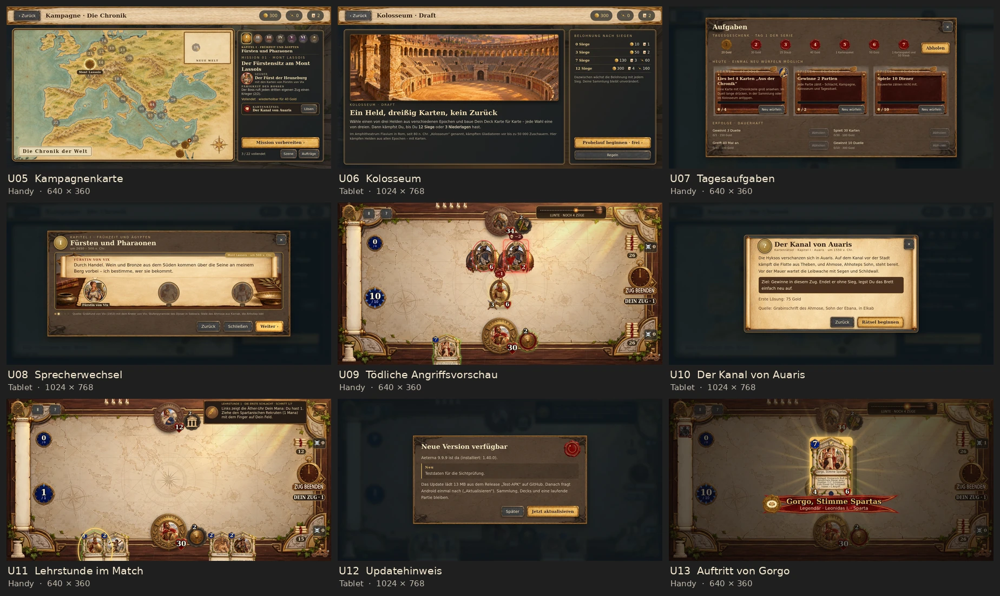

# Aeterna · Oberfläche U05 bis U13

Die neun Pakete enthalten 67 in den Bestellungen benannte PNGs und zwei separat bewegliche Sprechblasenspitzen. Dazu kommen im Ordner U05 zwei bereits auf dem Ausgangsstand vorhandene Steinknöpfe. Die Helden-Skins im Basar verwenden die Spielermünze aus U01.



## Aufnahmen und Prüfbedingungen

Die Einzelaufnahmen zeigen den vollständigen emulierten Bildschirm bei doppelter Pixeldichte. Die Übersicht zeigt jeweils die Spielbühne.

| Paket | Aufnahme | Emulierter Bildschirm |
|---|---|---|
| U05 | [Kampagnenkarte](handy-karte.webp) | 640 × 360 |
| U06 | [Kolosseum](tablet-arena.webp) | 1024 × 768 |
| U07 | [Tagesaufgaben](handy-aufgaben.webp) | 640 × 360 |
| U08 | [Sprecherwechsel](tablet-szene.webp) | 1024 × 768 |
| U09 | [Tödliche Angriffsvorschau](handy-angriff-toedlich.webp) | 640 × 360 |
| U10 | [Der Kanal von Auaris](tablet-raetsel.webp) | 1024 × 768 |
| U11 | [Lehrstunde im Match](handy-lehrstunde-brett.webp) | 640 × 360 |
| U12 | [Updatehinweis](tablet-update.webp) | 1024 × 768 |
| U13 | [Auftritt von Gorgo](handy-legendaer-voll.webp) | 640 × 360 |

Weitere Aufnahmen aus demselben Prüflauf

- [Basartisch](handy-basar.webp)
- [Sammlungsfilter](handy-sammlung.webp)
- [Draft-Wahl](tablet-draft.webp)
- [Zwei Siege und eine Niederlage](tablet-sand.webp)
- [Chronist und wartende Sprecher](tablet-chronist.webp)
- [Katapult und Lunte](handy-diorama.webp)
- [Normaler Treffer](handy-angriff.webp)
- [Rätselziel im Match](tablet-raetsel-brett.webp)
- [Drei Lehrstunden](tablet-lehrstunden.webp)
- [Reduzierte Bewegung](handy-legendaer-ruhig.webp)

## Testergebnisse

| Prüfung | Ergebnis |
|---|---|
| Node-Projekttests | 268 von 268 bestanden |
| Visueller Klickpfad | 69 von 69 bestanden, darunter 23 Bildvergleiche |
| Gerätematrix | 36 von 36 bestanden, sieben emulierte Geräteprofile |
| Erweiterter Bedienpfad | Beide Durchläufe abgeschlossen, 19 Bildschirmaufnahmen je Format, keine JavaScript-Fehler |

## Reproduzieren

Die Prüfungen laufen in getrennten Chromium-Kontexten mit festen Spielständen. Der zusätzliche Bedienpfad wählt 30 Draft-Karten, zeigt beide Trefferprognosen während eines gezogenen Angriffs und spielt Gorgo vollständig, mit Antippen und mit reduzierter Bewegung aus. Für das Auftrittsfoto hält er die Matchuhr nach einem gezeichneten Bild an. Anschließend läuft die Sequenz bis zum Aufprall weiter. Der Updatehinweis erhält simulierte Versionsdaten.

```sh
node --test werkzeuge/tests/*.test.js
node werkzeuge/klickpfad.js
node werkzeuge/geraetematrix.js
node werkzeuge/oberflaechenpfad.js
```

Die lokale Abnahme lief mit Playwright 1.62.1 und Chromium 156 unter Linux. Die Gerätematrix umfasst sieben Querformate von 640 × 360 bis 1280 × 800, einschließlich des sparsamen Profils mit vierfacher CPU-Drosselung.

## Originale und WebP-Bilder

Die Pixelmaße stammen aus den Dateien. Alle 69 neuen Originale sind RGBA-PNGs in doppelter Tabellenauflösung. Die WebP-Dateien und die Einträge in `model/bilder.js` haben die einfache Tabellenauflösung. Für beide separat geforderten Spitzen wurde eine Darstellung von 64 × 42 px gewählt. Die Position des freien Insetfeldes „Neue Welt“ folgt der Projektion und der Missionsposition im Spiel (oben rechts).

| Paket | Im Auftrag benannt | Hinzugefügte PNGs | PNGs im Lieferordner |
|---|---:|---:|---:|
| U05 | 19 | 19 | 21 |
| U06 | 9 | 9 | 9 |
| U07 | 6 | 6 | 6 |
| U08 | 8 | 9 | 9 |
| U09 | 12 | 13 | 13 |
| U10 | 5 | 5 | 5 |
| U11 | 4 | 4 | 4 |
| U12 | 1 | 1 | 1 |
| U13 | 3 | 3 | 3 |
| **Gesamt** | **67** | **69** | **71** |

| Paket | Originalgröße (px) | Dateien |
|---|---:|---|
| U05 | 1024 × 1024 | [panel-hell.png](../../ungenutzte_assets/neue_astra_assets/Lieferung_U05/panel-hell.png), [panel-dunkel.png](../../ungenutzte_assets/neue_astra_assets/Lieferung_U05/panel-dunkel.png), [heldengalerie-medaillon.png](../../ungenutzte_assets/neue_astra_assets/Lieferung_U05/heldengalerie-medaillon.png) |
| U05 | 1080 × 224 | [reiter-ruhend.png](../../ungenutzte_assets/neue_astra_assets/Lieferung_U05/reiter-ruhend.png), [reiter-aktiv.png](../../ungenutzte_assets/neue_astra_assets/Lieferung_U05/reiter-aktiv.png) |
| U05 | 192 × 192 | [filterknopf-normal.png](../../ungenutzte_assets/neue_astra_assets/Lieferung_U05/filterknopf-normal.png), [filterknopf-aktiv.png](../../ungenutzte_assets/neue_astra_assets/Lieferung_U05/filterknopf-aktiv.png) |
| U05 | 80 × 440 | [manakurve-frueh.png](../../ungenutzte_assets/neue_astra_assets/Lieferung_U05/manakurve-frueh.png), [manakurve-mittel.png](../../ungenutzte_assets/neue_astra_assets/Lieferung_U05/manakurve-mittel.png), [manakurve-spaet.png](../../ungenutzte_assets/neue_astra_assets/Lieferung_U05/manakurve-spaet.png) |
| U05 | 2000 × 1400 | [miniatur-spielfeld.png](../../ungenutzte_assets/neue_astra_assets/Lieferung_U05/miniatur-spielfeld.png) |
| U05 | 256 × 256 | [missionssiegel-offen.png](../../ungenutzte_assets/neue_astra_assets/Lieferung_U05/missionssiegel-offen.png), [missionssiegel-offen-belagerung.png](../../ungenutzte_assets/neue_astra_assets/Lieferung_U05/missionssiegel-offen-belagerung.png), [missionssiegel-vollendet.png](../../ungenutzte_assets/neue_astra_assets/Lieferung_U05/missionssiegel-vollendet.png), [missionssiegel-vollendet-belagerung.png](../../ungenutzte_assets/neue_astra_assets/Lieferung_U05/missionssiegel-vollendet-belagerung.png), [missionssiegel-versiegelt.png](../../ungenutzte_assets/neue_astra_assets/Lieferung_U05/missionssiegel-versiegelt.png), [missionssiegel-versiegelt-belagerung.png](../../ungenutzte_assets/neue_astra_assets/Lieferung_U05/missionssiegel-versiegelt-belagerung.png) |
| U05 | 4320 × 2560 | [weltkarte.png](../../ungenutzte_assets/neue_astra_assets/Lieferung_U05/weltkarte.png) |
| U05 | 6400 × 3200 | [feldherrentisch-gravur.png](../../ungenutzte_assets/neue_astra_assets/Lieferung_U05/feldherrentisch-gravur.png) |
| U06 | 2200 × 1240 | [kolosseum-arena.png](../../ungenutzte_assets/neue_astra_assets/Lieferung_U06/kolosseum-arena.png) |
| U06 | 1400 × 1240 | [kolosseum-sand.png](../../ungenutzte_assets/neue_astra_assets/Lieferung_U06/kolosseum-sand.png) |
| U06 | 192 × 192 | [kolosseum-lorbeer-leer.png](../../ungenutzte_assets/neue_astra_assets/Lieferung_U06/kolosseum-lorbeer-leer.png), [kolosseum-lorbeer-gewonnen.png](../../ungenutzte_assets/neue_astra_assets/Lieferung_U06/kolosseum-lorbeer-gewonnen.png), [kolosseum-schild-heil.png](../../ungenutzte_assets/neue_astra_assets/Lieferung_U06/kolosseum-schild-heil.png), [kolosseum-schild-gebrochen.png](../../ungenutzte_assets/neue_astra_assets/Lieferung_U06/kolosseum-schild-gebrochen.png) |
| U06 | 760 × 240 | [draft-wahl-gewoehnlich.png](../../ungenutzte_assets/neue_astra_assets/Lieferung_U06/draft-wahl-gewoehnlich.png), [draft-wahl-selten.png](../../ungenutzte_assets/neue_astra_assets/Lieferung_U06/draft-wahl-selten.png), [draft-wahl-episch.png](../../ungenutzte_assets/neue_astra_assets/Lieferung_U06/draft-wahl-episch.png) |
| U07 | 192 × 192 | [tagesgeschenk-offen.png](../../ungenutzte_assets/neue_astra_assets/Lieferung_U07/tagesgeschenk-offen.png), [tagesgeschenk-heute.png](../../ungenutzte_assets/neue_astra_assets/Lieferung_U07/tagesgeschenk-heute.png), [tagesgeschenk-abgeholt.png](../../ungenutzte_assets/neue_astra_assets/Lieferung_U07/tagesgeschenk-abgeholt.png) |
| U07 | 720 × 420 | [aufgabe-tafel.png](../../ungenutzte_assets/neue_astra_assets/Lieferung_U07/aufgabe-tafel.png), [aufgabe-tafel-lernen.png](../../ungenutzte_assets/neue_astra_assets/Lieferung_U07/aufgabe-tafel-lernen.png) |
| U07 | 128 × 128 | [heldenstufe.png](../../ungenutzte_assets/neue_astra_assets/Lieferung_U07/heldenstufe.png) |
| U08 | 192 × 192 | [kapitelsiegel-offen.png](../../ungenutzte_assets/neue_astra_assets/Lieferung_U08/kapitelsiegel-offen.png), [kapitelsiegel-vollendet.png](../../ungenutzte_assets/neue_astra_assets/Lieferung_U08/kapitelsiegel-vollendet.png), [kapitelsiegel-versiegelt.png](../../ungenutzte_assets/neue_astra_assets/Lieferung_U08/kapitelsiegel-versiegelt.png) |
| U08 | 2400 × 1040 | [szene-buehne.png](../../ungenutzte_assets/neue_astra_assets/Lieferung_U08/szene-buehne.png) |
| U08 | 2000 × 360 | [sprechblase.png](../../ungenutzte_assets/neue_astra_assets/Lieferung_U08/sprechblase.png) |
| U08 | 512 × 512 | [chronist.png](../../ungenutzte_assets/neue_astra_assets/Lieferung_U08/chronist.png) |
| U08 | 760 × 140 | [lunte-schnur.png](../../ungenutzte_assets/neue_astra_assets/Lieferung_U08/lunte-schnur.png), [lunte-fass.png](../../ungenutzte_assets/neue_astra_assets/Lieferung_U08/lunte-fass.png) |
| U08 | 128 × 84 | [sprechblase-spitze.png](../../ungenutzte_assets/neue_astra_assets/Lieferung_U08/sprechblase-spitze.png) |
| U09 | 1000 × 1000 | [eck-astrolabium.png](../../ungenutzte_assets/neue_astra_assets/Lieferung_U09/eck-astrolabium.png), [eck-astrolabium-netz.png](../../ungenutzte_assets/neue_astra_assets/Lieferung_U09/eck-astrolabium-netz.png), [eck-raeuchergefaess.png](../../ungenutzte_assets/neue_astra_assets/Lieferung_U09/eck-raeuchergefaess.png), [eck-saeule.png](../../ungenutzte_assets/neue_astra_assets/Lieferung_U09/eck-saeule.png), [eck-saeule-kapitell.png](../../ungenutzte_assets/neue_astra_assets/Lieferung_U09/eck-saeule-kapitell.png), [eck-katapult.png](../../ungenutzte_assets/neue_astra_assets/Lieferung_U09/eck-katapult.png), [eck-katapult-arm.png](../../ungenutzte_assets/neue_astra_assets/Lieferung_U09/eck-katapult-arm.png) |
| U09 | 1840 × 720 | [sprechblase-match.png](../../ungenutzte_assets/neue_astra_assets/Lieferung_U09/sprechblase-match.png) |
| U09 | 320 × 200 | [angriffsvorschau.png](../../ungenutzte_assets/neue_astra_assets/Lieferung_U09/angriffsvorschau.png), [angriffsvorschau-tod.png](../../ungenutzte_assets/neue_astra_assets/Lieferung_U09/angriffsvorschau-tod.png) |
| U09 | 2000 × 320 | [erzaehlkasten.png](../../ungenutzte_assets/neue_astra_assets/Lieferung_U09/erzaehlkasten.png) |
| U09 | 512 × 512 | [schattenriss.png](../../ungenutzte_assets/neue_astra_assets/Lieferung_U09/schattenriss.png) |
| U09 | 128 × 84 | [sprechblase-match-spitze.png](../../ungenutzte_assets/neue_astra_assets/Lieferung_U09/sprechblase-match-spitze.png) |
| U10 | 192 × 192 | [raetsel-siegel-offen.png](../../ungenutzte_assets/neue_astra_assets/Lieferung_U10/raetsel-siegel-offen.png), [raetsel-siegel-geloest.png](../../ungenutzte_assets/neue_astra_assets/Lieferung_U10/raetsel-siegel-geloest.png), [raetsel-siegel-versiegelt.png](../../ungenutzte_assets/neue_astra_assets/Lieferung_U10/raetsel-siegel-versiegelt.png) |
| U10 | 2000 × 840 | [raetsel-lage.png](../../ungenutzte_assets/neue_astra_assets/Lieferung_U10/raetsel-lage.png) |
| U10 | 760 × 140 | [raetsel-tafel.png](../../ungenutzte_assets/neue_astra_assets/Lieferung_U10/raetsel-tafel.png) |
| U11 | 1040 × 240 | [lehrstunde-chronist.png](../../ungenutzte_assets/neue_astra_assets/Lieferung_U11/lehrstunde-chronist.png) |
| U11 | 320 × 320 | [lehrstunde-siegel-offen.png](../../ungenutzte_assets/neue_astra_assets/Lieferung_U11/lehrstunde-siegel-offen.png), [lehrstunde-siegel-naechste.png](../../ungenutzte_assets/neue_astra_assets/Lieferung_U11/lehrstunde-siegel-naechste.png), [lehrstunde-siegel-geschafft.png](../../ungenutzte_assets/neue_astra_assets/Lieferung_U11/lehrstunde-siegel-geschafft.png) |
| U12 | 240 × 240 | [update-siegel.png](../../ungenutzte_assets/neue_astra_assets/Lieferung_U12/update-siegel.png) |
| U13 | 1360 × 220 | [legendaer-band.png](../../ungenutzte_assets/neue_astra_assets/Lieferung_U13/legendaer-band.png) |
| U13 | 1680 × 1680 | [legendaer-strahlen.png](../../ungenutzte_assets/neue_astra_assets/Lieferung_U13/legendaer-strahlen.png) |
| U13 | 300 × 300 | [legendaer-siegel.png](../../ungenutzte_assets/neue_astra_assets/Lieferung_U13/legendaer-siegel.png) |
